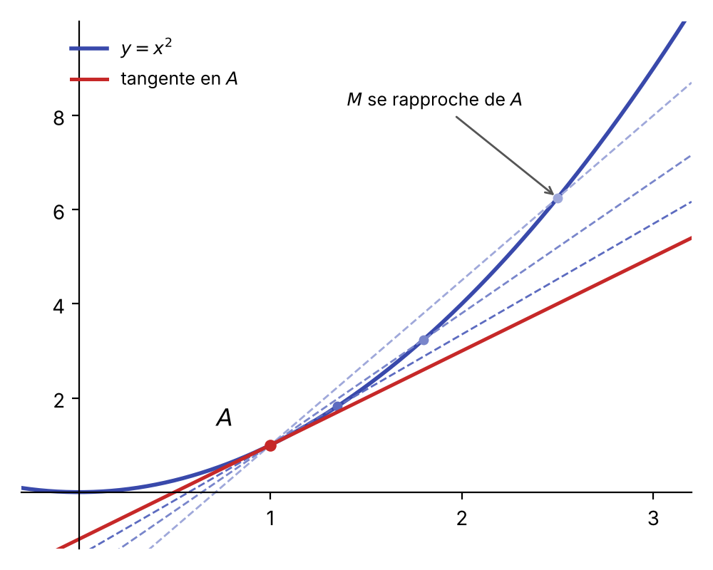

# Cours — Dérivation

[📄 Cours en PDF (version classique)](pdf/cours.pdf){ .md-button }
[📄 Cours complet avec toutes les démonstrations (PDF)](pdf/cours-complet.pdf){ .md-button }

!!! lecture "Comment lire les démonstrations"
    Chaque résultat est démontré dès que c'est possible avec les outils de Première.

    Sur le site, clique sur un bloc pour l'ouvrir.

    - **Démonstration — au programme** : à savoir refaire, elle peut être demandée en évaluation.
    - **Démonstration — pour aller plus loin** : à comprendre, inutile de l'apprendre par cœur. Indispensable si tu vises des études de maths.
    - **Pourquoi ce résultat est admis** : la preuve demande une notion vue plus tard, qui est indiquée.

Dans tout le chapitre, $f$ est une fonction définie sur un intervalle $I$, et $\mathcal{C}_f$ est sa courbe représentative dans un repère.

---

## 1. Taux de variation

!!! definition "Taux de variation"
    Soit $a$ et $b$ deux réels distincts de $I$. Le **taux de variation** de $f$ entre $a$ et $b$ est
    $$\frac{f(b) - f(a)}{b - a}.$$
    C'est le **coefficient directeur** de la droite $(AB)$, appelée **sécante**, qui passe par les points $A(a\,;\,f(a))$ et $B(b\,;\,f(b))$ de la courbe.

On écrit souvent $b = a + h$, avec $h \neq 0$ : le taux de variation entre $a$ et $a + h$ est $\dfrac{f(a + h) - f(a)}{h}$.

**Interprétation.** Si $f(t)$ est la position d'un mobile à l'instant $t$, le taux de variation entre $a$ et $b$ est sa **vitesse moyenne** sur cet intervalle de temps.

**Exemple.** Pour $f(x) = x^2$ entre $1$ et $1 + h$ :
$$\frac{(1 + h)^2 - 1}{h} = \frac{2h + h^2}{h} = 2 + h.$$

---

## 2. Nombre dérivé et tangente

### 2.1 Nombre dérivé

Dans l'exemple précédent, quand $h$ devient de plus en plus proche de $0$, le taux $2 + h$ se rapproche de $2$. On dit que $2 + h$ **tend vers $2$ quand $h$ tend vers $0$**, et l'on écrit $\displaystyle\lim_{h \to 0}(2 + h) = 2$.

!!! definition "Nombre dérivé"
    On dit que $f$ est **dérivable en $a$** si le taux de variation $\dfrac{f(a + h) - f(a)}{h}$ tend vers un **nombre réel** quand $h$ tend vers $0$. Ce nombre s'appelle le **nombre dérivé** de $f$ en $a$, et se note $f'(a)$ :
    $$f'(a) = \lim_{h \to 0} \frac{f(a + h) - f(a)}{h}.$$

??? admis "Pourquoi la notion de limite est admise"
    En Première, « $h$ tend vers $0$ » est une notion **intuitive** : le taux se rapproche autant qu'on veut de $f'(a)$ quand $h$ est assez proche de $0$. La définition précise de la limite d'une fonction (avec des intervalles) est au programme de Terminale ([chapitre 2 de Terminale](../../terminale/limites-fonctions/cours.md)). Dans ce chapitre, on utilise seulement des limites évidentes, comme $\lim_{h \to 0}(2 + h) = 2$ ou $\lim_{h \to 0}\sqrt{a + h} = \sqrt{a}$.

**Interprétation.** Si $f(t)$ est la position d'un mobile, $f'(a)$ est sa **vitesse instantanée** à l'instant $a$ : c'est ce qu'affiche un compteur de vitesse.

### 2.2 Tangente

Quand $h$ tend vers $0$, le point $M(a + h\,;\,f(a + h))$ se rapproche de $A(a\,;\,f(a))$ sur la courbe, et la sécante $(AM)$ se rapproche d'une droite « limite » : la **tangente** en $A$.

{ width="50%" }

!!! definition "Tangente"
    Si $f$ est dérivable en $a$, la **tangente** à $\mathcal{C}_f$ au point $A(a\,;\,f(a))$ est la droite passant par $A$ et de coefficient directeur $f'(a)$.

!!! theoreme "Équation de la tangente"
    Si $f$ est dérivable en $a$, la tangente à $\mathcal{C}_f$ au point d'abscisse $a$ a pour équation
    $$y = f'(a)\,(x - a) + f(a).$$

??? demo "Démonstration — au programme"
    La tangente n'est pas verticale (elle a un coefficient directeur), donc elle a une équation de la forme $y = mx + p$, avec $m = f'(a)$ par définition. Elle passe par $A(a\,;\,f(a))$, donc $f(a) = f'(a) \times a + p$, d'où $p = f(a) - a\,f'(a)$. L'équation s'écrit
    $$y = f'(a)\,x + f(a) - a\,f'(a) = f'(a)\,(x - a) + f(a).$$

**Exemple.** Pour $f(x) = x^2$ en $a = 1$ : $f(1) = 1$ et $f'(1) = 2$. La tangente a pour équation $y = 2(x - 1) + 1$, soit $y = 2x - 1$.

!!! tip "Lecture graphique"
    $f'(a)$ est le coefficient directeur de la tangente : on le lit sur un graphique en mesurant « de combien on monte quand on avance de $1$ » le long de la tangente. Une tangente **horizontale** correspond à $f'(a) = 0$.

### 2.3 Approximation linéaire

Près de $A$, la courbe et sa tangente sont très proches. On en déduit une approximation de $f(a + h)$ pour $h$ petit.

!!! propriete "Approximation linéaire"
    Si $f$ est dérivable en $a$, alors pour $h$ proche de $0$ :
    $$f(a + h) \approx f(a) + f'(a)\,h.$$

**Exemple.** Avec $f(x) = \sqrt{x}$, $a = 1$ et $f'(1) = \frac{1}{2}$ (voir § 3) : $\sqrt{1{,}02} \approx 1 + \frac{1}{2} \times 0{,}02 = 1{,}01$. La calculatrice donne $1{,}00995\ldots$

!!! info "Pourquoi l'approximation est bonne"
    On peut écrire $f(a + h) = f(a) + f'(a)\,h + h\,\varepsilon(h)$, où $\varepsilon(h) = \frac{f(a+h) - f(a)}{h} - f'(a)$ tend vers $0$ quand $h$ tend vers $0$. L'erreur $h\,\varepsilon(h)$ est donc **beaucoup plus petite que $h$**.

### 2.4 Des fonctions non dérivables

!!! theoreme "La racine carrée n'est pas dérivable en $0$"
    La fonction $x \mapsto \sqrt{x}$, définie sur $[0\,;\,+\infty[$, n'est pas dérivable en $0$.

??? demo "Démonstration — au programme"
    Pour $h > 0$, le taux de variation entre $0$ et $h$ vaut
    $$\frac{\sqrt{h} - \sqrt{0}}{h} = \frac{\sqrt{h}}{h} = \frac{1}{\sqrt{h}}.$$
    Quand $h$ tend vers $0$, $\sqrt{h}$ tend vers $0$ en restant positif, donc $\frac{1}{\sqrt{h}}$ devient aussi grand qu'on veut (par exemple, il vaut $100$ pour $h = 10^{-4}$, et $1\,000$ pour $h = 10^{-6}$). Il ne tend vers aucun nombre réel : la fonction n'est pas dérivable en $0$.

    *Graphiquement, la courbe de la racine carrée a une tangente verticale à l'origine.*

!!! propriete "La valeur absolue n'est pas dérivable en $0$"
    La fonction $x \mapsto |x|$ (qui vaut $x$ si $x \geq 0$ et $-x$ si $x < 0$) n'est pas dérivable en $0$.

??? demoplus "Démonstration — pour aller plus loin"
    $\dfrac{|0 + h| - |0|}{h} = \dfrac{|h|}{h}$ vaut $1$ si $h > 0$ et $-1$ si $h < 0$. Quand $h$ tend vers $0$, ce taux ne se rapproche d'aucun nombre unique. *La courbe a un « point anguleux » en $0$.*

---

## 3. Fonction dérivée et dérivées usuelles

!!! definition "Fonction dérivée"
    Si $f$ est dérivable en tout point d'un intervalle $I$, on dit que $f$ est **dérivable sur $I$**. La fonction $f' : x \mapsto f'(x)$ est la **fonction dérivée** de $f$.

!!! theoreme "Dérivées usuelles"
    | Fonction $f(x)$ | Dérivée $f'(x)$ | Dérivable sur |
    |---|---|---|
    | $k$ (constante) | $0$ | $\mathbb{R}$ |
    | $x$ | $1$ | $\mathbb{R}$ |
    | $x^2$ | $2x$ | $\mathbb{R}$ |
    | $x^3$ | $3x^2$ | $\mathbb{R}$ |
    | $x^n$ ($n \geq 1$ entier) | $nx^{n-1}$ | $\mathbb{R}$ |
    | $\dfrac{1}{x}$ | $-\dfrac{1}{x^2}$ | $]-\infty\,;\,0[$ et $]0\,;\,+\infty[$ |
    | $\sqrt{x}$ | $\dfrac{1}{2\sqrt{x}}$ | $]0\,;\,+\infty[$ |

??? demo "Démonstration pour la fonction carré et la fonction inverse — au programme"
    **Carré.** Pour tout réel $a$ et tout $h \neq 0$ :
    $$\frac{(a + h)^2 - a^2}{h} = \frac{2ah + h^2}{h} = 2a + h,$$
    qui tend vers $2a$ quand $h$ tend vers $0$. Donc $f'(a) = 2a$.

    **Inverse.** Pour $a \neq 0$ et $h \neq 0$ assez petit pour que $a + h$ soit du même signe que $a$ :
    $$\frac{\frac{1}{a + h} - \frac{1}{a}}{h} = \frac{a - (a + h)}{h\,a(a + h)} = \frac{-h}{h\,a(a + h)} = \frac{-1}{a(a + h)},$$
    qui tend vers $-\dfrac{1}{a^2}$ quand $h$ tend vers $0$. Donc $f'(a) = -\dfrac{1}{a^2}$.

??? demoplus "Démonstration pour les autres fonctions — pour aller plus loin"
    **Constante et identité.** Le taux de variation vaut $\frac{k - k}{h} = 0$, et $\frac{(a + h) - a}{h} = 1$.

    **Cube.** $\dfrac{(a + h)^3 - a^3}{h} = \dfrac{3a^2h + 3ah^2 + h^3}{h} = 3a^2 + 3ah + h^2$, qui tend vers $3a^2$.

    **Racine carrée.** Pour $a > 0$, on multiplie par la quantité conjuguée :
    $$\frac{\sqrt{a + h} - \sqrt{a}}{h} = \frac{(a + h) - a}{h\left(\sqrt{a + h} + \sqrt{a}\right)} = \frac{1}{\sqrt{a + h} + \sqrt{a}},$$
    qui tend vers $\frac{1}{2\sqrt{a}}$.

    **Puissance $n$.** On l'obtient de proche en proche avec la dérivée d'un produit (§ 4) : $x^4 = x^3 \times x$ a pour dérivée $3x^2 \times x + x^3 \times 1 = 4x^3$, puis $x^5 = x^4 \times x$ a pour dérivée $5x^4$, et ainsi de suite. *En Terminale, cette preuve s'écrit proprement par récurrence.*

---

## 4. Opérations sur les dérivées

Dans ce paragraphe, $u$ et $v$ sont deux fonctions dérivables sur un intervalle $I$, et $k$ est un réel.

!!! theoreme "Somme, produit par un réel, produit"
    - $(u + v)' = u' + v'$ ;
    - $(ku)' = k\,u'$ ;
    - $(uv)' = u'v + uv'$.

??? demo "Démonstration de la dérivée d'un produit — au programme"
    Soit $a \in I$ et $h \neq 0$. On fait apparaître les taux de variation de $u$ et de $v$ en ajoutant et en retranchant $u(a)\,v(a + h)$ :
    $$\frac{u(a + h)\,v(a + h) - u(a)\,v(a)}{h} = \frac{u(a + h) - u(a)}{h} \times v(a + h) + u(a) \times \frac{v(a + h) - v(a)}{h}.$$
    Quand $h$ tend vers $0$ : le premier quotient tend vers $u'(a)$, le second vers $v'(a)$, et $v(a + h)$ tend vers $v(a)$ (une fonction dérivable est continue : voir le bloc suivant). Le taux tend donc vers $u'(a)\,v(a) + u(a)\,v'(a)$.

??? demoplus "Une fonction dérivable est continue — pour aller plus loin"
    Si $v$ est dérivable en $a$, alors $v(a + h) - v(a) = h \times \dfrac{v(a + h) - v(a)}{h}$. Quand $h$ tend vers $0$, le premier facteur tend vers $0$ et le second vers $v'(a)$ : le produit tend vers $0 \times v'(a) = 0$. Donc $v(a + h)$ tend vers $v(a)$.

??? demoplus "Démonstration pour la somme et le produit par un réel — pour aller plus loin"
    $\dfrac{(u + v)(a + h) - (u + v)(a)}{h} = \dfrac{u(a + h) - u(a)}{h} + \dfrac{v(a + h) - v(a)}{h}$ tend vers $u'(a) + v'(a)$. De même, $\dfrac{k\,u(a + h) - k\,u(a)}{h} = k \times \dfrac{u(a + h) - u(a)}{h}$ tend vers $k\,u'(a)$.

!!! theoreme "Inverse et quotient"
    Si de plus $v$ ne s'annule pas sur $I$ :
    $$\left(\frac{1}{v}\right)' = -\frac{v'}{v^2} \qquad \text{et} \qquad \left(\frac{u}{v}\right)' = \frac{u'v - uv'}{v^2}.$$

??? demoplus "Démonstration — pour aller plus loin"
    **Inverse.**
    $$\frac{\frac{1}{v(a + h)} - \frac{1}{v(a)}}{h} = -\frac{v(a + h) - v(a)}{h} \times \frac{1}{v(a + h)\,v(a)},$$
    qui tend vers $-v'(a) \times \frac{1}{v(a)^2}$, car $v(a + h)$ tend vers $v(a)$.

    **Quotient.** On écrit $\frac{u}{v} = u \times \frac{1}{v}$ et l'on applique la formule du produit :
    $$\left(\frac{u}{v}\right)' = u' \times \frac{1}{v} + u \times \left(-\frac{v'}{v^2}\right) = \frac{u'v - uv'}{v^2}.$$

!!! theoreme "Fonction $x \mapsto g(ax + b)$"
    Si $g$ est dérivable, la fonction $f : x \mapsto g(ax + b)$ est dérivable (là où $ax + b$ est dans l'ensemble de dérivabilité de $g$), et
    $$f'(x) = a\,g'(ax + b).$$

??? demoplus "Démonstration — pour aller plus loin"
    Si $a = 0$, $f$ est constante et le résultat est vrai. Sinon, posons $X = ax + b$ et $H = ah$, qui tend vers $0$ quand $h$ tend vers $0$ :
    $$\frac{f(x + h) - f(x)}{h} = \frac{g(X + H) - g(X)}{h} = a \times \frac{g(X + H) - g(X)}{H},$$
    qui tend vers $a\,g'(X) = a\,g'(ax + b)$.

**Exemples.**

- $f(x) = 3x^4 - 5x^2 + 2x - 7$ : $f'(x) = 12x^3 - 10x + 2$.
- $f(x) = (x^2 + 1)(3x - 2)$ : $f'(x) = 2x(3x - 2) + 3(x^2 + 1) = 9x^2 - 4x + 3$.
- $f(x) = \dfrac{2x + 1}{x - 3}$ sur $]3\,;\,+\infty[$ : $f'(x) = \dfrac{2(x - 3) - (2x + 1)}{(x - 3)^2} = \dfrac{-7}{(x - 3)^2}$.
- $f(x) = \sqrt{3x + 1}$ sur $\left]-\frac{1}{3}\,;\,+\infty\right[$ : $f'(x) = 3 \times \dfrac{1}{2\sqrt{3x + 1}} = \dfrac{3}{2\sqrt{3x + 1}}$.

!!! warning "Erreurs fréquentes"
    - La dérivée d'un produit **n'est pas** le produit des dérivées : $(uv)' \neq u'v'$.
    - Dans la formule du quotient, l'ordre compte : $u'v - uv'$, et non $uv' - u'v$.
    - Avant de dériver, préciser l'intervalle de dérivabilité (dénominateur non nul, racine d'un nombre strictement positif).

---

## 5. Pour aller plus loin

- **Dérivée et variations.** Le signe de $f'$ donne le sens de variation de $f$ : c'est l'objet du [chapitre 4](../index.md).
- **Méthode de Newton.** Pour approcher une solution de $f(x) = 0$, on remplace la courbe par sa tangente et l'on prend l'intersection de la tangente avec l'axe des abscisses : $x_{n+1} = x_n - \frac{f(x_n)}{f'(x_n)}$. La méthode converge extraordinairement vite (exercice 28 et sujet 4).
- **Dérivée d'une composée.** En Terminale, la formule $\left(g(ax + b)\right)' = a\,g'(ax + b)$ se généralise en $(g \circ u)' = u' \times (g' \circ u)$.
- **Développements limités.** L'approximation linéaire est le premier étage d'approximations de plus en plus précises par des polynômes (formule de Taylor, première année post-bac).

!!! success "Tu as fini le cours"
    Passe aux [méthodes](methodes.md), puis entraîne-toi avec les exercices corrigés.
