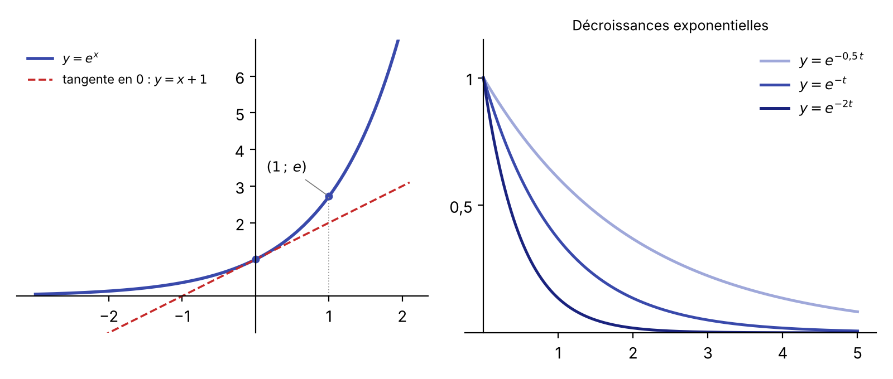

# Cours — Fonction exponentielle

[📄 Cours en PDF (version classique)](pdf/cours.pdf){ .md-button }
[📄 Cours complet avec toutes les démonstrations (PDF)](pdf/cours-complet.pdf){ .md-button }

!!! lecture "Comment lire les démonstrations"
    Chaque résultat est démontré dès que c'est possible avec les outils de Première.

    Sur le site, clique sur un bloc pour l'ouvrir.

    - **Démonstration — pour aller plus loin** : à comprendre, inutile de l'apprendre par cœur. Ces démonstrations sont courtes et souvent posées en devoir.
    - **Pourquoi ce résultat est admis** : la preuve demande une notion vue plus tard, qui est indiquée.

Dans ce chapitre, on utilise le théorème du chapitre 4 : **une fonction dont la dérivée est nulle sur un intervalle est constante sur cet intervalle**.

---

## 1. Définition

!!! theoreme "Existence et unicité"
    Il existe une **unique** fonction $f$ dérivable sur $\mathbb{R}$ telle que
    $$f' = f \qquad \text{et} \qquad f(0) = 1.$$
    Cette fonction s'appelle la **fonction exponentielle** et se note $\exp$.

??? admis "Pourquoi l'existence est admise"
    Construire une telle fonction demande des outils du supérieur. Il y a plusieurs façons de le faire : comme somme d'une **série** $1 + x + \frac{x^2}{2} + \frac{x^3}{6} + \cdots$ (L1), comme fonction réciproque du logarithme, lui-même défini par une **intégrale** (Terminale puis L1), ou grâce au **théorème de Cauchy-Lipschitz** sur les équations différentielles (L2-L3).

    On peut cependant s'en faire une idée avec la **méthode d'Euler** (§ 6) : en partant de $f(0) = 1$ et en avançant par petits pas de longueur $h$, avec $f(x + h) \approx f(x) + h f'(x) = (1 + h) f(x)$, on obtient des valeurs approchées de plus en plus précises.

!!! propriete "L'exponentielle ne s'annule jamais"
    Pour tout réel $x$ : $\exp(x) \times \exp(-x) = 1$. En particulier, $\exp(x) \neq 0$.

??? demoplus "Démonstration — pour aller plus loin"
    Posons $\varphi(x) = \exp(x)\exp(-x)$. Avec la dérivée d'un produit et celle de $x \mapsto \exp(-x)$ (qui vaut $-\exp'(-x) = -\exp(-x)$) :
    $$\varphi'(x) = \exp(x)\exp(-x) - \exp(x)\exp(-x) = 0.$$
    Donc $\varphi$ est constante sur $\mathbb{R}$, égale à $\varphi(0) = 1 \times 1 = 1$.

??? demoplus "Démonstration de l'unicité — pour aller plus loin"
    Soit $g$ une fonction dérivable telle que $g' = g$ et $g(0) = 1$. Comme $\exp$ ne s'annule pas, on peut considérer $\frac{g}{\exp}$, dont la dérivée vaut
    $$\frac{g'\exp - g\exp'}{\exp^2} = \frac{g\exp - g\exp}{\exp^2} = 0.$$
    Donc $\frac{g}{\exp}$ est constante, égale à $\frac{g(0)}{\exp(0)} = 1 :$ $g = \exp$.

---

## 2. Propriétés algébriques

!!! theoreme "Relation fonctionnelle"
    Pour tous réels $a$ et $b$ :
    $$\exp(a + b) = \exp(a) \times \exp(b).$$

??? demoplus "Démonstration — pour aller plus loin"
    Fixons $b$ et posons $g(x) = \exp(x + b)\exp(-x)$. La dérivée de $x \mapsto \exp(x + b)$ est $\exp(x + b)$, donc
    $$g'(x) = \exp(x + b)\exp(-x) - \exp(x + b)\exp(-x) = 0.$$
    Ainsi $g$ est constante, égale à $g(0) = \exp(b)$ : $\exp(x + b)\exp(-x) = \exp(b)$. En multipliant par $\exp(x)$ et en utilisant $\exp(-x)\exp(x) = 1$, on obtient $\exp(x + b) = \exp(x)\exp(b)$.

!!! propriete "Conséquences"
    Pour tous réels $a$, $b$ et tout entier relatif $n$ :
    $$\exp(-a) = \frac{1}{\exp(a)}, \qquad \exp(a - b) = \frac{\exp(a)}{\exp(b)}, \qquad \exp(na) = \big(\exp(a)\big)^n.$$

??? demoplus "Démonstration — pour aller plus loin"
    La première est le § 1. Pour la deuxième : $\exp(a - b)\exp(b) = \exp(a)$, et l'on divise par $\exp(b) \neq 0$. Pour la troisième, avec $n \geq 1$ : $\exp(2a) = \exp(a + a) = \exp(a)^2$, puis $\exp(3a) = \exp(2a)\exp(a) = \exp(a)^3$, et ainsi de suite de proche en proche. Pour $n$ négatif, on utilise $\exp(-a) = \frac{1}{\exp(a)}$.

### Notation $e^x$

On note $e = \exp(1) \approx 2{,}718$. D'après la dernière propriété, $\exp(n) = \exp(1)^n = e^n$ pour tout entier $n$. Cela justifie la **notation puissance**, utilisée pour tout réel $x$ :
$$\exp(x) = e^x.$$
Les propriétés s'écrivent alors comme des règles de calcul sur les puissances :
$$e^0 = 1, \qquad e^{a + b} = e^a e^b, \qquad e^{-a} = \frac{1}{e^a}, \qquad e^{a - b} = \frac{e^a}{e^b}, \qquad \left(e^a\right)^n = e^{na}.$$

**Exemples.** $e^3 \times e^{-1} = e^2$ ; $\dfrac{(e^2)^3}{e^5} = \dfrac{e^6}{e^5} = e$ ; $e^{2x} - 1 = (e^x)^2 - 1 = (e^x - 1)(e^x + 1)$.

---

## 3. Signe et variations

!!! theoreme "Signe et variations"
    - Pour tout réel $x$, $e^x > 0$.
    - La fonction exponentielle est **strictement croissante** sur $\mathbb{R}$, et $(e^x)' = e^x$.

??? demoplus "Démonstration — pour aller plus loin"
    $e^x = e^{x/2 + x/2} = \left(e^{x/2}\right)^2 \geq 0$, et $e^x \neq 0$ : donc $e^x > 0$. Ensuite, $\exp' = \exp > 0$ sur $\mathbb{R}$, donc $\exp$ est strictement croissante (chapitre 4).

{ width="80%" }

!!! propriete "Équations et inéquations"
    Pour tous réels $a$ et $b$ :
    $$e^a = e^b \iff a = b, \qquad e^a < e^b \iff a < b.$$

??? demoplus "Démonstration — pour aller plus loin"
    Si $a < b$, la stricte croissance donne $e^a < e^b$. Réciproquement, si $e^a < e^b$, on ne peut avoir ni $a = b$ (on aurait $e^a = e^b$), ni $a > b$ (on aurait $e^a > e^b$) : donc $a < b$. L'équivalence pour l'égalité s'en déduit de la même façon.

**Exemples.**

- $e^{2x - 1} = e^{x + 3} \iff 2x - 1 = x + 3 \iff x = 4$.
- $e^{3x} > e^{-x + 2} \iff 3x > -x + 2 \iff x > \frac{1}{2}$.
- $e^{x^2} = e \iff x^2 = 1 \iff x = 1$ ou $x = -1$.

!!! warning "Ce qu'on ne peut pas encore faire"
    Résoudre $e^x = 2$ demande une fonction réciproque de l'exponentielle : le **logarithme népérien** $\ln$, étudié en Terminale ([chapitre 5 de Terminale](../../terminale/logarithme/index.md)). En Première, on se ramène toujours à une égalité de la forme $e^a = e^b$.

!!! tip "Inégalité à connaître"
    Pour tout réel $x$, $e^x \geq 1 + x$ : la courbe de l'exponentielle est au-dessus de sa tangente en $0$ (exercice 21).

---

## 4. Dérivée de $x \mapsto e^{ax + b}$

!!! propriete "Dérivée"
    Pour tous réels $a$ et $b$, la fonction $x \mapsto e^{ax + b}$ est dérivable sur $\mathbb{R}$, et
    $$\left(e^{ax + b}\right)' = a\,e^{ax + b}.$$

??? demoplus "Démonstration — pour aller plus loin"
    C'est la formule $\left(g(ax + b)\right)' = a\,g'(ax + b)$ du chapitre 3, avec $g = \exp$.

**Exemples.** $\left(e^{-2x + 1}\right)' = -2e^{-2x + 1}$ ; $\left(e^{0{,}5t}\right)' = 0{,}5\,e^{0{,}5t}$.

**Exemple d'étude.** $f(x) = (x - 2)e^x$. Par la dérivée d'un produit : $f'(x) = e^x + (x - 2)e^x = (x - 1)e^x$. Comme $e^x > 0$, $f'(x)$ a le signe de $x - 1$ : $f$ est décroissante sur $]-\infty\,;\,1]$, croissante sur $[1\,;\,+\infty[$, de minimum $f(1) = -e$.

!!! tip "Le réflexe : factoriser par $e^{\ldots}$"
    Après dérivation, on factorise par l'exponentielle, qui est **strictement positive** : le signe de la dérivée est celui du facteur restant.

---

## 5. Exponentielle et suites géométriques

!!! propriete "Lien avec les suites géométriques"
    Pour tout réel $a$, la suite $u_n = e^{na}$ est **géométrique** de raison $q = e^a$. Elle est croissante si $a > 0$ (car $q > 1$), décroissante si $a < 0$ (car $0 < q < 1$).

??? demoplus "Démonstration — pour aller plus loin"
    $u_{n+1} = e^{(n+1)a} = e^{na}e^a = e^a\,u_n$. Si $a > 0$, $e^a > e^0 = 1$ ; si $a < 0$, $0 < e^a < 1$.

**Modélisation.** Les phénomènes qui varient d'un **pourcentage constant par unité de temps** (population, radioactivité, refroidissement, placement à intérêts composés) se modélisent :

- en temps **discret** (année par année) par une suite géométrique $u_n = u_0 \times q^n$ ;
- en temps **continu** par une fonction $f(t) = C\,e^{kt}$, qui vérifie $f'(t) = k f(t)$ : la vitesse de variation est proportionnelle à la quantité.

Avec $k > 0$, c'est une **croissance exponentielle** ; avec $k < 0$, une **décroissance exponentielle**. Par exemple, la masse d'un élément radioactif est de la forme $m(t) = m_0\,e^{-\lambda t}$.

---

## 6. Approcher $e$ et l'exponentielle

!!! tip "La méthode d'Euler en Python"
    On approche $e = \exp(1)$ en avançant de $0$ à $1$ par $n$ pas de longueur $h = \frac{1}{n}$, avec $y \leftarrow y + h \times y$ (car la dérivée de l'exponentielle est égale à elle-même) :

    ```python
    def euler(n):
        h = 1 / n
        y = 1                 # exp(0) = 1
        for k in range(n):
            y = y + h * y     # y(x + h) ≈ y(x) + h y'(x) = y(x) + h y(x)
        return y

    print(euler(10), euler(100), euler(10000))   # 2.5937..., 2.7048..., 2.7181...
    ```

    On calcule en fait $\left(1 + \frac{1}{n}\right)^n$, qui se rapproche de $e = 2{,}71828\ldots$ quand $n$ grandit.

---

## 7. Pour aller plus loin

- **Le logarithme népérien** (Terminale) est la fonction réciproque de l'exponentielle : $e^x = y \iff x = \ln y$.
- **Limites.** En Terminale, on démontre que $e^x$ tend vers $+\infty$ en $+\infty$ et vers $0$ en $-\infty$, et qu'elle « l'emporte » sur toutes les puissances de $x$ ([chapitre 2 de Terminale](../../terminale/limites-fonctions/index.md)).
- **Équations différentielles.** Les solutions de $y' = ky$ sont exactement les fonctions $x \mapsto Ce^{kx}$ (Terminale, chapitre 7).
- **Nombres complexes.** La formule d'Euler $e^{i\theta} = \cos\theta + i\sin\theta$ relie l'exponentielle et la trigonométrie (maths expertes, puis L1).

!!! success "Tu as fini le cours"
    Passe aux [méthodes](methodes.md), puis entraîne-toi avec les exercices corrigés.
