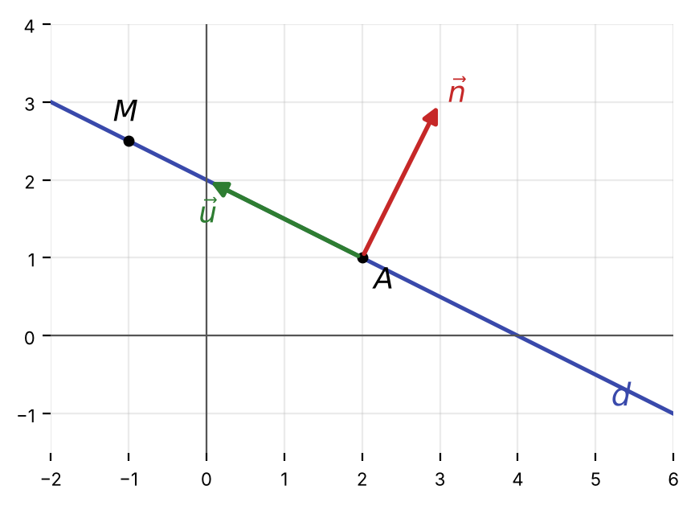
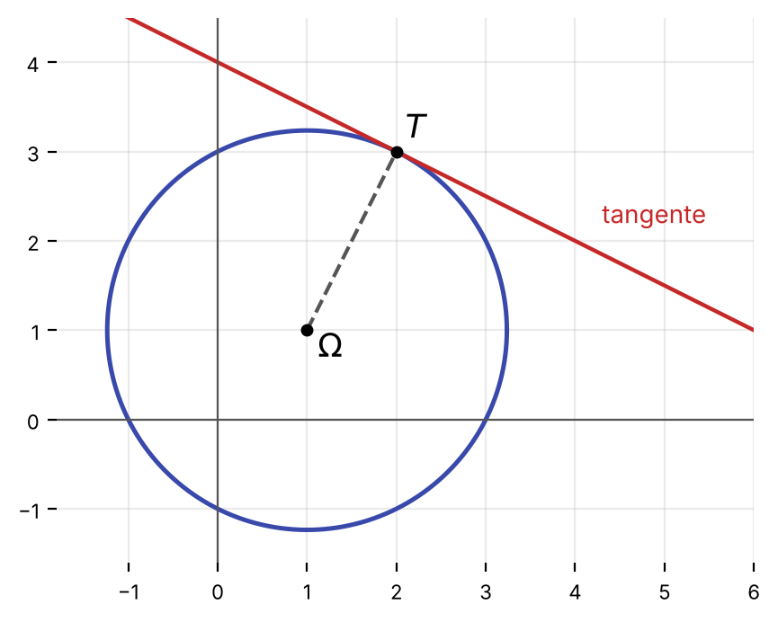
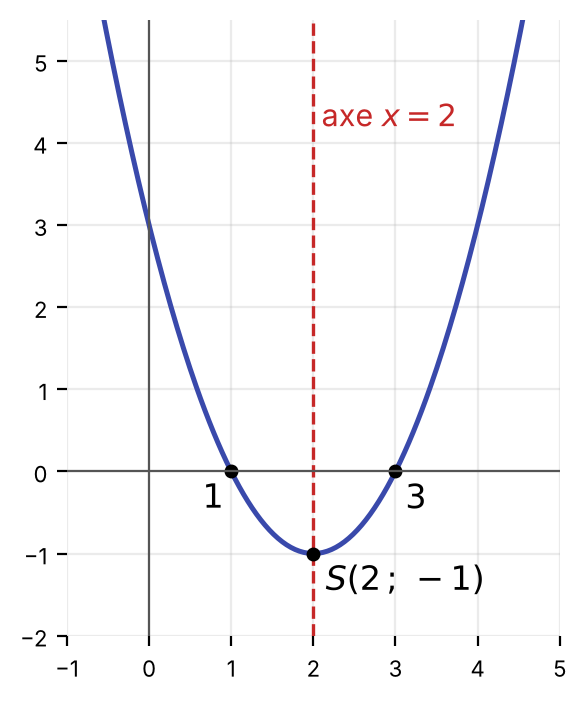

# Cours — Géométrie repérée

[📄 Cours en PDF (version classique)](pdf/cours.pdf){ .md-button }
[📄 Cours complet avec toutes les démonstrations (PDF)](pdf/cours-complet.pdf){ .md-button }

!!! lecture "Comment lire les démonstrations"
    Chaque résultat est démontré dès que c'est possible avec les outils de Première.

    Sur le site, clique sur un bloc pour l'ouvrir.

    - **Démonstration — au programme** : à savoir refaire, elle peut être demandée en évaluation.
    - **Démonstration — pour aller plus loin** : à comprendre, inutile de l'apprendre par cœur.
    - **Pourquoi ce résultat est admis** : la preuve demande une notion vue plus tard, qui est indiquée.

Dans tout le chapitre, le plan est muni d'un **repère orthonormé** $(O\,;\,\vec{\imath},\,\vec{\jmath})$.

---

## 1. Droites : vecteur directeur et équation cartésienne

!!! definition "Vecteur directeur"
    Un **vecteur directeur** d'une droite $d$ est un vecteur non nul $\vec{u} = \overrightarrow{AB}$, où $A$ et $B$ sont deux points distincts de $d$. Tout vecteur non nul colinéaire à $\vec{u}$ est aussi un vecteur directeur de $d$.

!!! theoreme "Équation cartésienne d'une droite"
    1. Toute droite admet une équation de la forme $ax + by + c = 0$, avec $(a\,;\,b) \neq (0\,;\,0)$ : c'est une **équation cartésienne**. Le vecteur $\vec{u}\begin{pmatrix} -b \\ a \end{pmatrix}$ est un vecteur directeur de cette droite.
    2. Réciproquement, si $(a\,;\,b) \neq (0\,;\,0)$, l'ensemble des points $M(x\,;\,y)$ tels que $ax + by + c = 0$ est une droite.

??? demoplus "Démonstration — pour aller plus loin"
    **1.** Soit $d$ la droite passant par $A(x_A\,;\,y_A)$ et dirigée par $\vec{u}\begin{pmatrix} \alpha \\ \beta \end{pmatrix}$ non nul. Un point $M(x\,;\,y)$ est sur $d$ si et seulement si $\overrightarrow{AM}$ et $\vec{u}$ sont colinéaires, c'est-à-dire
    $$\det\left(\overrightarrow{AM}, \vec{u}\right) = (x - x_A)\beta - (y - y_A)\alpha = 0 \iff \beta x - \alpha y + (\alpha y_A - \beta x_A) = 0.$$
    C'est une équation $ax + by + c = 0$ avec $a = \beta$, $b = -\alpha$, non tous deux nuls, et $\begin{pmatrix} -b \\ a \end{pmatrix} = \begin{pmatrix} \alpha \\ \beta \end{pmatrix} = \vec{u}$.

    **2.** Si $b \neq 0$, le point $A\left(0\,;\,-\frac{c}{b}\right)$ vérifie l'équation ; si $b = 0$, alors $a \neq 0$ et $A\left(-\frac{c}{a}\,;\,0\right)$ la vérifie. Dans les deux cas, $c = -ax_A - by_A$, et l'équation s'écrit $a(x - x_A) + b(y - y_A) = 0$, soit $\det\left(\overrightarrow{AM}, \vec{u}\right) = 0$ avec $\vec{u}\begin{pmatrix} -b \\ a \end{pmatrix}$ : c'est la droite passant par $A$ dirigée par $\vec{u}$.

!!! propriete "Équation réduite"
    - Si $b \neq 0$, l'équation s'écrit $y = mx + p$ (**équation réduite**) : $m = -\frac{a}{b}$ est le **coefficient directeur**, et $\vec{u}\begin{pmatrix} 1 \\ m \end{pmatrix}$ est un vecteur directeur.
    - Si $b = 0$, la droite est **parallèle à l'axe des ordonnées**, d'équation $x = k$.

!!! propriete "Droites parallèles"
    Les droites d'équations $ax + by + c = 0$ et $a'x + b'y + c' = 0$ sont parallèles si et seulement si $ab' - a'b = 0$. Pour des équations réduites : si et seulement si elles ont le même coefficient directeur.

---

## 2. Vecteur normal à une droite

!!! definition "Vecteur normal"
    Un **vecteur normal** à une droite $d$ est un vecteur **non nul** orthogonal à un vecteur directeur de $d$.

{ width="50%" }

!!! theoreme "Vecteur normal et équation cartésienne"
    1. La droite passant par $A(x_A\,;\,y_A)$ et de vecteur normal $\vec{n}\begin{pmatrix} a \\ b \end{pmatrix}$ est l'ensemble des points $M$ tels que $\overrightarrow{AM} \cdot \vec{n} = 0$. Elle a une équation de la forme $ax + by + c = 0$.
    2. Réciproquement, la droite d'équation $ax + by + c = 0$ admet $\vec{n}\begin{pmatrix} a \\ b \end{pmatrix}$ comme vecteur normal.

??? demoplus "Démonstration — pour aller plus loin"
    **1.** Soit $\vec{u}$ un vecteur directeur de $d$, orthogonal à $\vec{n}$. Si $M \in d$, $\overrightarrow{AM}$ est colinéaire à $\vec{u}$, donc orthogonal à $\vec{n}$. Réciproquement, $\vec{u}$ et $\overrightarrow{AM}$ sont tous deux orthogonaux au vecteur non nul $\vec{n}$ : dans le plan, ils sont donc colinéaires (si $\vec{n}(a\,;\,b)$, les vecteurs orthogonaux à $\vec{n}$ sont les $(x\,;\,y)$ tels que $ax + by = 0$, c'est-à-dire, d'après la partie 1, les vecteurs colinéaires à $(-b\,;\,a)$). Donc $M \in d$.

    En coordonnées, $\overrightarrow{AM} \cdot \vec{n} = a(x - x_A) + b(y - y_A) = ax + by + c$ avec $c = -ax_A - by_A$.

    **2.** D'après la partie 1, $\vec{u}\begin{pmatrix} -b \\ a \end{pmatrix}$ dirige la droite, et $\vec{n} \cdot \vec{u} = -ab + ba = 0$ avec $\vec{n} \neq \vec{0}$.

!!! tip "Directeur ou normal : comment les retrouver"
    Pour $d : ax + by + c = 0$, le vecteur **normal** se lit directement : $\vec{n}(a\,;\,b)$. Le vecteur **directeur** s'obtient en « échangeant et changeant un signe » : $\vec{u}(-b\,;\,a)$.

**Exemple.** La droite passant par $A(2\,;\,1)$ de vecteur normal $\vec{n}(1\,;\,2)$ a une équation $x + 2y + c = 0$ ; $A$ est dessus : $2 + 2 + c = 0$, donc $c = -4$. Équation : $x + 2y - 4 = 0$.

!!! propriete "Droites perpendiculaires"
    - Deux droites sont perpendiculaires si et seulement si leurs vecteurs normaux (ou leurs vecteurs directeurs) sont orthogonaux : $aa' + bb' = 0$.
    - Deux droites d'équations réduites $y = mx + p$ et $y = m'x + p'$ sont perpendiculaires si et seulement si $mm' = -1$.

??? demoplus "Démonstration — pour aller plus loin"
    Le premier point découle de la définition. Pour le second, les vecteurs directeurs $\begin{pmatrix} 1 \\ m \end{pmatrix}$ et $\begin{pmatrix} 1 \\ m' \end{pmatrix}$ sont orthogonaux si et seulement si $1 + mm' = 0$.

---

## 3. Projeté orthogonal et distance à une droite

!!! definition "Projeté orthogonal, distance"
    Le **projeté orthogonal** d'un point $M$ sur une droite $d$ est le point $H$ d'intersection de $d$ avec la perpendiculaire à $d$ passant par $M$. La **distance** de $M$ à $d$ est la longueur $MH$ : c'est la plus petite distance entre $M$ et un point de $d$.

??? demoplus "Pourquoi $MH$ est la plus petite distance — pour aller plus loin"
    Pour tout point $P$ de $d$, le triangle $MHP$ est rectangle en $H$ (ou $P = H$) : $MP^2 = MH^2 + HP^2 \geq MH^2$, avec égalité seulement si $P = H$.

**Méthode de calcul.** On écrit l'équation de la perpendiculaire à $d$ passant par $M$ (un vecteur normal de $d$ en est un vecteur **directeur**), puis on résout le système formé par les deux équations.

!!! propriete "Formule de la distance"
    La distance du point $M_0(x_0\,;\,y_0)$ à la droite $d : ax + by + c = 0$ est
    $$\frac{|ax_0 + by_0 + c|}{\sqrt{a^2 + b^2}}.$$

??? demoplus "Démonstration — pour aller plus loin"
    Soit $H$ le projeté de $M_0$ sur $d$ et $\vec{n}(a\,;\,b)$. Les vecteurs $\overrightarrow{HM_0}$ et $\vec{n}$ sont colinéaires (tous deux orthogonaux à $d$), donc, d'après le cas d'égalité de Cauchy-Schwarz, $\left|\overrightarrow{HM_0} \cdot \vec{n}\right| = HM_0 \times \|\vec{n}\|$.

    Or $\overrightarrow{HM_0} \cdot \vec{n} = a(x_0 - x_H) + b(y_0 - y_H) = ax_0 + by_0 - (ax_H + by_H) = ax_0 + by_0 + c$, car $H \in d$ donne $ax_H + by_H = -c$. On divise par $\|\vec{n}\| = \sqrt{a^2 + b^2}$.

**Exemple.** Distance de $O$ à $d : 3x + 4y - 10 = 0$ : $\dfrac{|-10|}{\sqrt{9 + 16}} = \dfrac{10}{5} = 2$.

---

## 4. Équation d'un cercle

!!! theoreme "Équation d'un cercle"
    Le cercle de centre $\Omega(x_0\,;\,y_0)$ et de rayon $r > 0$ a pour équation
    $$(x - x_0)^2 + (y - y_0)^2 = r^2.$$

??? demoplus "Démonstration — pour aller plus loin"
    $M(x\,;\,y)$ est sur le cercle si et seulement si $\Omega M = r$, c'est-à-dire $\Omega M^2 = r^2$ (car les deux nombres sont positifs). Dans un repère orthonormé, $\Omega M^2 = (x - x_0)^2 + (y - y_0)^2$.

!!! propriete "Reconnaître un cercle"
    Une équation $x^2 + y^2 + \alpha x + \beta y + \gamma = 0$ se ramène, avec les **formes canoniques** $x^2 + \alpha x = \left(x + \frac{\alpha}{2}\right)^2 - \frac{\alpha^2}{4}$ (et de même en $y$), à
    $$\left(x + \frac{\alpha}{2}\right)^2 + \left(y + \frac{\beta}{2}\right)^2 = k.$$
    C'est un **cercle** de rayon $\sqrt{k}$ si $k > 0$, un **point** si $k = 0$, l'**ensemble vide** si $k < 0$.

**Exemple.** $x^2 + y^2 - 2x - 2y - 3 = 0 \iff (x - 1)^2 - 1 + (y - 1)^2 - 1 - 3 = 0 \iff (x - 1)^2 + (y - 1)^2 = 5$ : cercle de centre $\Omega(1\,;\,1)$ et de rayon $\sqrt{5}$.

!!! propriete "Cercle de diamètre $[AB]$"
    Le cercle de diamètre $[AB]$ est l'ensemble des points $M$ tels que $\overrightarrow{MA} \cdot \overrightarrow{MB} = 0$ ([chapitre 7](../produit-scalaire/cours.md)). En coordonnées : $(x - x_A)(x - x_B) + (y - y_A)(y - y_B) = 0$.

---

## 5. Droites et cercles

!!! propriete "Position d'une droite et d'un cercle"
    Soit $\mathcal{C}$ un cercle de centre $\Omega$ et de rayon $r$, et $d$ une droite. Avec $\delta$ la distance de $\Omega$ à $d$ :

    - si $\delta < r$, la droite coupe le cercle en **deux points** ;
    - si $\delta = r$, la droite est **tangente** au cercle (un seul point commun) ;
    - si $\delta > r$, la droite et le cercle n'ont **aucun point commun**.

En pratique, on peut aussi remplacer $y$ (ou $x$) dans l'équation du cercle à l'aide de l'équation de la droite : on obtient une équation du second degré, dont le **discriminant** donne le nombre de points d'intersection.

!!! theoreme "Tangente à un cercle"
    La tangente au cercle $\mathcal{C}$ de centre $\Omega$ au point $T$ est la droite passant par $T$ et **perpendiculaire au rayon** $[\Omega T]$ : c'est l'ensemble des points $M$ tels que $\overrightarrow{TM} \cdot \overrightarrow{\Omega T} = 0$.

{ width="50%" }

??? demoplus "Démonstration — pour aller plus loin"
    Soit $d$ la droite passant par $T$ et de vecteur normal $\overrightarrow{\Omega T}$. La distance de $\Omega$ à $d$ est $\Omega T = r$, car $T$ est le projeté orthogonal de $\Omega$ sur $d$. D'après la propriété précédente, $d$ n'a qu'un point commun avec $\mathcal{C}$ : le point $T$.

**Exemple.** Le cercle de centre $\Omega(1\,;\,1)$ passant par $T(2\,;\,3)$ : $\overrightarrow{\Omega T}(1\,;\,2)$ est normal à la tangente, d'équation $x + 2y + c = 0$ avec $2 + 6 + c = 0$ : $x + 2y - 8 = 0$.

---

## 6. Paraboles

!!! definition "Parabole"
    La courbe représentative de $f(x) = ax^2 + bx + c$ ($a \neq 0$) est une **parabole**, tournée vers le haut si $a > 0$ et vers le bas si $a < 0$.

!!! theoreme "Sommet et axe de symétrie"
    Avec la forme canonique $f(x) = a(x - \alpha)^2 + \beta$, où $\alpha = -\frac{b}{2a}$ et $\beta = f(\alpha)$ :

    - la parabole a pour **sommet** le point $S(\alpha\,;\,\beta)$ ;
    - elle admet la droite d'équation $x = \alpha$ comme **axe de symétrie**.

{ width="45%" }

??? demoplus "Démonstration — pour aller plus loin"
    Pour tout réel $h$, $f(\alpha + h) = ah^2 + \beta = f(\alpha - h)$. Les points d'abscisses $\alpha + h$ et $\alpha - h$ ont la même ordonnée : ils sont symétriques par rapport à la droite $x = \alpha$. De plus, $f(x) - \beta = a(x - \alpha)^2$ est du signe de $a$ : si $a > 0$, $\beta$ est le minimum de $f$, atteint en $\alpha$ (maximum si $a < 0$).

**Exemple.** $f(x) = x^2 - 4x + 3 = (x - 2)^2 - 1$ : sommet $S(2\,;\,-1)$, axe $x = 2$. Les racines $1$ et $3$ sont bien symétriques par rapport à $2$.

!!! tip "Intersections avec une droite"
    Pour trouver les points communs de la parabole $y = ax^2 + bx + c$ et de la droite $y = mx + p$, on résout $ax^2 + bx + c = mx + p$ : une équation du second degré, qui a $0$, $1$ ou $2$ solutions.

---

## 7. Pour aller plus loin

- **Dans l'espace.** Un vecteur normal définit un **plan** : le plan passant par $A$ de vecteur normal $\vec{n}(a\,;\,b\,;\,c)$ a une équation $ax + by + cz + d = 0$ ([Terminale](../../terminale/equations-espace/index.md)).
- **Coniques.** Les cercles et les paraboles sont des **coniques**, comme les ellipses et les hyperboles : ce sont les sections d'un cône par un plan. Les orbites des planètes sont des ellipses (lois de Kepler).
- **Optique.** Une parabole renvoie tous les rayons parallèles à son axe vers un même point, le **foyer** : c'est le principe des antennes paraboliques et des fours solaires.

!!! success "Tu as fini le cours"
    Passe aux [méthodes](methodes.md), puis entraîne-toi avec les exercices corrigés.
