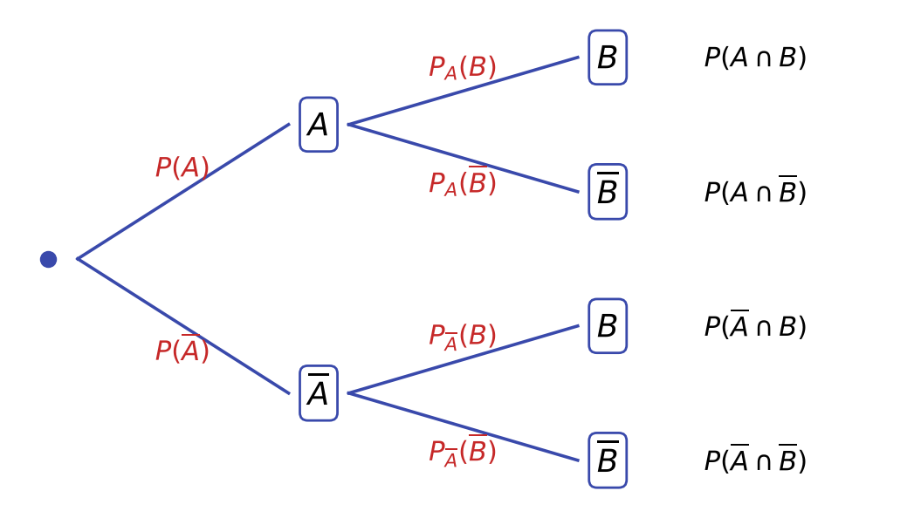
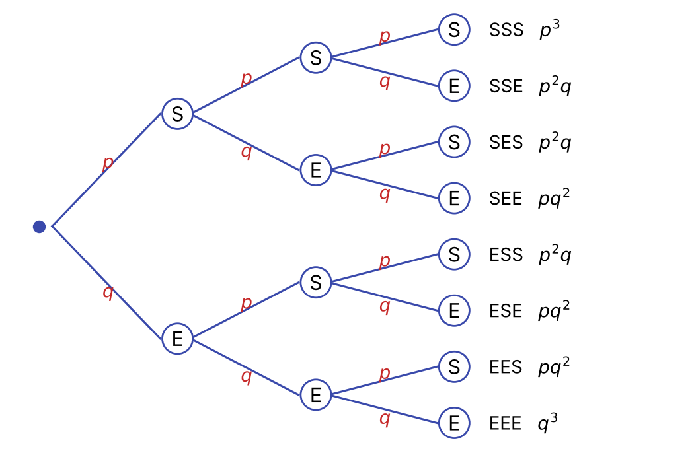

# Cours — Probabilités conditionnelles et indépendance

[📄 Cours en PDF (version classique)](pdf/cours.pdf){ .md-button }
[📄 Cours complet avec toutes les démonstrations (PDF)](pdf/cours-complet.pdf){ .md-button }

!!! lecture "Comment lire les démonstrations"
    Chaque résultat est démontré dès que c'est possible avec les outils de Première.

    Sur le site, clique sur un bloc pour l'ouvrir.

    - **Démonstration — au programme** : à savoir refaire, elle peut être demandée en évaluation.
    - **Démonstration — pour aller plus loin** : à comprendre, inutile de l'apprendre par cœur.
    - **Pourquoi ce résultat est admis** : la preuve demande une notion vue plus tard, qui est indiquée.

---

## 1. Rappels de Seconde

On considère une expérience aléatoire d'univers $\Omega$ fini, muni d'une probabilité $P$.

- Un **événement** est une partie de $\Omega$. On a $0 \leq P(A) \leq 1$, $P(\Omega) = 1$ et $P(\varnothing) = 0$.
- $\overline{A}$ est l'**événement contraire** de $A$ : $P\left(\overline{A}\right) = 1 - P(A)$.
- $A \cap B$ (« $A$ et $B$ ») et $A \cup B$ (« $A$ ou $B$ ») vérifient $P(A \cup B) = P(A) + P(B) - P(A \cap B)$.
- $A$ et $B$ sont **incompatibles** si $A \cap B = \varnothing$ ; alors $P(A \cup B) = P(A) + P(B)$.
- En situation d'**équiprobabilité** : $P(A) = \dfrac{\text{nombre d'issues de } A}{\text{nombre d'issues de } \Omega}$.

---

## 2. Probabilité conditionnelle

**Exemple d'introduction.** Dans un lycée de $1\,000$ élèves, on relève qui est demi-pensionnaire ($D$) et qui est en Première ($R$).

| | $R$ | $\overline{R}$ | Total |
|---|---|---|---|
| $D$ | $240$ | $460$ | $700$ |
| $\overline{D}$ | $60$ | $240$ | $300$ |
| Total | $300$ | $700$ | $1\,000$ |

On choisit un élève au hasard. $P(D) = 0{,}7$. Mais **si l'on sait** que l'élève est en Première, la proportion de demi-pensionnaires devient $\frac{240}{300} = 0{,}8$ : c'est la probabilité de $D$ **sachant** $R$. On remarque que $\frac{240}{300} = \dfrac{240/1\,000}{300/1\,000} = \dfrac{P(R \cap D)}{P(R)}$.

!!! definition "Probabilité conditionnelle"
    Soit $A$ un événement de probabilité **non nulle**. La **probabilité de $B$ sachant $A$** est
    $$P_A(B) = \frac{P(A \cap B)}{P(A)}.$$

!!! warning "Ne pas confondre"
    $P_A(B)$, $P_B(A)$ et $P(A \cap B)$ sont trois nombres différents. Dans l'exemple : $P_R(D) = 0{,}8$ (proportion de demi-pensionnaires parmi les Premières), $P_D(R) = \frac{240}{700} \approx 0{,}34$ (proportion de Premières parmi les demi-pensionnaires), $P(R \cap D) = 0{,}24$.

!!! propriete "Formule du produit"
    Si $P(A) \neq 0$ : $P(A \cap B) = P(A) \times P_A(B)$.

!!! propriete "$P_A$ est une probabilité"
    Si $P(A) \neq 0$, alors $0 \leq P_A(B) \leq 1$, $P_A(A) = 1$, et $P_A\left(\overline{B}\right) = 1 - P_A(B)$.

??? demoplus "Démonstration — pour aller plus loin"
    $A \cap B \subset A$, donc $0 \leq P(A \cap B) \leq P(A)$ : on divise par $P(A) > 0$. Ensuite $P_A(A) = \frac{P(A)}{P(A)} = 1$.

    Les événements $A \cap B$ et $A \cap \overline{B}$ sont incompatibles et leur réunion est $A$ : $P(A \cap B) + P\left(A \cap \overline{B}\right) = P(A)$. En divisant par $P(A)$ : $P_A(B) + P_A\left(\overline{B}\right) = 1$.

---

## 3. Arbres pondérés

Un **arbre pondéré** représente une expérience en plusieurs étapes. Au premier niveau, on place un événement $A$ et son contraire ; au second, les événements $B$ et $\overline{B}$, avec les probabilités **conditionnelles** sachant le chemin déjà parcouru.

{ width="70%" }

!!! propriete "Règles de calcul dans un arbre"
    1. La somme des probabilités des branches issues d'un même nœud vaut $1$.
    2. La probabilité d'un **chemin** est le **produit** des probabilités de ses branches : $P(A \cap B) = P(A) \times P_A(B)$.
    3. La probabilité d'un événement est la **somme** des probabilités des chemins qui y mènent.

La règle 1 vient de $P_A(B) + P_A\left(\overline{B}\right) = 1$ ; la règle 2 est la formule du produit ; la règle 3 est la formule des probabilités totales ci-dessous.

---

## 4. Formule des probabilités totales

!!! definition "Partition"
    Des événements $A_1, A_2, \ldots, A_n$, de probabilités non nulles, forment une **partition** de $\Omega$ s'ils sont deux à deux incompatibles et si leur réunion est $\Omega$. Exemple : $A$ et $\overline{A}$ (si $0 < P(A) < 1$).

!!! theoreme "Formule des probabilités totales"
    Si $A_1, \ldots, A_n$ forment une partition de $\Omega$, alors pour tout événement $B$ :
    $$P(B) = P(A_1 \cap B) + \cdots + P(A_n \cap B) = P(A_1)P_{A_1}(B) + \cdots + P(A_n)P_{A_n}(B).$$
    En particulier : $P(B) = P(A)\,P_A(B) + P\left(\overline{A}\right)P_{\overline{A}}(B)$.

??? demoplus "Démonstration — pour aller plus loin"
    $B = (A_1 \cap B) \cup \cdots \cup (A_n \cap B)$, car tout résultat de $B$ appartient à l'un des $A_i$. Ces événements sont deux à deux incompatibles (puisque les $A_i$ le sont), donc leurs probabilités s'additionnent. On conclut avec la formule du produit.

**Exemple.** Une maladie touche $2\,\%$ d'une population. Un test est positif ($T$) chez $95\,\%$ des malades ($M$) et chez $10\,\%$ des personnes saines. Alors
$$P(T) = 0{,}02 \times 0{,}95 + 0{,}98 \times 0{,}10 = 0{,}019 + 0{,}098 = 0{,}117.$$

!!! propriete "Inverser un conditionnement (formule de Bayes)"
    Si $P(A) \neq 0$ et $P(B) \neq 0$ :
    $$P_B(A) = \frac{P(A \cap B)}{P(B)} = \frac{P(A) \times P_A(B)}{P(B)}.$$

??? demoplus "Démonstration — pour aller plus loin"
    C'est la définition de $P_B(A)$, dans laquelle on remplace $P(A \cap B)$ par $P(A) \times P_A(B)$.

**Exemple (suite).** La probabilité qu'une personne testée positive soit malade est $P_T(M) = \frac{0{,}019}{0{,}117} \approx 0{,}16$. Seulement $16\,\%$ ! La maladie est rare : la plupart des tests positifs sont des « faux positifs ». C'est pourquoi on confirme toujours un test positif par un second examen.

---

## 5. Indépendance de deux événements

!!! definition "Événements indépendants"
    Deux événements $A$ et $B$ sont **indépendants** si $P(A \cap B) = P(A) \times P(B)$.

!!! propriete "Indépendance et conditionnement"
    Si $P(A) \neq 0$ : $A$ et $B$ sont indépendants si et seulement si $P_A(B) = P(B)$. Autrement dit, savoir que $A$ est réalisé ne change pas la probabilité de $B$.

??? demoplus "Démonstration — pour aller plus loin"
    $P_A(B) = P(B) \iff \frac{P(A \cap B)}{P(A)} = P(B) \iff P(A \cap B) = P(A)P(B)$.

!!! propriete "Indépendance et événement contraire"
    Si $A$ et $B$ sont indépendants, alors $A$ et $\overline{B}$ sont indépendants (ainsi que $\overline{A}$ et $B$, et $\overline{A}$ et $\overline{B}$).

??? demoplus "Démonstration — pour aller plus loin"
    $A$ est la réunion des événements incompatibles $A \cap B$ et $A \cap \overline{B}$, donc
    $$P\left(A \cap \overline{B}\right) = P(A) - P(A \cap B) = P(A) - P(A)P(B) = P(A)\big(1 - P(B)\big) = P(A)P\left(\overline{B}\right).$$
    Par symétrie des rôles, $\overline{A}$ et $B$ sont indépendants ; en appliquant le résultat à $\overline{A}$ et $B$, on obtient l'indépendance de $\overline{A}$ et $\overline{B}$.

!!! warning "Indépendants ne veut pas dire incompatibles"
    Deux événements incompatibles de probabilités non nulles ne sont **jamais** indépendants : $P(A \cap B) = 0$ alors que $P(A)P(B) > 0$. Si $A$ est réalisé, on sait que $B$ ne l'est pas : c'est une information très forte.

**Exemple.** On tire une carte dans un jeu de $32$ cartes. $A$ : « la carte est un as » ; $C$ : « la carte est un cœur ». $P(A) = \frac{4}{32} = \frac{1}{8}$, $P(C) = \frac{1}{4}$, $P(A \cap C) = \frac{1}{32} = \frac{1}{8} \times \frac{1}{4}$ : les événements sont indépendants.

---

## 6. Succession de deux épreuves indépendantes

Lorsqu'une expérience consiste à enchaîner deux épreuves **sans que le résultat de la première influe sur la seconde** (deux lancers de dé, deux tirages **avec remise**…), on la modélise par un arbre dans lequel les probabilités du second niveau sont **les mêmes sur chaque branche** : ce sont celles de la seconde épreuve seule.

!!! propriete "Règle du produit"
    Dans la succession de deux épreuves indépendantes, la probabilité du couple de résultats $(x\,;\,y)$ est
    $$P\big((x\,;\,y)\big) = p_1(x) \times p_2(y),$$
    où $p_1$ et $p_2$ sont les probabilités associées à chacune des épreuves.

On peut aussi représenter les issues dans un **tableau à double entrée** : chaque case contient le produit des probabilités de sa ligne et de sa colonne.

**Exemple.** On lance une pièce équilibrée, puis un dé équilibré à six faces. $P(\text{« pile, puis } 6\text{ »}) = \frac{1}{2} \times \frac{1}{6} = \frac{1}{12}$.

!!! warning "Avec ou sans remise"
    Tirer deux boules **avec remise** donne deux épreuves indépendantes. **Sans remise**, la composition de l'urne change après le premier tirage : les probabilités du second niveau dépendent de la branche, et les épreuves ne sont pas indépendantes.

---

## 7. Répétition d'épreuves de Bernoulli

!!! definition "Épreuve de Bernoulli"
    Une **épreuve de Bernoulli** de paramètre $p$ est une épreuve à deux issues : le **succès** $S$, de probabilité $p$, et l'**échec** $E$, de probabilité $q = 1 - p$.

On **répète** $n$ fois la même épreuve de Bernoulli, de façon indépendante. En Première, on se limite à $n \leq 4$ : on peut tracer l'arbre complet.

{ width="65%" }

!!! propriete "Probabilité d'un chemin"
    Dans la répétition de $n$ épreuves de Bernoulli indépendantes, un chemin comportant $k$ succès et $n - k$ échecs a pour probabilité $p^k q^{n-k}$.

??? demoplus "Démonstration — pour aller plus loin"
    C'est la règle du produit, appliquée $n$ fois : chaque branche « succès » porte $p$ et chaque branche « échec » porte $q$, quel que soit le chemin, puisque les épreuves sont indépendantes. Le produit comporte $k$ facteurs $p$ et $n - k$ facteurs $q$.

Pour calculer la probabilité d'obtenir **exactement $k$ succès**, on **compte** les chemins qui en comportent $k$ et on multiplie par $p^k q^{n-k}$. Sur l'arbre ci-dessus ($n = 3$) :

| Nombre de succès $k$ | $0$ | $1$ | $2$ | $3$ |
|---|---|---|---|---|
| Nombre de chemins | $1$ | $3$ | $3$ | $1$ |
| Probabilité | $q^3$ | $3pq^2$ | $3p^2q$ | $p^3$ |

!!! tip "Au moins un succès"
    $P(\text{« au moins un succès »}) = 1 - P(\text{« aucun succès »}) = 1 - q^n$. Le passage à l'événement contraire évite d'additionner beaucoup de chemins.

**Exemple.** Un tireur atteint sa cible avec la probabilité $0{,}8$ et tire $3$ fois, de façon indépendante. La probabilité d'atteindre la cible exactement deux fois est $3 \times 0{,}8^2 \times 0{,}2 = 0{,}384$ ; au moins une fois : $1 - 0{,}2^3 = 0{,}992$.

---

## 8. Pour aller plus loin

- **Variables aléatoires.** Le nombre de succès est une **variable aléatoire** ([chapitre 10](../index.md)) ; en Terminale, sa loi s'appelle la [loi binomiale](../../terminale/loi-binomiale/index.md), avec les coefficients binomiaux $\binom{n}{k}$ pour compter les chemins.
- **Statistique bayésienne.** La formule de Bayes est à la base des filtres anti-spam, du diagnostic médical assisté et de nombreux algorithmes d'apprentissage automatique.
- **Le paradoxe de Monty Hall**, célèbre jeu télévisé où il vaut mieux changer de porte : un très bon exercice d'arbre (exercice 28).

!!! success "Tu as fini le cours"
    Passe aux [méthodes](methodes.md), puis entraîne-toi avec les exercices corrigés.
