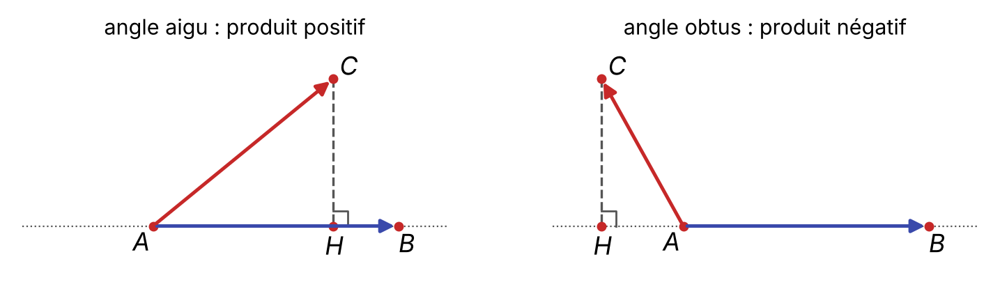
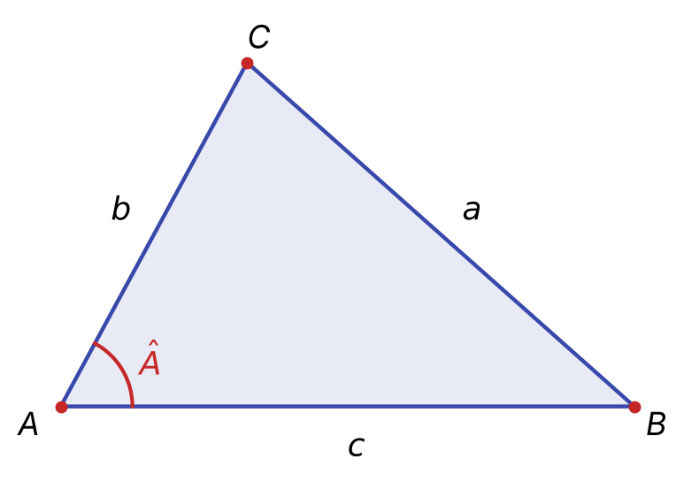
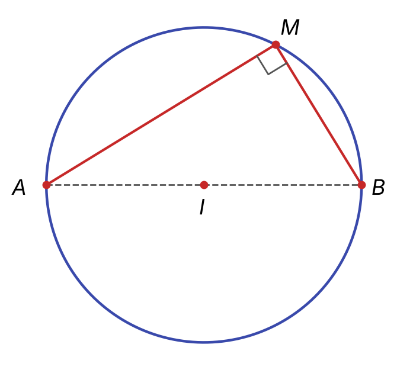

# Cours — Calcul vectoriel et produit scalaire

[📄 Cours en PDF (version classique)](pdf/cours.pdf){ .md-button }
[📄 Cours complet avec toutes les démonstrations (PDF)](pdf/cours-complet.pdf){ .md-button }

!!! lecture "Comment lire les démonstrations"
    Chaque résultat est démontré dès que c'est possible avec les outils de Première.

    Sur le site, clique sur un bloc pour l'ouvrir.

    - **Démonstration — au programme** : à savoir refaire, elle peut être demandée en évaluation.
    - **Démonstration — pour aller plus loin** : à comprendre, inutile de l'apprendre par cœur.
    - **Pourquoi ce résultat est admis** : la preuve demande une notion vue plus tard, qui est indiquée.

Dans tout le chapitre, on travaille dans le plan. Pour un vecteur $\vec{u}$, on note $\|\vec{u}\|$ sa **norme** (sa longueur) ; pour deux points $A$ et $B$, $\|\overrightarrow{AB}\| = AB$.

---

## 1. Rappels et compléments de calcul vectoriel

!!! definition "Combinaison linéaire, base"
    - Une **combinaison linéaire** de $\vec{u}$ et $\vec{v}$ est un vecteur de la forme $a\vec{u} + b\vec{v}$, avec $a$ et $b$ réels.
    - Deux vecteurs $\vec{\imath}$ et $\vec{\jmath}$ non colinéaires forment une **base** du plan : tout vecteur $\vec{u}$ s'écrit de façon unique $\vec{u} = x\vec{\imath} + y\vec{\jmath}$. Les réels $x$ et $y$ sont les **coordonnées** de $\vec{u}$, notées $\vec{u}\begin{pmatrix} x \\ y \end{pmatrix}$.
    - La base est **orthonormée** si $\vec{\imath}$ et $\vec{\jmath}$ sont orthogonaux et de norme $1$.

!!! propriete "Calculs en coordonnées"
    Dans un repère $(O\,;\,\vec{\imath},\,\vec{\jmath})$, avec $\vec{u}\begin{pmatrix} x \\ y \end{pmatrix}$, $\vec{v}\begin{pmatrix} x' \\ y' \end{pmatrix}$, $A(x_A\,;\,y_A)$ et $B(x_B\,;\,y_B)$ :

    - $\vec{u} + \vec{v}\begin{pmatrix} x + x' \\ y + y' \end{pmatrix}$ et $k\vec{u}\begin{pmatrix} kx \\ ky \end{pmatrix}$ ;
    - $\overrightarrow{AB}\begin{pmatrix} x_B - x_A \\ y_B - y_A \end{pmatrix}$ et le milieu de $[AB]$ a pour coordonnées $\left(\dfrac{x_A + x_B}{2}\,;\,\dfrac{y_A + y_B}{2}\right)$ ;
    - si le repère est **orthonormé** : $\|\vec{u}\| = \sqrt{x^2 + y^2}$ et $AB = \sqrt{(x_B - x_A)^2 + (y_B - y_A)^2}$.

!!! definition "Déterminant"
    Le **déterminant** de $\vec{u}\begin{pmatrix} x \\ y \end{pmatrix}$ et $\vec{v}\begin{pmatrix} x' \\ y' \end{pmatrix}$ est le réel $\det(\vec{u}, \vec{v}) = xy' - x'y$.

!!! propriete "Critère de colinéarité"
    $\vec{u}$ et $\vec{v}$ sont colinéaires si et seulement si $\det(\vec{u}, \vec{v}) = 0$.

??? demoplus "Démonstration — pour aller plus loin"
    **Sens direct.** Si $\vec{u} = \vec{0}$, alors $x = y = 0$ et le déterminant est nul. Sinon, $\vec{v} = k\vec{u}$ : $x' = kx$, $y' = ky$, donc $xy' - x'y = kxy - kxy = 0$.

    **Réciproque.** Supposons $xy' - x'y = 0$. Si $\vec{u} = \vec{0}$, les vecteurs sont colinéaires. Sinon, par exemple $x \neq 0$ : posons $k = \frac{x'}{x}$. Alors $x' = kx$ et $y' = \frac{x'y}{x} = ky$ (car $xy' = x'y$), donc $\vec{v} = k\vec{u}$. Le cas $y \neq 0$ est identique avec $k = \frac{y'}{y}$.

**Application.** Trois points $A$, $B$, $C$ sont **alignés** si et seulement si $\det\left(\overrightarrow{AB}, \overrightarrow{AC}\right) = 0$ ; deux droites $(AB)$ et $(CD)$ sont **parallèles** si et seulement si $\det\left(\overrightarrow{AB}, \overrightarrow{CD}\right) = 0$.

---

## 2. Définition du produit scalaire

!!! definition "Produit scalaire"
    Le **produit scalaire** des vecteurs $\vec{u}$ et $\vec{v}$ est le **nombre réel**
    $$\vec{u} \cdot \vec{v} = \frac{1}{2}\left(\|\vec{u} + \vec{v}\|^2 - \|\vec{u}\|^2 - \|\vec{v}\|^2\right).$$

!!! warning "Un produit scalaire est un nombre"
    Le produit scalaire de deux vecteurs n'est **pas un vecteur** : c'est un réel, qui peut être positif, négatif ou nul. On n'écrit jamais $\vec{u} \cdot \vec{v} \cdot \vec{w}$.

!!! definition "Carré scalaire"
    $\vec{u} \cdot \vec{u}$ se note $\vec{u}^{\,2}$. D'après la définition, $\vec{u}^{\,2} = \frac{1}{2}\left(\|2\vec{u}\|^2 - 2\|\vec{u}\|^2\right) = \frac{1}{2}\left(4\|\vec{u}\|^2 - 2\|\vec{u}\|^2\right) = \|\vec{u}\|^2$. En particulier, $\overrightarrow{AB}^{\,2} = AB^2$.

---

## 3. Expression en repère orthonormé

!!! theoreme "Produit scalaire et coordonnées"
    Dans une base **orthonormée**, si $\vec{u}\begin{pmatrix} x \\ y \end{pmatrix}$ et $\vec{v}\begin{pmatrix} x' \\ y' \end{pmatrix}$, alors
    $$\vec{u} \cdot \vec{v} = xx' + yy'.$$

??? demoplus "Démonstration — pour aller plus loin"
    $\vec{u} + \vec{v}$ a pour coordonnées $(x + x'\,;\,y + y')$. Dans une base orthonormée :
    $$\|\vec{u} + \vec{v}\|^2 = (x + x')^2 + (y + y')^2 = x^2 + 2xx' + x'^2 + y^2 + 2yy' + y'^2.$$
    En retranchant $\|\vec{u}\|^2 = x^2 + y^2$ et $\|\vec{v}\|^2 = x'^2 + y'^2$, il reste $2xx' + 2yy'$. On divise par $2$.

**Exemple.** $\vec{u}\begin{pmatrix} 3 \\ -2 \end{pmatrix}$ et $\vec{v}\begin{pmatrix} 4 \\ 5 \end{pmatrix}$ : $\vec{u} \cdot \vec{v} = 12 - 10 = 2$.

---

## 4. Propriétés de calcul

!!! propriete "Symétrie et bilinéarité"
    Pour tous vecteurs $\vec{u}$, $\vec{v}$, $\vec{w}$ et tout réel $k$ :

    - **symétrie** : $\vec{u} \cdot \vec{v} = \vec{v} \cdot \vec{u}$ ;
    - **bilinéarité** : $\vec{u} \cdot (\vec{v} + \vec{w}) = \vec{u} \cdot \vec{v} + \vec{u} \cdot \vec{w}$ et $\vec{u} \cdot (k\vec{v}) = k(\vec{u} \cdot \vec{v})$ ; de même à gauche.

??? demoplus "Démonstration — pour aller plus loin"
    On se place dans une base orthonormée, avec $\vec{u}(x\,;\,y)$, $\vec{v}(x'\,;\,y')$, $\vec{w}(x''\,;\,y'')$.

    - $\vec{u} \cdot \vec{v} = xx' + yy' = x'x + y'y = \vec{v} \cdot \vec{u}$.
    - $\vec{u} \cdot (\vec{v} + \vec{w}) = x(x' + x'') + y(y' + y'') = (xx' + yy') + (xx'' + yy'')$.
    - $\vec{u} \cdot (k\vec{v}) = x(kx') + y(ky') = k(xx' + yy')$.

    La linéarité à gauche découle de la linéarité à droite et de la symétrie.

!!! propriete "Identités remarquables"
    Pour tous vecteurs $\vec{u}$ et $\vec{v}$ :
    $$\|\vec{u} + \vec{v}\|^2 = \|\vec{u}\|^2 + 2\,\vec{u} \cdot \vec{v} + \|\vec{v}\|^2, \qquad \|\vec{u} - \vec{v}\|^2 = \|\vec{u}\|^2 - 2\,\vec{u} \cdot \vec{v} + \|\vec{v}\|^2,$$
    $$(\vec{u} + \vec{v}) \cdot (\vec{u} - \vec{v}) = \|\vec{u}\|^2 - \|\vec{v}\|^2.$$
    On en déduit une autre formule : $\vec{u} \cdot \vec{v} = \frac{1}{2}\left(\|\vec{u}\|^2 + \|\vec{v}\|^2 - \|\vec{u} - \vec{v}\|^2\right)$.

??? demoplus "Démonstration — pour aller plus loin"
    Par bilinéarité et symétrie : $(\vec{u} + \vec{v}) \cdot (\vec{u} + \vec{v}) = \vec{u} \cdot \vec{u} + \vec{u} \cdot \vec{v} + \vec{v} \cdot \vec{u} + \vec{v} \cdot \vec{v} = \|\vec{u}\|^2 + 2\,\vec{u} \cdot \vec{v} + \|\vec{v}\|^2$. Même calcul pour les deux autres, en développant comme avec des nombres.

---

## 5. Produit scalaire et cosinus

Si $\vec{u}$ et $\vec{v}$ sont non nuls, on choisit un point $A$ et on place $B$ et $C$ tels que $\overrightarrow{AB} = \vec{u}$ et $\overrightarrow{AC} = \vec{v}$. L'**angle géométrique** des deux vecteurs est l'angle $\widehat{BAC}$, compris entre $0$ et $\pi$.

!!! theoreme "Formule avec le cosinus"
    Si $\vec{u}$ et $\vec{v}$ sont non nuls et forment un angle géométrique $\theta$ :
    $$\vec{u} \cdot \vec{v} = \|\vec{u}\| \times \|\vec{v}\| \times \cos\theta.$$
    Autrement dit : $\overrightarrow{AB} \cdot \overrightarrow{AC} = AB \times AC \times \cos\widehat{BAC}$. Si l'un des vecteurs est nul, le produit scalaire est nul.

??? demoplus "Démonstration — pour aller plus loin"
    On choisit un repère orthonormé d'origine $A$ dont le premier vecteur de base a la direction et le sens de $\vec{u}$ : $\vec{\imath} = \dfrac{\vec{u}}{\|\vec{u}\|}$. Dans ce repère, $\vec{u}$ a pour coordonnées $(\|\vec{u}\|\,;\,0)$.

    Le point $C$ tel que $\overrightarrow{AC} = \vec{v}$ est à la distance $\|\vec{v}\|$ de $A$, et la demi-droite $[AC)$ fait l'angle $\theta$ avec l'axe des abscisses (au-dessus ou au-dessous de l'axe). D'après le chapitre de trigonométrie (en divisant par $\|\vec{v}\|$ pour se ramener au cercle trigonométrique), $\vec{v}$ a pour coordonnées $(\|\vec{v}\|\cos\theta\,;\,\pm\|\vec{v}\|\sin\theta)$.

    Donc $\vec{u} \cdot \vec{v} = \|\vec{u}\| \times \|\vec{v}\|\cos\theta + 0 = \|\vec{u}\|\,\|\vec{v}\|\cos\theta$.

!!! propriete "Signe du produit scalaire"
    Pour deux vecteurs non nuls d'angle géométrique $\theta$ : le produit scalaire est **positif** si $\theta$ est aigu, **négatif** si $\theta$ est obtus, **nul** si $\theta = \frac{\pi}{2}$.

!!! propriete "Inégalité de Cauchy-Schwarz"
    Pour tous vecteurs $\vec{u}$ et $\vec{v}$ : $|\vec{u} \cdot \vec{v}| \leq \|\vec{u}\| \times \|\vec{v}\|$, avec égalité si et seulement si $\vec{u}$ et $\vec{v}$ sont colinéaires.

??? demoplus "Démonstration — pour aller plus loin"
    Si l'un des vecteurs est nul, tout est nul. Sinon, $|\vec{u} \cdot \vec{v}| = \|\vec{u}\|\,\|\vec{v}\|\,|\cos\theta| \leq \|\vec{u}\|\,\|\vec{v}\|$, car $|\cos\theta| \leq 1$. L'égalité a lieu si et seulement si $\cos\theta = \pm 1$, c'est-à-dire $\theta = 0$ ou $\theta = \pi$ : les vecteurs sont colinéaires.

---

## 6. Projeté orthogonal

!!! definition "Projeté orthogonal"
    Le **projeté orthogonal** d'un point $C$ sur une droite $(d)$ est le point $H$ de $(d)$ tel que $(CH) \perp (d)$ (ou $H = C$ si $C \in (d)$).

!!! theoreme "Formule du projeté"
    Soit $A \neq B$ et $H$ le projeté orthogonal de $C$ sur $(AB)$. Alors
    $$\overrightarrow{AB} \cdot \overrightarrow{AC} = \overrightarrow{AB} \cdot \overrightarrow{AH} = \begin{cases} AB \times AH & \text{si } \overrightarrow{AB} \text{ et } \overrightarrow{AH} \text{ sont de même sens,} \\ -AB \times AH & \text{sinon.} \end{cases}$$

{ width="80%" }

??? demoplus "Démonstration — pour aller plus loin"
    $\overrightarrow{AC} = \overrightarrow{AH} + \overrightarrow{HC}$, donc par bilinéarité $\overrightarrow{AB} \cdot \overrightarrow{AC} = \overrightarrow{AB} \cdot \overrightarrow{AH} + \overrightarrow{AB} \cdot \overrightarrow{HC}$. Le second terme est nul, car $\overrightarrow{HC}$ est orthogonal à $\overrightarrow{AB}$ (voir la partie 7).

    Les vecteurs $\overrightarrow{AB}$ et $\overrightarrow{AH}$ sont colinéaires : leur angle vaut $0$ (même sens, $\cos 0 = 1$) ou $\pi$ (sens contraires, $\cos\pi = -1$). La formule avec le cosinus donne $\pm AB \times AH$.

---

## 7. Orthogonalité

!!! definition "Vecteurs orthogonaux"
    Deux vecteurs non nuls sont **orthogonaux** si les droites qu'ils dirigent sont perpendiculaires. Par convention, le vecteur nul est orthogonal à tout vecteur.

!!! theoreme "Caractérisation de l'orthogonalité"
    $$\vec{u} \perp \vec{v} \iff \vec{u} \cdot \vec{v} = 0.$$
    En repère orthonormé : $\vec{u}(x\,;\,y) \perp \vec{v}(x'\,;\,y') \iff xx' + yy' = 0$.

??? demoplus "Démonstration — pour aller plus loin"
    Si l'un des vecteurs est nul, les deux propriétés sont vraies. Sinon, $\vec{u} \cdot \vec{v} = \|\vec{u}\|\,\|\vec{v}\|\cos\theta$ avec $\|\vec{u}\|\,\|\vec{v}\| \neq 0$ : le produit est nul si et seulement si $\cos\theta = 0$, c'est-à-dire $\theta = \frac{\pi}{2}$ (car $\theta \in [0\,;\,\pi]$).

    *Remarque.* La démonstration de la partie 6 utilise ce résultat, qui ne dépend que de la formule avec le cosinus : il n'y a pas de cercle vicieux.

!!! tip "Pythagore, version vectorielle"
    D'après l'identité $\|\vec{u} + \vec{v}\|^2 = \|\vec{u}\|^2 + 2\,\vec{u} \cdot \vec{v} + \|\vec{v}\|^2$ : $\|\vec{u} + \vec{v}\|^2 = \|\vec{u}\|^2 + \|\vec{v}\|^2 \iff \vec{u} \perp \vec{v}$. C'est le théorème de Pythagore **et** sa réciproque, en une seule ligne.

---

## 8. Formule d'Al-Kashi

On note, dans un triangle $ABC$, $a = BC$, $b = CA$ et $c = AB$.

!!! theoreme "Formule d'Al-Kashi"
    Dans tout triangle $ABC$ :
    $$a^2 = b^2 + c^2 - 2bc\cos\widehat{A}.$$
    De même, $b^2 = a^2 + c^2 - 2ac\cos\widehat{B}$ et $c^2 = a^2 + b^2 - 2ab\cos\widehat{C}$.

{ width="45%" }

??? demo "Démonstration — au programme"
    On écrit $\overrightarrow{BC} = \overrightarrow{AC} - \overrightarrow{AB}$ (relation de Chasles). Alors
    $$a^2 = BC^2 = \left\|\overrightarrow{AC} - \overrightarrow{AB}\right\|^2 = AC^2 - 2\,\overrightarrow{AC} \cdot \overrightarrow{AB} + AB^2.$$
    Or $\overrightarrow{AB} \cdot \overrightarrow{AC} = AB \times AC \times \cos\widehat{A} = cb\cos\widehat{A}$. Donc $a^2 = b^2 + c^2 - 2bc\cos\widehat{A}$.

!!! info "Généralisation de Pythagore"
    Si $\widehat{A} = 90°$, $\cos\widehat{A} = 0$ et on retrouve $a^2 = b^2 + c^2$. La formule permet de calculer :

    - le **troisième côté** connaissant deux côtés et l'angle compris ;
    - un **angle** connaissant les trois côtés : $\cos\widehat{A} = \dfrac{b^2 + c^2 - a^2}{2bc}$.

**Exemple.** $b = 3$, $c = 5$, $\widehat{A} = \frac{2\pi}{3}$ : $a^2 = 9 + 25 - 30 \times \left(-\frac{1}{2}\right) = 49$, donc $a = 7$.

---

## 9. Ensemble des points $M$ tels que $\overrightarrow{MA} \cdot \overrightarrow{MB} = 0$

!!! theoreme "Cercle de diamètre $[AB]$"
    Soit $A$ et $B$ deux points distincts. L'ensemble des points $M$ tels que $\overrightarrow{MA} \cdot \overrightarrow{MB} = 0$ est le **cercle de diamètre $[AB]$**.

{ width="40%" }

??? demo "Démonstration — au programme"
    Soit $I$ le milieu de $[AB]$ : $\overrightarrow{IB} = -\overrightarrow{IA}$. Par la relation de Chasles et la bilinéarité :
    $$\overrightarrow{MA} \cdot \overrightarrow{MB} = \left(\overrightarrow{MI} + \overrightarrow{IA}\right) \cdot \left(\overrightarrow{MI} + \overrightarrow{IB}\right) = \left(\overrightarrow{MI} + \overrightarrow{IA}\right) \cdot \left(\overrightarrow{MI} - \overrightarrow{IA}\right) = MI^2 - IA^2.$$
    Donc $\overrightarrow{MA} \cdot \overrightarrow{MB} = 0 \iff MI^2 = IA^2 \iff MI = IA = \frac{AB}{2}$ (des longueurs sont positives).

    L'ensemble cherché est donc le cercle de centre $I$ et de rayon $\frac{AB}{2}$ : c'est le cercle de diamètre $[AB]$.

!!! tip "Lecture géométrique"
    Pour $M$ distinct de $A$ et $B$, $\overrightarrow{MA} \cdot \overrightarrow{MB} = 0$ signifie que le triangle $AMB$ est **rectangle en $M$**. On retrouve un résultat du collège : un triangle inscrit dans un cercle, dont un côté est un diamètre, est rectangle, et réciproquement.

La formule $\overrightarrow{MA} \cdot \overrightarrow{MB} = MI^2 - \frac{AB^2}{4}$ obtenue dans la démonstration est utile en elle-même : elle permet de trouver l'ensemble des points $M$ tels que $\overrightarrow{MA} \cdot \overrightarrow{MB} = k$ (un cercle, un point ou l'ensemble vide selon le signe de $k + \frac{AB^2}{4}$).

---

## 10. Théorème de la médiane

!!! propriete "Théorème de la médiane"
    Soit $I$ le milieu de $[AB]$. Pour tout point $M$ :
    $$MA^2 + MB^2 = 2MI^2 + \frac{AB^2}{2}.$$

??? demoplus "Démonstration — pour aller plus loin"
    $MA^2 = \left\|\overrightarrow{MI} + \overrightarrow{IA}\right\|^2 = MI^2 + 2\,\overrightarrow{MI} \cdot \overrightarrow{IA} + IA^2$ et $MB^2 = MI^2 + 2\,\overrightarrow{MI} \cdot \overrightarrow{IB} + IB^2$. En additionnant, les doubles produits s'annulent car $\overrightarrow{IA} + \overrightarrow{IB} = \vec{0}$ ; il reste $2MI^2 + 2IA^2 = 2MI^2 + 2 \times \frac{AB^2}{4}$.

**Application.** Dans un triangle de côtés $AB = 6$, $MA = 5$ et $MB = 7$, la médiane issue de $M$ mesure $MI$ avec $2MI^2 = 25 + 49 - 18 = 56$, donc $MI = \sqrt{28} = 2\sqrt{7}$.

---

## 11. Pour aller plus loin

- **Géométrie repérée.** Le produit scalaire donne l'équation d'une droite à partir d'un **vecteur normal** et l'équation d'un cercle ([chapitre 8](../geometrie-reperee/index.md)).
- **Dans l'espace.** Toutes les formules restent vraies dans l'espace, avec trois coordonnées : $\vec{u} \cdot \vec{v} = xx' + yy' + zz'$ ([orthogonalité dans l'espace, Terminale](../../terminale/orthogonalite-espace/index.md)).
- **Formules d'addition.** Avec deux vecteurs unitaires d'angles $a$ et $b$, le produit scalaire calculé de deux façons donne $\cos(b - a) = \cos a\cos b + \sin a\sin b$.
- **En physique.** Le **travail** d'une force constante $\vec{F}$ le long d'un déplacement $\overrightarrow{AB}$ est $W = \vec{F} \cdot \overrightarrow{AB}$ : seule la composante de la force dans la direction du mouvement travaille.

!!! success "Tu as fini le cours"
    Passe aux [méthodes](methodes.md), puis entraîne-toi avec les exercices corrigés.
