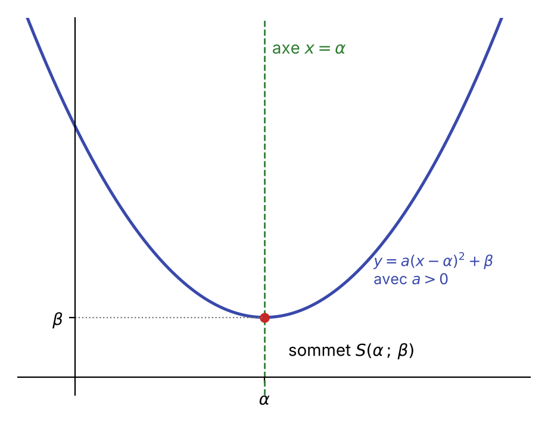
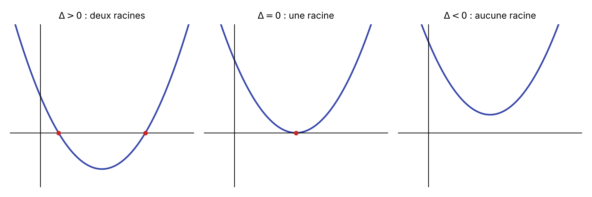

# Cours — Équations, fonctions polynômes du second degré

[📄 Cours en PDF (version classique)](pdf/cours.pdf){ .md-button }
[📄 Cours complet avec toutes les démonstrations (PDF)](pdf/cours-complet.pdf){ .md-button }

!!! lecture "Comment lire les démonstrations"
    Chaque résultat est démontré dès que c'est possible avec les outils de Première.

    Sur le site, clique sur un bloc pour l'ouvrir.

    - **Démonstration — au programme** : à savoir refaire, elle peut être demandée en évaluation.
    - **Démonstration — pour aller plus loin** : à comprendre, inutile de l'apprendre par cœur. Indispensable si tu vises des études de maths.

---

## 1. Fonctions polynômes du second degré

!!! definition "Trinôme du second degré"
    Une **fonction polynôme du second degré** est une fonction $f$ définie sur $\mathbb{R}$ par
    $$f(x) = ax^2 + bx + c,$$
    où $a$, $b$, $c$ sont des réels avec $a \neq 0$. L'expression $ax^2 + bx + c$ s'appelle un **trinôme du second degré** ; c'est sa **forme développée**.

    Un réel $x_0$ tel que $f(x_0) = 0$ est une **racine** du trinôme.

**Exemples.** $f(x) = 2x^2 - 4x - 6$ ($a = 2$, $b = -4$, $c = -6$) ; $g(x) = -x^2 + 3$ ($b = 0$) ; $h(x) = (x - 1)(x + 5)$, qui se développe en $x^2 + 4x - 5$. En revanche, $3x + 1$ n'est pas du second degré ($a = 0$).

---

## 2. La forme canonique

!!! theoreme "Forme canonique"
    Tout trinôme $ax^2 + bx + c$ (avec $a \neq 0$) s'écrit de façon **unique** sous la forme
    $$a(x - \alpha)^2 + \beta, \qquad \text{avec} \quad \alpha = -\frac{b}{2a} \quad \text{et} \quad \beta = f(\alpha).$$
    C'est la **forme canonique** du trinôme.

??? demoplus "Démonstration — pour aller plus loin"
    **Existence.** On factorise par $a$ et l'on reconnaît le début d'une identité remarquable :
    $$ax^2 + bx + c = a\left(x^2 + \frac{b}{a}x\right) + c = a\left[\left(x + \frac{b}{2a}\right)^2 - \frac{b^2}{4a^2}\right] + c = a\left(x + \frac{b}{2a}\right)^2 - \frac{b^2}{4a} + c.$$
    C'est la forme annoncée avec $\alpha = -\frac{b}{2a}$ et $\beta = c - \frac{b^2}{4a}$. En remplaçant $x$ par $\alpha$, le carré s'annule : $f(\alpha) = \beta$.

    **Unicité.** Supposons que $a(x - \alpha)^2 + \beta = a(x - \alpha')^2 + \beta'$ pour tout réel $x$. Avec $x = \alpha$ : $\beta = a(\alpha - \alpha')^2 + \beta'$. Avec $x = \alpha'$ : $a(\alpha' - \alpha)^2 + \beta = \beta'$. En additionnant : $2a(\alpha - \alpha')^2 = 0$, donc $\alpha = \alpha'$ (car $a \neq 0$), puis $\beta = \beta'$.

**Exemple.** $x^2 - 6x + 5 = (x - 3)^2 - 9 + 5 = (x - 3)^2 - 4$. Ici $\alpha = 3$, $\beta = -4$.

**Exemple.** $2x^2 + 8x + 3 = 2(x^2 + 4x) + 3 = 2\left[(x + 2)^2 - 4\right] + 3 = 2(x + 2)^2 - 5$.

!!! tip "Retenir la méthode plutôt que la formule"
    Pour mettre sous forme canonique, on factorise par $a$ les termes en $x^2$ et en $x$, puis on écrit $x^2 + px = \left(x + \frac{p}{2}\right)^2 - \frac{p^2}{4}$. On peut aussi calculer $\alpha = -\frac{b}{2a}$, puis $\beta = f(\alpha)$.

---

## 3. Variations et parabole

!!! theoreme "Variations"
    Soit $f(x) = a(x - \alpha)^2 + \beta$.

    - Si $a > 0$ : $f$ est **décroissante** sur $]-\infty\,;\,\alpha]$ et **croissante** sur $[\alpha\,;\,+\infty[$. Elle admet un **minimum** égal à $\beta$, atteint en $\alpha$.
    - Si $a < 0$ : $f$ est **croissante** sur $]-\infty\,;\,\alpha]$ et **décroissante** sur $[\alpha\,;\,+\infty[$. Elle admet un **maximum** égal à $\beta$, atteint en $\alpha$.

??? demoplus "Démonstration — pour aller plus loin"
    Cas $a > 0$. Soit $u < v \leq \alpha$. Alors $u - \alpha < v - \alpha \leq 0$. La fonction carré est décroissante sur $]-\infty\,;\,0]$, donc $(u - \alpha)^2 > (v - \alpha)^2$. En multipliant par $a > 0$ et en ajoutant $\beta$ : $f(u) > f(v)$. La fonction est donc décroissante sur $]-\infty\,;\,\alpha]$. On raisonne de même sur $[\alpha\,;\,+\infty[$, où la fonction carré est croissante.

    Enfin, $(x - \alpha)^2 \geq 0$ donc $f(x) \geq \beta = f(\alpha)$ pour tout $x$ : $\beta$ est le minimum.

    Si $a < 0$, la multiplication par $a$ renverse toutes les inégalités.

!!! propriete "La parabole"
    La courbe représentative d'une fonction polynôme du second degré est une **parabole** :

    - de **sommet** $S(\alpha\,;\,\beta)$ ;
    - d'**axe de symétrie** la droite d'équation $x = \alpha$ ;
    - « tournée vers le haut » si $a > 0$, « vers le bas » si $a < 0$.

{ width="45%" }

??? demoplus "Démonstration de la symétrie — pour aller plus loin"
    Pour tout réel $h$, $f(\alpha + h) = ah^2 + \beta$ et $f(\alpha - h) = a(-h)^2 + \beta = ah^2 + \beta$. Les points d'abscisses $\alpha + h$ et $\alpha - h$, symétriques par rapport à la droite $x = \alpha$, ont la même ordonnée.

**Exemple.** $f(x) = -x^2 + 4x + 1$. On a $\alpha = -\frac{4}{-2} = 2$ et $\beta = f(2) = 5$. Comme $a = -1 < 0$, $f$ est croissante sur $]-\infty\,;\,2]$, décroissante sur $[2\,;\,+\infty[$, et son maximum vaut $5$.

---

## 4. L'équation du second degré

!!! definition "Discriminant"
    Le **discriminant** du trinôme $ax^2 + bx + c$ est le nombre
    $$\Delta = b^2 - 4ac.$$

!!! theoreme "Résolution de l'équation $ax^2 + bx + c = 0$"
    - Si $\Delta > 0$, l'équation a **deux solutions** distinctes :
      $$x_1 = \frac{-b - \sqrt{\Delta}}{2a} \qquad \text{et} \qquad x_2 = \frac{-b + \sqrt{\Delta}}{2a}.$$
    - Si $\Delta = 0$, l'équation a **une solution** (dite double) : $x_0 = -\dfrac{b}{2a}$.
    - Si $\Delta < 0$, l'équation n'a **aucune solution** réelle.

??? demo "Démonstration — au programme"
    D'après le § 2, $ax^2 + bx + c = a\left(x + \dfrac{b}{2a}\right)^2 - \dfrac{b^2}{4a} + c$. On met les deux derniers termes au même dénominateur :
    $$-\frac{b^2}{4a} + c = -\frac{b^2 - 4ac}{4a} = -\frac{\Delta}{4a}, \qquad \text{donc} \qquad ax^2 + bx + c = a\left[\left(x + \frac{b}{2a}\right)^2 - \frac{\Delta}{4a^2}\right].$$
    Comme $a \neq 0$, l'équation équivaut à
    $$\left(x + \frac{b}{2a}\right)^2 = \frac{\Delta}{4a^2}.$$
    Le dénominateur $4a^2$ est strictement positif, donc le membre de droite a le signe de $\Delta$.

    - **Si $\Delta < 0$** : un carré ne peut pas être strictement négatif ; il n'y a **aucune solution**.
    - **Si $\Delta = 0$** : l'équation devient $\left(x + \frac{b}{2a}\right)^2 = 0$, soit $x = -\frac{b}{2a}$ : **une solution**.
    - **Si $\Delta > 0$** : $\frac{\Delta}{4a^2} = \left(\frac{\sqrt{\Delta}}{2a}\right)^2$, et l'équation $X^2 = k^2$ équivaut à $X = k$ ou $X = -k$. Donc
      $$x + \frac{b}{2a} = \frac{\sqrt{\Delta}}{2a} \quad \text{ou} \quad x + \frac{b}{2a} = -\frac{\sqrt{\Delta}}{2a},$$
      c'est-à-dire $x = \dfrac{-b + \sqrt{\Delta}}{2a}$ ou $x = \dfrac{-b - \sqrt{\Delta}}{2a}$ : **deux solutions**, distinctes car $\sqrt{\Delta} \neq 0$.

{ width="80%" }

Graphiquement, les solutions sont les abscisses des points d'intersection de la parabole avec l'axe des abscisses.

**Exemples.**

- $x^2 - 5x + 6 = 0$ : $\Delta = 25 - 24 = 1 > 0$, solutions $\frac{5 - 1}{2} = 2$ et $\frac{5 + 1}{2} = 3$.
- $9x^2 - 6x + 1 = 0$ : $\Delta = 36 - 36 = 0$, une solution $x_0 = \frac{6}{18} = \frac{1}{3}$.
- $x^2 + x + 1 = 0$ : $\Delta = 1 - 4 = -3 < 0$, aucune solution.

!!! warning "Inutile de calculer $\Delta$ à chaque fois"
    Si $b = 0$ ou $c = 0$, ou si l'on reconnaît une identité remarquable, on résout plus vite directement. Par exemple, $x^2 - 7x = 0 \iff x(x - 7) = 0 \iff x = 0$ ou $x = 7$ ; et $(x - 3)^2 = 4 \iff x - 3 = 2$ ou $x - 3 = -2$.

---

## 5. Forme factorisée

!!! theoreme "Factorisation"
    - Si $\Delta > 0$ : $ax^2 + bx + c = a(x - x_1)(x - x_2)$.
    - Si $\Delta = 0$ : $ax^2 + bx + c = a(x - x_0)^2$.
    - Si $\Delta < 0$ : le trinôme **ne peut pas** s'écrire comme un produit de facteurs du premier degré.

??? demoplus "Démonstration — pour aller plus loin"
    D'après la démonstration du § 4, $ax^2 + bx + c = a\left[\left(x + \frac{b}{2a}\right)^2 - \frac{\Delta}{4a^2}\right]$.

    Si $\Delta > 0$, on reconnaît une différence de deux carrés $X^2 - k^2 = (X - k)(X + k)$, avec $X = x + \frac{b}{2a}$ et $k = \frac{\sqrt{\Delta}}{2a}$ :
    $$ax^2 + bx + c = a\left(x + \frac{b}{2a} - \frac{\sqrt{\Delta}}{2a}\right)\left(x + \frac{b}{2a} + \frac{\sqrt{\Delta}}{2a}\right) = a(x - x_2)(x - x_1).$$
    Si $\Delta = 0$, il reste $a\left(x + \frac{b}{2a}\right)^2 = a(x - x_0)^2$.

    Si $\Delta < 0$ et si l'on avait $ax^2 + bx + c = (mx + p)(nx + r)$ avec $m \neq 0$, le réel $-\frac{p}{m}$ annulerait le trinôme, qui aurait une racine : c'est impossible.

**Exemple.** $2x^2 - 4x - 6$ : $\Delta = 16 + 48 = 64$, racines $\frac{4 - 8}{4} = -1$ et $\frac{4 + 8}{4} = 3$. Donc $2x^2 - 4x - 6 = 2(x + 1)(x - 3)$.

---

## 6. Somme et produit des racines

!!! propriete "Somme et produit"
    Si $\Delta \geq 0$ et si $x_1$, $x_2$ sont les racines (éventuellement égales quand $\Delta = 0$) :
    $$x_1 + x_2 = -\frac{b}{a} \qquad \text{et} \qquad x_1 \times x_2 = \frac{c}{a}.$$

??? demoplus "Démonstration — pour aller plus loin"
    Avec les formules du § 4 :
    $$x_1 + x_2 = \frac{-b - \sqrt{\Delta} - b + \sqrt{\Delta}}{2a} = -\frac{b}{a}, \qquad x_1 x_2 = \frac{(-b)^2 - \left(\sqrt{\Delta}\right)^2}{4a^2} = \frac{b^2 - (b^2 - 4ac)}{4a^2} = \frac{c}{a}.$$
    Le cas $\Delta = 0$ ($x_1 = x_2 = -\frac{b}{2a}$) se vérifie de la même façon.

!!! tip "Deux usages"
    - **Racine évidente.** Si l'on repère une racine (souvent $1$, $-1$ ou $2$), le produit donne l'autre sans calcul. Pour $3x^2 - 5x + 2$ : $x_1 = 1$ convient ($3 - 5 + 2 = 0$), et $x_2 = \frac{c}{a} \div x_1 = \frac{2}{3}$.
    - **Deux nombres de somme $S$ et de produit $P$** sont les solutions de $x^2 - Sx + P = 0$. Par exemple, deux nombres de somme $10$ et de produit $21$ sont solutions de $x^2 - 10x + 21 = 0$ : ce sont $3$ et $7$.

---

## 7. Signe d'un trinôme

!!! theoreme "Signe de $ax^2 + bx + c$"
    - Si $\Delta > 0$ (racines $x_1 < x_2$) : le trinôme est **du signe de $a$ à l'extérieur des racines**, du signe opposé entre les racines, et nul en $x_1$ et $x_2$.
    - Si $\Delta = 0$ : le trinôme est du signe de $a$, et s'annule seulement en $x_0$.
    - Si $\Delta < 0$ : le trinôme est **toujours du signe de $a$**.

Dans le cas $\Delta > 0$, avec $x_1 < x_2$ :

| $x$ | $-\infty$ | | $x_1$ | | $x_2$ | | $+\infty$ |
|---|---|---|---|---|---|---|---|
| $ax^2 + bx + c$ | | signe de $a$ | $0$ | signe de $-a$ | $0$ | signe de $a$ | |

??? demoplus "Démonstration — pour aller plus loin"
    Si $\Delta > 0$, on utilise la forme factorisée $a(x - x_1)(x - x_2)$. Pour $x < x_1$, les deux facteurs $x - x_1$ et $x - x_2$ sont négatifs, leur produit est positif : signe de $a$. Pour $x_1 < x < x_2$, un facteur est positif et l'autre négatif : signe de $-a$. Pour $x > x_2$, les deux sont positifs : signe de $a$.

    Si $\Delta = 0$, $a(x - x_0)^2$ a le signe de $a$, et s'annule en $x_0$.

    Si $\Delta < 0$, $ax^2 + bx + c = a\left[\left(x + \frac{b}{2a}\right)^2 - \frac{\Delta}{4a^2}\right]$, et le crochet est strictement positif (un carré plus un nombre strictement positif) : signe de $a$.

**Exemple.** Résoudre $2x^2 - 3x - 2 \leq 0$. $\Delta = 9 + 16 = 25$, racines $-\frac{1}{2}$ et $2$. Comme $a = 2 > 0$, le trinôme est négatif entre les racines : $S = \left[-\frac{1}{2}\,;\,2\right]$.

!!! tip "Le réflexe graphique"
    Pour retrouver le signe sans apprendre par cœur, dessine l'allure de la parabole (vers le haut si $a > 0$) et place ses intersections avec l'axe des abscisses : le trinôme est positif là où la parabole est au-dessus de l'axe.

---

## 8. Choisir la bonne forme

Une même fonction a trois écritures. Par exemple :
$$f(x) = 2x^2 - 4x - 6 = 2(x - 1)^2 - 8 = 2(x + 1)(x - 3).$$

| Pour… | on utilise la forme… | Ici |
|---|---|---|
| calculer $f(0)$, dériver, identifier $a$, $b$, $c$ | développée | $f(0) = -6$ |
| trouver le sommet, les variations, un extremum | canonique | minimum $-8$ en $1$ |
| résoudre $f(x) = 0$, étudier le signe | factorisée | racines $-1$ et $3$ |

!!! tip "En Python"
    ```python
    from math import sqrt

    def racines(a, b, c):
        delta = b**2 - 4*a*c
        if delta > 0:
            return [(-b - sqrt(delta)) / (2*a), (-b + sqrt(delta)) / (2*a)]
        elif delta == 0:
            return [-b / (2*a)]
        else:
            return []

    print(racines(2, -4, -6))   # [-1.0, 3.0]
    ```

---

## 9. Pour aller plus loin

- **Équations bicarrées.** L'équation $x^4 - 5x^2 + 4 = 0$ se ramène au second degré en posant $X = x^2$ (exercice 17).
- **Nombres complexes.** Quand $\Delta < 0$, il n'y a pas de solution réelle. Mais en inventant un nombre $i$ tel que $i^2 = -1$, on obtient deux solutions $\frac{-b \pm i\sqrt{-\Delta}}{2a}$ : ce sont les **nombres complexes**, étudiés en option maths expertes en Terminale.
- **Degré 3 et au-delà.** Il existe des formules (de Cardan) pour le degré $3$ et le degré $4$. Pour le degré $5$ et plus, Abel et Galois ont démontré au XIXᵉ siècle qu'aucune formule de ce type ne peut exister : c'est le point de départ de la théorie de Galois (Master).

!!! success "Tu as fini le cours"
    Passe aux [méthodes](methodes.md), puis entraîne-toi avec les exercices corrigés.
