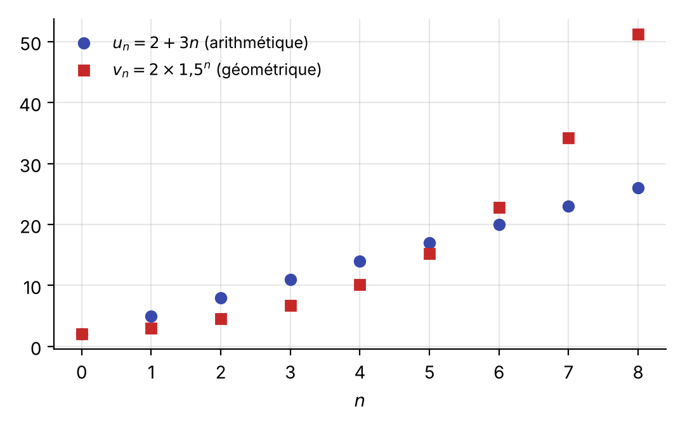
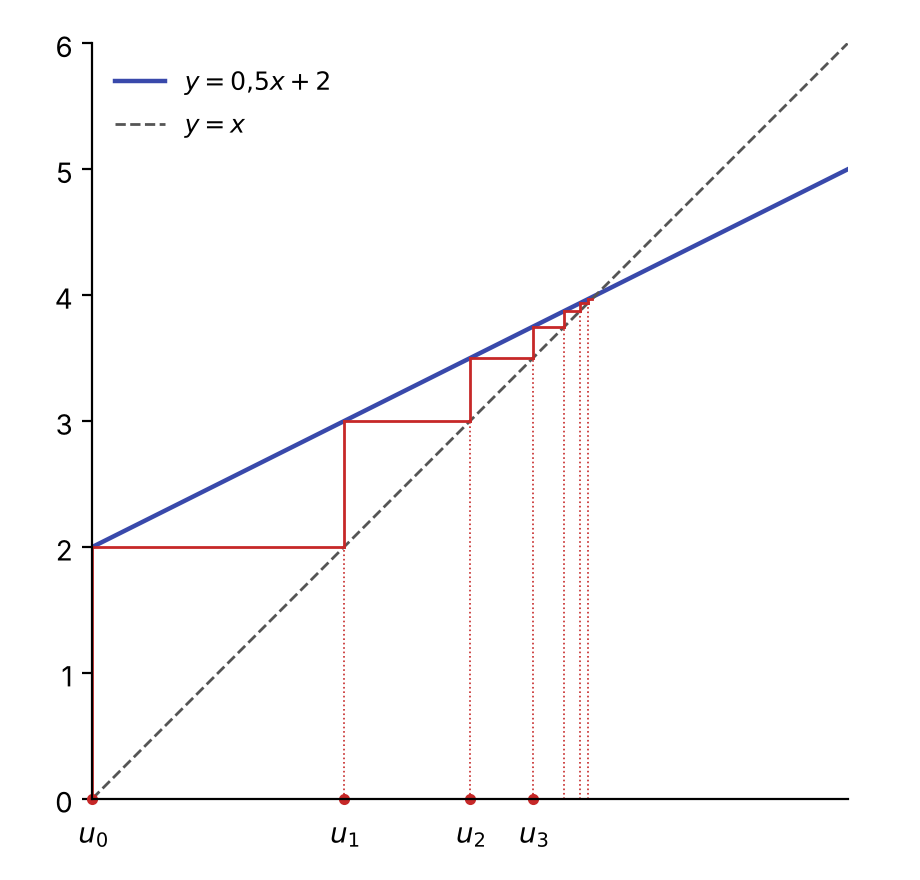

# Cours — Suites numériques, modèles discrets

[📄 Cours en PDF (version classique)](pdf/cours.pdf){ .md-button }
[📄 Cours complet avec toutes les démonstrations (PDF)](pdf/cours-complet.pdf){ .md-button }

!!! lecture "Comment lire les démonstrations"
    Chaque résultat est démontré dès que c'est possible avec les outils de Première.

    Sur le site, clique sur un bloc pour l'ouvrir.

    - **Démonstration — au programme** : à savoir refaire, elle peut être demandée en évaluation.
    - **Démonstration — pour aller plus loin** : à comprendre, inutile de l'apprendre par cœur. Indispensable si tu vises des études de maths.
    - **Pourquoi ce résultat est admis** : la preuve demande une notion vue plus tard, qui est indiquée.

---

## 1. Qu'est-ce qu'une suite ?

!!! definition "Suite numérique"
    Une **suite numérique** $u$ associe à chaque entier naturel $n$ (éventuellement à partir d'un certain rang) un nombre réel noté $u_n$, appelé **terme de rang $n$** (ou terme d'indice $n$). On note la suite $u$ ou $(u_n)$.

!!! warning "Ne pas confondre $(u_n)$ et $u_n$"
    $(u_n)$ désigne la suite tout entière ; $u_n$ est un nombre, le terme de rang $n$. De même, $u_{n+1}$ (le terme qui suit $u_n$) n'a rien à voir avec $u_n + 1$.

### 1.1 Les modes de génération

!!! definition "Suite définie de façon explicite"
    La suite est définie **de façon explicite** lorsque $u_n = f(n)$ pour une fonction $f$ : on calcule directement n'importe quel terme.

**Exemple.** $u_n = n^2 - 3n$ pour tout $n \in \mathbb{N}$. Alors $u_0 = 0$, $u_1 = -2$, $u_{10} = 70$, et $u_{n+1} = (n+1)^2 - 3(n+1) = n^2 - n - 2$.

!!! definition "Suite définie par récurrence"
    La suite est définie **par récurrence** lorsque l'on donne son premier terme et une relation qui permet de calculer chaque terme à partir du précédent : $u_0 = a$ et $u_{n+1} = f(u_n)$ pour tout $n$.

**Exemple.** $u_0 = 2$ et $u_{n+1} = 3u_n - 1$. On calcule de proche en proche : $u_1 = 5$, $u_2 = 14$, $u_3 = 41$. Pour obtenir $u_{100}$, il faut calculer les $99$ termes précédents.

**Autres modes de génération.** Une suite peut aussi être produite par un **algorithme** (par exemple un programme Python), ou par un **motif géométrique** : nombre d'allumettes nécessaires pour construire $n$ carrés alignés, nombre de points d'une figure qui grandit…

!!! tip "Calculer des termes en Python avec une liste"
    ```python
    u = [2]                      # u[0] = 2
    for n in range(10):
        u.append(3 * u[n] - 1)   # u[n+1] = 3 u[n] - 1
    print(u)                     # [2, 5, 14, 41, 122, ...]
    ```

    La liste `u` contient les termes $u_0, u_1, \ldots, u_{10}$, et `u[n]` est le terme de rang $n$.

### 1.2 Représentation graphique

On représente une suite par le **nuage des points** de coordonnées $(n\,;\,u_n)$. Ces points sont isolés : on ne les relie pas.

{ width="60%" }

Pour une suite définie par $u_{n+1} = f(u_n)$, on peut aussi placer les termes sur l'axe des abscisses à l'aide de la courbe de $f$ et de la droite $y = x$ : c'est la construction **en escalier** (ou en toile d'araignée).

{ width="45%" }

Sur cette figure, les termes semblent se rapprocher de $4$, l'abscisse du point d'intersection des deux droites.

---

## 2. Sens de variation

!!! definition "Suite croissante, décroissante"
    - $(u_n)$ est **croissante** lorsque $u_{n+1} \geq u_n$ pour tout $n$ ;
    - $(u_n)$ est **décroissante** lorsque $u_{n+1} \leq u_n$ pour tout $n$ ;
    - $(u_n)$ est **constante** lorsque $u_{n+1} = u_n$ pour tout $n$.

    On parle de suite **strictement** croissante ou décroissante avec des inégalités strictes. Une suite croissante ou décroissante est dite **monotone**.

!!! propriete "Trois méthodes"
    1. **Le signe de la différence** : si $u_{n+1} - u_n \geq 0$ pour tout $n$, la suite est croissante ; si $u_{n+1} - u_n \leq 0$, elle est décroissante.
    2. **Le quotient**, si tous les termes sont **strictement positifs** : si $\dfrac{u_{n+1}}{u_n} \geq 1$ pour tout $n$, la suite est croissante ; si $\dfrac{u_{n+1}}{u_n} \leq 1$, elle est décroissante.
    3. **La fonction**, si $u_n = f(n)$ : si $f$ est croissante sur $[0\,;\,+\infty[$, la suite est croissante ; si $f$ est décroissante, elle est décroissante.

??? demoplus "Démonstration — pour aller plus loin"
    Le point 1 est la définition. Pour le point 2, comme $u_n > 0$, on peut multiplier l'inégalité $\frac{u_{n+1}}{u_n} \geq 1$ par $u_n$ sans changer son sens : $u_{n+1} \geq u_n$. Pour le point 3, $n < n + 1$ et $f$ croissante donnent $f(n) \leq f(n+1)$, soit $u_n \leq u_{n+1}$.

!!! warning "La réciproque du point 3 est fausse"
    La suite $u_n = (n - 0{,}4)^2$ est croissante ($u_0 = 0{,}16$, $u_1 = 0{,}36$, $u_2 = 2{,}56$…), alors que la fonction $x \mapsto (x - 0{,}4)^2$ n'est pas croissante sur $[0\,;\,+\infty[$ : elle décroît sur $[0\,;\,0{,}4]$. Seuls les entiers comptent.

**Exemple.** $u_n = 3n - 7$ : $u_{n+1} - u_n = 3(n+1) - 7 - (3n - 7) = 3 > 0$, donc la suite est strictement croissante.

---

## 3. Suites arithmétiques

### 3.1 Définition et terme général

!!! definition "Suite arithmétique"
    Une suite $(u_n)$ est **arithmétique** s'il existe un réel $r$, appelé **raison**, tel que pour tout $n$ :
    $$u_{n+1} = u_n + r.$$
    On passe d'un terme au suivant en **ajoutant** toujours le même nombre.

!!! theoreme "Terme général"
    Si $(u_n)$ est arithmétique de raison $r$, alors pour tous entiers $n$ et $p$ :
    $$u_n = u_0 + nr \qquad \text{et} \qquad u_n = u_p + (n - p)\,r.$$

??? demo "Démonstration — au programme"
    Pour tout $k$, $u_{k+1} - u_k = r$. On écrit cette égalité pour $k = 0, 1, \ldots, n - 1$ :
    $$u_1 - u_0 = r, \quad u_2 - u_1 = r, \quad \ldots, \quad u_n - u_{n-1} = r.$$
    En additionnant ces $n$ égalités membre à membre, les termes intermédiaires $u_1, \ldots, u_{n-1}$ apparaissent une fois avec le signe $+$ et une fois avec le signe $-$ : ils s'éliminent. Il reste
    $$u_n - u_0 = nr, \qquad \text{soit} \qquad u_n = u_0 + nr.$$
    Enfin, $u_n - u_p = (u_0 + nr) - (u_0 + pr) = (n - p)\,r$.

    *En Terminale, on refait cette preuve plus proprement avec le raisonnement par récurrence.*

!!! propriete "Reconnaître une suite arithmétique"
    $(u_n)$ est arithmétique si et seulement si la différence $u_{n+1} - u_n$ est **constante** (ne dépend pas de $n$). Une suite définie par $u_n = an + b$ est arithmétique de raison $a$ et de premier terme $b$ ; son nuage de points est **aligné** sur la droite $y = ax + b$.

**Exemple.** $u_5 = 17$ et $u_{12} = 38$. Alors $u_{12} - u_5 = 7r = 21$, donc $r = 3$, et $u_0 = u_5 - 5r = 2$ : $u_n = 2 + 3n$.

### 3.2 Sens de variation

!!! propriete "Sens de variation d'une suite arithmétique"
    Une suite arithmétique de raison $r$ est strictement croissante si $r > 0$, strictement décroissante si $r < 0$, constante si $r = 0$.

??? demoplus "Démonstration — pour aller plus loin"
    $u_{n+1} - u_n = r$, dont le signe ne dépend pas de $n$.

### 3.3 Sommes

!!! theoreme "Somme des premiers entiers"
    Pour tout entier $n \geq 1$ :
    $$1 + 2 + 3 + \cdots + n = \frac{n(n+1)}{2}.$$

??? demo "Démonstration — au programme"
    Notons $S = 1 + 2 + \cdots + n$, et écrivons cette somme dans les deux sens :
    $$\begin{aligned} S &= 1 + 2 + \cdots + (n-1) + n \\ S &= n + (n-1) + \cdots + 2 + 1 \end{aligned}$$
    En additionnant terme à terme, chaque colonne donne $n + 1$ (par exemple $1 + n$, $2 + (n-1)$, …), et il y a $n$ colonnes :
    $$2S = n(n + 1), \qquad \text{donc} \qquad S = \frac{n(n+1)}{2}.$$

    *On raconte que Gauss trouva cette astuce à l'école, pour calculer $1 + 2 + \cdots + 100 = 5\,050$.*

!!! propriete "Somme de termes consécutifs d'une suite arithmétique"
    $$\text{Somme} = \text{(nombre de termes)} \times \frac{\text{premier terme} + \text{dernier terme}}{2}.$$
    En particulier, $u_0 + u_1 + \cdots + u_n = (n + 1)\,\dfrac{u_0 + u_n}{2}$.

??? demoplus "Démonstration — pour aller plus loin"
    Avec $u_k = u_0 + kr$ :
    $$u_0 + u_1 + \cdots + u_n = (n+1)\,u_0 + r\,(0 + 1 + \cdots + n) = (n+1)\,u_0 + r\,\frac{n(n+1)}{2} = (n+1)\,\frac{2u_0 + nr}{2} = (n+1)\,\frac{u_0 + u_n}{2}.$$
    Pour une somme qui commence à un autre rang $p$, on applique le même calcul à la suite $v_k = u_{p+k}$, qui est arithmétique de même raison.

!!! warning "Compter les termes"
    De $u_p$ à $u_n$, il y a $n - p + 1$ termes, et non $n - p$. Par exemple, de $u_0$ à $u_{20}$, il y a $21$ termes.

---

## 4. Suites géométriques

### 4.1 Définition et terme général

!!! definition "Suite géométrique"
    Une suite $(u_n)$ est **géométrique** s'il existe un réel $q$, appelé **raison**, tel que pour tout $n$ :
    $$u_{n+1} = q \times u_n.$$
    On passe d'un terme au suivant en **multipliant** toujours par le même nombre.

!!! theoreme "Terme général"
    Si $(u_n)$ est géométrique de raison $q$, alors pour tous entiers $n$ et $p$ :
    $$u_n = u_0 \times q^n \qquad \text{et, si } q \neq 0, \qquad u_n = u_p \times q^{\,n - p}.$$

??? demo "Démonstration — au programme"
    Si $u_0 = 0$, tous les termes sont nuls et la formule est vraie. Si $q = 0$, tous les termes à partir de $u_1$ sont nuls, et la formule aussi (avec la convention $q^0 = 1$).

    Sinon, $u_0 \neq 0$ et $q \neq 0$, donc tous les termes sont non nuls (chacun est le produit du précédent par $q \neq 0$). On écrit $u_{k+1} = q\,u_k$ pour $k = 0, 1, \ldots, n - 1$ :
    $$u_1 = q\,u_0, \quad u_2 = q\,u_1, \quad \ldots, \quad u_n = q\,u_{n-1}.$$
    En multipliant ces $n$ égalités membre à membre :
    $$u_1 \times u_2 \times \cdots \times u_n = q^n \times u_0 \times u_1 \times \cdots \times u_{n-1}.$$
    On simplifie par le produit $u_1 \times \cdots \times u_{n-1}$, qui est non nul : $u_n = q^n\,u_0$.

    Enfin, $\dfrac{u_n}{u_p} = \dfrac{u_0\,q^n}{u_0\,q^p} = q^{\,n-p}$ (quand $u_0 \neq 0$ ; si $u_0 = 0$, les deux membres sont nuls).

!!! propriete "Reconnaître une suite géométrique"
    Si tous les termes sont non nuls, $(u_n)$ est géométrique si et seulement si le quotient $\dfrac{u_{n+1}}{u_n}$ est **constant**. Une suite définie par $u_n = a \times b^n$ est géométrique de raison $b$ et de premier terme $a$.

### 4.2 Sens de variation

!!! propriete "Sens de variation d'une suite géométrique"
    Soit $(u_n)$ géométrique de raison $q$ et de premier terme $u_0 > 0$.

    - Si $q > 1$, la suite est strictement croissante.
    - Si $0 < q < 1$, la suite est strictement décroissante.
    - Si $q = 1$, la suite est constante.
    - Si $q < 0$, les termes changent de signe à chaque rang : la suite n'est pas monotone.

    Si $u_0 < 0$, les sens de variation sont inversés.

??? demoplus "Démonstration — pour aller plus loin"
    $u_{n+1} - u_n = u_0\,q^{n+1} - u_0\,q^n = u_0\,q^n\,(q - 1)$. Pour $q > 0$ et $u_0 > 0$, le produit $u_0\,q^n$ est strictement positif, donc $u_{n+1} - u_n$ a le signe de $q - 1$. Pour $q < 0$, $q^n$ est positif quand $n$ est pair et négatif quand $n$ est impair, donc les termes alternent de signe.

### 4.3 Sommes

!!! theoreme "Somme des premières puissances"
    Pour tout réel $q \neq 1$ et tout entier $n \geq 0$ :
    $$1 + q + q^2 + \cdots + q^n = \frac{1 - q^{n+1}}{1 - q}.$$

??? demo "Démonstration — au programme"
    Notons $S = 1 + q + q^2 + \cdots + q^n$. Alors
    $$qS = q + q^2 + \cdots + q^n + q^{n+1}.$$
    En soustrayant, presque tous les termes s'éliminent :
    $$S - qS = 1 - q^{n+1}, \qquad \text{soit} \qquad (1 - q)\,S = 1 - q^{n+1}.$$
    Comme $q \neq 1$, on peut diviser par $1 - q$ : $S = \dfrac{1 - q^{n+1}}{1 - q}$.

    *Si $q = 1$, la somme vaut simplement $n + 1$.*

!!! propriete "Somme de termes consécutifs d'une suite géométrique"
    Si $q \neq 1$ :
    $$\text{Somme} = \text{premier terme} \times \frac{1 - q^{\text{nombre de termes}}}{1 - q}.$$
    En particulier, $u_0 + u_1 + \cdots + u_n = u_0 \times \dfrac{1 - q^{n+1}}{1 - q}$.

??? demoplus "Démonstration — pour aller plus loin"
    $u_0 + u_0 q + \cdots + u_0 q^n = u_0\,(1 + q + \cdots + q^n)$, et l'on applique le théorème. Pour une somme qui commence au rang $p$, on factorise par le premier terme $u_p$ : $u_p + u_p q + \cdots + u_p q^{\,n-p} = u_p\,\dfrac{1 - q^{\,n-p+1}}{1 - q}$.

**Exemple.** $1 + 2 + 4 + \cdots + 2^{10} = \dfrac{1 - 2^{11}}{1 - 2} = 2^{11} - 1 = 2\,047$.

---

## 5. Modéliser une évolution

!!! propriete "Deux modèles de croissance"
    - Une quantité qui **augmente (ou diminue) de la même valeur** $r$ à chaque étape est modélisée par une suite **arithmétique** de raison $r$ : on parle de **croissance linéaire**.
    - Une quantité qui **augmente (ou diminue) du même pourcentage** $t$ à chaque étape est modélisée par une suite **géométrique** de raison $q = 1 + t$ : on parle de **croissance exponentielle**. Une hausse de $5\,\%$ correspond à $q = 1{,}05$, une baisse de $5\,\%$ à $q = 0{,}95$.

??? demoplus "Démonstration — pour aller plus loin"
    Augmenter $u_n$ de $t$ (en proportion) donne $u_{n+1} = u_n + t\,u_n = (1 + t)\,u_n$ : c'est la définition d'une suite géométrique de raison $1 + t$.

**Exemple.** On place $1\,000$ € à intérêts composés au taux annuel de $4\,\%$ : le capital après $n$ années est $C_n = 1\,000 \times 1{,}04^n$. Avec des intérêts simples de $40$ € par an, il serait $S_n = 1\,000 + 40n$. Les deux modèles coïncident pour $n = 0$ et $n = 1$, puis le placement à intérêts composés prend l'avantage, de plus en plus nettement : une croissance exponentielle finit toujours par dépasser une croissance linéaire.

!!! tip "Déterminer un seuil en Python"
    Pour trouver le premier rang à partir duquel le capital dépasse $2\,000$ € :

    ```python
    n = 0
    C = 1000
    while C < 2000:
        C = C * 1.04
        n = n + 1
    print(n)    # 18
    ```

---

## 6. Comportement quand $n$ devient grand

En Première, on **conjecture** le comportement d'une suite à partir de quelques termes, d'un tableau de valeurs ou d'un nuage de points. Le vocabulaire est le suivant :

- la suite **tend vers $+\infty$** si ses termes finissent par dépasser n'importe quel nombre, aussi grand soit-il (exemple : $u_n = n^2$) ;
- la suite **tend vers $-\infty$** si ses termes finissent par être inférieurs à n'importe quel nombre ;
- la suite **converge vers un réel $\ell$** si ses termes finissent par être aussi proches de $\ell$ qu'on veut (exemples : $u_n = \frac{1}{n+1}$ converge vers $0$, $v_n = 2 - \frac{1}{n+1}$ vers $2$) ;
- certaines suites n'ont aucun de ces comportements : $(-1)^n$ vaut alternativement $1$ et $-1$.

!!! propriete "Suites géométriques (conjecture)"
    - Si $q > 1$, $q^n$ tend vers $+\infty$.
    - Si $0 \leq q < 1$, $q^n$ tend vers $0$.

??? admis "Pourquoi ce résultat est admis"
    Pour le démontrer, il faut d'abord une **définition précise** de la limite (« pour tout intervalle ouvert contenant $\ell$, tous les termes à partir d'un certain rang sont dans cet intervalle »), et un outil pour comparer $q^n$ à une quantité plus simple : l'inégalité de Bernoulli $(1 + a)^n \geq 1 + na$, qui se démontre **par récurrence**. Ces deux notions sont au programme de Terminale ([chapitre 1 de Terminale](../../terminale/suites/cours.md)).

---

## 7. Pour aller plus loin

- **Suites arithmético-géométriques.** Une suite définie par $u_{n+1} = a\,u_n + b$ (avec $a \neq 1$) se ramène à une suite géométrique en posant $v_n = u_n - \ell$, où $\ell$ est la solution de $\ell = a\ell + b$ (exercice 26). C'est le cas de la suite de la construction en escalier, avec $\ell = 4$.
- **La suite de Fibonacci** ($F_0 = 0$, $F_1 = 1$, $F_{n+2} = F_{n+1} + F_n$) est définie par une récurrence d'ordre $2$. Le quotient $\frac{F_{n+1}}{F_n}$ semble converger vers le nombre d'or $\frac{1 + \sqrt{5}}{2}$.
- **La suite de Syracuse** : on part d'un entier, on le divise par $2$ s'il est pair, on le multiplie par $3$ et l'on ajoute $1$ sinon. Tous les essais finissent par atteindre $1$, mais personne n'a jamais su le démontrer : c'est un problème ouvert célèbre.

!!! success "Tu as fini le cours"
    Passe aux [méthodes](methodes.md), puis entraîne-toi avec les exercices corrigés.
