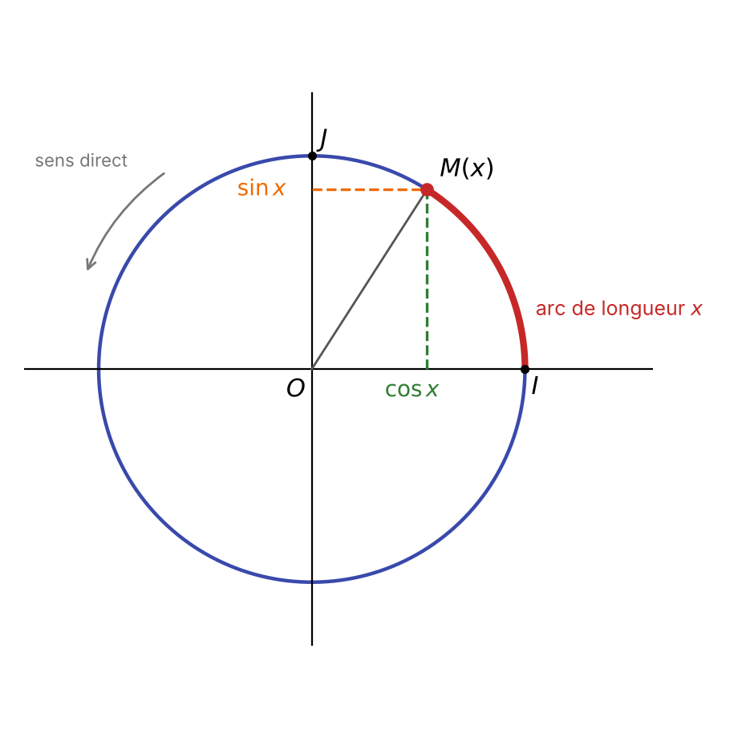
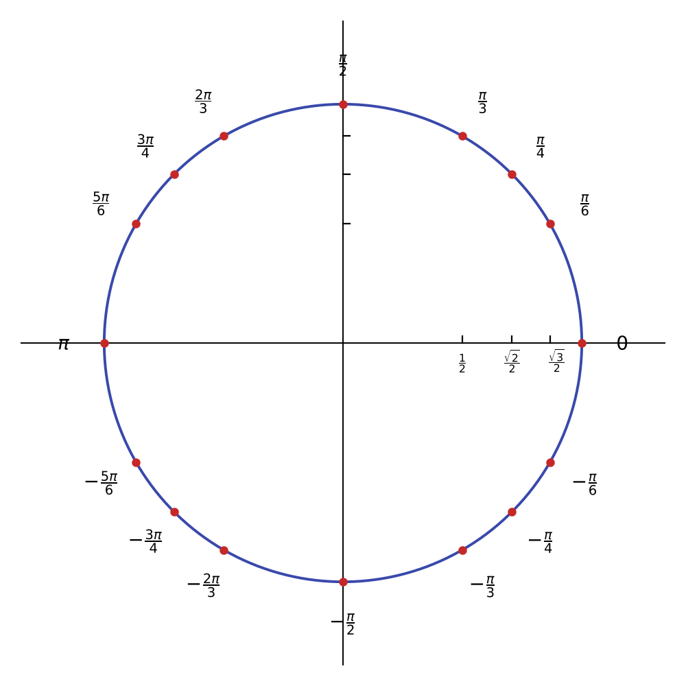
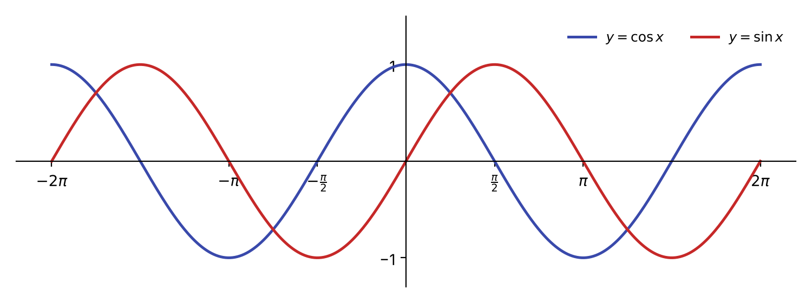

# Cours — Trigonométrie

[📄 Cours en PDF (version classique)](pdf/cours.pdf){ .md-button }
[📄 Cours complet avec toutes les démonstrations (PDF)](pdf/cours-complet.pdf){ .md-button }

!!! lecture "Comment lire les démonstrations"
    Chaque résultat est démontré dès que c'est possible avec les outils de Première.

    Sur le site, clique sur un bloc pour l'ouvrir.

    - **Démonstration — au programme** : à savoir refaire, elle peut être demandée en évaluation.
    - **Démonstration — pour aller plus loin** : à comprendre, inutile de l'apprendre par cœur.
    - **Pourquoi ce résultat est admis** : la preuve demande une notion vue plus tard, qui est indiquée.

Dans tout le chapitre, le plan est muni d'un repère orthonormé $(O\,;\,I,\,J)$.

---

## 1. Le cercle trigonométrique et le radian

!!! definition "Cercle trigonométrique"
    Le **cercle trigonométrique** est le cercle de centre $O$ et de rayon $1$, orienté dans le **sens direct** (sens inverse des aiguilles d'une montre).

!!! definition "Enroulement de la droite réelle"
    On « enroule » la droite des réels sur le cercle, en plaçant $0$ en $I$ : à chaque réel $x$ correspond un unique point $M(x)$ du cercle, tel que l'arc $\overset{\frown}{IM}$, parcouru dans le sens direct si $x > 0$ (indirect si $x < 0$), ait pour longueur $|x|$.

??? admis "Pourquoi l'enroulement est admis"
    Cette construction repose sur la **longueur d'un arc de cercle**, que l'on admet depuis le collège (le périmètre du cercle de rayon $1$ vaut $2\pi$). Une définition rigoureuse de la longueur d'une courbe utilise les **intégrales** (première année post-bac). On peut aussi faire le chemin inverse : définir $\cos$ et $\sin$ par des séries, puis en déduire $\pi$ et la longueur des arcs.

Comme le cercle a pour périmètre $2\pi$, **les réels $x$ et $x + 2k\pi$ ($k \in \mathbb{Z}$) correspondent au même point** du cercle : on fait $k$ tours de plus.

!!! definition "Radian"
    Le **radian** est l'unité de mesure d'angle telle que l'angle $\widehat{IOM(x)}$ mesure $x$ radians lorsque $0 \leq x \leq \pi$. Un tour complet mesure $2\pi$ radians, soit $360°$ :
    $$180° = \pi \text{ rad}, \qquad \text{donc} \qquad \alpha \text{ en degrés} = \frac{180}{\pi} \times x \text{ en radians}.$$

| Degrés | $0$ | $30$ | $45$ | $60$ | $90$ | $120$ | $135$ | $150$ | $180$ | $360$ |
|---|---|---|---|---|---|---|---|---|---|---|
| Radians | $0$ | $\frac{\pi}{6}$ | $\frac{\pi}{4}$ | $\frac{\pi}{3}$ | $\frac{\pi}{2}$ | $\frac{2\pi}{3}$ | $\frac{3\pi}{4}$ | $\frac{5\pi}{6}$ | $\pi$ | $2\pi$ |

!!! definition "Mesure principale"
    Parmi tous les réels associés à un même point $M$ du cercle, un seul appartient à l'intervalle $]-\pi\,;\,\pi]$ : c'est la **mesure principale**.

**Exemple.** $\frac{17\pi}{6} = \frac{5\pi}{6} + 2\pi$ : la mesure principale est $\frac{5\pi}{6}$. De même, $-\frac{7\pi}{3} = -\frac{\pi}{3} - 2\pi$ a pour mesure principale $-\frac{\pi}{3}$.

---

## 2. Cosinus et sinus d'un réel

!!! definition "Cosinus et sinus"
    Pour tout réel $x$, le **cosinus** et le **sinus** de $x$ sont l'abscisse et l'ordonnée du point $M(x)$ :
    $$M(x) = \big(\cos x\,;\,\sin x\big).$$

{ width="45%" }

!!! propriete "Premières propriétés"
    Pour tout réel $x$ et tout entier relatif $k$ :

    - $-1 \leq \cos x \leq 1$ et $-1 \leq \sin x \leq 1$ ;
    - $\cos^2 x + \sin^2 x = 1$ (où $\cos^2 x$ désigne $(\cos x)^2$) ;
    - $\cos(x + 2k\pi) = \cos x$ et $\sin(x + 2k\pi) = \sin x$.

??? demoplus "Démonstration — pour aller plus loin"
    Le point $M(x)$ est sur le cercle de centre $O$ et de rayon $1$, donc $OM^2 = 1$. Dans un repère orthonormé, $OM^2 = \cos^2 x + \sin^2 x$. Chaque carré étant positif, $\cos^2 x \leq 1$ et $\sin^2 x \leq 1$, d'où les encadrements. Enfin, $x$ et $x + 2k\pi$ correspondent au même point.

!!! propriete "Lien avec le triangle rectangle"
    Si $0 < x < \frac{\pi}{2}$, on retrouve les définitions du collège : dans le triangle $OHM$ rectangle en $H$ (où $H$ est le projeté de $M$ sur l'axe des abscisses), $\cos x = \dfrac{OH}{OM}$ et $\sin x = \dfrac{HM}{OM}$, avec $OM = 1$.

**Signe.** Selon le quart de cercle (le « quadrant ») où se trouve $M(x)$ : $\cos x > 0$ à droite de l'axe des ordonnées, $\sin x > 0$ au-dessus de l'axe des abscisses.

---

## 3. Valeurs remarquables

!!! theoreme "Valeurs remarquables"
    | $x$ | $0$ | $\frac{\pi}{6}$ | $\frac{\pi}{4}$ | $\frac{\pi}{3}$ | $\frac{\pi}{2}$ | $\pi$ |
    |---|---|---|---|---|---|---|
    | $\cos x$ | $1$ | $\frac{\sqrt{3}}{2}$ | $\frac{\sqrt{2}}{2}$ | $\frac{1}{2}$ | $0$ | $-1$ |
    | $\sin x$ | $0$ | $\frac{1}{2}$ | $\frac{\sqrt{2}}{2}$ | $\frac{\sqrt{3}}{2}$ | $1$ | $0$ |

??? demo "Démonstration pour $\frac{\pi}{4}$ et $\frac{\pi}{3}$ — au programme"
    **Cas $\frac{\pi}{4}$.** Le point $M\left(\frac{\pi}{4}\right)$ est sur la bissectrice du premier quadrant (l'angle $\widehat{IOM}$ mesure $45°$, la moitié de l'angle droit $\widehat{IOJ}$). Cette bissectrice est la droite d'équation $y = x$, donc $\cos\frac{\pi}{4} = \sin\frac{\pi}{4}$. Avec $\cos^2 + \sin^2 = 1$ : $2\cos^2\frac{\pi}{4} = 1$, soit $\cos^2\frac{\pi}{4} = \frac{1}{2}$. Comme $\cos\frac{\pi}{4} > 0$ :
    $$\cos\frac{\pi}{4} = \sin\frac{\pi}{4} = \frac{1}{\sqrt{2}} = \frac{\sqrt{2}}{2}.$$

    **Cas $\frac{\pi}{3}$.** Soit $M = M\left(\frac{\pi}{3}\right)$. Le triangle $OIM$ est isocèle en $O$ ($OI = OM = 1$) et son angle en $O$ mesure $60°$. Ses deux autres angles sont égaux et leur somme vaut $120°$ : ils mesurent $60°$ chacun. Le triangle $OIM$ est donc **équilatéral**.

    Le projeté $H$ de $M$ sur $(OI)$ est le pied de la hauteur issue de $M$, qui est aussi la médiane : $H$ est le milieu de $[OI]$. Donc $\cos\frac{\pi}{3} = OH = \frac{1}{2}$. Puis $\sin^2\frac{\pi}{3} = 1 - \frac{1}{4} = \frac{3}{4}$, et comme $\sin\frac{\pi}{3} > 0$ :
    $$\cos\frac{\pi}{3} = \frac{1}{2}, \qquad \sin\frac{\pi}{3} = \frac{\sqrt{3}}{2}.$$

??? demoplus "Démonstration pour $\frac{\pi}{6}$ — pour aller plus loin"
    Les points $M\left(\frac{\pi}{6}\right)$ et $M\left(\frac{\pi}{3}\right)$ sont symétriques par rapport à la bissectrice $y = x$ (les angles $\frac{\pi}{6}$ et $\frac{\pi}{3}$ sont à égale distance de $\frac{\pi}{4}$). Cette symétrie échange abscisse et ordonnée : $\cos\frac{\pi}{6} = \sin\frac{\pi}{3} = \frac{\sqrt{3}}{2}$ et $\sin\frac{\pi}{6} = \cos\frac{\pi}{3} = \frac{1}{2}$.

{ width="55%" }

!!! tip "Retenir les valeurs"
    Dans le premier quadrant, les sinus de $0$, $\frac{\pi}{6}$, $\frac{\pi}{4}$, $\frac{\pi}{3}$, $\frac{\pi}{2}$ valent $\frac{\sqrt{0}}{2}$, $\frac{\sqrt{1}}{2}$, $\frac{\sqrt{2}}{2}$, $\frac{\sqrt{3}}{2}$, $\frac{\sqrt{4}}{2}$ ; les cosinus sont les mêmes dans l'ordre inverse. Le dessin du cercle permet de tout retrouver.

---

## 4. Angles associés

En utilisant les symétries du cercle, on exprime le cosinus et le sinus de $-x$, $\pi - x$, $\pi + x$ et $\frac{\pi}{2} - x$ en fonction de $\cos x$ et $\sin x$.

!!! propriete "Angles associés"
    Pour tout réel $x$ :

    | | $-x$ | $\pi - x$ | $\pi + x$ | $\frac{\pi}{2} - x$ |
    |---|---|---|---|---|
    | $\cos$ | $\cos x$ | $-\cos x$ | $-\cos x$ | $\sin x$ |
    | $\sin$ | $-\sin x$ | $\sin x$ | $-\sin x$ | $\cos x$ |
    | Symétrie | axe des abscisses | axe des ordonnées | centre $O$ | droite $y = x$ |

??? demoplus "Démonstration — pour aller plus loin"
    - $M(-x)$ s'obtient en parcourant le même arc dans l'autre sens : c'est le symétrique de $M(x)$ par rapport à l'axe des abscisses, de coordonnées $(\cos x\,;\,-\sin x)$.
    - $M(\pi + x)$ s'obtient en faisant un demi-tour de plus : c'est le symétrique de $M(x)$ par rapport à $O$, de coordonnées $(-\cos x\,;\,-\sin x)$.
    - $\pi - x = \pi + (-x)$ : on applique les deux résultats précédents, ce qui donne $(-\cos x\,;\,\sin x)$.
    - $M\left(\frac{\pi}{2} - x\right)$ est le symétrique de $M(x)$ par rapport à la droite $y = x$ (les deux arcs ont la même longueur, l'un mesuré depuis $I$, l'autre depuis $J$) : abscisse et ordonnée sont échangées.

**Exemples.** $\cos\frac{2\pi}{3} = \cos\left(\pi - \frac{\pi}{3}\right) = -\frac{1}{2}$ ; $\sin\frac{7\pi}{6} = \sin\left(\pi + \frac{\pi}{6}\right) = -\frac{1}{2}$ ; $\cos\left(-\frac{\pi}{4}\right) = \frac{\sqrt{2}}{2}$.

---

## 5. Les fonctions cosinus et sinus

!!! definition "Fonctions cosinus et sinus"
    Les fonctions **cosinus** et **sinus** sont définies sur $\mathbb{R}$ par $x \mapsto \cos x$ et $x \mapsto \sin x$.

!!! propriete "Parité et périodicité"
    - La fonction cosinus est **paire** : $\cos(-x) = \cos x$. Sa courbe est symétrique par rapport à l'axe des ordonnées.
    - La fonction sinus est **impaire** : $\sin(-x) = -\sin x$. Sa courbe est symétrique par rapport à l'origine.
    - Les deux fonctions sont **périodiques de période $2\pi$** : $\cos(x + 2\pi) = \cos x$ et $\sin(x + 2\pi) = \sin x$. Leurs courbes se reproduisent identiques sur chaque intervalle de longueur $2\pi$.

??? demoplus "Démonstration — pour aller plus loin"
    Ce sont les propriétés des angles associés (pour $-x$) et le fait que $x$ et $x + 2\pi$ correspondent au même point du cercle.

{ width="85%" }

**Lecture du cercle.** Quand $x$ va de $0$ à $\pi$, le point $M(x)$ parcourt le demi-cercle supérieur de $I$ vers le point $(-1\,;\,0)$ : son abscisse $\cos x$ **décroît** de $1$ à $-1$. Son ordonnée $\sin x$ croît de $0$ à $1$ (jusqu'en $\frac{\pi}{2}$), puis décroît jusqu'à $0$. *Les variations seront démontrées en Terminale, grâce aux dérivées $\cos' = -\sin$ et $\sin' = \cos$.*

**Remarque.** La courbe du sinus s'obtient en décalant celle du cosinus de $\frac{\pi}{2}$ vers la droite, car $\sin x = \cos\left(\frac{\pi}{2} - x\right) = \cos\left(x - \frac{\pi}{2}\right)$ (le cosinus est pair).

---

## 6. Équations trigonométriques

!!! propriete "Équations $\cos x = \cos a$ et $\sin x = \sin a$"
    Pour tout réel $a$ :

    - $\cos x = \cos a \iff x = a + 2k\pi$ ou $x = -a + 2k\pi$, avec $k \in \mathbb{Z}$ ;
    - $\sin x = \sin a \iff x = a + 2k\pi$ ou $x = \pi - a + 2k\pi$, avec $k \in \mathbb{Z}$.

??? demoplus "Démonstration — pour aller plus loin"
    Les points du cercle d'abscisse $\cos a$ sont $M(a)$ et son symétrique par rapport à l'axe des abscisses, $M(-a)$ (ils sont confondus si $\cos a = \pm 1$). Les réels associés à ces points sont $a + 2k\pi$ et $-a + 2k\pi$. Pour le sinus, les points d'ordonnée $\sin a$ sont $M(a)$ et son symétrique par rapport à l'axe des ordonnées, $M(\pi - a)$.

**Exemple.** Résoudre $\cos x = \frac{1}{2}$ dans $]-\pi\,;\,\pi]$. Comme $\frac{1}{2} = \cos\frac{\pi}{3}$, les solutions dans $\mathbb{R}$ sont $\frac{\pi}{3} + 2k\pi$ et $-\frac{\pi}{3} + 2k\pi$. Dans $]-\pi\,;\,\pi]$ : $S = \left\{-\frac{\pi}{3}\,;\,\frac{\pi}{3}\right\}$.

!!! tip "Toujours faire un dessin"
    Pour résoudre $\cos x = c$, on trace la droite verticale $x = c$ et l'on repère ses intersections avec le cercle ; pour $\sin x = s$, la droite horizontale $y = s$. Pour une inéquation comme $\cos x \geq \frac{1}{2}$, on repère l'arc du cercle situé à droite de la droite $x = \frac{1}{2}$.

---

## 7. Pour aller plus loin

- **Formules d'addition.** $\cos(a + b) = \cos a\cos b - \sin a\sin b$ et $\sin(a + b) = \sin a\cos b + \cos a\sin b$. Elles se démontrent avec le produit scalaire ([chapitre 6 de Terminale](../../terminale/trigonometrie/index.md)).
- **Dérivées.** $\cos' = -\sin$ et $\sin' = \cos$ (Terminale) : cosinus et sinus sont solutions de l'équation $y'' = -y$, celle des oscillations (ressort, pendule, circuit électrique).
- **Séries de Fourier.** Tout signal périodique (un son, une onde) se décompose en une somme de sinus et de cosinus : c'est la base du traitement du signal (L2 et écoles d'ingénieurs).
- **Le calcul de $\pi$** par la méthode d'Archimède, avec des polygones réguliers inscrits dans le cercle (exercice 28).

!!! success "Tu as fini le cours"
    Passe aux [méthodes](methodes.md), puis entraîne-toi avec les exercices corrigés.
