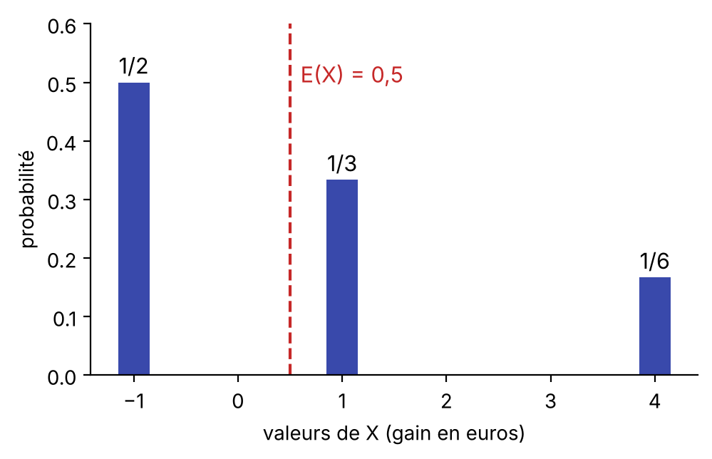

# Cours — Variables aléatoires réelles

[📄 Cours en PDF (version classique)](pdf/cours.pdf){ .md-button }
[📄 Cours complet avec toutes les démonstrations (PDF)](pdf/cours-complet.pdf){ .md-button }

!!! lecture "Comment lire les démonstrations"
    Chaque résultat est démontré dès que c'est possible avec les outils de Première.

    Sur le site, clique sur un bloc pour l'ouvrir.

    - **Démonstration — au programme** : à savoir refaire, elle peut être demandée en évaluation.
    - **Démonstration — pour aller plus loin** : à comprendre, inutile de l'apprendre par cœur.
    - **Pourquoi ce résultat est admis** : la preuve demande une notion vue plus tard, qui est indiquée.

Dans tout le chapitre, $\Omega$ est l'univers **fini** d'une expérience aléatoire, muni d'une probabilité $P$.

**Exemple fil rouge.** On lance un dé équilibré. Si l'on obtient $1$, $2$ ou $3$, on perd $1$ € ; avec $4$ ou $5$, on gagne $1$ € ; avec $6$, on gagne $4$ €.

---

## 1. Variable aléatoire et loi de probabilité

!!! definition "Variable aléatoire"
    Une **variable aléatoire réelle** $X$ est une fonction qui associe un **nombre réel** à chaque issue de $\Omega$.

Dans l'exemple, $X$ est le gain : $X(1) = X(2) = X(3) = -1$, $X(4) = X(5) = 1$ et $X(6) = 4$.

!!! definition "Notations"
    Pour un réel $a$, on note $\{X = a\}$ l'événement formé des issues $\omega$ telles que $X(\omega) = a$. De même pour $\{X \leq a\}$, $\{X > a\}$, etc. On écrit simplement $P(X = a)$ au lieu de $P(\{X = a\})$.

!!! definition "Loi de probabilité"
    Si $X$ prend les valeurs $x_1, x_2, \ldots, x_n$, la **loi de probabilité** de $X$ est la donnée des probabilités $p_i = P(X = x_i)$, souvent présentée dans un tableau. On a toujours $p_1 + p_2 + \cdots + p_n = 1$.

| $x_i$ | $-1$ | $1$ | $4$ |
|---|---|---|---|
| $P(X = x_i)$ | $\frac{1}{2}$ | $\frac{1}{3}$ | $\frac{1}{6}$ |

{ width="55%" }

**Exemple.** $P(X \geq 1) = \frac{1}{3} + \frac{1}{6} = \frac{1}{2}$ : on gagne de l'argent une fois sur deux.

---

## 2. Espérance

!!! definition "Espérance"
    L'**espérance** de $X$ est le réel
    $$E(X) = p_1x_1 + p_2x_2 + \cdots + p_nx_n = \sum_{i=1}^{n} p_ix_i.$$

**Exemple.** $E(X) = \frac{1}{2} \times (-1) + \frac{1}{3} \times 1 + \frac{1}{6} \times 4 = -\frac{3}{6} + \frac{2}{6} + \frac{4}{6} = \frac{1}{2}$.

!!! info "Interprétation"
    L'espérance est la **moyenne** des valeurs de $X$ pondérée par leurs probabilités. Si l'on répète l'expérience un grand nombre de fois, la **moyenne des valeurs obtenues** est proche de $E(X)$ (on l'observe par simulation ; c'est la loi des grands nombres, démontrée en Terminale).

    Ici, en jouant un très grand nombre de fois, on gagne en moyenne environ $0{,}50$ € par partie. Un jeu est dit **équitable** si l'espérance du gain est nulle ; il est **favorable au joueur** si elle est positive.

??? admis "Pourquoi le lien avec la moyenne est admis"
    Le fait que la moyenne de $N$ résultats indépendants « se rapproche » de $E(X)$ quand $N$ devient grand demande de donner un sens précis à ce rapprochement : c'est la **loi des grands nombres**, démontrée en Terminale avec l'inégalité de Bienaymé-Tchebychev ([chapitre de Terminale](../../terminale/loi-grands-nombres/index.md)). En Première, on se contente de l'observer par simulation.

---

## 3. Variance et écart-type

!!! definition "Variance, écart-type"
    La **variance** de $X$ est le réel positif
    $$V(X) = \sum_{i=1}^{n} p_i\big(x_i - E(X)\big)^2.$$
    L'**écart-type** de $X$ est $\sigma(X) = \sqrt{V(X)}$.

!!! info "Interprétation"
    La variance est la moyenne des carrés des écarts à l'espérance. L'écart-type mesure la **dispersion** des valeurs de $X$ autour de $E(X)$, dans la **même unité** que $X$. Pour un jeu, c'est une mesure du **risque**.

!!! theoreme "Formule de König-Huygens"
    $$V(X) = E\left(X^2\right) - E(X)^2, \qquad \text{où } E\left(X^2\right) = \sum_{i=1}^{n} p_ix_i^2.$$

??? demoplus "Démonstration — pour aller plus loin"
    Notons $\mu = E(X)$. En développant $(x_i - \mu)^2 = x_i^2 - 2\mu x_i + \mu^2$ :
    $$V(X) = \sum p_ix_i^2 - 2\mu\sum p_ix_i + \mu^2\sum p_i = E\left(X^2\right) - 2\mu \times \mu + \mu^2 \times 1 = E\left(X^2\right) - \mu^2.$$

**Exemple.** $E\left(X^2\right) = \frac{1}{2} \times 1 + \frac{1}{3} \times 1 + \frac{1}{6} \times 16 = \frac{3 + 2 + 16}{6} = \frac{21}{6} = \frac{7}{2}$, donc
$$V(X) = \frac{7}{2} - \frac{1}{4} = \frac{13}{4} \qquad \text{et} \qquad \sigma(X) = \frac{\sqrt{13}}{2} \approx 1{,}80 \text{ €}.$$

---

## 4. Transformation affine

On considère la variable aléatoire $Y = aX + b$, qui prend les valeurs $ax_i + b$ avec les mêmes probabilités $p_i$.

!!! theoreme "Linéarité de l'espérance, variance de $aX + b$"
    Pour tous réels $a$ et $b$ :
    $$E(aX + b) = aE(X) + b, \qquad V(aX + b) = a^2V(X), \qquad \sigma(aX + b) = |a|\,\sigma(X).$$

??? demoplus "Démonstration — pour aller plus loin"
    $E(aX + b) = \sum p_i(ax_i + b) = a\sum p_ix_i + b\sum p_i = aE(X) + b$.

    Les écarts à l'espérance de $Y$ valent $(ax_i + b) - (aE(X) + b) = a\big(x_i - E(X)\big)$, donc
    $$V(Y) = \sum p_i a^2\big(x_i - E(X)\big)^2 = a^2V(X).$$
    Enfin $\sigma(Y) = \sqrt{a^2V(X)} = |a|\sqrt{V(X)}$.

!!! tip "Lecture"
    Ajouter une constante $b$ décale toutes les valeurs : l'espérance est décalée, la dispersion ne change pas. Multiplier par $a$ multiplie l'écart-type par $|a|$ (changement d'unité, par exemple).

**Exemple.** Les gains sont convertis en points de fidélité : $Y = 10X + 5$. Alors $E(Y) = 10 \times \frac{1}{2} + 5 = 10$ et $\sigma(Y) = 10 \times \frac{\sqrt{13}}{2} = 5\sqrt{13}$.

---

## 5. Variable de Bernoulli et nombre de succès

!!! definition "Variable de Bernoulli"
    Une **variable de Bernoulli** de paramètre $p$ prend la valeur $1$ (succès) avec la probabilité $p$ et la valeur $0$ (échec) avec la probabilité $1 - p$.

!!! propriete "Espérance et variance"
    Si $X$ suit une loi de Bernoulli de paramètre $p$ : $E(X) = p$ et $V(X) = p(1 - p)$.

??? demoplus "Démonstration — pour aller plus loin"
    $E(X) = p \times 1 + (1 - p) \times 0 = p$. $E\left(X^2\right) = p \times 1^2 + (1 - p) \times 0^2 = p$, donc $V(X) = p - p^2 = p(1 - p)$.

**Nombre de succès.** On répète $n$ fois ($n \leq 4$) une épreuve de Bernoulli de paramètre $p$, de façon indépendante, et on note $S$ le nombre de succès. On obtient la loi de $S$ avec l'arbre ([chapitre 9](../probabilites-conditionnelles/cours.md)). Par exemple, pour $n = 2$ :

| $k$ | $0$ | $1$ | $2$ |
|---|---|---|---|
| $P(S = k)$ | $(1 - p)^2$ | $2p(1 - p)$ | $p^2$ |

Alors $E(S) = 2p(1 - p) + 2p^2 = 2p$. On retrouve l'intuition : en moyenne, on obtient $np$ succès (résultat général démontré en Terminale).

---

## 6. Simulation

On peut **simuler** une variable aléatoire en Python, puis calculer la **moyenne** d'un grand échantillon de valeurs, stockées dans une **liste**.

```python
from random import randint

def gain():
    de = randint(1, 6)
    if de <= 3:
        return -1
    elif de <= 5:
        return 1
    else:
        return 4

def echantillon(N):
    return [gain() for i in range(N)]

valeurs = echantillon(100000)
print(sum(valeurs) / len(valeurs))   # proche de 0.5 = E(X)
```

!!! info "Moyenne et espérance"
    La moyenne de l'échantillon varie d'une simulation à l'autre, mais pour $N$ grand elle est **proche de l'espérance**. De même, l'écart-type de l'échantillon est proche de $\sigma(X)$.

---

## 7. Pour aller plus loin

- **Loi binomiale** (Terminale) : la loi du nombre de succès pour $n$ quelconque, avec $E(S) = np$ et $V(S) = np(1 - p)$ ([chapitre de Terminale](../../terminale/loi-binomiale/index.md)).
- **Somme de variables aléatoires** (Terminale) : $E(X + Y) = E(X) + E(Y)$ en toute généralité ([chapitre de Terminale](../../terminale/sommes-variables/index.md)).
- **Assurance et finance.** Une prime d'assurance est calculée à partir de l'espérance des remboursements ; l'écart-type mesure le risque d'un placement.

!!! success "Tu as fini le cours"
    Passe aux [méthodes](methodes.md), puis entraîne-toi avec les exercices corrigés.
