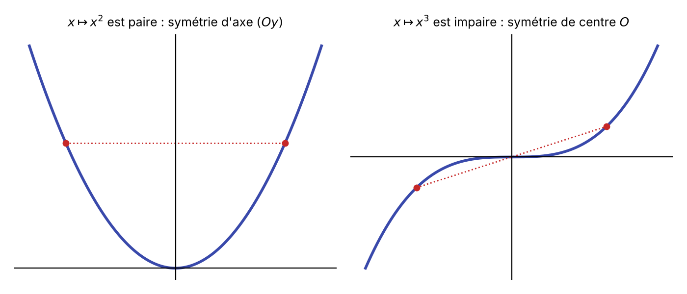
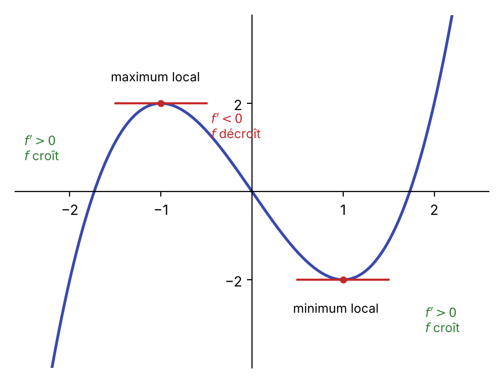

# Cours — Variations et courbes représentatives

[📄 Cours en PDF (version classique)](pdf/cours.pdf){ .md-button }
[📄 Cours complet avec toutes les démonstrations (PDF)](pdf/cours-complet.pdf){ .md-button }

!!! lecture "Comment lire les démonstrations"
    Chaque résultat est démontré dès que c'est possible avec les outils de Première.

    Sur le site, clique sur un bloc pour l'ouvrir.

    - **Démonstration — pour aller plus loin** : à comprendre, inutile de l'apprendre par cœur. Indispensable si tu vises des études de maths.
    - **Pourquoi ce résultat est admis** : la preuve demande une notion vue plus tard, qui est indiquée.

---

## 1. Fonctions paires et impaires

!!! definition "Parité"
    Soit $f$ une fonction définie sur un ensemble $D$ **symétrique par rapport à $0$** (si $x \in D$, alors $-x \in D$).

    - $f$ est **paire** si $f(-x) = f(x)$ pour tout $x \in D$.
    - $f$ est **impaire** si $f(-x) = -f(x)$ pour tout $x \in D$.

!!! propriete "Interprétation graphique"
    Dans un repère orthogonal :

    - la courbe d'une fonction **paire** est **symétrique par rapport à l'axe des ordonnées** ;
    - la courbe d'une fonction **impaire** est **symétrique par rapport à l'origine** $O$.

{ width="70%" }

??? demoplus "Démonstration — pour aller plus loin"
    Le symétrique du point $M(x\,;\,y)$ par rapport à l'axe des ordonnées est $M'(-x\,;\,y)$, et son symétrique par rapport à $O$ est $M''(-x\,;\,-y)$.

    Si $f$ est paire et $M(x\,;\,f(x))$ est sur la courbe, alors $M'(-x\,;\,f(x)) = (-x\,;\,f(-x))$ est aussi sur la courbe. Si $f$ est impaire, $M''(-x\,;\,-f(x)) = (-x\,;\,f(-x))$ est sur la courbe.

**Exemples.** $x \mapsto x^2$, $x \mapsto x^4$, $x \mapsto |x|$ sont paires ; $x \mapsto x$, $x \mapsto x^3$, $x \mapsto \frac{1}{x}$ sont impaires. La fonction $x \mapsto x^2 + x$ n'est ni paire ni impaire : $f(1) = 2$ et $f(-1) = 0$.

!!! tip "Pourquoi c'est utile"
    Pour étudier une fonction paire ou impaire, il suffit de l'étudier sur $D \cap [0\,;\,+\infty[$, puis de compléter par symétrie. De plus, une fonction impaire définie en $0$ vérifie $f(0) = -f(0)$, donc $f(0) = 0$.

!!! warning "Montrer qu'une fonction n'est pas paire"
    Il suffit d'un **contre-exemple** : une valeur $x$ telle que $f(-x) \neq f(x)$. Pour montrer qu'elle est paire, en revanche, il faut un calcul valable **pour tout $x$**.

---

## 2. Dérivée et sens de variation

### 2.1 Le théorème fondamental

!!! theoreme "Signe de la dérivée et sens de variation"
    Soit $f$ une fonction dérivable sur un **intervalle** $I$.

    - Si $f'(x) \geq 0$ pour tout $x \in I$, alors $f$ est **croissante** sur $I$.
    - Si $f'(x) \leq 0$ pour tout $x \in I$, alors $f$ est **décroissante** sur $I$.
    - Si $f'(x) = 0$ pour tout $x \in I$, alors $f$ est **constante** sur $I$.

    Si $f'(x) > 0$ sur $I$, sauf éventuellement en un nombre fini de points où $f'$ s'annule, $f$ est **strictement croissante** sur $I$ (et de même pour « strictement décroissante »).

??? admis "Pourquoi ce théorème est admis"
    Ce résultat paraît évident sur un dessin, mais il ne l'est pas : la dérivée ne renseigne que sur le comportement de $f$ **très près** de chaque point, et il faut passer de cette information locale à une comparaison entre deux points $a < b$ éloignés.

    Le lien est fait par le **théorème des accroissements finis** : il existe un réel $c$ entre $a$ et $b$ tel que $f(b) - f(a) = f'(c)\,(b - a)$. Si $f' \geq 0$, on en déduit $f(b) \geq f(a)$. Ce théorème se démontre en première année post-bac (L1, MPSI) : il repose sur le fait qu'une fonction continue sur un intervalle fermé borné atteint son maximum, conséquence de la construction des nombres réels.

!!! warning "Sur un intervalle seulement"
    La fonction inverse a une dérivée strictement négative sur $]-\infty\,;\,0[ \cup\, ]0\,;\,+\infty[$, mais elle n'est **pas** décroissante sur cette réunion : $-1 < 1$ et $\frac{1}{-1} < \frac{1}{1}$. Elle est décroissante sur chacun des deux intervalles séparément.

!!! propriete "Réciproque"
    Si $f$ est dérivable et croissante sur un intervalle $I$, alors $f'(x) \geq 0$ pour tout $x \in I$.

??? demoplus "Démonstration — pour aller plus loin"
    Soit $a \in I$. Si $f$ est croissante, pour $h > 0$ on a $f(a + h) \geq f(a)$, et pour $h < 0$ on a $f(a + h) \leq f(a)$. Dans les deux cas, le taux $\frac{f(a + h) - f(a)}{h}$ est **positif ou nul**. Sa limite $f'(a)$ ne peut donc pas être strictement négative : si elle l'était, le taux serait strictement négatif pour $h$ assez proche de $0$.

!!! warning "Croissante ne veut pas dire $f' > 0$"
    La fonction cube est strictement croissante sur $\mathbb{R}$, et pourtant sa dérivée $3x^2$ s'annule en $0$. C'est pourquoi le théorème autorise un nombre fini de points où $f'$ s'annule.

### 2.2 Le tableau de variations

**Exemple.** Étudions $f(x) = x^3 - 3x$ sur $\mathbb{R}$. On a $f'(x) = 3x^2 - 3 = 3(x - 1)(x + 1)$, trinôme positif à l'extérieur des racines $-1$ et $1$.

| $x$ | $-\infty$ | | $-1$ | | $1$ | | $+\infty$ |
|---|---|---|---|---|---|---|---|
| $f'(x)$ | | $+$ | $0$ | $-$ | $0$ | $+$ | |
| $f$ | | $\nearrow$ | $2$ | $\searrow$ | $-2$ | $\nearrow$ | |

{ width="50%" }

---

## 3. Extremums

!!! definition "Extremum"
    Soit $f$ définie sur un intervalle $I$ et $a \in I$.

    - $f(a)$ est le **maximum** de $f$ sur $I$ si $f(x) \leq f(a)$ pour tout $x \in I$ ; c'est le **minimum** si $f(x) \geq f(a)$ pour tout $x \in I$.
    - $f(a)$ est un **maximum local** (ou minimum local) s'il est le maximum (ou le minimum) de $f$ sur un intervalle ouvert contenant $a$.

    Un **extremum** est un maximum ou un minimum.

Dans l'exemple de $x^3 - 3x$, $2$ est un maximum local (atteint en $-1$) mais pas le maximum sur $\mathbb{R}$, puisque $f(3) = 18$.

!!! theoreme "Extremum et dérivée"
    Soit $f$ dérivable sur un intervalle **ouvert** $I$ et $a \in I$.

    1. Si $f$ admet un extremum local en $a$, alors $f'(a) = 0$ : la tangente est horizontale.
    2. Si $f'$ **s'annule en changeant de signe** en $a$, alors $f$ admet un extremum local en $a$.

??? demoplus "Démonstration — pour aller plus loin"
    **1.** Supposons que $f(a)$ soit un maximum local. Pour $h$ assez proche de $0$, $f(a + h) \leq f(a)$. Pour $h > 0$, le taux $\frac{f(a + h) - f(a)}{h}$ est négatif ou nul, donc sa limite $f'(a)$ est négative ou nulle. Pour $h < 0$, le taux est positif ou nul, donc $f'(a) \geq 0$. Finalement $f'(a) = 0$. Le cas d'un minimum est symétrique.

    **2.** Si $f' \geq 0$ juste avant $a$ et $f' \leq 0$ juste après, le théorème du § 2 montre que $f$ croît puis décroît autour de $a$ : $f(a)$ est un maximum local. L'autre cas est symétrique.

!!! warning "La réciproque du point 1 est fausse"
    $f(x) = x^3$ vérifie $f'(0) = 0$, mais $0$ n'est pas un extremum : $f$ est croissante sur $\mathbb{R}$. La dérivée s'annule **sans changer de signe**. De même, le point 1 ne s'applique pas aux bornes d'un intervalle fermé : sur $[0\,;\,1]$, la fonction $x \mapsto x$ a un maximum en $1$, où sa dérivée vaut $1$.

---

## 4. Position relative de courbes et inégalités

!!! propriete "Position relative"
    Pour comparer les courbes de $f$ et $g$ sur un intervalle, on étudie le **signe de $f(x) - g(x)$** : là où il est positif, la courbe de $f$ est au-dessus de celle de $g$.

!!! tip "Démontrer une inégalité avec une fonction"
    Pour démontrer que $f(x) \geq g(x)$ sur $I$, on étudie $h = f - g$ : on calcule $h'$, on dresse le tableau de variations, et l'on montre que le **minimum** de $h$ sur $I$ est positif ou nul.

**Exemple.** Montrons que $\sqrt{x} \leq \dfrac{1 + x}{2}$ pour tout $x \geq 0$. On pose $h(x) = \dfrac{1 + x}{2} - \sqrt{x}$. Pour $x > 0$, $h'(x) = \dfrac{1}{2} - \dfrac{1}{2\sqrt{x}} = \dfrac{\sqrt{x} - 1}{2\sqrt{x}}$, du signe de $\sqrt{x} - 1$ : négatif sur $]0\,;\,1[$, positif sur $]1\,;\,+\infty[$. Donc $h$ est minimale en $1$, et $h(1) = 0$. Ainsi $h(x) \geq 0$ pour tout $x \geq 0$. *Autre preuve : $\frac{1 + x}{2} - \sqrt{x} = \frac{(1 - \sqrt{x})^2}{2} \geq 0$.*

---

## 5. Optimisation

De nombreux problèmes concrets demandent de rendre une quantité **maximale** (un volume, un bénéfice) ou **minimale** (un coût, une distance, une surface).

!!! tip "Démarche"
    1. Choisir une variable $x$ et préciser l'**intervalle** où elle varie.
    2. Exprimer la quantité à optimiser par une fonction $f(x)$.
    3. Étudier les variations de $f$ sur cet intervalle (dérivée, signe, tableau).
    4. Lire l'extremum et **répondre à la question posée**, avec des unités.

**Exemple.** Dans une feuille carrée de $30$ cm de côté, on découpe aux quatre coins des carrés de côté $x$ (avec $0 < x < 15$), puis l'on replie les bords pour former une boîte sans couvercle. Son volume est $V(x) = x(30 - 2x)^2$.

On dérive le produit : $V'(x) = (30 - 2x)^2 + x \times 2(30 - 2x) \times (-2) = (30 - 2x)(30 - 2x - 4x) = (30 - 2x)(30 - 6x)$. Sur $]0\,;\,15[$, $30 - 2x > 0$, donc $V'(x)$ a le signe de $30 - 6x$ : positif avant $5$, négatif après. Le volume est maximal pour $x = 5$ cm, et vaut $V(5) = 5 \times 20^2 = 2\,000$ cm³.

---

## 6. Pour aller plus loin

- **Le théorème des accroissements finis** et le **théorème de Rolle** (si $f(a) = f(b)$, la dérivée s'annule entre $a$ et $b$) sont la clé de toute l'analyse : ils sont démontrés en première année post-bac.
- **Convexité.** En Terminale, le signe de la dérivée **seconde** $f''$ indique si la courbe est au-dessus ou en dessous de ses tangentes ([chapitre 3 de Terminale](../../terminale/derivation-convexite/index.md)).
- **Optimisation à plusieurs variables.** Quand la quantité dépend de plusieurs variables, on annule les dérivées partielles : c'est la base de l'économie mathématique et de l'apprentissage automatique.

!!! success "Tu as fini le cours"
    Passe aux [méthodes](methodes.md), puis entraîne-toi avec les exercices corrigés.
