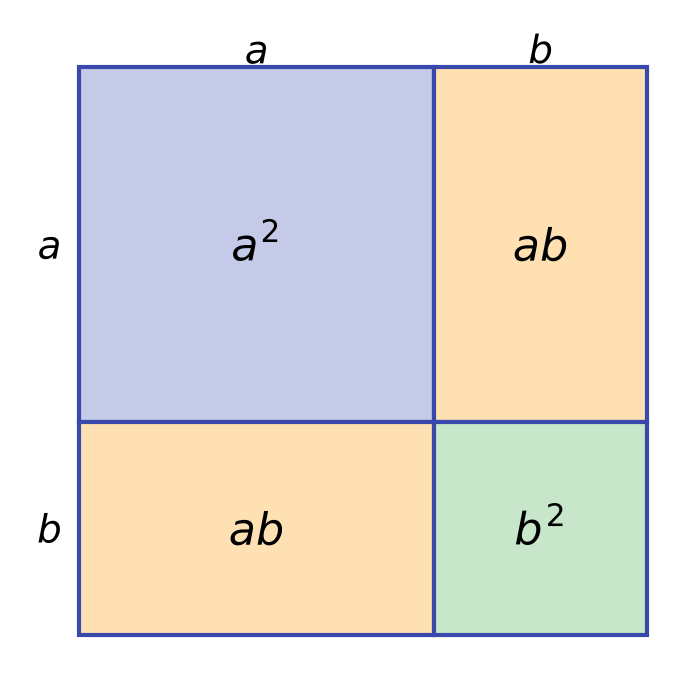

# Cours — Calcul numérique et algébrique

[📄 Cours en PDF (version classique)](pdf/cours.pdf){ .md-button }
[📄 Cours complet avec toutes les démonstrations (PDF)](pdf/cours-complet.pdf){ .md-button }

!!! lecture "Comment lire les démonstrations"
    Chaque résultat est démontré dès que c'est possible avec les outils de Seconde.

    Sur le site, clique sur un bloc pour l'ouvrir.

    - **Démonstration — au programme** : à savoir refaire, elle peut être demandée en évaluation.
    - **Démonstration — pour aller plus loin** : à comprendre, inutile de l'apprendre par cœur.
    - **Pourquoi ce résultat est admis** : la preuve demande une notion vue plus tard, qui est indiquée.

---

## 1. Fractions

!!! propriete "Règles de calcul"
    Pour $b$, $d$ non nuls :
    $$\frac{a}{b} + \frac{c}{b} = \frac{a + c}{b}, \qquad \frac{a}{b} + \frac{c}{d} = \frac{ad + cb}{bd}, \qquad \frac{a}{b} \times \frac{c}{d} = \frac{ac}{bd}, \qquad \frac{a}{b} \div \frac{c}{d} = \frac{a}{b} \times \frac{d}{c} \ (c \neq 0).$$
    On peut multiplier ou diviser le numérateur et le dénominateur par un même nombre non nul : $\frac{ka}{kb} = \frac{a}{b}$.

**Exemple.** $\dfrac{5}{6} - \dfrac{3}{8} = \dfrac{20}{24} - \dfrac{9}{24} = \dfrac{11}{24}$ (on choisit le plus petit dénominateur commun) ; $\dfrac{\frac{2}{3}}{\frac{4}{9}} = \dfrac{2}{3} \times \dfrac{9}{4} = \dfrac{18}{12} = \dfrac{3}{2}$.

---

## 2. Puissances

!!! definition "Puissances entières"
    Pour un réel $a$ et un entier $n \geq 1$ : $a^n = a \times a \times \cdots \times a$ ($n$ facteurs). Pour $a \neq 0$ : $a^0 = 1$ et $a^{-n} = \dfrac{1}{a^n}$.

!!! propriete "Règles de calcul"
    Pour $a$, $b$ non nuls et $m$, $n$ entiers relatifs :
    $$a^m \times a^n = a^{m+n}, \qquad \frac{a^m}{a^n} = a^{m-n}, \qquad (a^m)^n = a^{mn}, \qquad (ab)^n = a^nb^n, \qquad \left(\frac{a}{b}\right)^n = \frac{a^n}{b^n}.$$

??? demoplus "Démonstration — pour aller plus loin"
    Pour $m$ et $n$ positifs, $a^m \times a^n$ est un produit de $m$ facteurs $a$ suivi de $n$ facteurs $a$ : il y en a $m + n$. Les autres règles se justifient de même en comptant les facteurs, puis s'étendent aux exposants négatifs grâce à $a^{-n} = \frac{1}{a^n}$. Par exemple, $a^3 \times a^{-5} = \frac{a \times a \times a}{a \times a \times a \times a \times a} = \frac{1}{a^2} = a^{-2} = a^{3 + (-5)}$.

!!! warning "Erreurs classiques"
    $(-2)^4 = 16$ mais $-2^4 = -16$ (la puissance est prioritaire sur le signe moins). $2^3 + 2^4 \neq 2^7$ : il n'y a **pas** de règle pour la somme.

!!! definition "Notation scientifique"
    Tout nombre décimal non nul s'écrit de façon unique $a \times 10^n$, avec $1 \leq |a| < 10$ et $n$ entier relatif.

**Exemple.** $0{,}000\,58 = 5{,}8 \times 10^{-4}$ ; $\dfrac{6 \times 10^{5} \times 4 \times 10^{-2}}{8 \times 10^{-3}} = \dfrac{24}{8} \times 10^{5 - 2 + 3} = 3 \times 10^{6}$.

---

## 3. Racines carrées

!!! definition "Racine carrée"
    Pour un réel $a \geq 0$, la **racine carrée** de $a$, notée $\sqrt{a}$, est l'unique réel **positif** dont le carré est $a$.

    Ainsi, pour $a \geq 0$ : $\sqrt{a} \geq 0$ et $\left(\sqrt{a}\right)^2 = a$. Pour tout réel $x$ : $\sqrt{x^2} = |x|$.

**Exemple.** $\sqrt{(-3)^2} = \sqrt{9} = 3 = |-3|$ (et non $-3$).

!!! theoreme "Racine d'un produit"
    Pour tous réels $a \geq 0$ et $b \geq 0$ :
    $$\sqrt{ab} = \sqrt{a} \times \sqrt{b}.$$

??? demo "Démonstration — au programme"
    Le nombre $\sqrt{a} \times \sqrt{b}$ est **positif** (produit de deux positifs), et son carré vaut
    $$\left(\sqrt{a} \times \sqrt{b}\right)^2 = \left(\sqrt{a}\right)^2 \times \left(\sqrt{b}\right)^2 = a \times b.$$
    C'est donc **le** réel positif dont le carré est $ab$ : par définition, c'est $\sqrt{ab}$.

!!! propriete "Racine d'un quotient"
    Pour $a \geq 0$ et $b > 0$ : $\sqrt{\dfrac{a}{b}} = \dfrac{\sqrt{a}}{\sqrt{b}}$.

??? demoplus "Démonstration — pour aller plus loin"
    $\frac{\sqrt{a}}{\sqrt{b}}$ est positif et son carré vaut $\frac{a}{b}$ : c'est donc $\sqrt{\frac{a}{b}}$ (même raisonnement que pour le produit).

!!! theoreme "Racine d'une somme"
    Pour $a > 0$ et $b > 0$ : $\sqrt{a + b} < \sqrt{a} + \sqrt{b}$. Il n'y a **pas** de règle pour la racine d'une somme.

??? demoplus "Démonstration — pour aller plus loin"
    Les deux nombres sont positifs : il suffit de comparer leurs carrés (si $0 \leq x < y$, alors $x^2 < y^2$, et réciproquement pour des positifs). Or $\left(\sqrt{a} + \sqrt{b}\right)^2 = a + 2\sqrt{a}\sqrt{b} + b > a + b = \left(\sqrt{a + b}\right)^2$, car $2\sqrt{a}\sqrt{b} > 0$.

    *Exemple : $\sqrt{9 + 16} = 5$ alors que $\sqrt{9} + \sqrt{16} = 7$.*

!!! tip "Simplifier une racine"
    On fait apparaître un **carré parfait** sous le radical : $\sqrt{72} = \sqrt{36 \times 2} = 6\sqrt{2}$. Pour **supprimer une racine du dénominateur**, on multiplie en haut et en bas : $\frac{3}{\sqrt{6}} = \frac{3\sqrt{6}}{6} = \frac{\sqrt{6}}{2}$.

---

## 4. Développer et factoriser

!!! propriete "Distributivité"
    $k(a + b) = ka + kb$ et $(a + b)(c + d) = ac + ad + bc + bd$.

!!! theoreme "Identités remarquables"
    Pour tous réels $a$ et $b$ :
    $$(a + b)^2 = a^2 + 2ab + b^2, \qquad (a - b)^2 = a^2 - 2ab + b^2, \qquad (a + b)(a - b) = a^2 - b^2.$$

??? demoplus "Démonstration et illustration géométrique — pour aller plus loin"
    Par distributivité : $(a + b)^2 = (a + b)(a + b) = a^2 + ab + ba + b^2 = a^2 + 2ab + b^2$. De même pour les deux autres.

    Pour $a$ et $b$ positifs, le carré de côté $a + b$ se découpe en un carré d'aire $a^2$, un carré d'aire $b^2$ et deux rectangles d'aire $ab$ :

    { width="35%" }

- **Développer**, c'est transformer un produit en somme. **Factoriser**, c'est transformer une somme en produit : on cherche un **facteur commun**, ou on reconnaît une **identité remarquable**.

**Exemples.** $(2x - 3)^2 = 4x^2 - 12x + 9$. $9x^2 - 25 = (3x - 5)(3x + 5)$. $(x + 1)(2x - 3) - (x + 1)(x + 4) = (x + 1)\big[(2x - 3) - (x + 4)\big] = (x + 1)(x - 7)$.

!!! tip "Choisir la bonne forme"
    - Pour **résoudre une équation** $= 0$ ou étudier un **signe** : la forme **factorisée**.
    - Pour calculer une **image** en $0$, comparer à une constante, repérer le terme de plus haut degré : la forme **développée**.
    - Avant de factoriser ou de développer, **se demander à quoi va servir** l'expression.

---

## 5. Comparer deux nombres

!!! propriete "Comparer par différence"
    $a \leq b \iff b - a \geq 0$. Pour comparer deux nombres, on étudie le **signe de leur différence**.

!!! propriete "Comparer par quotient"
    Si $a > 0$ et $b > 0$ : $a \leq b \iff \dfrac{b}{a} \geq 1$.

**Exemple.** Comparer $A = \frac{7}{9}$ et $B = \frac{11}{14}$ : $B - A = \frac{99 - 98}{126} = \frac{1}{126} > 0$, donc $A < B$.

!!! propriete "Comparer $a$, $a^2$ et $\sqrt{a}$"
    - Si $0 < a < 1$ : $a^2 < a < \sqrt{a}$.
    - Si $a > 1$ : $\sqrt{a} < a < a^2$.

??? demoplus "Démonstration — pour aller plus loin"
    $a^2 - a = a(a - 1)$. Si $0 < a < 1$, $a > 0$ et $a - 1 < 0$ : $a^2 - a < 0$, donc $a^2 < a$. En appliquant ce résultat à $\sqrt{a}$, qui est aussi entre $0$ et $1$ : $\left(\sqrt{a}\right)^2 < \sqrt{a}$, soit $a < \sqrt{a}$. Le cas $a > 1$ se traite de même.

**Exemple.** $0{,}3^2 = 0{,}09 < 0{,}3 < \sqrt{0{,}3} \approx 0{,}55$.

---

## 6. Inégalités

!!! propriete "Règles sur les inégalités"
    Pour tous réels $a$, $b$, $c$ :

    - $a < b \iff a + c < b + c$ (on peut ajouter ou retrancher un même nombre) ;
    - si $c > 0$ : $a < b \iff ac < bc$ (le sens est **conservé**) ;
    - si $c < 0$ : $a < b \iff ac > bc$ (le sens est **changé**) ;
    - si $a < b$ et $c < d$, alors $a + c < b + d$ (on peut **additionner** des inégalités de même sens).

??? demoplus "Démonstration — pour aller plus loin"
    $(b + c) - (a + c) = b - a$ : même signe. $bc - ac = (b - a)c$ : si $b - a > 0$, ce produit est du signe de $c$. Enfin $(b + d) - (a + c) = (b - a) + (d - c)$ est une somme de deux positifs strictement.

!!! warning "Pas de soustraction ni de division d'inégalités"
    De $1 < 3$ et $0 < 5$, on ne peut pas déduire $1 - 0 < 3 - 5$ (c'est faux). Pour soustraire, on ajoute l'**opposé** de l'inégalité, dont le sens change.

**Exemple.** Si $2 \leq x \leq 5$, alors $-10 \leq -2x \leq -4$, puis $-7 \leq 3 - 2x \leq -1$.

---

## 7. Isoler une variable

Une **formule** relie plusieurs grandeurs. **Isoler** une variable, c'est réécrire la formule sous la forme « variable $=$ … », en appliquant les mêmes opérations aux deux membres.

**Exemples.**

- $v = \dfrac{d}{t}$ : $d = vt$ et $t = \dfrac{d}{v}$.
- Aire d'un trapèze $\mathcal{A} = \dfrac{(B + b)h}{2}$ : $h = \dfrac{2\mathcal{A}}{B + b}$ et $b = \dfrac{2\mathcal{A}}{h} - B$.
- Énergie cinétique $E = \dfrac{1}{2}mv^2$ : $v = \sqrt{\dfrac{2E}{m}}$ (car $v \geq 0$).

---

## 8. Pour aller plus loin

- **Le binôme de Newton.** Les identités se généralisent : $(a + b)^3 = a^3 + 3a^2b + 3ab^2 + b^3$, et les coefficients forment le **triangle de Pascal** (Terminale).
- **Les inégalités de moyennes.** Pour $a, b > 0$ : $\sqrt{ab} \leq \frac{a + b}{2}$ (la moyenne géométrique est inférieure à la moyenne arithmétique). Exercice 27.
- **Ordres de grandeur.** En physique, la notation scientifique permet d'estimer rapidement un résultat : c'est un réflexe essentiel pour vérifier un calcul.

!!! success "Tu as fini le cours"
    Passe aux [méthodes](methodes.md), puis entraîne-toi avec les exercices corrigés.
