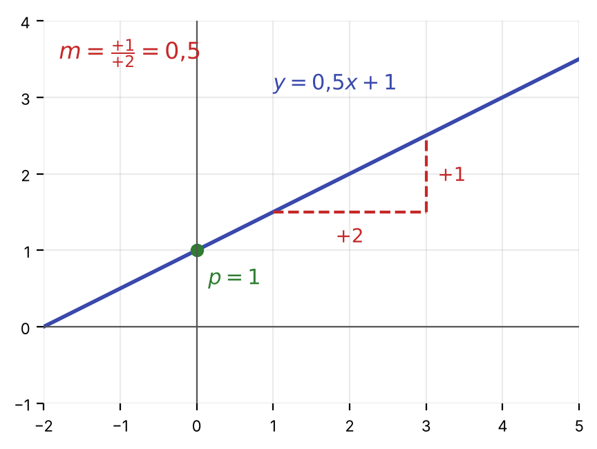
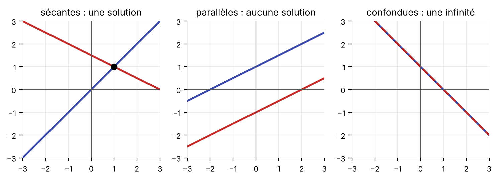

# Cours — Droites du plan

[📄 Cours en PDF (version classique)](pdf/cours.pdf){ .md-button }
[📄 Cours complet avec toutes les démonstrations (PDF)](pdf/cours-complet.pdf){ .md-button }

!!! lecture "Comment lire les démonstrations"
    Chaque résultat est démontré dès que c'est possible avec les outils de Seconde.

    Sur le site, clique sur un bloc pour l'ouvrir.

    - **Démonstration — au programme** : à savoir refaire, elle peut être demandée en évaluation.
    - **Démonstration — pour aller plus loin** : à comprendre, inutile de l'apprendre par cœur.
    - **Pourquoi ce résultat est admis** : la preuve demande une notion vue plus tard, qui est indiquée.

Dans tout le chapitre, le plan est muni d'un repère $(O\,;\,\vec{\imath},\,\vec{\jmath})$.

---

## 1. Vecteur directeur et équation cartésienne

!!! definition "Vecteur directeur"
    Un **vecteur directeur** d'une droite $d$ est un vecteur **non nul** $\vec{u} = \overrightarrow{AB}$, où $A$ et $B$ sont deux points distincts de $d$. Tout vecteur non nul colinéaire à $\vec{u}$ dirige aussi $d$.

!!! propriete "Caractérisation"
    Soit $d$ la droite passant par $A$ et dirigée par $\vec{u}$. Un point $M$ appartient à $d$ si et seulement si $\overrightarrow{AM}$ et $\vec{u}$ sont **colinéaires**.

!!! theoreme "Équation cartésienne"
    Toute droite admet une équation de la forme
    $$ax + by + c = 0, \qquad \text{avec } (a\,;\,b) \neq (0\,;\,0).$$
    Le vecteur $\vec{u}\begin{pmatrix} -b \\ a \end{pmatrix}$ est alors un vecteur directeur de la droite.

??? demo "Démonstration — au programme"
    Soit $d$ la droite passant par $A(x_A\,;\,y_A)$ et dirigée par $\vec{u}\begin{pmatrix} \alpha \\ \beta \end{pmatrix}$, non nul. Pour un point $M(x\,;\,y)$, $\overrightarrow{AM}\begin{pmatrix} x - x_A \\ y - y_A \end{pmatrix}$, et :
    $$M \in d \iff \det\left(\overrightarrow{AM}, \vec{u}\right) = 0 \iff (x - x_A)\beta - (y - y_A)\alpha = 0 \iff \beta x - \alpha y + (\alpha y_A - \beta x_A) = 0.$$
    En posant $a = \beta$, $b = -\alpha$ et $c = \alpha y_A - \beta x_A$, on obtient une équation $ax + by + c = 0$. Comme $\vec{u} \neq \vec{0}$, $a$ et $b$ ne sont pas tous deux nuls, et $\begin{pmatrix} -b \\ a \end{pmatrix} = \begin{pmatrix} \alpha \\ \beta \end{pmatrix} = \vec{u}$.

!!! propriete "Réciproque"
    Si $(a\,;\,b) \neq (0\,;\,0)$, l'ensemble des points $M(x\,;\,y)$ tels que $ax + by + c = 0$ est une droite, de vecteur directeur $\begin{pmatrix} -b \\ a \end{pmatrix}$.

??? demoplus "Démonstration — pour aller plus loin"
    On trouve d'abord un point $A$ de l'ensemble : si $b \neq 0$, $A\left(0\,;\,-\frac{c}{b}\right)$ convient ; sinon $a \neq 0$ et $A\left(-\frac{c}{a}\,;\,0\right)$ convient. Alors $c = -ax_A - by_A$, et l'équation s'écrit $a(x - x_A) + b(y - y_A) = 0$, c'est-à-dire $\det\left(\overrightarrow{AM}, \vec{u}\right) = 0$ avec $\vec{u}\begin{pmatrix} -b \\ a \end{pmatrix}$. C'est la droite passant par $A$ dirigée par $\vec{u}$.

!!! warning "Une droite a une infinité d'équations cartésiennes"
    $2x - y + 3 = 0$ et $-4x + 2y - 6 = 0$ décrivent la même droite : on peut multiplier une équation par n'importe quel nombre non nul.

**Exemple.** La droite passant par $A(1\,;\,2)$ et dirigée par $\vec{u}\begin{pmatrix} 3 \\ 1 \end{pmatrix}$ : $M(x\,;\,y) \in d \iff (x - 1) \times 1 - (y - 2) \times 3 = 0 \iff x - 3y + 5 = 0$.

---

## 2. Équation réduite

!!! theoreme "Équation réduite"
    - Si la droite n'est **pas parallèle à l'axe des ordonnées**, elle a une unique équation de la forme $y = mx + p$, appelée **équation réduite**.
    - Si elle est **parallèle à l'axe des ordonnées**, elle a une équation de la forme $x = k$.

??? demoplus "Démonstration — pour aller plus loin"
    Partons de $ax + by + c = 0$. Si $b \neq 0$, on divise par $b$ : $y = -\frac{a}{b}x - \frac{c}{b}$, de la forme $y = mx + p$. Si $b = 0$, alors $a \neq 0$ et $x = -\frac{c}{a}$ : la droite est dirigée par $\begin{pmatrix} 0 \\ a \end{pmatrix}$, parallèle à l'axe des ordonnées.

!!! definition "Coefficient directeur, ordonnée à l'origine"
    Dans $y = mx + p$ :

    - $m$ est le **coefficient directeur** (ou la **pente**) : quand $x$ augmente de $1$, $y$ augmente de $m$ ;
    - $p$ est l'**ordonnée à l'origine** : la droite passe par le point $(0\,;\,p)$ ;
    - $\vec{u}\begin{pmatrix} 1 \\ m \end{pmatrix}$ est un vecteur directeur.

{ width="50%" }

!!! theoreme "Calcul du coefficient directeur"
    Si $A$ et $B$ sont deux points distincts de la droite, avec $x_A \neq x_B$ :
    $$m = \frac{y_B - y_A}{x_B - x_A}.$$

??? demoplus "Démonstration — pour aller plus loin"
    $y_A = mx_A + p$ et $y_B = mx_B + p$. En soustrayant : $y_B - y_A = m(x_B - x_A)$, puis on divise par $x_B - x_A \neq 0$.

!!! tip "Lecture graphique"
    $m > 0$ : la droite « monte » ; $m < 0$ : elle « descend » ; $m = 0$ : elle est horizontale. On lit $m$ en partant d'un point de la droite, en avançant de $1$ (ou de $n$) unités vers la droite, et en mesurant la variation verticale (divisée par $n$).

**Exemple.** Droite passant par $A(-1\,;\,5)$ et $B(3\,;\,-3)$ : $m = \frac{-3 - 5}{3 + 1} = -2$. Puis $5 = -2 \times (-1) + p$, donc $p = 3$ : $y = -2x + 3$.

---

## 3. Droites parallèles

!!! propriete "Parallélisme"
    - Deux droites d'équations réduites $y = mx + p$ et $y = m'x + p'$ sont **parallèles** si et seulement si $m = m'$.
    - Deux droites d'équations $ax + by + c = 0$ et $a'x + b'y + c' = 0$ sont parallèles si et seulement si $ab' - a'b = 0$.

??? demoplus "Démonstration — pour aller plus loin"
    Deux droites sont parallèles si et seulement si leurs vecteurs directeurs sont colinéaires. Pour $\begin{pmatrix} 1 \\ m \end{pmatrix}$ et $\begin{pmatrix} 1 \\ m' \end{pmatrix}$ : $1 \times m' - 1 \times m = 0 \iff m = m'$. Pour $\begin{pmatrix} -b \\ a \end{pmatrix}$ et $\begin{pmatrix} -b' \\ a' \end{pmatrix}$ : $-ba' + b'a = 0$.

---

## 4. Systèmes de deux équations linéaires

!!! definition "Système linéaire"
    Un **système de deux équations linéaires à deux inconnues** s'écrit
    $$\begin{cases} ax + by = c \\ a'x + b'y = c' \end{cases}$$
    Une **solution** est un couple $(x\,;\,y)$ qui vérifie **les deux** équations.

!!! propriete "Interprétation graphique"
    Chaque équation est celle d'une droite. Les solutions du système sont les coordonnées des **points communs** aux deux droites :

    - droites **sécantes** : une unique solution ;
    - droites **strictement parallèles** : aucune solution ;
    - droites **confondues** : une infinité de solutions.

{ width="85%" }

!!! propriete "Critère"
    Le système a une **unique solution** si et seulement si $ab' - a'b \neq 0$.

??? demoplus "Démonstration — pour aller plus loin"
    $ab' - a'b \neq 0$ signifie que les vecteurs directeurs $\begin{pmatrix} -b \\ a \end{pmatrix}$ et $\begin{pmatrix} -b' \\ a' \end{pmatrix}$ ne sont pas colinéaires, c'est-à-dire que les droites sont sécantes : elles ont exactement un point commun.

**Résolution par substitution.** On isole une inconnue dans une équation et on la remplace dans l'autre.
$$\begin{cases} 2x + y = 7 \\ 3x - 2y = 0 \end{cases} \iff \begin{cases} y = 7 - 2x \\ 3x - 2(7 - 2x) = 0 \end{cases} \iff \begin{cases} y = 7 - 2x \\ 7x = 14 \end{cases} \iff \begin{cases} x = 2 \\ y = 3 \end{cases}$$

**Résolution par combinaison.** On multiplie les équations par des nombres bien choisis puis on les additionne pour éliminer une inconnue.
$$\begin{cases} 3x + 4y = 10 \\ 2x - 3y = 1 \end{cases} \quad \to \quad \begin{cases} 9x + 12y = 30 \\ 8x - 12y = 4 \end{cases} \quad \to \quad 17x = 34, \ x = 2, \text{ puis } y = 1.$$

!!! tip "Vérifier"
    On vérifie toujours la solution trouvée dans **les deux** équations de départ : $3 \times 2 + 4 \times 1 = 10$ ✓ et $2 \times 2 - 3 \times 1 = 1$ ✓.

---

## 5. Pour aller plus loin

- **Fonctions affines.** La droite $y = mx + p$ est la courbe de la fonction affine $x \mapsto mx + p$ ([chapitre 7](../fonctions-reference/index.md)).
- **Programmation linéaire.** Les systèmes et les demi-plans ($ax + by \leq c$) servent à optimiser une production sous contraintes (logistique, économie).
- **Systèmes plus grands.** Avec trois inconnues et trois équations, on cherche l'intersection de trois **plans** de l'espace ; la méthode du **pivot de Gauss** (enseignement supérieur) généralise la combinaison.
- **En Première**, un **vecteur normal** donnera directement l'équation d'une droite perpendiculaire ([Première, chapitre 8](../../premiere/geometrie-reperee/index.md)).

!!! success "Tu as fini le cours"
    Passe aux [méthodes](methodes.md), puis entraîne-toi avec les exercices corrigés.
