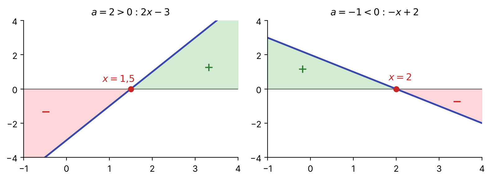

# Cours — Équations et inéquations

[📄 Cours en PDF (version classique)](pdf/cours.pdf){ .md-button }
[📄 Cours complet avec toutes les démonstrations (PDF)](pdf/cours-complet.pdf){ .md-button }

!!! lecture "Comment lire les démonstrations"
    Chaque résultat est démontré dès que c'est possible avec les outils de Seconde.

    Sur le site, clique sur un bloc pour l'ouvrir.

    - **Démonstration — au programme** : à savoir refaire, elle peut être demandée en évaluation.
    - **Démonstration — pour aller plus loin** : à comprendre, inutile de l'apprendre par cœur.
    - **Pourquoi ce résultat est admis** : la preuve demande une notion vue plus tard, qui est indiquée.

---

## 1. Équations : vocabulaire

!!! definition "Équation, solution"
    Une **équation** d'inconnue $x$ est une égalité contenant $x$. Une **solution** est une valeur de $x$ pour laquelle l'égalité est vraie. **Résoudre** l'équation, c'est trouver **toutes** ses solutions ; on note $S$ l'**ensemble des solutions**.

!!! propriete "Équations équivalentes"
    On obtient une équation qui a les **mêmes solutions** (une équation **équivalente**) :

    - en ajoutant ou en retranchant un même nombre (ou une même expression) aux deux membres ;
    - en multipliant ou en divisant les deux membres par un même nombre **non nul**.

---

## 2. Équations du premier degré

!!! propriete "Équation $ax + b = 0$"
    Si $a \neq 0$, l'équation $ax + b = 0$ a une unique solution : $x = -\dfrac{b}{a}$.

**Exemple.** $5x - 3 = 2x + 9 \iff 3x = 12 \iff x = 4$. $S = \{4\}$.

!!! warning "Cas particuliers"
    Après réduction, on peut obtenir $0x = c$ : si $c \neq 0$, aucune solution ($S = \varnothing$) ; si $c = 0$, tous les réels sont solutions ($S = \mathbb{R}$). Exemple : $2(x + 1) = 2x + 5 \iff 0x = 3$, pas de solution.

---

## 3. Équation produit nul

!!! theoreme "Règle du produit nul"
    Un produit de facteurs est nul si et seulement si l'un au moins de ses facteurs est nul :
    $$A \times B = 0 \iff A = 0 \text{ ou } B = 0.$$

??? demoplus "Démonstration — pour aller plus loin"
    Si $A = 0$ ou $B = 0$, le produit est nul. Réciproquement, supposons $AB = 0$ et $A \neq 0$ : en divisant par $A$, on obtient $B = \frac{0}{A} = 0$.

**Exemple.** $(2x - 1)(x + 3) = 0 \iff 2x - 1 = 0$ ou $x + 3 = 0 \iff x = \frac{1}{2}$ ou $x = -3$. $S = \left\{-3\,;\,\frac{1}{2}\right\}$.

!!! tip "Factoriser d'abord"
    Pour résoudre une équation qui n'est pas du premier degré, on **regroupe tout du même côté** pour avoir $\ldots = 0$, puis on **factorise**. Ne **jamais** diviser par une expression qui contient $x$ : on risque de perdre des solutions. Exemple : $x^2 = 3x \iff x^2 - 3x = 0 \iff x(x - 3) = 0$, $S = \{0\,;\,3\}$ (diviser par $x$ ferait perdre la solution $0$).

---

## 4. L'équation $x^2 = a$

!!! theoreme "Solutions de $x^2 = a$"
    - Si $a > 0$, l'équation $x^2 = a$ a deux solutions : $\sqrt{a}$ et $-\sqrt{a}$.
    - Si $a = 0$, elle a une seule solution : $0$.
    - Si $a < 0$, elle n'a aucune solution (un carré est toujours positif).

??? demoplus "Démonstration — pour aller plus loin"
    Pour $a > 0$ : $x^2 = a \iff x^2 - \left(\sqrt{a}\right)^2 = 0 \iff \left(x - \sqrt{a}\right)\left(x + \sqrt{a}\right) = 0 \iff x = \sqrt{a}$ ou $x = -\sqrt{a}$. Pour $a = 0$ : $x^2 = 0 \iff x = 0$. Pour $a < 0$ : $x^2 \geq 0 > a$.

**Exemples.** $x^2 = 7 \iff x = \pm\sqrt{7}$. $(x - 1)^2 = 9 \iff x - 1 = 3$ ou $x - 1 = -3 \iff x = 4$ ou $x = -2$. $x^2 + 4 = 0$ n'a pas de solution.

---

## 5. Équations quotient

!!! definition "Valeur interdite"
    Dans une expression $\frac{A(x)}{B(x)}$, les **valeurs interdites** sont celles qui annulent le dénominateur $B(x)$ : le quotient n'y est pas défini.

!!! theoreme "Quotient nul"
    $$\frac{A}{B} = 0 \iff A = 0 \text{ et } B \neq 0.$$

??? demoplus "Démonstration — pour aller plus loin"
    Le quotient n'existe que si $B \neq 0$. Dans ce cas, $\frac{A}{B} = 0 \iff A = 0 \times B = 0$ (on multiplie par $B \neq 0$).

**Exemple.** $\dfrac{x^2 - 4}{x + 2} = 0$. Valeur interdite : $-2$. Le numérateur s'annule pour $x = 2$ ou $x = -2$ ; on exclut $-2$. $S = \{2\}$.

!!! tip "Équations avec des fractions"
    Pour résoudre $\frac{A}{B} = \frac{C}{D}$ : chercher les valeurs interdites, puis se ramener à « $\ldots = 0$ » en réduisant au même dénominateur, ou utiliser les produits en croix ($AD = BC$) en vérifiant que les solutions trouvées ne sont pas interdites.

---

## 6. Inéquations du premier degré

!!! propriete "Inéquations équivalentes"
    On obtient une inéquation équivalente :

    - en ajoutant ou en retranchant un même nombre aux deux membres ;
    - en multipliant ou en divisant par un nombre **strictement positif** (le sens est **conservé**) ;
    - en multipliant ou en divisant par un nombre **strictement négatif**, à condition de **changer le sens** de l'inégalité.

**Exemple.** $3 - 2x \leq x + 9 \iff -3x \leq 6 \iff x \geq -2$ (on divise par $-3 < 0$). $S = [-2\,;\,+\infty[$.

---

## 7. Signe d'une expression affine

!!! theoreme "Signe de $ax + b$"
    Soit $a \neq 0$. L'expression $ax + b$ s'annule en $x = -\frac{b}{a}$ ; elle est **du signe de $a$ à droite** de cette valeur, et **du signe contraire à gauche**.

| $x$ | $-\infty$ | | $-\frac{b}{a}$ | | $+\infty$ |
|---|---|---|---|---|---|
| $ax + b$ | | signe de $-a$ | $0$ | signe de $a$ | |

{ width="80%" }

??? demoplus "Démonstration — pour aller plus loin"
    Si $a > 0$ : $ax + b > 0 \iff ax > -b \iff x > -\frac{b}{a}$ (on divise par $a > 0$). Si $a < 0$ : $ax + b > 0 \iff ax > -b \iff x < -\frac{b}{a}$ (le sens change). Dans les deux cas, $ax + b$ a le signe de $a$ pour $x > -\frac{b}{a}$.

---

## 8. Signe d'un produit et d'un quotient

!!! propriete "Règle des signes"
    Un produit (ou un quotient) de deux facteurs est **positif** si les facteurs ont le **même signe**, et **négatif** s'ils ont des signes **contraires**.

On étudie le signe de chaque facteur, puis on rassemble les résultats dans un **tableau de signes**.

**Exemple.** Signe de $P(x) = (2x - 3)(-x + 2)$. $2x - 3$ s'annule en $\frac{3}{2}$ ($a = 2 > 0$) ; $-x + 2$ s'annule en $2$ ($a = -1 < 0$).

| $x$ | $-\infty$ | | $\frac{3}{2}$ | | $2$ | | $+\infty$ |
|---|---|---|---|---|---|---|---|
| $2x - 3$ | | $-$ | $0$ | $+$ | | $+$ | |
| $-x + 2$ | | $+$ | | $+$ | $0$ | $-$ | |
| $P(x)$ | | $-$ | $0$ | $+$ | $0$ | $-$ | |

Ainsi $P(x) > 0 \iff x \in \left]\frac{3}{2}\,;\,2\right[$.

!!! warning "Quotient : la double barre"
    Pour un quotient $\frac{A(x)}{B(x)}$, les valeurs qui annulent le **dénominateur** sont **interdites** : on les marque d'une **double barre** $\parallel$ dans la dernière ligne du tableau, et on les **exclut** toujours de l'ensemble des solutions.

**Exemple.** $\dfrac{x + 1}{x - 3} \geq 0$. $x + 1$ s'annule en $-1$, $x - 3$ en $3$ (valeur interdite).

| $x$ | $-\infty$ | | $-1$ | | $3$ | | $+\infty$ |
|---|---|---|---|---|---|---|---|
| $x + 1$ | | $-$ | $0$ | $+$ | | $+$ | |
| $x - 3$ | | $-$ | | $-$ | $0$ | $+$ | |
| quotient | | $+$ | $0$ | $-$ | $\parallel$ | $+$ | |

$S = ]-\infty\,;\,-1] \cup ]3\,;\,+\infty[$.

!!! tip "Pour résoudre une inéquation qui n'est pas du premier degré"
    1. Tout passer du même côté : $\ldots \geq 0$ (ne **jamais** multiplier par une expression dont on ne connaît pas le signe).
    2. Factoriser, ou réduire au même dénominateur.
    3. Dresser le tableau de signes et lire les solutions.

---

## 9. Pour aller plus loin

- **Résolution graphique.** Résoudre $f(x) = k$ ou $f(x) > g(x)$ revient à lire des abscisses de points d'intersection ou des positions de courbes ([chapitre 6](../index.md)).
- **Le second degré** (Première) : on saura résoudre $ax^2 + bx + c = 0$ dans tous les cas, avec le discriminant $\Delta = b^2 - 4ac$ ([Première, chapitre 2](../../premiere/second-degre/index.md)).
- **Équations et histoire.** Les mathématiciens arabes (Al-Khwârizmî, IXᵉ siècle) ont donné son nom à l'algèbre (*al-jabr* : la remise en place, c'est-à-dire le passage d'un terme d'un membre à l'autre).

!!! success "Tu as fini le cours"
    Passe aux [méthodes](methodes.md), puis entraîne-toi avec les exercices corrigés.
