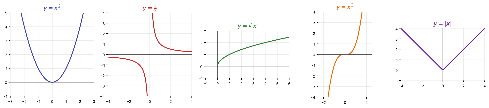
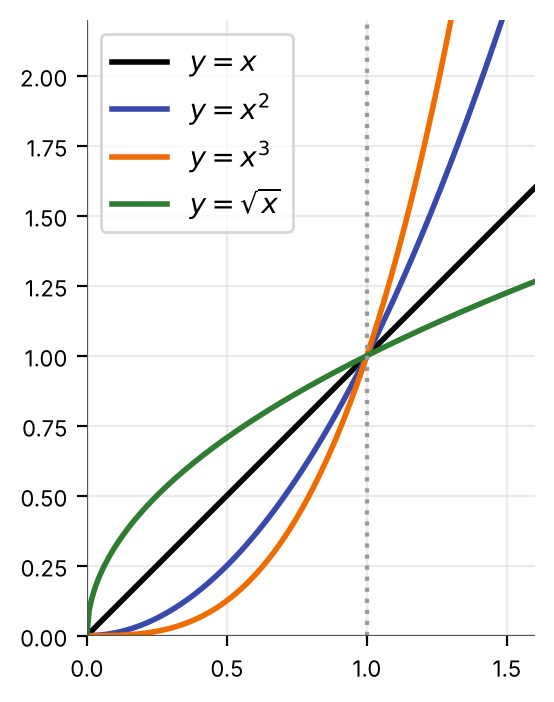

# Cours — Fonctions de référence

[📄 Cours en PDF (version classique)](pdf/cours.pdf){ .md-button }
[📄 Cours complet avec toutes les démonstrations (PDF)](pdf/cours-complet.pdf){ .md-button }

!!! lecture "Comment lire les démonstrations"
    Chaque résultat est démontré dès que c'est possible avec les outils de Seconde.

    Sur le site, clique sur un bloc pour l'ouvrir.

    - **Démonstration — au programme** : à savoir refaire, elle peut être demandée en évaluation.
    - **Démonstration — pour aller plus loin** : à comprendre, inutile de l'apprendre par cœur.
    - **Pourquoi ce résultat est admis** : la preuve demande une notion vue plus tard, qui est indiquée.

{ width="100%" }

Pour étudier le sens de variation d'une fonction $f$ sur un intervalle $I$, on prend deux réels $a < b$ de $I$ et on étudie le **signe de $f(b) - f(a)$** : positif pour une fonction croissante, négatif pour une fonction décroissante.

---

## 1. Fonctions affines

!!! definition "Fonction affine"
    Une fonction **affine** est définie sur $\mathbb{R}$ par $f(x) = mx + p$. Sa courbe est une **droite** de coefficient directeur $m$ et d'ordonnée à l'origine $p$. Si $p = 0$, la fonction est **linéaire** ; si $m = 0$, elle est **constante**.

!!! propriete "Variations et signe"
    - Si $m > 0$, $f$ est croissante sur $\mathbb{R}$ ; si $m < 0$, décroissante ; si $m = 0$, constante.
    - Si $m \neq 0$, $mx + p$ s'annule en $-\frac{p}{m}$ et a le **signe de $m$ à droite** de cette valeur.

??? demoplus "Démonstration — pour aller plus loin"
    Pour $a < b$ : $f(b) - f(a) = m(b - a)$, du signe de $m$ puisque $b - a > 0$. Le signe a été étudié au [chapitre 3](../equations-inequations/cours.md).

---

## 2. La fonction carré

!!! definition "Fonction carré"
    La fonction **carré** est définie sur $\mathbb{R}$ par $f(x) = x^2$. Sa courbe est une **parabole** de sommet $O$. Elle est **paire** : sa courbe est symétrique par rapport à l'axe des ordonnées.

!!! theoreme "Variations de la fonction carré"
    La fonction carré est **décroissante** sur $]-\infty\,;\,0]$ et **croissante** sur $[0\,;\,+\infty[$.

| $x$ | $-\infty$ | | $0$ | | $+\infty$ |
|---|---|---|---|---|---|
| $x^2$ | | $\searrow$ | $0$ | $\nearrow$ | |

??? demo "Démonstration — au programme"
    Soit $a < b$ deux réels. On calcule
    $$f(b) - f(a) = b^2 - a^2 = (b - a)(b + a).$$
    On sait que $b - a > 0$.

    - **Sur $[0\,;\,+\infty[$** : si $0 \leq a < b$, alors $a + b > 0$. Le produit est strictement positif : $f(a) < f(b)$. La fonction carré est strictement croissante sur $[0\,;\,+\infty[$.
    - **Sur $]-\infty\,;\,0]$** : si $a < b \leq 0$, alors $a + b < 0$. Le produit est strictement négatif : $f(a) > f(b)$. La fonction carré est strictement décroissante sur $]-\infty\,;\,0]$.

!!! propriete "Équations et inéquations"
    Pour $k > 0$ : $x^2 = k \iff x = \pm\sqrt{k}$ ; $x^2 < k \iff -\sqrt{k} < x < \sqrt{k}$ ; $x^2 > k \iff x < -\sqrt{k}$ ou $x > \sqrt{k}$.

**Exemple.** $x^2 \leq 9 \iff x \in [-3\,;\,3]$. Si $-2 \leq x \leq 3$, alors $0 \leq x^2 \leq 9$ (attention : l'intervalle contient $0$, où la fonction change de sens).

---

## 3. La fonction inverse

!!! definition "Fonction inverse"
    La fonction **inverse** est définie sur $\mathbb{R}^* = ]-\infty\,;\,0[ \cup ]0\,;\,+\infty[$ par $f(x) = \frac{1}{x}$. Sa courbe est une **hyperbole**. Elle est **impaire** : sa courbe est symétrique par rapport à l'origine.

!!! theoreme "Variations de la fonction inverse"
    La fonction inverse est **décroissante** sur $]-\infty\,;\,0[$ et **décroissante** sur $]0\,;\,+\infty[$.

| $x$ | $-\infty$ | | $0$ | | $+\infty$ |
|---|---|---|---|---|---|
| $\frac{1}{x}$ | | $\searrow$ | $\parallel$ | $\searrow$ | |

??? demo "Démonstration — au programme"
    Soit $a < b$ deux réels **non nuls et de même signe**. On calcule
    $$f(b) - f(a) = \frac{1}{b} - \frac{1}{a} = \frac{a - b}{ab}.$$
    On a $a - b < 0$. Comme $a$ et $b$ sont de même signe, $ab > 0$. Le quotient est strictement négatif : $f(b) < f(a)$.

    La fonction inverse est donc strictement décroissante sur $]0\,;\,+\infty[$ (où $a$ et $b$ sont positifs) et sur $]-\infty\,;\,0[$ (où ils sont négatifs).

!!! warning "Pas décroissante sur $\mathbb{R}^*$"
    La fonction inverse **n'est pas** décroissante sur $\mathbb{R}^*$ tout entier : $-1 < 1$ et pourtant $\frac{1}{-1} = -1 < 1 = \frac{1}{1}$. On ne peut comparer les inverses que de deux nombres **de même signe** : si $0 < a < b$, alors $\frac{1}{a} > \frac{1}{b}$.

**Exemple.** Si $2 \leq x \leq 5$, alors $\frac{1}{5} \leq \frac{1}{x} \leq \frac{1}{2}$.

---

## 4. La fonction racine carrée

!!! definition "Fonction racine carrée"
    La fonction **racine carrée** est définie sur $[0\,;\,+\infty[$ par $f(x) = \sqrt{x}$.

!!! propriete "Variations"
    La fonction racine carrée est **croissante** sur $[0\,;\,+\infty[$.

??? demoplus "Démonstration — pour aller plus loin"
    Soit $0 \leq a < b$. Alors $\sqrt{b} + \sqrt{a} > 0$ (car $b > 0$), et
    $$\sqrt{b} - \sqrt{a} = \frac{\left(\sqrt{b} - \sqrt{a}\right)\left(\sqrt{b} + \sqrt{a}\right)}{\sqrt{b} + \sqrt{a}} = \frac{b - a}{\sqrt{b} + \sqrt{a}} > 0.$$

**Exemple.** $\sqrt{x} = 3 \iff x = 9$ ; $\sqrt{x} < 2 \iff 0 \leq x < 4$.

---

## 5. La fonction cube

!!! definition "Fonction cube"
    La fonction **cube** est définie sur $\mathbb{R}$ par $f(x) = x^3$. Elle est **impaire**.

!!! propriete "Variations"
    La fonction cube est **croissante** sur $\mathbb{R}$.

??? demoplus "Démonstration — pour aller plus loin"
    Pour $a < b$ : $b^3 - a^3 = (b - a)(b^2 + ab + a^2)$ (on le vérifie en développant). Or
    $$b^2 + ab + a^2 = \left(b + \frac{a}{2}\right)^2 + \frac{3a^2}{4} \geq 0,$$
    et cette quantité n'est nulle que si $a = b = 0$, ce qui est exclu. Donc $b^3 - a^3 > 0$.

**Exemple.** $x^3 = 8 \iff x = 2$ ; $x^3 = -27 \iff x = -3$. Contrairement au carré, l'équation $x^3 = k$ a **toujours exactement une** solution.

---

## 6. La fonction valeur absolue

!!! definition "Fonction valeur absolue"
    La fonction **valeur absolue** est définie sur $\mathbb{R}$ par $f(x) = |x|$, c'est-à-dire $f(x) = x$ si $x \geq 0$ et $f(x) = -x$ si $x < 0$. Sa courbe est formée de deux demi-droites : elle a la forme d'un « V ». Elle est **paire**.

!!! propriete "Variations"
    La fonction valeur absolue est **décroissante** sur $]-\infty\,;\,0]$ et **croissante** sur $[0\,;\,+\infty[$ ; son minimum est $0$, atteint en $0$.

??? demoplus "Démonstration — pour aller plus loin"
    Sur $[0\,;\,+\infty[$, $|x| = x$ : fonction affine croissante. Sur $]-\infty\,;\,0]$, $|x| = -x$ : fonction affine décroissante.

**Exemple.** $|x| = 4 \iff x = \pm 4$ ; $|x| < 4 \iff x \in ]-4\,;\,4[$ ; et plus généralement $|x - a| \leq r$ signifie que $x$ est à distance au plus $r$ de $a$ ([chapitre 1](../nombres-arithmetique/cours.md)).

---

## 7. Positions relatives

!!! theoreme "Comparer $x$, $x^2$, $x^3$, $\sqrt{x}$"
    - Si $0 < x < 1$ : $x^3 < x^2 < x < \sqrt{x}$.
    - Si $x > 1$ : $\sqrt{x} < x < x^2 < x^3$.

    Les courbes se coupent aux points d'abscisses $0$ et $1$.

{ width="45%" }

??? demoplus "Démonstration — pour aller plus loin"
    $x^2 - x = x(x - 1)$ et $x^3 - x^2 = x^2(x - 1)$ : pour $x > 0$, ces différences ont le signe de $x - 1$. Ensuite, $x - \sqrt{x} = \sqrt{x}\left(\sqrt{x} - 1\right)$ a aussi le signe de $x - 1$ (car $\sqrt{x} > 1 \iff x > 1$).

---

## 8. Pour aller plus loin

- **Fonctions polynômes du second degré** (Première) : toute fonction $x \mapsto ax^2 + bx + c$ s'obtient à partir de la fonction carré par des transformations simples de sa courbe ([Première, chapitre 2](../../premiere/second-degre/index.md)).
- **Fonction exponentielle** (Première) : une nouvelle fonction de référence, qui modélise les croissances « explosives » ([Première, chapitre 5](../../premiere/exponentielle/index.md)).
- **En physique** : l'aire d'un disque est proportionnelle au **carré** du rayon, l'intensité d'un son décroît comme l'**inverse** du carré de la distance, la période d'un pendule est proportionnelle à la **racine carrée** de sa longueur.

!!! success "Tu as fini le cours"
    Passe aux [méthodes](methodes.md), puis entraîne-toi avec les exercices corrigés.
