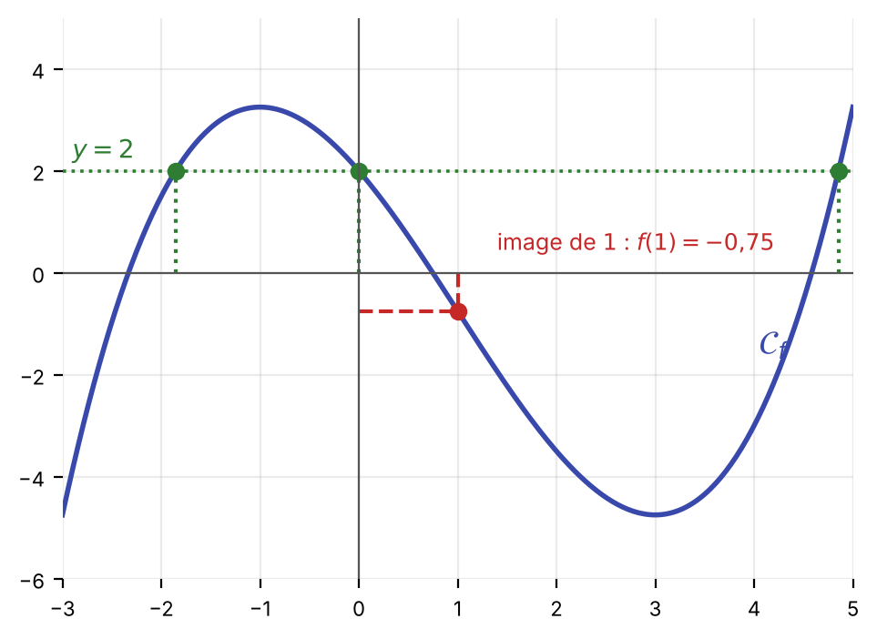
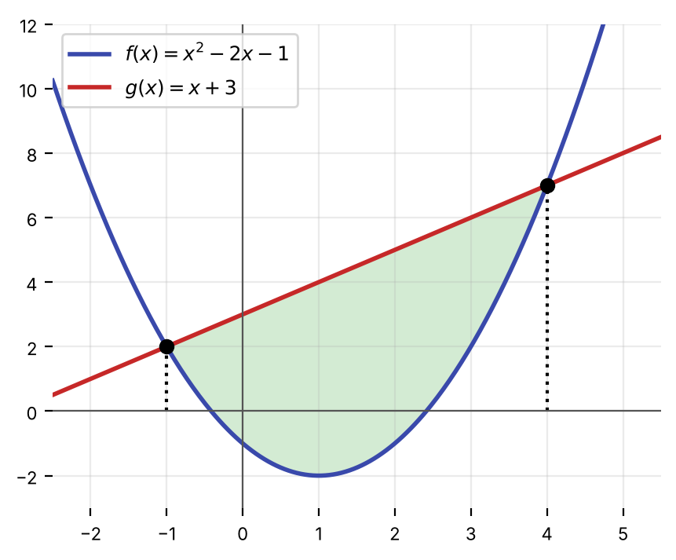
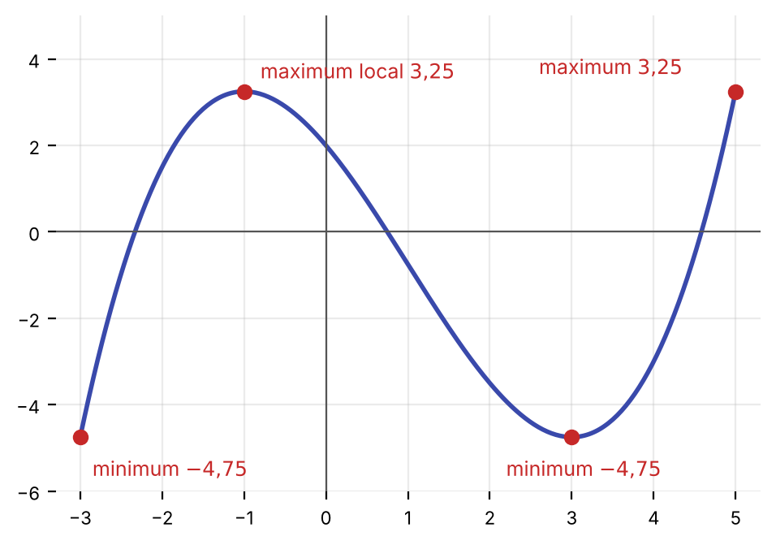

# Cours — Généralités sur les fonctions

[📄 Cours en PDF (version classique)](pdf/cours.pdf){ .md-button }
[📄 Cours complet avec toutes les démonstrations (PDF)](pdf/cours-complet.pdf){ .md-button }

!!! lecture "Comment lire les démonstrations"
    Chaque résultat est démontré dès que c'est possible avec les outils de Seconde.

    Sur le site, clique sur un bloc pour l'ouvrir.

    - **Démonstration — au programme** : à savoir refaire, elle peut être demandée en évaluation.
    - **Démonstration — pour aller plus loin** : à comprendre, inutile de l'apprendre par cœur.
    - **Pourquoi ce résultat est admis** : la preuve demande une notion vue plus tard, qui est indiquée.

---

## 1. Notion de fonction

!!! definition "Fonction, image, antécédent"
    Soit $D$ un ensemble de réels. Une **fonction** $f$ définie sur $D$ associe à **chaque** réel $x$ de $D$ un **unique** réel, noté $f(x)$. On note
    $$f : x \longmapsto f(x).$$

    - $D$ est l'**ensemble de définition** de $f$.
    - $f(x)$ est l'**image** de $x$ par $f$.
    - Si $f(a) = b$, on dit que $a$ est **un antécédent** de $b$ par $f$.

!!! warning "Image unique, antécédents multiples"
    Un réel $x$ de $D$ a **une seule** image. En revanche, un réel $b$ peut avoir **aucun, un ou plusieurs** antécédents. Exemple avec $f(x) = x^2$ : $9$ a deux antécédents ($3$ et $-3$), $0$ en a un, $-4$ n'en a aucun.

**Exemple.** $f(x) = \dfrac{1}{x - 2}$ est définie pour $x \neq 2$ : $D = ]-\infty\,;\,2[ \cup ]2\,;\,+\infty[$. L'image de $3$ est $f(3) = 1$. Les antécédents de $\frac{1}{2}$ vérifient $x - 2 = 2$ : il y en a un seul, $4$.

!!! tip "Ensemble de définition"
    On cherche les valeurs **interdites** : un **dénominateur** ne peut pas être nul, et l'expression sous une **racine carrée** doit être positive ou nulle. Ainsi $x \mapsto \sqrt{3 - x}$ est définie sur $]-\infty\,;\,3]$.

---

## 2. Courbe représentative

!!! definition "Courbe représentative"
    Dans un repère, la **courbe représentative** $\mathcal{C}_f$ de $f$ est l'ensemble des points $M(x\,;\,y)$ tels que $x \in D$ et $y = f(x)$. On dit que $y = f(x)$ est une **équation** de $\mathcal{C}_f$.

!!! propriete "Appartenance à la courbe"
    $M(a\,;\,b) \in \mathcal{C}_f \iff a \in D \text{ et } b = f(a)$.

**Lire une image** : on part de $a$ sur l'axe des abscisses, on monte (ou descend) jusqu'à la courbe, puis on lit l'ordonnée. **Lire les antécédents** de $b$ : on trace la droite horizontale $y = b$ et on lit les abscisses des points d'intersection avec la courbe.

{ width="55%" }

Sur cette figure, $f(1) = -0{,}75$, et $2$ a trois antécédents : $0$ et deux autres, environ $-1{,}85$ et $4{,}85$.

!!! tip "Tracer une courbe"
    On calcule un **tableau de valeurs** (à la main, avec la calculatrice ou en Python), on place les points, puis on les relie par une courbe « lisse ». Plus il y a de points, plus le tracé est fidèle.

---

## 3. Résolutions graphiques

!!! propriete "Équations et inéquations $f(x) = k$, $f(x) < k$"
    - Les solutions de $f(x) = k$ sont les **abscisses** des points de $\mathcal{C}_f$ d'ordonnée $k$ (intersection avec la droite $y = k$).
    - Les solutions de $f(x) < k$ sont les abscisses des points de $\mathcal{C}_f$ situés **strictement en dessous** de la droite $y = k$.

!!! propriete "Équations et inéquations $f(x) = g(x)$, $f(x) \leq g(x)$"
    - Les solutions de $f(x) = g(x)$ sont les **abscisses des points d'intersection** de $\mathcal{C}_f$ et $\mathcal{C}_g$.
    - Les solutions de $f(x) \leq g(x)$ sont les abscisses des points où $\mathcal{C}_f$ est **en dessous de** (ou sur) $\mathcal{C}_g$.

{ width="50%" }

Ici, $f(x) \leq g(x) \iff x \in [-1\,;\,4]$. Par le calcul : $x^2 - 2x - 1 \leq x + 3 \iff x^2 - 3x - 4 \leq 0 \iff (x + 1)(x - 4) \leq 0$, ce qui confirme la lecture.

??? admis "Pourquoi une lecture graphique ne suffit pas"
    Un graphique n'a qu'une précision limitée : on lit des **valeurs approchées**, et on peut « rater » une solution (deux courbes très proches, une intersection hors de la fenêtre). Une lecture graphique est donc une **conjecture** ; on la confirme par un calcul dès que c'est possible.

---

## 4. Variations

!!! definition "Fonction croissante, décroissante"
    Soit $f$ une fonction définie sur un intervalle $I$.

    - $f$ est **croissante** sur $I$ si, pour tous $a$ et $b$ de $I$ : $a < b \Rightarrow f(a) \leq f(b)$. (Elle « conserve l'ordre ».)
    - $f$ est **décroissante** sur $I$ si, pour tous $a$ et $b$ de $I$ : $a < b \Rightarrow f(a) \geq f(b)$. (Elle « renverse l'ordre ».)
    - $f$ est **monotone** sur $I$ si elle est croissante sur $I$ ou décroissante sur $I$.

    On parle de **strictement** croissante (ou décroissante) avec des inégalités strictes.

Graphiquement : sur un intervalle où $f$ est croissante, la courbe « monte » quand on la parcourt de gauche à droite.

!!! definition "Tableau de variations"
    On résume les variations dans un **tableau de variations** : des flèches montantes ou descendantes, avec les valeurs de $f$ aux bornes et aux changements de sens.

Pour la fonction de la figure ci-dessous, définie sur $[-3\,;\,5]$ :

| $x$ | $-3$ | | $-1$ | | $3$ | | $5$ |
|---|---|---|---|---|---|---|---|
| $f(x)$ | $-4{,}75$ | $\nearrow$ | $3{,}25$ | $\searrow$ | $-4{,}75$ | $\nearrow$ | $3{,}25$ |

{ width="55%" }

!!! definition "Maximum, minimum"
    - $f$ admet un **maximum** $M$ sur $I$, atteint en $a$, si $f(a) = M$ et si $f(x) \leq M$ pour tout $x$ de $I$.
    - $f$ admet un **minimum** $m$ sur $I$, atteint en $a$, si $f(a) = m$ et si $f(x) \geq m$ pour tout $x$ de $I$.
    - Un maximum ou un minimum est un **extremum**.

Sur la figure, le maximum de $f$ sur $[-3\,;\,5]$ est $3{,}25$ (atteint en $-1$ et en $5$), le minimum est $-4{,}75$ (atteint en $-3$ et en $3$).

**Exemple de démonstration d'un maximum.** Soit $g(x) = 5 - (x - 2)^2$. Pour tout réel $x$, $(x - 2)^2 \geq 0$, donc $g(x) \leq 5$, et $g(2) = 5$. Le maximum de $g$ sur $\mathbb{R}$ est $5$, atteint en $2$.

!!! propriete "Variations d'une fonction affine"
    La fonction $x \mapsto mx + p$ est **croissante** sur $\mathbb{R}$ si $m > 0$, **décroissante** si $m < 0$, **constante** si $m = 0$.

??? demoplus "Démonstration — pour aller plus loin"
    Pour $a < b$ : $f(b) - f(a) = (mb + p) - (ma + p) = m(b - a)$. Comme $b - a > 0$, cette différence a le signe de $m$. Si $m > 0$, $f(a) < f(b)$ : $f$ est strictement croissante. Si $m < 0$, $f(a) > f(b)$ : strictement décroissante.

!!! tip "Comparer des images"
    Si $f$ est croissante sur $I$ et si $a < b$ sont dans $I$, alors $f(a) \leq f(b)$ sans calculer les images. Par exemple, si $f$ est décroissante sur $[0\,;\,10]$, alors $f(3) \geq f(7)$.

---

## 5. Fonctions paires et impaires

!!! definition "Parité"
    Soit $f$ définie sur un ensemble $D$ **symétrique par rapport à $0$** (si $x \in D$, alors $-x \in D$).

    - $f$ est **paire** si $f(-x) = f(x)$ pour tout $x$ de $D$ : sa courbe est **symétrique par rapport à l'axe des ordonnées**.
    - $f$ est **impaire** si $f(-x) = -f(x)$ pour tout $x$ de $D$ : sa courbe est **symétrique par rapport à l'origine**.

??? demoplus "Exemples démontrés — pour aller plus loin"
    - $f(x) = x^2$ : $f(-x) = (-x)^2 = x^2 = f(x)$, paire.
    - $g(x) = x^3$ : $g(-x) = -x^3 = -g(x)$, impaire.
    - $h(x) = x^2 + x$ : $h(-1) = 0$ et $h(1) = 2$, donc $h(-1) \neq h(1)$ et $h(-1) \neq -h(1)$ : ni paire ni impaire (**un** contre-exemple suffit).

    Le point $M(x\,;\,f(x))$ a pour symétrique par rapport à l'axe des ordonnées le point $(-x\,;\,f(x))$, qui est sur la courbe si $f(-x) = f(x)$ : d'où la symétrie de la courbe d'une fonction paire.

---

## 6. Fonctions en Python

Une fonction mathématique se programme naturellement avec une fonction Python :

```python
def f(x):
    return x**2 - 2*x - 1

# tableau de valeurs de -2 à 4 avec un pas de 1
for x in range(-2, 5):
    print(x, f(x))

# liste des images pour x = 0 ; 0,5 ; 1 ; ... ; 3
X = [k / 2 for k in range(0, 7)]
Y = [f(x) for x in X]
```

---

## 7. Pour aller plus loin

- **Fonctions de référence.** Les fonctions carré, inverse, racine carrée, cube et valeur absolue sont étudiées au [chapitre 7](../fonctions-reference/index.md).
- **Dérivation (Première).** Le **signe de la dérivée** permettra de démontrer les variations de presque toutes les fonctions ([Première, chapitre 4](../../premiere/variations/index.md)).
- **Modélisation.** Une fonction décrit une **dépendance** entre deux grandeurs : distance de freinage selon la vitesse, coût selon la quantité produite, population selon le temps.

!!! success "Tu as fini le cours"
    Passe aux [méthodes](methodes.md), puis entraîne-toi avec les exercices corrigés.
