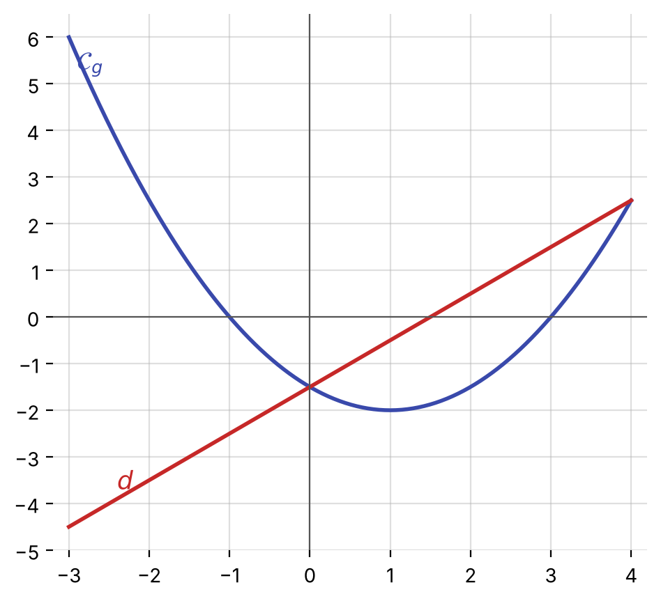

# Exercices corrigés — Généralités sur les fonctions

[📄 Énoncés seuls (PDF)](pdf/exercices-enonces.pdf){ .md-button }
[📄 Énoncés + corrections (PDF)](pdf/exercices-corriges.pdf){ .md-button }

28 exercices classés par thème. Difficulté : <span class="etoiles">★</span> application directe — <span class="etoiles">★★</span> entraînement — <span class="etoiles">★★★</span> approfondissement.

Pour t'entraîner dans les conditions d'un devoir, va voir les [évaluations type](bac.md). Les exercices se font **sans calculatrice**, sauf l'exercice Python.

Clique sur **Correction** seulement après avoir vraiment cherché.

| Thème | Exercices |
|---|---|
| 1. Images, antécédents, ensemble de définition | 1 à 6 |
| 2. Courbes et lectures graphiques | 7 à 12 |
| 3. Résolutions graphiques | 13 à 17 |
| 4. Variations et extremums | 18 à 23 |
| 5. Parité, Python et approfondissement | 24 à 28 |

Plusieurs exercices utilisent la figure suivante : $\mathcal{C}_g$ est la courbe d'une fonction $g$ définie sur $[-3\,;\,4]$, et $d$ est une droite.

{ width="50%" }

---

## Thème 1 — Images, antécédents, ensemble de définition

*Méthodes associées : [Méthode 1](methodes.md#methode-1-calculer-une-image-chercher-des-antecedents) et [Méthode 2](methodes.md#methode-2-determiner-un-ensemble-de-definition).*

### Exercice 1 — Images <span class="etoiles">★</span>

Soit $f(x) = x^2 - 3x + 1$. Calculer $f(0)$, $f(-2)$, $f\left(\frac{1}{2}\right)$ et $f\left(\sqrt{2}\right)$.

??? success "Correction"
    $f(0) = 1$ ; $f(-2) = 4 + 6 + 1 = 11$ ; $f\left(\frac{1}{2}\right) = \frac{1}{4} - \frac{3}{2} + 1 = -\frac{1}{4}$ ; $f\left(\sqrt{2}\right) = 2 - 3\sqrt{2} + 1 = 3 - 3\sqrt{2}$.

### Exercice 2 — Antécédents <span class="etoiles">★</span>

Soit $f(x) = 3x - 5$ et $g(x) = x^2 + 1$. Déterminer les antécédents de $7$ par $f$, puis ceux de $10$, de $1$ et de $0$ par $g$.

??? success "Correction"
    $3x - 5 = 7 \iff x = 4$. Par $g$ : $x^2 = 9$, antécédents $-3$ et $3$ ; $x^2 = 0$, antécédent $0$ ; $x^2 = -1$, aucun antécédent.

### Exercice 3 — Point sur la courbe <span class="etoiles">★</span>

Soit $f(x) = \dfrac{2x + 1}{x - 1}$. Les points $A(2\,;\,5)$, $B(0\,;\,1)$ et $C(-1\,;\,\frac{1}{2})$ sont-ils sur la courbe de $f$ ?

??? success "Correction"
    $f(2) = 5$ : oui. $f(0) = -1 \neq 1$ : non. $f(-1) = \frac{-1}{-2} = \frac{1}{2}$ : oui.

### Exercice 4 — Ensembles de définition <span class="etoiles">★★</span>

Déterminer l'ensemble de définition de : $f(x) = \dfrac{3}{2x - 4}$ ; $g(x) = \sqrt{6 - 2x}$ ; $h(x) = \dfrac{1}{x^2 - 9}$ ; $k(x) = \dfrac{\sqrt{x}}{x - 1}$.

??? success "Correction"
    - $2x - 4 \neq 0$ : $D = \mathbb{R} \setminus \{2\} = ]-\infty\,;\,2[ \cup ]2\,;\,+\infty[$.
    - $6 - 2x \geq 0 \iff x \leq 3$ : $D = ]-\infty\,;\,3]$.
    - $x^2 \neq 9$ : $D = \mathbb{R} \setminus \{-3\,;\,3\}$.
    - $x \geq 0$ et $x \neq 1$ : $D = [0\,;\,1[ \cup ]1\,;\,+\infty[$.

### Exercice 5 — Fonction définie par un programme <span class="etoiles">★★</span>

Un programme de calcul : « choisir un nombre, lui ajouter $3$, élever le résultat au carré, puis soustraire $9$ ».

1. On note $f(x)$ le résultat pour le nombre $x$. Exprimer $f(x)$ et le développer.
2. Quels nombres donnent $0$ ?

??? success "Correction"
    1. $f(x) = (x + 3)^2 - 9 = x^2 + 6x$.
    2. $x(x + 6) = 0$ : $x = 0$ ou $x = -6$.

### Exercice 6 — Aire d'un rectangle <span class="etoiles">★★★</span>

Un rectangle a un périmètre de $20$ cm. On note $x$ sa largeur (en cm).

1. Exprimer sa longueur, puis son aire $A(x)$, en fonction de $x$. Quel est l'ensemble de définition de $A$ ?
2. Calculer $A(2)$ et $A(5)$. Montrer que $A(x) = 25 - (x - 5)^2$.
3. En déduire l'aire maximale, et les dimensions correspondantes.

??? success "Correction"
    1. Longueur $10 - x$ ; $A(x) = x(10 - x)$ ; il faut $x > 0$ et $10 - x > 0$ : $D = ]0\,;\,10[$.
    2. $A(2) = 16$, $A(5) = 25$. $25 - (x^2 - 10x + 25) = 10x - x^2 = A(x)$. ✓
    3. $(x - 5)^2 \geq 0$, donc $A(x) \leq 25$, avec égalité pour $x = 5$ : l'aire maximale est $25$ cm², pour un carré de côté $5$ cm.

---

## Thème 2 — Courbes et lectures graphiques

*Les exercices 7 à 9 utilisent la figure en haut de la page.*

### Exercice 7 — Lire des images <span class="etoiles">★</span>

Lire $g(-3)$, $g(-1)$, $g(0)$, $g(1)$ et $g(4)$.

??? success "Correction"
    $g(-3) = 6$ ; $g(-1) = 0$ ; $g(0) = -1{,}5$ ; $g(1) = -2$ ; $g(4) = 2{,}5$.

### Exercice 8 — Lire des antécédents <span class="etoiles">★</span>

Lire les antécédents de $0$, de $-2$, de $2{,}5$ et de $-3$ par $g$.

??? success "Correction"
    $0$ : $-1$ et $3$ ; $-2$ : $1$ ; $2{,}5$ : $-2$ et $4$ ; $-3$ : aucun (la courbe ne descend pas sous $-2$).

### Exercice 9 — Expression de $g$ <span class="etoiles">★★</span>

On admet que $g(x) = \frac{1}{2}x^2 - x - \frac{3}{2}$.

1. Vérifier par le calcul les valeurs lues à l'exercice 7.
2. Montrer que $g(x) = \frac{1}{2}(x + 1)(x - 3)$ et retrouver les antécédents de $0$.

??? success "Correction"
    1. $g(-3) = \frac{9}{2} + 3 - \frac{3}{2} = 6$ ; $g(-1) = \frac{1}{2} + 1 - \frac{3}{2} = 0$ ; $g(0) = -\frac{3}{2}$ ; $g(1) = \frac{1}{2} - 1 - \frac{3}{2} = -2$ ; $g(4) = 8 - 4 - \frac{3}{2} = \frac{5}{2}$.
    2. $\frac{1}{2}(x^2 - 2x - 3) = \frac{1}{2}x^2 - x - \frac{3}{2}$. ✓ $g(x) = 0 \iff x = -1$ ou $x = 3$.

### Exercice 10 — Tableau de valeurs <span class="etoiles">★</span>

Compléter le tableau de valeurs de $f(x) = x^2 - 4x + 3$ pour $x$ entier de $-1$ à $5$, puis tracer la courbe.

??? success "Correction"
    | $x$ | $-1$ | $0$ | $1$ | $2$ | $3$ | $4$ | $5$ |
    |---|---|---|---|---|---|---|---|
    | $f(x)$ | $8$ | $3$ | $0$ | $-1$ | $0$ | $3$ | $8$ |

    La courbe est une parabole « tournée vers le haut », symétrique par rapport à la droite $x = 2$.

### Exercice 11 — Point d'une courbe <span class="etoiles">★★</span>

Déterminer le réel $a$ pour que le point $A(2\,;\,1)$ appartienne à la courbe de $f(x) = ax^2 - 3$.

??? success "Correction"
    $f(2) = 4a - 3 = 1 \iff a = 1$.

### Exercice 12 — Intersection avec les axes <span class="etoiles">★★</span>

Déterminer les points d'intersection de la courbe de $f(x) = (x - 2)(x + 5)$ avec les axes du repère.

??? success "Correction"
    Axe des ordonnées : $f(0) = -10$, point $(0\,;\,-10)$. Axe des abscisses : $f(x) = 0 \iff x = 2$ ou $x = -5$, points $(2\,;\,0)$ et $(-5\,;\,0)$.

---

## Thème 3 — Résolutions graphiques

*Méthode associée : [Méthode 3](methodes.md#methode-3-resoudre-graphiquement). Les exercices 13 à 15 utilisent la figure en haut de la page.*

### Exercice 13 — Équations <span class="etoiles">★</span>

Résoudre graphiquement : $g(x) = 0$ ; $g(x) = 2{,}5$ ; $g(x) = -1{,}5$.

??? success "Correction"
    $\{-1\,;\,3\}$ ; $\{-2\,;\,4\}$ ; $\{0\,;\,2\}$.

### Exercice 14 — Inéquations <span class="etoiles">★★</span>

Résoudre graphiquement : $g(x) < 0$ ; $g(x) \geq 2{,}5$ ; $g(x) > -2$.

??? success "Correction"
    $]-1\,;\,3[$ ; $[-3\,;\,-2] \cup \{4\}$ ; $[-3\,;\,1[ \cup ]1\,;\,4]$ (tous sauf $1$).

### Exercice 15 — Courbe et droite <span class="etoiles">★★</span>

La droite $d$ a pour équation $y = x - 1{,}5$.

1. Résoudre graphiquement $g(x) = x - 1{,}5$, puis $g(x) \leq x - 1{,}5$.
2. Retrouver ces résultats par le calcul (on utilisera l'expression de $g$ de l'exercice 9).

??? success "Correction"
    1. Les courbes se coupent en $x = 0$ et $x = 4$ ; $\mathcal{C}_g$ est sous $d$ entre ces deux valeurs : $S = [0\,;\,4]$.
    2. $\frac{1}{2}x^2 - x - \frac{3}{2} = x - \frac{3}{2} \iff \frac{1}{2}x^2 - 2x = 0 \iff \frac{1}{2}x(x - 4) = 0$. L'inéquation équivaut à $\frac{1}{2}x(x - 4) \leq 0$, vraie entre les racines : $[0\,;\,4]$.

### Exercice 16 — Graphique et calcul <span class="etoiles">★★</span>

Soit $f(x) = x^2$ et $h(x) = x + 2$.

1. Tracer les deux courbes et conjecturer les solutions de $f(x) > h(x)$.
2. Vérifier que $x^2 - x - 2 = (x - 2)(x + 1)$ et résoudre par le calcul.

??? success "Correction"
    1. Les courbes se coupent en $x = -1$ et $x = 2$ ; la parabole est au-dessus de la droite à l'extérieur de ces valeurs.
    2. $x^2 > x + 2 \iff (x - 2)(x + 1) > 0 \iff x \in ]-\infty\,;\,-1[ \cup ]2\,;\,+\infty[$.

### Exercice 17 — Une conjecture fausse <span class="etoiles">★★★</span>

Sur l'écran d'une calculatrice, avec la fenêtre $-10 \leq x \leq 10$ et $-10 \leq y \leq 10$, les courbes de $f(x) = \frac{x^2}{100}$ et $h(x) = \frac{x}{10} + 30$ semblent ne pas se couper. Démontrer qu'elles se coupent pourtant en deux points.

??? success "Correction"
    $\frac{x^2}{100} = \frac{x}{10} + 30 \iff x^2 - 10x - 3\,000 = 0 \iff (x - 60)(x + 50) = 0$ (on vérifie en développant). Points d'abscisses $60$ et $-50$, et d'ordonnées $36$ et $25$ : hors de la fenêtre. Une lecture graphique reste une conjecture.

---

## Thème 4 — Variations et extremums

*Méthodes associées : [Méthode 4](methodes.md#methode-4-dresser-et-exploiter-un-tableau-de-variations) et [Méthode 5](methodes.md#methode-5-demontrer-quune-fonction-admet-un-maximum-ou-un-minimum).*

### Exercice 18 — Tableau de variations <span class="etoiles">★</span>

Dresser le tableau de variations de la fonction $g$ de la figure. Quels sont son maximum et son minimum sur $[-3\,;\,4]$ ?

??? success "Correction"
    | $x$ | $-3$ | | $1$ | | $4$ |
    |---|---|---|---|---|---|
    | $g(x)$ | $6$ | $\searrow$ | $-2$ | $\nearrow$ | $2{,}5$ |

    Maximum $6$ (en $-3$), minimum $-2$ (en $1$).

### Exercice 19 — Comparer des images <span class="etoiles">★</span>

$f$ est définie sur $[-5\,;\,5]$, croissante sur $[-5\,;\,1]$ et décroissante sur $[1\,;\,5]$. Comparer, si possible : $f(-4)$ et $f(-2)$ ; $f(2)$ et $f(4)$ ; $f(0)$ et $f(3)$.

??? success "Correction"
    $f(-4) \leq f(-2)$ (croissante) ; $f(2) \geq f(4)$ (décroissante) ; on ne peut pas comparer $f(0)$ et $f(3)$, qui ne sont pas dans un même intervalle de monotonie.

### Exercice 20 — Construire une courbe <span class="etoiles">★★</span>

Tracer une courbe possible d'une fonction $f$ définie sur $[-2\,;\,6]$ telle que : $f(-2) = 1$, $f$ croissante sur $[-2\,;\,1]$ avec $f(1) = 4$, décroissante sur $[1\,;\,6]$ avec $f(6) = -3$. Combien d'antécédents a le nombre $2$ ? Le nombre $0$ ?

??? success "Correction"
    Toute courbe qui respecte le tableau convient. $2$ est atteint une fois sur la partie croissante (entre $1$ et $4$) et une fois sur la partie décroissante (entre $4$ et $-3$) : deux antécédents. $0$ n'est atteint que sur la partie décroissante (sur $[-2\,;\,1]$, $f \geq 1$) : un antécédent.

### Exercice 21 — Fonctions affines <span class="etoiles">★</span>

Donner le sens de variation de $f(x) = -3x + 7$, $g(x) = \frac{x}{2} - 4$ et $h(x) = 5$ sur $\mathbb{R}$.

??? success "Correction"
    $f$ décroissante ($-3 < 0$) ; $g$ croissante ($\frac{1}{2} > 0$) ; $h$ constante.

### Exercice 22 — Démontrer un minimum <span class="etoiles">★★</span>

Soit $f(x) = x^2 + 4x + 7$.

1. Montrer que $f(x) = (x + 2)^2 + 3$.
2. En déduire que $f$ admet un minimum sur $\mathbb{R}$, et préciser où il est atteint.

??? success "Correction"
    1. $(x + 2)^2 + 3 = x^2 + 4x + 4 + 3$. ✓
    2. $(x + 2)^2 \geq 0$, donc $f(x) \geq 3$, et $f(-2) = 3$ : minimum $3$, atteint en $-2$.

### Exercice 23 — Variations par la définition <span class="etoiles">★★★</span>

Soit $f(x) = x^2$ sur $[0\,;\,+\infty[$. Soit $0 \leq a < b$.

1. Montrer que $f(b) - f(a) = (b - a)(b + a)$.
2. En déduire que $f$ est strictement croissante sur $[0\,;\,+\infty[$.

??? success "Correction"
    1. $b^2 - a^2 = (b - a)(b + a)$.
    2. $b - a > 0$ et $b + a > 0$ (car $b > a \geq 0$) : le produit est strictement positif, donc $f(a) < f(b)$.

---

## Thème 5 — Parité, Python et approfondissement

### Exercice 24 — Paire ou impaire ? <span class="etoiles">★★</span>

Étudier la parité de $f(x) = 3x^4 - x^2$, $g(x) = x^3 - 2x$, $h(x) = x^2 + x$ et $k(x) = \frac{1}{x}$.

??? success "Correction"
    $f(-x) = 3x^4 - x^2 = f(x)$ : paire. $g(-x) = -x^3 + 2x = -g(x)$ : impaire. $h(1) = 2$, $h(-1) = 0$ : ni paire ni impaire. $k$ est définie sur $\mathbb{R} \setminus \{0\}$, symétrique, et $k(-x) = -\frac{1}{x} = -k(x)$ : impaire.

### Exercice 25 — Compléter par symétrie <span class="etoiles">★★</span>

$f$ est une fonction **paire** définie sur $[-4\,;\,4]$. On sait que $f$ est croissante sur $[0\,;\,4]$, que $f(0) = -1$ et $f(4) = 3$. Dresser le tableau de variations de $f$ sur $[-4\,;\,4]$.

??? success "Correction"
    Par symétrie par rapport à l'axe des ordonnées, $f$ est décroissante sur $[-4\,;\,0]$ et $f(-4) = f(4) = 3$.

    | $x$ | $-4$ | | $0$ | | $4$ |
    |---|---|---|---|---|---|
    | $f(x)$ | $3$ | $\searrow$ | $-1$ | $\nearrow$ | $3$ |

### Exercice 26 — Tableau de valeurs en Python <span class="etoiles">★★</span>

Écrire un programme qui affiche les valeurs de $f(x) = x^3 - 3x$ pour $x$ allant de $-2$ à $2$ avec un pas de $0{,}5$, puis une fonction `maximum(f, a, b, n)` qui renvoie la plus grande des valeurs $f(a), f(a + h), \ldots, f(b)$ avec $h = \frac{b - a}{n}$.

??? success "Correction"
    ```python
    def f(x):
        return x**3 - 3*x

    for k in range(9):
        x = -2 + 0.5 * k
        print(x, f(x))

    def maximum(f, a, b, n):
        h = (b - a) / n
        valeurs = [f(a + k * h) for k in range(n + 1)]
        return max(valeurs)

    print(maximum(f, -2, 0, 1000))   # 2.0 (atteint en x = -1)
    ```

### Exercice 27 — Distance de freinage <span class="etoiles">★★★</span>

Sur route sèche, la distance de freinage (en m) d'une voiture roulant à $v$ km/h est environ $d(v) = \frac{v^2}{200}$.

1. Calculer $d(50)$, $d(100)$ et $d(130)$.
2. Par combien la distance est-elle multipliée quand la vitesse double ?
3. Résoudre $d(v) \leq 50$ pour $v \geq 0$.

??? success "Correction"
    1. $12{,}5$ m ; $50$ m ; $84{,}5$ m.
    2. $d(2v) = \frac{4v^2}{200} = 4d(v)$ : elle est multipliée par $4$.
    3. $v^2 \leq 10\,000 \iff v \leq 100$ (car $v \geq 0$) : $v \in [0\,;\,100]$.

### Exercice 28 — Une boîte de volume maximal <span class="etoiles">★★★</span>

Dans une feuille carrée de $12$ cm de côté, on découpe aux quatre coins des carrés de côté $x$ cm, puis on replie pour former une boîte sans couvercle.

1. Montrer que le volume de la boîte est $V(x) = x(12 - 2x)^2$, et préciser les valeurs possibles de $x$.
2. Calculer $V(1)$, $V(2)$, $V(3)$, $V(4)$. Conjecturer la valeur de $x$ qui rend le volume maximal.
3. On admet que $128 - V(x) = 4(x - 2)^2(8 - x)$. En déduire que $V$ admet bien un maximum sur l'intervalle, et le préciser.

??? success "Correction"
    1. Le fond est un carré de côté $12 - 2x$, la hauteur est $x$. Il faut $0 < x < 6$.
    2. $V(1) = 100$, $V(2) = 128$, $V(3) = 108$, $V(4) = 64$. Conjecture : maximum en $x = 2$.
    3. Pour $0 < x < 6$ : $(x - 2)^2 \geq 0$ et $8 - x > 0$, donc $128 - V(x) \geq 0$, soit $V(x) \leq 128 = V(2)$. Le volume maximal est $128$ cm³, pour $x = 2$ cm.
