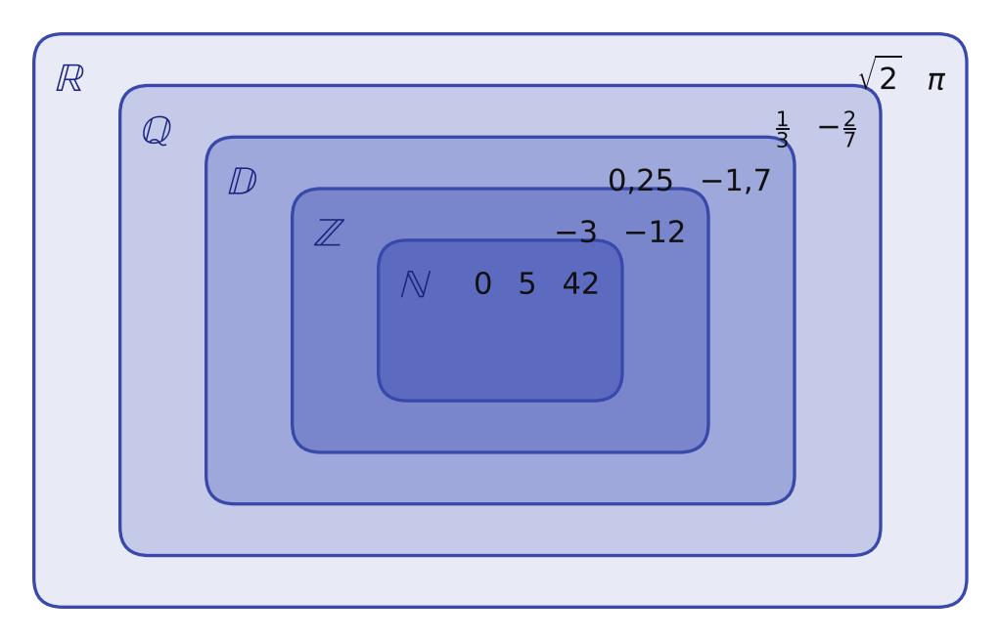
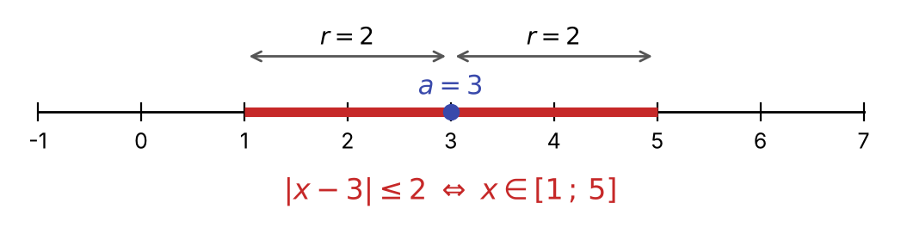

# Cours — Nombres, ensembles et arithmétique

[📄 Cours en PDF (version classique)](pdf/cours.pdf){ .md-button }
[📄 Cours complet avec toutes les démonstrations (PDF)](pdf/cours-complet.pdf){ .md-button }

!!! lecture "Comment lire les démonstrations"
    Chaque résultat est démontré dès que c'est possible avec les outils de Seconde.

    Sur le site, clique sur un bloc pour l'ouvrir.

    - **Démonstration — au programme** : à savoir refaire, elle peut être demandée en évaluation.
    - **Démonstration — pour aller plus loin** : à comprendre, inutile de l'apprendre par cœur.
    - **Pourquoi ce résultat est admis** : la preuve demande une notion vue plus tard, qui est indiquée.

---

## 1. Les ensembles de nombres

!!! definition "Les ensembles de nombres"
    - $\mathbb{N}$ : les **entiers naturels** $0, 1, 2, 3, \ldots$
    - $\mathbb{Z}$ : les **entiers relatifs** $\ldots, -2, -1, 0, 1, 2, \ldots$
    - $\mathbb{D}$ : les **nombres décimaux**, qui s'écrivent $\dfrac{a}{10^n}$ avec $a \in \mathbb{Z}$ et $n \in \mathbb{N}$ (ils ont un nombre fini de chiffres après la virgule).
    - $\mathbb{Q}$ : les **nombres rationnels**, qui s'écrivent $\dfrac{p}{q}$ avec $p \in \mathbb{Z}$ et $q \in \mathbb{N}$, $q \neq 0$.
    - $\mathbb{R}$ : les **nombres réels**, qui correspondent aux abscisses des points d'une droite graduée.

    Un réel qui n'est pas rationnel est dit **irrationnel** : par exemple $\sqrt{2}$ ou $\pi$.

!!! propriete "Inclusions"
    $$\mathbb{N} \subset \mathbb{Z} \subset \mathbb{D} \subset \mathbb{Q} \subset \mathbb{R}.$$
    Chaque inclusion est **stricte** : $-1 \in \mathbb{Z}$ mais $-1 \notin \mathbb{N}$ ; $0{,}5 \in \mathbb{D}$ mais $0{,}5 \notin \mathbb{Z}$ ; $\frac{1}{3} \in \mathbb{Q}$ mais $\frac{1}{3} \notin \mathbb{D}$ ; $\sqrt{2} \in \mathbb{R}$ mais $\sqrt{2} \notin \mathbb{Q}$.

{ width="60%" }

!!! theoreme "Un rationnel non décimal"
    Le nombre $\frac{1}{3}$ n'est pas un nombre décimal.

??? demo "Démonstration — au programme"
    Raisonnons **par l'absurde** : supposons que $\frac{1}{3}$ soit décimal. Il existe alors $a \in \mathbb{Z}$ et $n \in \mathbb{N}$ tels que $\frac{1}{3} = \frac{a}{10^n}$, c'est-à-dire $10^n = 3a$.

    Alors $10^n$ est un multiple de $3$, donc la somme de ses chiffres est un multiple de $3$. Or l'écriture de $10^n$ est un $1$ suivi de $n$ zéros : la somme de ses chiffres vaut $1$, qui n'est pas un multiple de $3$. C'est une contradiction : $\frac{1}{3}$ n'est pas décimal.

!!! theoreme "Un irrationnel"
    Le nombre $\sqrt{2}$ est irrationnel.

??? demo "Démonstration — au programme"
    Raisonnons **par l'absurde** : supposons que $\sqrt{2} = \frac{p}{q}$ avec $p$ et $q$ entiers naturels non nuls, la fraction étant **irréductible** (on peut toujours simplifier une fraction jusqu'à ce qu'elle le soit).

    En élevant au carré : $2 = \frac{p^2}{q^2}$, donc $p^2 = 2q^2$. Ainsi $p^2$ est pair, donc $p$ est pair (car le carré d'un nombre impair est impair, voir la partie 5). On écrit $p = 2k$ : alors $4k^2 = 2q^2$, soit $q^2 = 2k^2$. Donc $q^2$ est pair, et $q$ est pair.

    $p$ et $q$ sont tous deux pairs : la fraction $\frac{p}{q}$ se simplifie par $2$, ce qui contredit son irréductibilité. Donc $\sqrt{2}$ est irrationnel.

??? demoplus "Démonstration de l'irrationalité de $\sqrt{3}$ — pour aller plus loin"
    Même raisonnement : si $\sqrt{3} = \frac{p}{q}$ irréductible, alors $p^2 = 3q^2$. On montre (en étudiant les restes $0$, $1$, $2$ dans la division par $3$) que si $p^2$ est multiple de $3$, alors $p$ l'est : $p = 3k$, puis $q^2 = 3k^2$, donc $q$ est multiple de $3$. Contradiction.

??? admis "Pourquoi l'ensemble des réels est admis"
    On admet l'existence de l'ensemble $\mathbb{R}$, avec ses opérations et l'idée que « chaque point de la droite graduée a une abscisse ». Une construction rigoureuse des réels à partir des rationnels (par les coupures de Dedekind ou les suites de Cauchy) est faite dans l'enseignement supérieur.

---

## 2. Intervalles

!!! definition "Intervalles"
    Pour deux réels $a < b$ :

    | Intervalle | Réels $x$ tels que | Intervalle | Réels $x$ tels que |
    |---|---|---|---|
    | $[a\,;\,b]$ | $a \leq x \leq b$ | $[a\,;\,+\infty[$ | $x \geq a$ |
    | $]a\,;\,b[$ | $a < x < b$ | $]a\,;\,+\infty[$ | $x > a$ |
    | $[a\,;\,b[$ | $a \leq x < b$ | $]-\infty\,;\,b]$ | $x \leq b$ |
    | $]a\,;\,b]$ | $a < x \leq b$ | $]-\infty\,;\,b[$ | $x < b$ |

    Le crochet est **tourné vers le nombre** s'il est inclus, **vers l'extérieur** sinon. Du côté de $\pm\infty$, le crochet est toujours ouvert. On note aussi $\mathbb{R} = ]-\infty\,;\,+\infty[$.

!!! definition "Réunion et intersection"
    - L'**intersection** $I \cap J$ est l'ensemble des réels qui appartiennent **à la fois** à $I$ et à $J$.
    - La **réunion** $I \cup J$ est l'ensemble des réels qui appartiennent à $I$ **ou** à $J$ (ou aux deux).

**Exemple.** $[-2\,;\,3] \cap ]1\,;\,5] = ]1\,;\,3]$ et $[-2\,;\,3] \cup ]1\,;\,5] = [-2\,;\,5]$. En revanche, $[0\,;\,1] \cup [2\,;\,3]$ ne s'écrit pas comme un seul intervalle.

---

## 3. Valeur absolue et distance

!!! definition "Valeur absolue"
    La **valeur absolue** d'un réel $x$, notée $|x|$, est égale à $x$ si $x \geq 0$, et à $-x$ si $x < 0$. C'est la **distance** entre $0$ et $x$ sur la droite graduée.

    Plus généralement, la **distance** entre deux réels $a$ et $b$ est $|a - b| = |b - a|$.

**Exemples.** $|7| = 7$ ; $|-4| = 4$ ; $|3 - 8| = 5$ : la distance entre $3$ et $8$ vaut $5$. On a toujours $|x| \geq 0$ et $|-x| = |x|$.

!!! propriete "Intervalle centré"
    Pour tout réel $a$ et tout réel $r > 0$ :
    $$|x - a| \leq r \iff a - r \leq x \leq a + r \iff x \in [a - r\,;\,a + r].$$
    L'intervalle $[a - r\,;\,a + r]$ a pour **centre** $a$ et pour **rayon** $r$.

{ width="70%" }

??? demoplus "Démonstration — pour aller plus loin"
    $|x - a|$ est la distance entre $x$ et $a$. Dire qu'elle est au plus $r$, c'est dire que $x$ est à gauche de $a$ à une distance au plus $r$ (donc $a - r \leq x \leq a$), ou à droite à une distance au plus $r$ (donc $a \leq x \leq a + r$).

    Par le calcul : si $x \geq a$, $|x - a| = x - a \leq r \iff x \leq a + r$ ; si $x < a$, $|x - a| = a - x \leq r \iff x \geq a - r$. Dans les deux cas, on obtient $a - r \leq x \leq a + r$.

**Exemple.** $|x + 1| < 3 \iff |x - (-1)| < 3 \iff x \in ]-4\,;\,2[$.

---

## 4. Encadrements et arrondis

!!! definition "Encadrement décimal, arrondi"
    - Encadrer un réel $x$ **à $10^{-n}$ près**, c'est trouver deux décimaux $a$ et $b$ tels que $a \leq x \leq b$ et $b - a = 10^{-n}$.
    - L'**arrondi** de $x$ à $10^{-n}$ est la borne de cet encadrement la plus proche de $x$.

**Exemple.** $1{,}4^2 = 1{,}96$ et $1{,}5^2 = 2{,}25$, donc $1{,}4 < \sqrt{2} < 1{,}5$ : c'est un encadrement de $\sqrt{2}$ à $10^{-1}$ près. En continuant ($1{,}41^2 = 1{,}9881$ et $1{,}42^2 = 2{,}0164$) : $1{,}41 < \sqrt{2} < 1{,}42$, et l'arrondi au centième est $1{,}41$.

!!! tip "Valeur exacte, valeur approchée"
    $\frac{1}{3}$ et $\sqrt{2}$ sont des **valeurs exactes**. $0{,}33$ et $1{,}41$ sont des **valeurs approchées** : on écrit $\sqrt{2} \approx 1{,}41$, jamais $\sqrt{2} = 1{,}41$.

---

## 5. Arithmétique

Dans cette partie, les lettres désignent des **entiers relatifs**.

!!! definition "Multiples et diviseurs"
    On dit que $b$ est un **multiple** de $a$ (ou que $a$ est un **diviseur** de $b$, ou que $a$ **divise** $b$) s'il existe un entier $k$ tel que $b = ka$.

**Exemples.** $42 = 6 \times 7$ : $42$ est un multiple de $6$ et de $7$. Les diviseurs positifs de $12$ sont $1, 2, 3, 4, 6, 12$. $0$ est un multiple de tout entier.

!!! theoreme "Somme de multiples"
    Si $b$ et $c$ sont deux multiples de $a$, alors $b + c$ est un multiple de $a$.

??? demo "Démonstration — au programme"
    Il existe des entiers $k$ et $k'$ tels que $b = ka$ et $c = k'a$. Alors $b + c = ka + k'a = (k + k')a$, et $k + k'$ est un entier : $b + c$ est un multiple de $a$.

    *De même, $b - c = (k - k')a$ est un multiple de $a$.*

!!! definition "Nombres pairs et impairs"
    Un entier est **pair** s'il est multiple de $2$ : il s'écrit $2k$ avec $k$ entier. Sinon il est **impair** : il s'écrit $2k + 1$ avec $k$ entier.

!!! theoreme "Carré d'un nombre impair"
    Le carré d'un nombre impair est impair.

??? demo "Démonstration — au programme"
    Soit $n$ impair : $n = 2k + 1$ avec $k$ entier. Alors
    $$n^2 = (2k + 1)^2 = 4k^2 + 4k + 1 = 2(2k^2 + 2k) + 1,$$
    et $2k^2 + 2k$ est un entier : $n^2$ est impair.

!!! propriete "Conséquence"
    Si $n^2$ est pair, alors $n$ est pair.

??? demoplus "Démonstration — pour aller plus loin"
    C'est la **contraposée** du théorème précédent : « si $n$ est impair, alors $n^2$ est impair » équivaut à « si $n^2$ n'est pas impair, alors $n$ n'est pas impair ».

!!! definition "Nombre premier"
    Un entier naturel est **premier** s'il admet exactement **deux diviseurs positifs** : $1$ et lui-même. Les premiers nombres premiers sont $2, 3, 5, 7, 11, 13, 17, 19, 23, 29, \ldots$ ($1$ n'est pas premier : il n'a qu'un diviseur.)

!!! propriete "Décomposition en facteurs premiers"
    Tout entier supérieur ou égal à $2$ se décompose en un produit de nombres premiers, et cette décomposition est unique (à l'ordre des facteurs près).

**Exemple.** $360 = 2^3 \times 3^2 \times 5$. Cette décomposition permet de **simplifier des fractions** : $\frac{84}{360} = \frac{2^2 \times 3 \times 7}{2^3 \times 3^2 \times 5} = \frac{7}{2 \times 3 \times 5} = \frac{7}{30}$, fraction **irréductible**.

??? admis "Pourquoi l'unicité de la décomposition est admise"
    L'existence se montre facilement (on divise par le plus petit diviseur premier, et on recommence). L'**unicité** repose sur le lemme d'Euclide (« si un nombre premier divise un produit, il divise l'un des facteurs »), démontré en Terminale dans l'option mathématiques expertes.

!!! propriete "Il y a une infinité de nombres premiers"
    Aucune liste finie ne contient tous les nombres premiers.

??? demoplus "Démonstration (Euclide) — pour aller plus loin"
    Supposons qu'il n'y en ait qu'un nombre fini, $p_1, p_2, \ldots, p_n$, et posons $N = p_1 \times p_2 \times \cdots \times p_n + 1$. $N \geq 2$, donc $N$ a un diviseur premier $p$, qui est l'un des $p_i$. Alors $p$ divise $N$ et $p$ divise le produit $p_1 \cdots p_n$, donc il divise leur différence, qui vaut $1$. C'est impossible.

---

## 6. Pour aller plus loin

- **Les nombres premiers et la cryptographie.** Multiplier deux grands nombres premiers est rapide ; retrouver les deux facteurs à partir du produit est extrêmement long. C'est le principe du chiffrement RSA, qui protège les paiements en ligne.
- **Développement décimal.** Un nombre est rationnel si et seulement si son développement décimal est **périodique** à partir d'un certain rang : $\frac{1}{7} = 0{,}142857\,142857\ldots$
- **$\pi$ est irrationnel** (Lambert, 1761) et même **transcendant** (Lindemann, 1882) : il n'est solution d'aucune équation polynomiale à coefficients entiers. C'est pourquoi la « quadrature du cercle » à la règle et au compas est impossible.

!!! success "Tu as fini le cours"
    Passe aux [méthodes](methodes.md), puis entraîne-toi avec les exercices corrigés.
