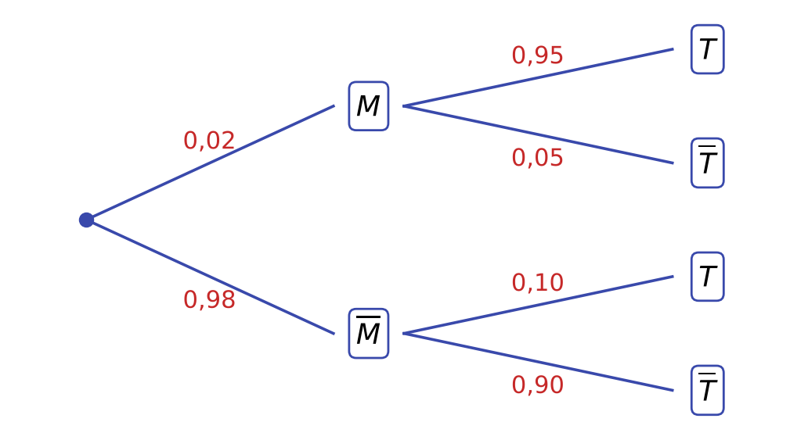
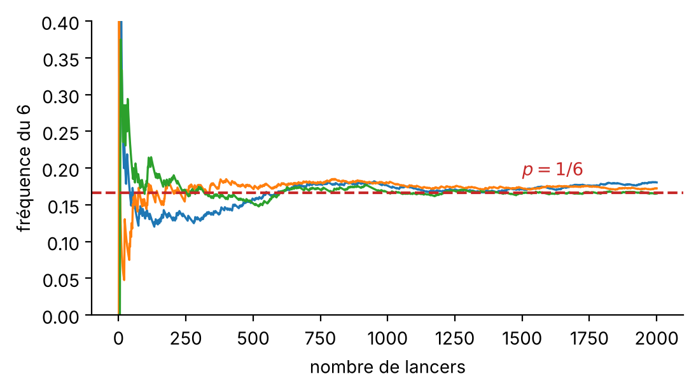

# Cours — Probabilités

[📄 Cours en PDF (version classique)](pdf/cours.pdf){ .md-button }
[📄 Cours complet avec toutes les démonstrations (PDF)](pdf/cours-complet.pdf){ .md-button }

!!! lecture "Comment lire les démonstrations"
    Chaque résultat est démontré dès que c'est possible avec les outils de Seconde.

    Sur le site, clique sur un bloc pour l'ouvrir.

    - **Démonstration — au programme** : à savoir refaire, elle peut être demandée en évaluation.
    - **Démonstration — pour aller plus loin** : à comprendre, inutile de l'apprendre par cœur.
    - **Pourquoi ce résultat est admis** : la preuve demande une notion vue plus tard, qui est indiquée.

---

## 1. Expérience aléatoire et loi de probabilité

!!! definition "Vocabulaire"
    - Une **expérience aléatoire** a plusieurs résultats possibles, et on ne peut pas prévoir lequel se produira.
    - Les résultats possibles sont les **issues** ; leur ensemble est l'**univers**, noté $\Omega$.
    - Un **événement** est une partie de l'univers. On dit qu'il est **réalisé** si l'issue obtenue lui appartient. Un événement qui ne contient qu'une issue est **élémentaire**.

**Exemple.** On lance un dé à six faces : $\Omega = \{1, 2, 3, 4, 5, 6\}$. L'événement $A$ : « obtenir un nombre pair » est $A = \{2, 4, 6\}$.

!!! definition "Loi de probabilité"
    Définir une **loi de probabilité** sur $\Omega = \{x_1, \ldots, x_n\}$, c'est associer à chaque issue $x_i$ un nombre $p_i \geq 0$, sa **probabilité**, avec $p_1 + p_2 + \cdots + p_n = 1$.

    La probabilité d'un événement $A$ est la **somme des probabilités des issues** qui le composent.

!!! definition "Équiprobabilité"
    Si toutes les issues ont la même probabilité, on parle d'**équiprobabilité** (« dé équilibré », « tirage au hasard »). Alors
    $$P(A) = \frac{\text{nombre d'issues de } A}{\text{nombre d'issues de } \Omega}.$$

**Exemple.** Avec un dé équilibré, $P(A) = \frac{3}{6} = \frac{1}{2}$.

**Exemple d'une loi non équiprobable.** Un dé est truqué : le $6$ sort avec la probabilité $0{,}3$, et les autres faces sont équiprobables. Chacune a pour probabilité $\frac{1 - 0{,}3}{5} = 0{,}14$.

---

## 2. Opérations sur les événements

!!! definition "Contraire, intersection, réunion"
    - L'**événement contraire** de $A$, noté $\overline{A}$, est formé des issues qui ne sont pas dans $A$.
    - $A \cap B$ (« $A$ **et** $B$ ») est formé des issues qui sont à la fois dans $A$ et dans $B$.
    - $A \cup B$ (« $A$ **ou** $B$ ») est formé des issues qui sont dans $A$, ou dans $B$, ou dans les deux.
    - $A$ et $B$ sont **incompatibles** si $A \cap B = \varnothing$ : ils ne peuvent pas être réalisés en même temps.

!!! theoreme "Formules"
    $$P\left(\overline{A}\right) = 1 - P(A), \qquad P(A \cup B) = P(A) + P(B) - P(A \cap B).$$
    Si $A$ et $B$ sont incompatibles : $P(A \cup B) = P(A) + P(B)$.

??? demoplus "Démonstration — pour aller plus loin"
    Les issues de $\Omega$ se répartissent entre $A$ et $\overline{A}$ : la somme de toutes les probabilités vaut $1$, donc $P(A) + P\left(\overline{A}\right) = 1$.

    Pour la réunion : quand on additionne $P(A)$ et $P(B)$, les probabilités des issues de $A \cap B$ sont comptées **deux fois** ; on les retire une fois.

**Exemple.** On tire une carte dans un jeu de $32$ cartes. $C$ : « cœur » ($8$ cartes), $R$ : « roi » ($4$ cartes), $C \cap R$ : « roi de cœur ». $P(C \cup R) = \frac{8}{32} + \frac{4}{32} - \frac{1}{32} = \frac{11}{32}$.

---

## 3. Tableaux et arbres

Pour une expérience à **deux épreuves** (deux lancers, deux tirages…), on représente les issues :

- dans un **tableau à double entrée** (lignes : première épreuve, colonnes : seconde) ;
- ou par un **arbre**, en suivant les épreuves dans l'ordre.

**Exemple (tableau).** On lance deux dés équilibrés et on fait la somme. Le tableau a $6 \times 6 = 36$ cases équiprobables. La somme $7$ apparaît $6$ fois : $P(\text{« somme } 7\text{ »}) = \frac{6}{36} = \frac{1}{6}$.

**Exemple (arbre).** Une urne contient $2$ boules rouges et $1$ verte. On tire deux boules **sans remise**. On numérote $R_1$, $R_2$, $V$ : l'arbre a $3 \times 2 = 6$ chemins équiprobables ($R_1R_2$, $R_1V$, $R_2R_1$, $R_2V$, $VR_1$, $VR_2$). $P(\text{« deux rouges »}) = \frac{2}{6} = \frac{1}{3}$.

!!! tip "Avec ou sans remise"
    **Avec remise**, la composition de l'urne est la même à chaque tirage : on peut tirer deux fois la même boule. **Sans remise**, le nombre de boules diminue de $1$ après chaque tirage.

---

## 4. Probabilités conditionnelles

On choisit au hasard une personne dans une population de $10\,000$ personnes, dont $200$ sont malades ($M$). On leur fait passer un test ($T$ : « le test est positif »).

| | $T$ | $\overline{T}$ | Total |
|---|---|---|---|
| $M$ | $190$ | $10$ | $200$ |
| $\overline{M}$ | $980$ | $8\,820$ | $9\,800$ |
| Total | $1\,170$ | $8\,830$ | $10\,000$ |

!!! definition "Probabilité conditionnelle"
    La **probabilité de $B$ sachant $A$**, notée $P_A(B)$, est la probabilité que $B$ soit réalisé **lorsqu'on sait que $A$ l'est**. En situation d'équiprobabilité :
    $$P_A(B) = \frac{\text{nombre d'issues de } A \cap B}{\text{nombre d'issues de } A}.$$
    On restreint l'univers à l'événement $A$.

**Exemple.** $P_M(T) = \frac{190}{200} = 0{,}95$ : le test est positif chez $95\,\%$ des malades. $P_T(M) = \frac{190}{1\,170} \approx 0{,}16$ : seulement $16\,\%$ des personnes testées positives sont malades.

!!! warning "$P_A(B)$ et $P_B(A)$ sont différentes"
    Ici, $P_M(T) = 0{,}95$ mais $P_T(M) \approx 0{,}16$. Confondre les deux est une erreur classique (et lourde de conséquences en médecine ou en justice).

!!! info "Vocabulaire des tests de dépistage"
    - **Sensibilité** : $P_M(T)$, la probabilité qu'un malade soit détecté.
    - **Spécificité** : $P_{\overline{M}}\left(\overline{T}\right)$, la probabilité qu'une personne saine ait un test négatif. Ici $\frac{8\,820}{9\,800} = 0{,}9$.
    - **Faux positif** : personne saine testée positive ; **faux négatif** : personne malade testée négative.
    - **Valeur prédictive positive** : $P_T(M)$, la probabilité d'être malade quand le test est positif.

**Arbre pondéré.** La même situation se représente par un arbre dont les branches portent des probabilités : au premier niveau $P(M) = 0{,}02$ et $P\left(\overline{M}\right) = 0{,}98$ ; au second niveau, les probabilités **conditionnelles** $P_M(T) = 0{,}95$, $P_{\overline{M}}(T) = 0{,}10$, etc.

{ width="60%" }

!!! propriete "Probabilité d'un chemin"
    La probabilité d'obtenir $A$ puis $B$ est le **produit** des probabilités le long du chemin : $P(A \cap B) = P(A) \times P_A(B)$.

??? demoplus "Justification dans le cas équiprobable — pour aller plus loin"
    $P(A) \times P_A(B) = \frac{n_A}{n_\Omega} \times \frac{n_{A \cap B}}{n_A} = \frac{n_{A \cap B}}{n_\Omega} = P(A \cap B)$.

**Exemple.** $P(M \cap T) = 0{,}02 \times 0{,}95 = 0{,}019$ : cela correspond aux $190$ personnes sur $10\,000$ du tableau.

---

## 5. Simulation et fréquences

On peut **simuler** une expérience aléatoire en Python avec le module `random` : `randint(1, 6)` donne un entier au hasard entre $1$ et $6$, `random()` un réel au hasard dans $[0\,;\,1[$.

```python
from random import randint

def frequence_6(n):
    nb = 0
    for i in range(n):
        if randint(1, 6) == 6:
            nb = nb + 1
    return nb / n

print(frequence_6(10000))   # proche de 1/6 = 0.1667
```

{ width="65%" }

!!! info "Fréquence et probabilité"
    Quand on répète une expérience un grand nombre de fois, la **fréquence** d'un événement **se stabilise** autour de sa **probabilité**. Cela permet d'**estimer** une probabilité inconnue (pièce truquée, phénomène naturel) en observant des fréquences.

??? admis "Pourquoi ce résultat est admis"
    Ce phénomène, la **loi des grands nombres**, se démontre en Terminale avec l'inégalité de Bienaymé-Tchebychev ([chapitre de Terminale](../../terminale/loi-grands-nombres/index.md)). En Seconde, on se contente de l'observer par simulation.

---

## 6. Pour aller plus loin

- **Probabilités conditionnelles et indépendance** (Première) : formule des probabilités totales, inversion du conditionnement, indépendance de deux événements ([Première, chapitre 9](../../premiere/probabilites-conditionnelles/index.md)).
- **Variables aléatoires** (Première) : associer un nombre (un gain, un nombre de succès) à chaque issue, et calculer une **espérance** ([Première, chapitre 10](../../premiere/variables-aleatoires/index.md)).
- **Le problème des anniversaires** : dans une classe de $23$ élèves, il y a plus d'une chance sur deux que deux élèves soient nés le même jour (exercice 28).

!!! success "Tu as fini le cours"
    Passe aux [méthodes](methodes.md), puis entraîne-toi avec les exercices corrigés.
