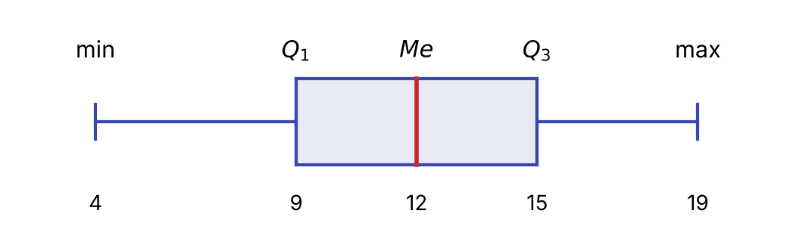
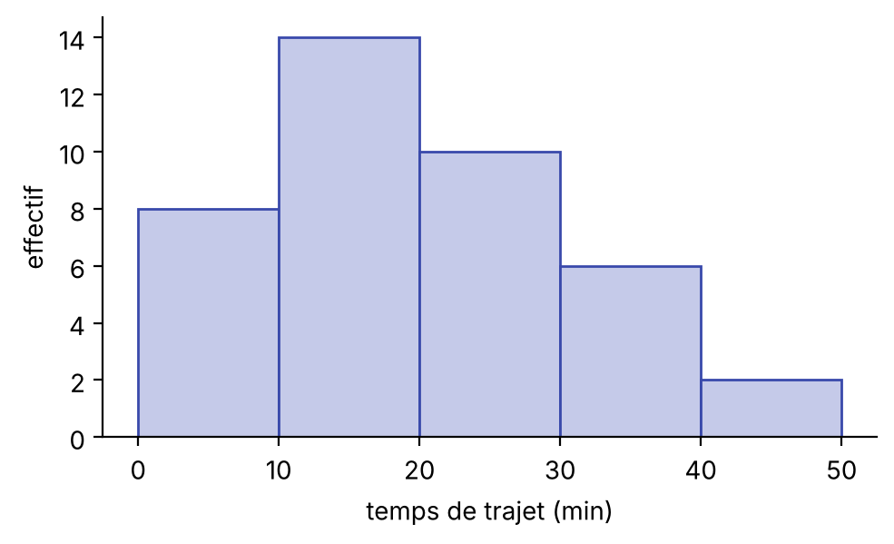

# Cours — Information chiffrée et statistiques

[📄 Cours en PDF (version classique)](pdf/cours.pdf){ .md-button }
[📄 Cours complet avec toutes les démonstrations (PDF)](pdf/cours-complet.pdf){ .md-button }

!!! lecture "Comment lire les démonstrations"
    Chaque résultat est démontré dès que c'est possible avec les outils de Seconde.

    Sur le site, clique sur un bloc pour l'ouvrir.

    - **Démonstration — au programme** : à savoir refaire, elle peut être demandée en évaluation.
    - **Démonstration — pour aller plus loin** : à comprendre, inutile de l'apprendre par cœur.
    - **Pourquoi ce résultat est admis** : la preuve demande une notion vue plus tard, qui est indiquée.

---

## 1. Proportions

!!! definition "Proportion"
    Soit $A$ une partie d'une population $E$. La **proportion** (ou **fréquence**) de $A$ dans $E$ est
    $$p = \frac{n_A}{n_E},$$
    où $n_A$ et $n_E$ sont les effectifs. On a $0 \leq p \leq 1$ ; on l'écrit souvent en pourcentage.

!!! propriete "Calculs"
    - $n_A = p \times n_E$ : prendre $t\,\%$ d'une quantité, c'est la multiplier par $\frac{t}{100}$.
    - **Proportion de proportion** : si $A \subset B \subset E$, avec $p$ la proportion de $A$ dans $B$ et $p'$ celle de $B$ dans $E$, alors la proportion de $A$ dans $E$ est $p \times p'$.

??? demoplus "Démonstration — pour aller plus loin"
    $\frac{n_A}{n_E} = \frac{n_A}{n_B} \times \frac{n_B}{n_E} = p \times p'$.

**Exemple.** $40\,\%$ des élèves d'un lycée sont en Seconde, et $30\,\%$ des Secondes sont externes. Proportion d'élèves du lycée qui sont en Seconde et externes : $0{,}4 \times 0{,}3 = 0{,}12$, soit $12\,\%$.

!!! warning "On n'additionne pas des pourcentages de populations différentes"
    Si $20\,\%$ des filles et $30\,\%$ des garçons font du théâtre, la proportion de l'ensemble des élèves qui font du théâtre **n'est pas** $50\,\%$, ni forcément $25\,\%$ : elle dépend des effectifs de filles et de garçons.

---

## 2. Évolutions

!!! definition "Taux d'évolution, coefficient multiplicateur"
    Une grandeur passe d'une valeur de départ $V_D \neq 0$ à une valeur d'arrivée $V_A$.

    - Le **taux d'évolution** est $t = \dfrac{V_A - V_D}{V_D}$ (positif pour une hausse, négatif pour une baisse).
    - Le **coefficient multiplicateur** est $CM = \dfrac{V_A}{V_D} = 1 + t$.

!!! propriete "Augmenter ou diminuer d’un pourcentage"
    - Augmenter de $t\,\%$, c'est multiplier par $1 + \frac{t}{100}$.
    - Diminuer de $t\,\%$, c'est multiplier par $1 - \frac{t}{100}$.

**Exemples.** $+15\,\%$ : $\times 1{,}15$. $-8\,\%$ : $\times 0{,}92$. Un prix passe de $40$ € à $46$ € : $t = \frac{6}{40} = 0{,}15$, soit $+15\,\%$.

!!! theoreme "Évolutions successives"
    Si une grandeur subit des évolutions successives de coefficients $CM_1$, $CM_2$, …, $CM_n$, le coefficient multiplicateur **global** est le **produit** $CM_1 \times CM_2 \times \cdots \times CM_n$.

??? demoplus "Démonstration — pour aller plus loin"
    Pour deux évolutions : $V_1 = CM_1 \times V_0$, puis $V_2 = CM_2 \times V_1 = (CM_1 \times CM_2) \times V_0$. On recommence pour les évolutions suivantes.

!!! warning "Les taux ne s'additionnent pas"
    Une hausse de $20\,\%$ suivie d'une baisse de $20\,\%$ : $1{,}2 \times 0{,}8 = 0{,}96$, soit une **baisse** globale de $4\,\%$ (et non $0\,\%$).

!!! theoreme "Évolution réciproque"
    L'évolution qui ramène $V_A$ à $V_D$ a pour coefficient multiplicateur $\dfrac{1}{CM}$.

??? demoplus "Démonstration — pour aller plus loin"
    $V_A = CM \times V_D \iff V_D = \frac{1}{CM} \times V_A$.

**Exemple.** Après une baisse de $20\,\%$ ($CM = 0{,}8$), il faut multiplier par $\frac{1}{0{,}8} = 1{,}25$, c'est-à-dire augmenter de $25\,\%$, pour retrouver la valeur de départ.

---

## 3. Indicateurs de position

On étudie une série statistique de valeurs $x_1, x_2, \ldots, x_p$ d'effectifs $n_1, n_2, \ldots, n_p$, d'effectif total $N = n_1 + n_2 + \cdots + n_p$.

!!! definition "Moyenne"
    $$\bar{x} = \frac{n_1x_1 + n_2x_2 + \cdots + n_px_p}{N} = f_1x_1 + f_2x_2 + \cdots + f_px_p,$$
    où $f_i = \frac{n_i}{N}$ est la **fréquence** de la valeur $x_i$.

!!! propriete "Linéarité de la moyenne"
    Si l'on transforme chaque valeur $x_i$ en $ax_i + b$, la moyenne devient $a\bar{x} + b$.

??? demoplus "Démonstration — pour aller plus loin"
    $\frac{1}{N}\sum n_i(ax_i + b) = a \times \frac{1}{N}\sum n_ix_i + b \times \frac{1}{N}\sum n_i = a\bar{x} + b$.

**Exemple.** Toutes les notes d'un contrôle sont augmentées de $2$ points : la moyenne augmente de $2$. On convertit des températures en °F ($F = 1{,}8C + 32$) : la moyenne se convertit de la même façon.

!!! definition "Médiane, quartiles"
    Les valeurs étant rangées dans l'ordre croissant (avec répétitions) :

    - la **médiane** $Me$ partage la série en deux groupes de même effectif : au moins $50\,\%$ des valeurs sont inférieures ou égales à $Me$, et au moins $50\,\%$ sont supérieures ou égales ;
    - le **premier quartile** $Q_1$ est la plus petite valeur de la série telle qu'au moins $25\,\%$ des valeurs lui soient inférieures ou égales ;
    - le **troisième quartile** $Q_3$ est la plus petite valeur telle qu'au moins $75\,\%$ des valeurs lui soient inférieures ou égales.

!!! tip "Calculer la médiane et les quartiles"
    Avec $N$ valeurs rangées : si $N$ est impair, $Me$ est la valeur de rang $\frac{N + 1}{2}$ ; si $N$ est pair, c'est la moyenne des valeurs de rangs $\frac{N}{2}$ et $\frac{N}{2} + 1$. $Q_1$ est la valeur de rang égal au premier entier supérieur ou égal à $\frac{N}{4}$ ; $Q_3$, au premier entier supérieur ou égal à $\frac{3N}{4}$.

**Exemple.** Notes : $4\,;\,7\,;\,9\,;\,10\,;\,12\,;\,12\,;\,14\,;\,15\,;\,16\,;\,19$ ($N = 10$). $Me = \frac{12 + 12}{2} = 12$ ; $\frac{N}{4} = 2{,}5$, donc $Q_1$ est la 3ᵉ valeur : $9$ ; $\frac{3N}{4} = 7{,}5$, donc $Q_3$ est la 8ᵉ valeur : $15$.

!!! info "Moyenne ou médiane ?"
    La médiane est **peu sensible aux valeurs extrêmes**, contrairement à la moyenne. Pour des salaires, quelques très hauts revenus tirent la moyenne vers le haut : la médiane décrit mieux le salaire « typique ».

---

## 4. Indicateurs de dispersion

!!! definition "Étendue, écart interquartile"
    - L'**étendue** est la différence entre la plus grande et la plus petite valeur.
    - L'**écart interquartile** est $Q_3 - Q_1$ : environ la moitié des valeurs, les plus « centrales », sont dans $[Q_1\,;\,Q_3]$.

!!! definition "Écart type"
    La **variance** est la moyenne des carrés des écarts à la moyenne :
    $$V = \frac{n_1(x_1 - \bar{x})^2 + \cdots + n_p(x_p - \bar{x})^2}{N}.$$
    L'**écart type** est $\sigma = \sqrt{V}$. Il mesure la dispersion des valeurs **autour de la moyenne**, dans la même unité que les valeurs.

**Exemple.** Série $8\,;\,10\,;\,12$ : $\bar{x} = 10$, $V = \frac{4 + 0 + 4}{3} = \frac{8}{3}$, $\sigma = \sqrt{\frac{8}{3}} \approx 1{,}63$. Série $2\,;\,10\,;\,18$ : même moyenne, $\sigma = \sqrt{\frac{128}{3}} \approx 6{,}53$ : beaucoup plus dispersée.

!!! propriete "Transformation affine"
    Si les valeurs $x_i$ deviennent $ax_i + b$, l'écart type devient $|a|\sigma$ (ajouter une constante ne change pas la dispersion).

??? demoplus "Démonstration — pour aller plus loin"
    Les écarts à la moyenne deviennent $(ax_i + b) - (a\bar{x} + b) = a(x_i - \bar{x})$ ; leurs carrés sont multipliés par $a^2$, donc la variance aussi, et l'écart type est multiplié par $\sqrt{a^2} = |a|$.

!!! definition "Diagramme en boîte"
    On résume une série par un **diagramme en boîte** : une boîte de $Q_1$ à $Q_3$ coupée par la médiane, et des « moustaches » jusqu'au minimum et au maximum.

{ width="65%" }

Le couple (moyenne ; écart type) et le couple (médiane ; écart interquartile) sont les deux façons classiques de résumer une série.

---

## 5. Séries regroupées en classes

Lorsque les valeurs sont nombreuses, on les regroupe en **classes** $[a\,;\,b[$. On représente la série par un **histogramme**.

{ width="55%" }

| Temps (min) | $[0\,;\,10[$ | $[10\,;\,20[$ | $[20\,;\,30[$ | $[30\,;\,40[$ | $[40\,;\,50[$ |
|---|---|---|---|---|---|
| Effectif | $8$ | $14$ | $10$ | $6$ | $2$ |

!!! propriete "Moyenne d'une série en classes"
    On remplace chaque classe par son **centre** $\frac{a + b}{2}$, puis on calcule la moyenne comme d'habitude. On obtient une **valeur approchée** de la moyenne.

**Exemple.** $\bar{x} \approx \frac{8 \times 5 + 14 \times 15 + 10 \times 25 + 6 \times 35 + 2 \times 45}{40} = \frac{800}{40} = 20$ min.

??? admis "Pourquoi le résultat est approché"
    À l'intérieur d'une classe, on ne connaît pas les valeurs exactes : on fait comme si elles étaient toutes égales au centre. Le résultat est exact seulement si, dans chaque classe, les valeurs se compensent autour du centre.

---

## 6. Tableaux croisés

Un **tableau croisé d'effectifs** répartit une population selon **deux caractères**.

| | Sport | Pas de sport | Total |
|---|---|---|---|
| Fille | $120$ | $80$ | $200$ |
| Garçon | $180$ | $120$ | $300$ |
| Total | $300$ | $200$ | $500$ |

!!! definition "Fréquences marginales et conditionnelles"
    - Une **fréquence marginale** se calcule avec les **totaux** : proportion de sportifs dans la population, $\frac{300}{500} = 0{,}6$.
    - Une **fréquence conditionnelle** se calcule **à l'intérieur** d'une ligne ou d'une colonne : proportion de sportifs **parmi les filles**, $\frac{120}{200} = 0{,}6$ ; proportion de filles **parmi les sportifs**, $\frac{120}{300} = 0{,}4$.

!!! tip "Repérer la population de référence"
    Les mots « parmi », « chez les », « sachant que » indiquent la population de référence : c'est elle qui donne le **dénominateur**. Les fréquences conditionnelles préparent les **probabilités conditionnelles** ([chapitre 9](../index.md)).

---

## 7. Statistiques en Python

```python
from math import sqrt

def moyenne(L):
    return sum(L) / len(L)

def ecart_type(L):
    m = moyenne(L)
    return sqrt(sum((x - m)**2 for x in L) / len(L))

def mediane(L):
    T = sorted(L)
    n = len(T)
    if n % 2 == 1:
        return T[n // 2]
    return (T[n // 2 - 1] + T[n // 2]) / 2

notes = [4, 7, 9, 10, 12, 12, 14, 15, 16, 19]
print(moyenne(notes), mediane(notes), ecart_type(notes))   # 11.8  12.0  environ 4.24
```

---

## 8. Pour aller plus loin

- **Indices.** En économie, on compare des grandeurs avec des **indices** base $100$ : si l'indice passe de $100$ à $112$, la grandeur a augmenté de $12\,\%$.
- **Intérêts composés.** Un placement à $3\,\%$ par an pendant $n$ ans est multiplié par $1{,}03^n$ : c'est une **suite géométrique** ([Première, chapitre 1](../../premiere/suites/index.md)).
- **Paradoxe de Simpson.** Un traitement peut être meilleur dans chaque groupe de patients et pourtant moins bon globalement, à cause de la répartition des effectifs : il faut toujours regarder les fréquences conditionnelles.

!!! success "Tu as fini le cours"
    Passe aux [méthodes](methodes.md), puis entraîne-toi avec les exercices corrigés.
