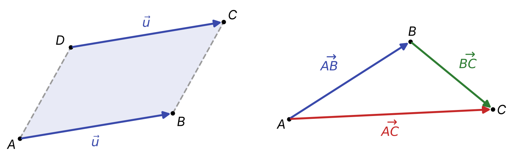
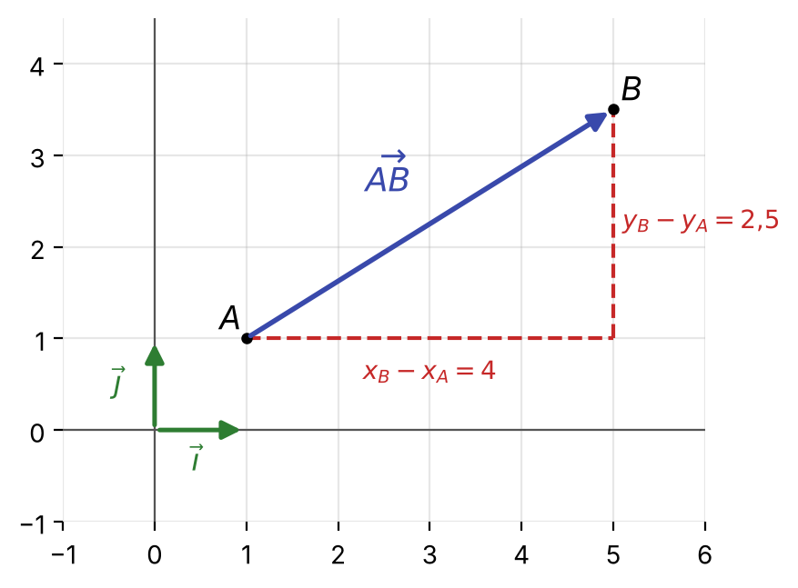

# Cours — Vecteurs

[📄 Cours en PDF (version classique)](pdf/cours.pdf){ .md-button }
[📄 Cours complet avec toutes les démonstrations (PDF)](pdf/cours-complet.pdf){ .md-button }

!!! lecture "Comment lire les démonstrations"
    Chaque résultat est démontré dès que c'est possible avec les outils de Seconde.

    Sur le site, clique sur un bloc pour l'ouvrir.

    - **Démonstration — au programme** : à savoir refaire, elle peut être demandée en évaluation.
    - **Démonstration — pour aller plus loin** : à comprendre, inutile de l'apprendre par cœur.
    - **Pourquoi ce résultat est admis** : la preuve demande une notion vue plus tard, qui est indiquée.

---

## 1. Vecteurs et translations

!!! definition "Vecteur"
    La **translation** qui transforme $A$ en $B$ est le « glissement » qui déplace chaque point dans la **même direction**, le **même sens** et de la **même longueur** que pour aller de $A$ à $B$. On l'appelle translation de **vecteur** $\overrightarrow{AB}$.

    Un vecteur non nul est caractérisé par :

    - une **direction** (celle de la droite $(AB)$) ;
    - un **sens** (de $A$ vers $B$) ;
    - une **norme** (la longueur $AB$), notée $\left\|\overrightarrow{AB}\right\|$.

    Le **vecteur nul**, noté $\vec{0}$, est $\overrightarrow{AA}$ : il n'a ni direction ni sens, et sa norme est nulle.

!!! definition "Vecteurs égaux"
    Deux vecteurs sont **égaux** s'ils ont même direction, même sens et même norme. On les note alors par une même lettre : $\vec{u} = \overrightarrow{AB} = \overrightarrow{DC}$.

!!! propriete "Égalité et parallélogramme"
    $\overrightarrow{AB} = \overrightarrow{DC}$ si et seulement si $ABCD$ est un **parallélogramme** (éventuellement aplati).

{ width="80%" }

!!! definition "Vecteur opposé"
    Le vecteur $\overrightarrow{BA}$ est l'**opposé** de $\overrightarrow{AB}$ : même direction, même norme, sens contraire. On note $\overrightarrow{BA} = -\overrightarrow{AB}$.

!!! propriete "Milieu"
    $I$ est le milieu de $[AB]$ si et seulement si $\overrightarrow{AI} = \overrightarrow{IB}$.

---

## 2. Somme de vecteurs

!!! definition "Somme"
    La **somme** $\vec{u} + \vec{v}$ est le vecteur de la translation obtenue en enchaînant la translation de vecteur $\vec{u}$ puis celle de vecteur $\vec{v}$.

!!! theoreme "Relation de Chasles"
    Pour tous points $A$, $B$, $C$ :
    $$\overrightarrow{AB} + \overrightarrow{BC} = \overrightarrow{AC}.$$

!!! propriete "Règle du parallélogramme"
    $\overrightarrow{AB} + \overrightarrow{AD} = \overrightarrow{AC}$ si et seulement si $ABCD$ est un parallélogramme.

!!! propriete "Règles de calcul"
    Pour tous vecteurs $\vec{u}$, $\vec{v}$, $\vec{w}$ : $\vec{u} + \vec{v} = \vec{v} + \vec{u}$ ; $(\vec{u} + \vec{v}) + \vec{w} = \vec{u} + (\vec{v} + \vec{w})$ ; $\vec{u} + \vec{0} = \vec{u}$ ; $\vec{u} + (-\vec{u}) = \vec{0}$. On note $\vec{u} - \vec{v} = \vec{u} + (-\vec{v})$.

**Exemple.** $\overrightarrow{MA} - \overrightarrow{MB} = \overrightarrow{MA} + \overrightarrow{BM} = \overrightarrow{BM} + \overrightarrow{MA} = \overrightarrow{BA}$.

---

## 3. Produit d'un vecteur par un réel

!!! definition "Produit par un réel"
    Soit $\vec{u}$ un vecteur non nul et $k$ un réel non nul. Le vecteur $k\vec{u}$ a :

    - la **même direction** que $\vec{u}$ ;
    - le **même sens** que $\vec{u}$ si $k > 0$, le **sens contraire** si $k < 0$ ;
    - pour norme $|k| \times \|\vec{u}\|$.

    Si $k = 0$ ou $\vec{u} = \vec{0}$, alors $k\vec{u} = \vec{0}$.

!!! propriete "Règles de calcul"
    $k(\vec{u} + \vec{v}) = k\vec{u} + k\vec{v}$ ; $(k + k')\vec{u} = k\vec{u} + k'\vec{u}$ ; $k(k'\vec{u}) = (kk')\vec{u}$.

**Exemple.** $I$ est le milieu de $[AB]$ si et seulement si $\overrightarrow{AI} = \frac{1}{2}\overrightarrow{AB}$, ou encore $\overrightarrow{IA} + \overrightarrow{IB} = \vec{0}$.

!!! definition "Vecteurs colinéaires"
    Deux vecteurs $\vec{u}$ et $\vec{v}$ sont **colinéaires** s'il existe un réel $k$ tel que $\vec{v} = k\vec{u}$ (ou $\vec{u} = k\vec{v}$). Autrement dit, ils ont la même direction, ou l'un d'eux est nul.

!!! propriete "Alignement et parallélisme"
    - $A$, $B$, $C$ sont **alignés** si et seulement si $\overrightarrow{AB}$ et $\overrightarrow{AC}$ sont colinéaires.
    - Les droites $(AB)$ et $(CD)$ sont **parallèles** si et seulement si $\overrightarrow{AB}$ et $\overrightarrow{CD}$ sont colinéaires.

---

## 4. Coordonnées

On munit le plan d'un repère $(O\,;\,\vec{\imath},\,\vec{\jmath})$. Le repère est **orthonormé** si $\vec{\imath}$ et $\vec{\jmath}$ ont des directions perpendiculaires et une norme égale à $1$.

!!! definition "Coordonnées d'un vecteur"
    Tout vecteur $\vec{u}$ s'écrit de façon unique $\vec{u} = x\vec{\imath} + y\vec{\jmath}$. Le couple $(x\,;\,y)$ est le couple de **coordonnées** de $\vec{u}$, noté en colonne $\vec{u}\begin{pmatrix} x \\ y \end{pmatrix}$.

!!! propriete "Calculs en coordonnées"
    Avec $\vec{u}\begin{pmatrix} x \\ y \end{pmatrix}$, $\vec{v}\begin{pmatrix} x' \\ y' \end{pmatrix}$ et $k$ réel :

    - $\vec{u} = \vec{v} \iff x = x'$ et $y = y'$ ;
    - $\vec{u} + \vec{v}\begin{pmatrix} x + x' \\ y + y' \end{pmatrix}$ et $k\vec{u}\begin{pmatrix} kx \\ ky \end{pmatrix}$.

!!! theoreme "Coordonnées de $\overrightarrow{AB}$ et du milieu"
    Pour $A(x_A\,;\,y_A)$ et $B(x_B\,;\,y_B)$ :
    $$\overrightarrow{AB}\begin{pmatrix} x_B - x_A \\ y_B - y_A \end{pmatrix}, \qquad \text{milieu de } [AB] : \left(\frac{x_A + x_B}{2}\,;\,\frac{y_A + y_B}{2}\right).$$

{ width="45%" }

??? demoplus "Démonstration — pour aller plus loin"
    Les coordonnées du point $A$ sont celles du vecteur $\overrightarrow{OA}$. Par la relation de Chasles, $\overrightarrow{AB} = \overrightarrow{AO} + \overrightarrow{OB} = \overrightarrow{OB} - \overrightarrow{OA}$, de coordonnées $(x_B - x_A\,;\,y_B - y_A)$.

    Pour le milieu $I$ : $\overrightarrow{AI} = \frac{1}{2}\overrightarrow{AB}$, donc $x_I - x_A = \frac{1}{2}(x_B - x_A)$, soit $x_I = \frac{x_A + x_B}{2}$. Même calcul pour $y_I$.

!!! theoreme "Norme et distance"
    Dans un repère **orthonormé**, si $\vec{u}\begin{pmatrix} x \\ y \end{pmatrix}$ :
    $$\|\vec{u}\| = \sqrt{x^2 + y^2}, \qquad AB = \sqrt{(x_B - x_A)^2 + (y_B - y_A)^2}.$$

??? demoplus "Démonstration — pour aller plus loin"
    Plaçons $A$ et le point $H(x_B\,;\,y_A)$ : le triangle $AHB$ est rectangle en $H$ (repère orthonormé), avec $AH = |x_B - x_A|$ et $HB = |y_B - y_A|$. Le théorème de Pythagore donne $AB^2 = (x_B - x_A)^2 + (y_B - y_A)^2$.

!!! warning "Repère orthonormé obligatoire"
    Les formules de **norme** et de **distance** ne sont valables que dans un repère **orthonormé**. Les autres formules (coordonnées de $\overrightarrow{AB}$, du milieu, déterminant) sont valables dans **tout** repère.

---

## 5. Colinéarité et déterminant

!!! definition "Déterminant"
    Le **déterminant** de $\vec{u}\begin{pmatrix} x \\ y \end{pmatrix}$ et $\vec{v}\begin{pmatrix} x' \\ y' \end{pmatrix}$ est le réel
    $$\det(\vec{u}, \vec{v}) = \begin{vmatrix} x & x' \\ y & y' \end{vmatrix} = xy' - x'y.$$

!!! theoreme "Critère de colinéarité"
    Les propriétés suivantes sont équivalentes :

    1. $\vec{u}$ et $\vec{v}$ sont colinéaires ;
    2. leurs coordonnées sont proportionnelles ;
    3. $\det(\vec{u}, \vec{v}) = xy' - x'y = 0$.

??? demo "Démonstration — au programme"
    **(1) $\Rightarrow$ (3).** Si $\vec{u} = \vec{0}$, alors $x = y = 0$ et $\det(\vec{u}, \vec{v}) = 0$. Sinon, $\vec{v} = k\vec{u}$, donc $x' = kx$ et $y' = ky$, et $xy' - x'y = x(ky) - (kx)y = 0$.

    **(3) $\Rightarrow$ (1).** Supposons $xy' - x'y = 0$. Si $\vec{u} = \vec{0}$, les vecteurs sont colinéaires. Sinon, $x \neq 0$ ou $y \neq 0$.

    - Si $x \neq 0$, posons $k = \frac{x'}{x}$ : alors $x' = kx$, et de $xy' = x'y$ on tire $y' = \frac{x'y}{x} = ky$. Donc $\vec{v} = k\vec{u}$.
    - Si $y \neq 0$, on pose de même $k = \frac{y'}{y}$, et l'on obtient $y' = ky$ et $x' = \frac{xy'}{y} = kx$.

    Dans tous les cas, $\vec{u}$ et $\vec{v}$ sont colinéaires.

    **(1) $\iff$ (2).** Dire que $\vec{v} = k\vec{u}$, c'est dire que l'on passe des coordonnées de $\vec{u}$ à celles de $\vec{v}$ en multipliant par un même nombre $k$ : c'est la définition de la proportionnalité.

**Exemple.** $A(1\,;\,2)$, $B(3\,;\,5)$, $C(7\,;\,11)$. $\overrightarrow{AB}\begin{pmatrix} 2 \\ 3 \end{pmatrix}$, $\overrightarrow{AC}\begin{pmatrix} 6 \\ 9 \end{pmatrix}$ : $\det = 2 \times 9 - 6 \times 3 = 0$. Les points $A$, $B$, $C$ sont alignés.

---

## 6. Pour aller plus loin

- **Droites du plan.** Le critère de colinéarité donne l'équation d'une droite ([chapitre 5](../droites/index.md)).
- **Le déterminant et les aires.** $|\det(\vec{u}, \vec{v})|$ est l'**aire** du parallélogramme construit sur $\vec{u}$ et $\vec{v}$ (en repère orthonormé) : il est nul exactement quand le parallélogramme est aplati.
- **En physique.** Forces, vitesses, déplacements sont des grandeurs **vectorielles** : la somme des forces se calcule avec la règle du parallélogramme.
- **En Première**, le **produit scalaire** permettra de calculer des angles et de caractériser l'orthogonalité ([Première, chapitre 7](../../premiere/produit-scalaire/index.md)).

!!! success "Tu as fini le cours"
    Passe aux [méthodes](methodes.md), puis entraîne-toi avec les exercices corrigés.
