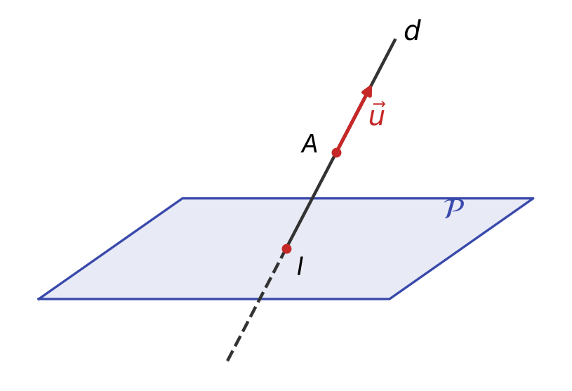

# Cours — Représentations paramétriques et équations cartésiennes

[📄 Cours en PDF (version classique)](pdf/cours.pdf){ .md-button }
[📄 Cours complet avec toutes les démonstrations (PDF)](pdf/cours-complet.pdf){ .md-button }

!!! lecture "Comment lire les démonstrations"
    Chaque résultat est démontré dès que c'est possible avec les outils de Terminale.

    Sur le site, clique sur un bloc pour l'ouvrir.

    - **Démonstration — pour aller plus loin** : à comprendre, inutile de l'apprendre par cœur. Indispensable si tu vises des études de maths.

Dans tout le chapitre, l'espace est muni d'un repère $\left(O \,;\, \vec{\imath}, \vec{\jmath}, \vec{k}\right)$. Les représentations paramétriques fonctionnent dans **n'importe quel** repère ; les équations cartésiennes avec vecteur normal, les distances et les projetés demandent un repère **orthonormé**.

---

## 1. Représentation paramétrique d'une droite

### 1.1 Le résultat

Au chapitre 10, on a vu qu'un point $M$ appartient à la droite $d$ passant par $A$ et de vecteur directeur $\vec{u}$ si et seulement s'il existe un réel $t$ tel que $\overrightarrow{AM} = t\vec{u}$. En coordonnées, cela donne :

!!! theoreme "Représentation paramétrique d'une droite"
    Soit $d$ la droite passant par $A(x_A, y_A, z_A)$ et de vecteur directeur $\vec{u}(a, b, c)$. Le point $M(x, y, z)$ appartient à $d$ si et seulement s'il existe un réel $t$ tel que
    $$\begin{cases} x = x_A + ta \\ y = y_A + tb \\ z = z_A + tc \end{cases}$$
    Ce système, avec $t \in \mathbb{R}$, est **une représentation paramétrique** de $d$. Le réel $t$ est le **paramètre**.

??? demoplus "Démonstration — pour aller plus loin"
    $\overrightarrow{AM}$ a pour coordonnées $(x - x_A, y - y_A, z - z_A)$ et $t\vec{u}$ a pour coordonnées $(ta, tb, tc)$. Deux vecteurs sont égaux si et seulement si leurs coordonnées le sont : l'égalité $\overrightarrow{AM} = t\vec{u}$ équivaut donc au système.

**Lecture.** Dans une représentation paramétrique, on lit directement :

- les **constantes** : les coordonnées d'un point de la droite (obtenu pour $t = 0$) ;
- les **coefficients de $t$** : les coordonnées d'un vecteur directeur.

**Exemple.** La droite passant par $A(1, 2, -1)$ et de vecteur directeur $\vec{u}(2, 0, 3)$ admet la représentation $x = 1 + 2t$, $y = 2$, $z = -1 + 3t$, $t \in \mathbb{R}$. Pour $t = 1$, on obtient le point $(3, 2, 2)$ de la droite.

{ width="42%" }

!!! warning "Une droite a une infinité de représentations"
    On peut changer de point de départ et de vecteur directeur (n'importe quel vecteur colinéaire non nul). Deux représentations très différentes peuvent donc décrire la même droite. Pour le vérifier, on contrôle que les vecteurs directeurs sont colinéaires **et** qu'un point de l'une est sur l'autre.

### 1.2 Appartenance d'un point

Pour savoir si $M(x_M, y_M, z_M)$ est sur $d$, on cherche $t$ dans la **première** équation, puis on vérifie que **la même valeur** de $t$ convient dans les deux autres.

**Exemple.** Avec la droite précédente, $M(5, 2, 5)$ : la première équation donne $t = 2$, et alors $y = 2$ et $z = -1 + 6 = 5$. Donc $M \in d$. Pour $N(5, 2, 4)$, $t = 2$ donne $z = 5 \neq 4$ : $N \notin d$.

### 1.3 Segments et demi-droites

!!! propriete "Restreindre le paramètre"
    Avec $A$ et $B$ distincts, et la représentation obtenue à partir de $A$ et $\vec{u} = \overrightarrow{AB}$ :

    - $t \in [0, 1]$ décrit le **segment** $[AB]$ ($t = 0$ donne $A$, $t = 1$ donne $B$, $t = \frac{1}{2}$ donne le milieu) ;
    - $t \geq 0$ décrit la **demi-droite** $[AB)$.

---

## 2. Équation cartésienne d'un plan

On travaille désormais dans un repère **orthonormé**.

!!! theoreme "Équation cartésienne d'un plan"
    1. Un plan de vecteur normal $\vec{n}(a, b, c)$ admet une équation de la forme
       $$ax + by + cz + d = 0,$$
       où $d$ est un réel.
    2. Réciproquement, si $a$, $b$, $c$ ne sont pas tous nuls, l'ensemble des points $M(x, y, z)$ tels que $ax + by + cz + d = 0$ est un plan de vecteur normal $\vec{n}(a, b, c)$.

??? demoplus "Démonstration — pour aller plus loin"
    **1.** Soit $A(x_A, y_A, z_A)$ un point du plan. D'après le chapitre 11, $M \in \mathcal{P}$ si et seulement si $\overrightarrow{AM} \cdot \vec{n} = 0$. En repère orthonormé, cela s'écrit
    $$a(x - x_A) + b(y - y_A) + c(z - z_A) = 0,$$
    soit $ax + by + cz + d = 0$ avec $d = -(ax_A + by_A + cz_A)$.

    **2.** Il suffit de trouver un point $A$ de l'ensemble. Si $a \neq 0$, le point $A\left(-\frac{d}{a}, 0, 0\right)$ convient (on le vérifie en remplaçant) ; si $a = 0$, on fait de même avec $b$ ou $c$. Alors $d = -(ax_A + by_A + cz_A)$, et l'équation $ax + by + cz + d = 0$ s'écrit $\overrightarrow{AM} \cdot \vec{n} = 0$ en refaisant le calcul de la partie 1 à l'envers. D'après le chapitre 11, c'est le plan passant par $A$ de vecteur normal $\vec{n}$.

**Lecture.** Dans $ax + by + cz + d = 0$, les **coefficients de $x$, $y$, $z$** donnent un vecteur normal. Pour trouver un point, on fixe deux coordonnées (souvent à $0$) et l'on calcule la troisième.

**Exemple.** Le plan passant par $A(1, -2, 3)$ et de vecteur normal $\vec{n}(2, -1, 4)$ a une équation $2x - y + 4z + d = 0$. Comme $A$ est dedans : $2 + 2 + 12 + d = 0$, donc $d = -16$. Équation : $2x - y + 4z - 16 = 0$.

!!! warning "Une équation n'est pas unique"
    $2x - y + 4z - 16 = 0$ et $-4x + 2y - 8z + 32 = 0$ décrivent le même plan : on peut multiplier par un réel non nul.

!!! tip "Plans particuliers"
    - Le plan $(xOy)$ a pour équation $z = 0$, et $z = 3$ est le plan parallèle à $(xOy)$ passant par $(0, 0, 3)$.
    - Une équation sans $z$, comme $x + y - 1 = 0$, est celle d'un plan **parallèle à l'axe $(Oz)$** : son vecteur normal $(1, 1, 0)$ est orthogonal à $\vec{k}$.

---

## 3. Positions relatives et intersections

### 3.1 Une droite et un plan

Soit $d$ une droite de vecteur directeur $\vec{u}$ et $\mathcal{P}$ un plan de vecteur normal $\vec{n}$.

!!! propriete "Droite et plan"
    - Si $\vec{u} \cdot \vec{n} \neq 0$, $d$ et $\mathcal{P}$ sont **sécants** en un unique point.
    - Si $\vec{u} \cdot \vec{n} = 0$, $d$ est **parallèle** à $\mathcal{P}$ : elle est contenue dans $\mathcal{P}$ si l'un de ses points est dans $\mathcal{P}$, et elle n'a aucun point commun avec $\mathcal{P}$ sinon.

    En pratique, on remplace $x$, $y$, $z$ de la représentation paramétrique dans l'équation du plan. On obtient une équation en $t$ qui a **une** solution (sécants), **aucune** (strictement parallèles) ou **une infinité** (droite contenue dans le plan).

??? demoplus "Démonstration — pour aller plus loin"
    Notons $ax + by + cz + d = 0$ une équation de $\mathcal{P}$ (ici, $d$ désigne la constante de l'équation), $\vec{u}(\alpha, \beta, \gamma)$, et $A(x_A, y_A, z_A)$ un point de la droite. Le point de paramètre $t$ est dans $\mathcal{P}$ si et seulement si
    $$a(x_A + t\alpha) + b(y_A + t\beta) + c(z_A + t\gamma) + d = 0 \iff (\vec{u} \cdot \vec{n})\,t + (ax_A + by_A + cz_A + d) = 0.$$
    Si $\vec{u} \cdot \vec{n} \neq 0$, cette équation du premier degré a une unique solution. Sinon, elle se réduit à $ax_A + by_A + cz_A + d = 0$ : elle est vraie pour tout $t$ si $A \in \mathcal{P}$, et pour aucun $t$ sinon.

### 3.2 Deux plans

!!! propriete "Deux plans"
    Soit $\mathcal{P}$ et $\mathcal{P}'$ de vecteurs normaux $\vec{n}$ et $\vec{n}'$.

    - Si $\vec{n}$ et $\vec{n}'$ sont colinéaires, les plans sont **parallèles** (confondus si leurs équations sont proportionnelles, strictement parallèles sinon).
    - Sinon, les plans sont **sécants** selon une droite. Pour en trouver une représentation paramétrique, on résout le système des deux équations en prenant l'une des coordonnées comme paramètre (méthode 4).

On dit que $\mathcal{P}$ et $\mathcal{P}'$ sont **perpendiculaires** lorsque $\vec{n} \cdot \vec{n}' = 0$.

??? demoplus "Démonstration — pour aller plus loin"
    Le premier point est la propriété du chapitre 11 sur les vecteurs normaux. Dans le second cas, les plans ne sont pas parallèles, donc ils sont sécants (chapitre 10) : leur intersection est une droite.

### 3.3 Deux droites

!!! propriete "Deux droites"
    Soit $d$ et $d'$ de vecteurs directeurs $\vec{u}$ et $\vec{u}'$.

    - Si $\vec{u}$ et $\vec{u}'$ sont colinéaires, les droites sont **parallèles** (confondues si un point de l'une est sur l'autre).
    - Sinon, on résout le système obtenu en égalant les coordonnées, **avec deux paramètres différents** $t$ et $s$. S'il a une solution, les droites sont **sécantes** ; sinon, elles sont **non coplanaires**.

!!! warning "Deux paramètres, pas un"
    Les deux droites n'ont aucune raison de passer par leur point commun pour la **même** valeur du paramètre. Renomme toujours le paramètre de la seconde droite avant de résoudre.

---

## 4. Distances et projetés avec des équations

!!! propriete "Distance d'un point à un plan"
    Dans un repère orthonormé, la distance du point $M(x_M, y_M, z_M)$ au plan $\mathcal{P}$ d'équation $ax + by + cz + d = 0$ est
    $$d(M, \mathcal{P}) = \frac{|ax_M + by_M + cz_M + d|}{\sqrt{a^2 + b^2 + c^2}}.$$

??? demoplus "Démonstration — pour aller plus loin"
    D'après le chapitre 11, $d(M, \mathcal{P}) = \dfrac{\left|\overrightarrow{AM} \cdot \vec{n}\right|}{\|\vec{n}\|}$ pour un point $A$ de $\mathcal{P}$. Or $\overrightarrow{AM} \cdot \vec{n} = a(x_M - x_A) + b(y_M - y_A) + c(z_M - z_A) = ax_M + by_M + cz_M + d$, car $ax_A + by_A + cz_A = -d$. Et $\|\vec{n}\| = \sqrt{a^2 + b^2 + c^2}$.

!!! propriete "Projeté orthogonal sur un plan"
    Le projeté orthogonal $H$ de $M$ sur $\mathcal{P}$ est l'intersection de $\mathcal{P}$ avec la droite passant par $M$ et dirigée par le vecteur normal $\vec{n}$. On écrit une représentation paramétrique de cette droite, et l'on cherche la valeur de $t$ pour laquelle le point est dans $\mathcal{P}$ (méthode 5).

!!! propriete "Projeté orthogonal sur une droite"
    Le projeté orthogonal $H$ de $M$ sur une droite $d$ de vecteur directeur $\vec{u}$ est l'intersection de $d$ avec le plan passant par $M$ et de vecteur normal $\vec{u}$. Autre méthode : on cherche le point $H$ de paramètre $t$ tel que $\overrightarrow{MH} \cdot \vec{u} = 0$.

**Exemple.** Distance de $M(1, 2, 3)$ au plan $2x - y + 2z + 4 = 0$ : $\dfrac{|2 - 2 + 6 + 4|}{\sqrt{4 + 1 + 4}} = \dfrac{10}{3}$.

---

## 5. Pour aller plus loin

- **Représentation paramétrique d'un plan.** Un plan passant par $A$ et dirigé par $\vec{u}$ et $\vec{v}$ est décrit par $\overrightarrow{AM} = t\vec{u} + s\vec{v}$, avec deux paramètres $t$ et $s$. Cette description n'est pas au programme, mais elle est utile en prépa et en informatique graphique.
- **Sphère.** En repère orthonormé, la sphère de centre $\Omega(\alpha, \beta, \gamma)$ et de rayon $r$ a pour équation $(x - \alpha)^2 + (y - \beta)^2 + (z - \gamma)^2 = r^2$. Un plan coupe la sphère si et seulement si sa distance au centre est au plus $r$.
- **Systèmes linéaires.** Intersecter des plans revient à résoudre un système linéaire. Trois plans se coupent en général en un point unique : c'est la question de l'**inversibilité d'une matrice** $3 \times 3$, étudiée en algèbre linéaire (L1) et, pour les matrices, en maths expertes.
- **Distance entre deux droites non coplanaires.** Il existe une unique droite perpendiculaire à deux droites non coplanaires données (la **perpendiculaire commune**), et elle réalise la distance minimale entre elles. C'est l'objet du sujet type bac 4.

!!! success "Tu as fini le cours"
    Passe aux [méthodes](methodes.md), puis entraîne-toi avec les exercices corrigés.
