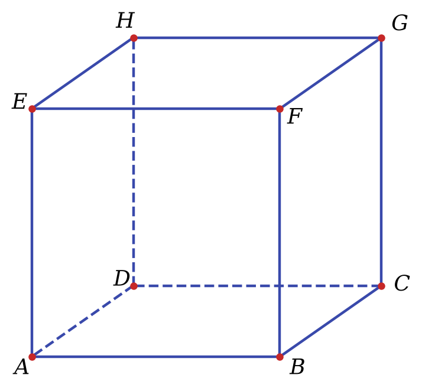

# Exercices corrigés — Représentations paramétriques et équations cartésiennes

[📄 Énoncés seuls (PDF)](pdf/exercices-enonces.pdf){ .md-button }
[📄 Énoncés + corrections (PDF)](pdf/exercices-corriges.pdf){ .md-button }

28 exercices classés par thème. Difficulté : <span class="etoiles">★</span> application directe — <span class="etoiles">★★</span> entraînement — <span class="etoiles">★★★</span> approfondissement.

Pour t'entraîner dans les conditions de l'examen, va voir les [sujets type bac](bac.md).

Clique sur **Correction** seulement après avoir vraiment cherché.

| Thème | Exercices |
|---|---|
| 1. Représentations paramétriques | 1 à 6 |
| 2. Équations cartésiennes de plans | 7 à 13 |
| 3. Intersections et positions relatives | 14 à 21 |
| 4. Distances et projetés | 22 à 25 |
| 5. Approfondissement | 26 à 28 |

Dans tous les exercices, le repère est orthonormé. Quand il est question du cube $ABCDEFGH$ d'arête $1$, le repère est $\left(A \,;\, \overrightarrow{AB}, \overrightarrow{AD}, \overrightarrow{AE}\right)$.

{ width="38%" }

---

## Thème 1 — Représentations paramétriques

*Méthode associée : [Méthode 1](methodes.md#methode-1-ecrire-et-utiliser-une-representation-parametrique).*

### Exercice 1 — Écrire une représentation <span class="etoiles">★</span>

Donner une représentation paramétrique de la droite passant par $A(1, 2, -1)$ et de vecteur directeur $\vec{u}(2, 0, 3)$, puis deux autres points de cette droite.

??? success "Correction"
    $x = 1 + 2t$, $y = 2$, $z = -1 + 3t$, $t \in \mathbb{R}$. Pour $t = 1$ : $(3, 2, 2)$ ; pour $t = -1$ : $(-1, 2, -4)$.

### Exercice 2 — La droite $(AB)$ <span class="etoiles">★</span>

Soit $A(1, 0, 2)$ et $B(3, -1, 5)$. Donner une représentation paramétrique de $(AB)$. Les points $C(7, -3, 11)$ et $D(5, -2, 7)$ sont-ils sur $(AB)$ ?

??? success "Correction"
    $\overrightarrow{AB}(2, -1, 3)$ : $x = 1 + 2t$, $y = -t$, $z = 2 + 3t$.

    - $C$ : $7 = 1 + 2t$ donne $t = 3$, puis $y = -3$ et $z = 11$ : $C \in (AB)$.
    - $D$ : $5 = 1 + 2t$ donne $t = 2$, puis $y = -2$ mais $z = 8 \neq 7$ : $D \notin (AB)$.

### Exercice 3 — Lire une représentation <span class="etoiles">★</span>

On considère $d$ : $x = 3 - t$, $y = 2t$, $z = 1 + 4t$ et $d'$ : $x = 1 + 2s$, $y = 5 - 4s$, $z = -8s$ ($t, s \in \mathbb{R}$).

1. Donner un point et un vecteur directeur de chaque droite.
2. Montrer que $d$ et $d'$ sont strictement parallèles.

??? success "Correction"
    **1.** $d$ passe par $(3, 0, 1)$, dirigée par $\vec{u}(-1, 2, 4)$ ; $d'$ passe par $(1, 5, 0)$, dirigée par $\vec{u}'(2, -4, -8)$.

    **2.** $\vec{u}' = -2\vec{u}$ : les droites sont parallèles. Le point $(3, 0, 1)$ de $d$ est-il sur $d'$ ? $3 = 1 + 2s$ donne $s = 1$, puis $y = 1 \neq 0$ : non. Elles sont donc strictement parallèles.

### Exercice 4 — Deux représentations d'une même droite <span class="etoiles">★★</span>

Montrer que $d$ : $x = 1 + t$, $y = 2 - t$, $z = 3t$ et $d'$ : $x = 3 - 2s$, $y = 2s$, $z = 6 - 6s$ représentent la même droite.

??? success "Correction"
    Vecteurs directeurs $(1, -1, 3)$ et $(-2, 2, -6) = -2(1, -1, 3)$ : colinéaires. Le point $(3, 0, 6)$ de $d'$ (pour $s = 0$) est sur $d$ : $3 = 1 + t$ donne $t = 2$, puis $y = 0$ et $z = 6$. Les droites sont parallèles avec un point commun : elles sont confondues.

### Exercice 5 — Un segment <span class="etoiles">★</span>

Soit $A(0, 1, 2)$ et $B(2, -1, 4)$.

1. Donner une représentation du segment $[AB]$.
2. En déduire le milieu de $[AB]$ et le point situé au tiers de $[AB]$ en partant de $A$.
3. Le point $C(3, -2, 5)$ est-il sur $[AB]$ ? Sur la demi-droite $[AB)$ ?

??? success "Correction"
    **1.** $\overrightarrow{AB}(2, -2, 2)$ : $x = 2t$, $y = 1 - 2t$, $z = 2 + 2t$, avec $t \in [0, 1]$.

    **2.** $t = \frac{1}{2}$ : $(1, 0, 3)$. $t = \frac{1}{3}$ : $\left(\frac{2}{3}, \frac{1}{3}, \frac{8}{3}\right)$.

    **3.** $3 = 2t$ donne $t = \frac{3}{2}$, puis $y = -2$ et $z = 5$ : $C$ est sur la droite $(AB)$, avec $t = \frac{3}{2} > 1$. Il n'est pas sur le segment, mais il est sur la demi-droite $[AB)$.

### Exercice 6 — Dans le cube <span class="etoiles">★</span>

Donner une représentation paramétrique de la droite $(BH)$. Passe-t-elle par le centre du cube ? Par le point $G$ ?

??? success "Correction"
    $B(1, 0, 0)$ et $\overrightarrow{BH}(-1, 1, 1)$ : $x = 1 - t$, $y = t$, $z = t$. Pour $t = \frac{1}{2}$, on obtient $\left(\frac{1}{2}, \frac{1}{2}, \frac{1}{2}\right)$, le centre du cube. Pour $G(1, 1, 1)$ : $x = 1$ impose $t = 0$, mais alors $y = 0 \neq 1$ : $G \notin (BH)$.

---

## Thème 2 — Équations cartésiennes de plans

*Méthode associée : [Méthode 2](methodes.md#methode-2-determiner-une-equation-cartesienne-dun-plan).*

### Exercice 7 — Avec un point et un vecteur normal <span class="etoiles">★</span>

Déterminer une équation du plan passant par $A(1, -2, 3)$ et de vecteur normal $\vec{n}(2, -1, 4)$. Le point $B(5, 2, 2)$ appartient-il à ce plan ?

??? success "Correction"
    $2x - y + 4z + d = 0$ avec $2 + 2 + 12 + d = 0$, soit $d = -16$ : $2x - y + 4z - 16 = 0$. Pour $B$ : $10 - 2 + 8 - 16 = 0$, donc $B$ appartient au plan.

### Exercice 8 — Lire une équation <span class="etoiles">★</span>

Soit $\mathcal{P}$ : $3x - y + 2z - 5 = 0$. Donner un vecteur normal, un point de $\mathcal{P}$, et les points d'intersection de $\mathcal{P}$ avec les trois axes du repère.

??? success "Correction"
    $\vec{n}(3, -1, 2)$. Avec $x = z = 0$ : $y = -5$, donc $(0, -5, 0) \in \mathcal{P}$ (c'est aussi l'intersection avec l'axe $(Oy)$). Avec $y = z = 0$ : $x = \frac{5}{3}$. Avec $x = y = 0$ : $z = \frac{5}{2}$. Les points sont $\left(\frac{5}{3}, 0, 0\right)$, $(0, -5, 0)$ et $\left(0, 0, \frac{5}{2}\right)$.

### Exercice 9 — Le plan passant par trois points <span class="etoiles">★★</span>

Déterminer une équation du plan $(ABC)$ avec $A(1, 0, 0)$, $B(0, 2, 0)$ et $C(0, 0, 3)$. Montrer qu'elle peut s'écrire $\dfrac{x}{1} + \dfrac{y}{2} + \dfrac{z}{3} = 1$.

??? success "Correction"
    $\overrightarrow{AB}(-1, 2, 0)$ et $\overrightarrow{AC}(-1, 0, 3)$. On veut $-a + 2b = 0$ et $-a + 3c = 0$ ; avec $a = 6$ : $b = 3$, $c = 2$. Équation $6x + 3y + 2z + d = 0$, et $A$ donne $d = -6$ : $6x + 3y + 2z - 6 = 0$. En divisant par $6$ : $x + \dfrac{y}{2} + \dfrac{z}{3} = 1$.

    *Plus généralement, le plan coupant les axes en $(p, 0, 0)$, $(0, q, 0)$, $(0, 0, r)$ (non nuls) a pour équation $\frac{x}{p} + \frac{y}{q} + \frac{z}{r} = 1$.*

### Exercice 10 — Plan parallèle <span class="etoiles">★</span>

Déterminer une équation du plan $\mathcal{Q}$ passant par $A(2, 1, -1)$ et parallèle au plan $\mathcal{P}$ : $x - 3y + z + 7 = 0$.

??? success "Correction"
    $\mathcal{Q}$ a le même vecteur normal $(1, -3, 1)$ : $x - 3y + z + d = 0$, avec $2 - 3 - 1 + d = 0$, soit $d = 2$. $\mathcal{Q}$ : $x - 3y + z + 2 = 0$.

### Exercice 11 — Plan médiateur <span class="etoiles">★★</span>

Soit $A(1, 2, 3)$ et $B(3, 0, -1)$. Le **plan médiateur** de $[AB]$ est le plan passant par le milieu de $[AB]$ et orthogonal à $(AB)$.

1. En déterminer une équation.
2. Retrouver cette équation en écrivant que $MA^2 = MB^2$.

??? success "Correction"
    **1.** Milieu $I(2, 1, 1)$, vecteur normal $\overrightarrow{AB}(2, -2, -4)$, ou plus simplement $(1, -1, -2)$. Équation $x - y - 2z + d = 0$ avec $2 - 1 - 2 + d = 0$, soit $x - y - 2z + 1 = 0$.

    **2.** $(x - 1)^2 + (y - 2)^2 + (z - 3)^2 = (x - 3)^2 + y^2 + (z + 1)^2$. Après simplification des carrés : $-2x - 4y - 6z + 14 = -6x + 2z + 10$, soit $4x - 4y - 8z + 4 = 0$, c'est-à-dire $x - y - 2z + 1 = 0$. Le plan médiateur est l'ensemble des points équidistants de $A$ et $B$.

### Exercice 12 — Deux plans du cube <span class="etoiles">★</span>

On rappelle (chapitre 11) que $\overrightarrow{AG}$ est normal au plan $(BDE)$. Déterminer une équation de $(BDE)$, puis de $(CFH)$, et vérifier que ces plans sont parallèles.

??? success "Correction"
    $\overrightarrow{AG}(1, 1, 1)$ et $B(1, 0, 0)$ : $(BDE)$ a pour équation $x + y + z - 1 = 0$. On vérifie que $D$ et $E$ la satisfont.

    $(CFH)$ : $C(1, 1, 0)$, $F(1, 0, 1)$ et $H(0, 1, 1)$ satisfont tous $x + y + z = 2$. Ces trois points ne sont pas alignés, donc $(CFH)$ : $x + y + z - 2 = 0$. Même vecteur normal : les plans sont parallèles, et distincts.

### Exercice 13 — Plan orthogonal à une droite <span class="etoiles">★</span>

Déterminer une équation du plan passant par $A(0, 1, -2)$ et orthogonal à la droite $d$ : $x = 1 + 2t$, $y = -t$, $z = 3 + t$.

??? success "Correction"
    Le vecteur directeur $(2, -1, 1)$ de $d$ est normal au plan : $2x - y + z + d = 0$ avec $0 - 1 - 2 + d = 0$, soit $2x - y + z + 3 = 0$.

---

## Thème 3 — Intersections et positions relatives

*Méthodes associées : [Méthode 3](methodes.md#methode-3-intersection-dune-droite-et-dun-plan), [Méthode 4](methodes.md#methode-4-intersection-de-deux-plans) et [Méthode 6](methodes.md#methode-6-position-relative-de-deux-droites).*

### Exercice 14 — Droite sécante à un plan <span class="etoiles">★</span>

Déterminer l'intersection de $d$ : $x = 1 + t$, $y = 2 - t$, $z = 3 + 2t$ et du plan $\mathcal{P}$ : $2x + y - z + 4 = 0$.

??? success "Correction"
    $2(1 + t) + (2 - t) - (3 + 2t) + 4 = 0$, soit $5 - t = 0$, donc $t = 5$. Le point d'intersection est $(6, -3, 13)$. Vérification : $12 - 3 - 13 + 4 = 0$.

### Exercice 15 — Droite parallèle à un plan <span class="etoiles">★★</span>

Étudier l'intersection de $d$ : $x = 2t$, $y = 1 + t$, $z = -1 + t$ et de $\mathcal{P}$ : $x - y - z + 3 = 0$.

??? success "Correction"
    $2t - (1 + t) - (-1 + t) + 3 = 0$ se simplifie en $3 = 0$ : aucune solution. La droite est **strictement parallèle** au plan. On le confirme : $\vec{u}(2, 1, 1)$ et $\vec{n}(1, -1, -1)$ vérifient $\vec{u} \cdot \vec{n} = 0$.

### Exercice 16 — Droite contenue dans un plan <span class="etoiles">★★</span>

Montrer que la droite $d$ : $x = 1 + t$, $y = t$, $z = 2 - t$ est contenue dans le plan $\mathcal{P}$ : $x - 2y - z + 1 = 0$.

??? success "Correction"
    $(1 + t) - 2t - (2 - t) + 1 = 0$ se simplifie en $0 = 0$, vrai pour tout $t$ : tous les points de $d$ sont dans $\mathcal{P}$.

### Exercice 17 — Intersection de deux plans <span class="etoiles">★★</span>

Soit $\mathcal{P}$ : $x + y + z - 3 = 0$ et $\mathcal{Q}$ : $x - y + 2z - 1 = 0$. Montrer que ces plans sont sécants et donner une représentation paramétrique de leur droite d'intersection.

??? success "Correction"
    Les vecteurs normaux $(1, 1, 1)$ et $(1, -1, 2)$ ne sont pas colinéaires. On pose $z = t$ : $x + y = 3 - t$ et $x - y = 1 - 2t$. En ajoutant : $x = 2 - \frac{3}{2}t$ ; en soustrayant : $y = 1 + \frac{1}{2}t$.

    Pour éviter les fractions, on pose $t = 2s$ : $x = 2 - 3s$, $y = 1 + s$, $z = 2s$, $s \in \mathbb{R}$. Vérification avec $s = 0$, point $(2, 1, 0)$ : $2 + 1 + 0 - 3 = 0$ et $2 - 1 + 0 - 1 = 0$.

### Exercice 18 — Droites sécantes <span class="etoiles">★★</span>

Montrer que les droites $d$ : $x = 2t$, $y = 1 + t$, $z = -1 + 3t$ et $d'$ : $x = 3 + s$, $y = 1 - s$, $z = 4 + 2s$ sont sécantes, et donner leur point d'intersection.

??? success "Correction"
    Vecteurs directeurs $(2, 1, 3)$ et $(1, -1, 2)$ : non colinéaires. On résout
    $$\begin{cases} 2t = 3 + s \\ 1 + t = 1 - s \\ -1 + 3t = 4 + 2s \end{cases}$$
    La deuxième donne $s = -t$, puis la première $3t = 3$ : $t = 1$, $s = -1$. Troisième : $-1 + 3 = 2$ et $4 - 2 = 2$, vraie. Les droites sont sécantes en $(2, 2, 2)$.

### Exercice 19 — Droites non coplanaires <span class="etoiles">★★</span>

On reprend $d$ de l'exercice 18, et $d''$ : $x = s$, $y = 1$, $z = s$. Montrer que $d$ et $d''$ sont non coplanaires.

??? success "Correction"
    Vecteurs directeurs $(2, 1, 3)$ et $(1, 0, 1)$ : non colinéaires, donc les droites ne sont pas parallèles. Le système $2t = s$, $1 + t = 1$, $-1 + 3t = s$ donne $t = 0$, puis $s = 0$, mais la troisième équation devient $-1 = 0$ : impossible. Pas de point commun, pas parallèles : les droites sont **non coplanaires**.

### Exercice 20 — Dans le cube <span class="etoiles">★★</span>

On admet (chapitre 11, exercice 13) que $\overrightarrow{HB}$ est normal au plan $(ACF)$.

1. Déterminer une équation de $(ACF)$.
2. Déterminer le point d'intersection $K$ de la droite $(BH)$ et du plan $(ACF)$.
3. Montrer que $K$ est le centre de gravité du triangle $ACF$.

??? success "Correction"
    **1.** $\overrightarrow{HB}(1, -1, -1)$ et $A(0, 0, 0)$ : $x - y - z = 0$.

    **2.** $(BH)$ : $x = 1 - t$, $y = t$, $z = t$ (exercice 6). En remplaçant : $1 - 3t = 0$, donc $t = \frac{1}{3}$ et $K\left(\frac{2}{3}, \frac{1}{3}, \frac{1}{3}\right)$.

    **3.** Centre de gravité de $A(0, 0, 0)$, $C(1, 1, 0)$, $F(1, 0, 1)$ : $\left(\frac{2}{3}, \frac{1}{3}, \frac{1}{3}\right)$. C'est $K$.

### Exercice 21 — Trois plans <span class="etoiles">★★</span>

Déterminer l'intersection des plans d'équations $x + y + z = 6$, $x - y + z = 2$ et $x + y - z = 0$.

??? success "Correction"
    En soustrayant la deuxième à la première : $2y = 4$, $y = 2$. En soustrayant la troisième à la première : $2z = 6$, $z = 3$. Puis $x = 6 - 2 - 3 = 1$. Les trois plans se coupent en l'unique point $(1, 2, 3)$.

---

## Thème 4 — Distances et projetés

*Méthode associée : [Méthode 5](methodes.md#methode-5-projete-orthogonal-et-distance-a-un-plan).*

### Exercice 22 — Distance d'un point à un plan <span class="etoiles">★</span>

Calculer la distance du point $M(1, 2, 3)$ au plan $\mathcal{P}$ : $2x - y + 2z + 4 = 0$.

??? success "Correction"
    $\dfrac{|2 - 2 + 6 + 4|}{\sqrt{4 + 1 + 4}} = \dfrac{10}{3}$.

### Exercice 23 — Projeté orthogonal sur un plan <span class="etoiles">★★</span>

Déterminer le projeté orthogonal $H$ de $M(1, 2, 3)$ sur le plan $\mathcal{P}$ de l'exercice 22, et retrouver la distance.

??? success "Correction"
    La droite passant par $M$ dirigée par $\vec{n}(2, -1, 2)$ : $x = 1 + 2t$, $y = 2 - t$, $z = 3 + 2t$. En remplaçant : $2 + 4t - 2 + t + 6 + 4t + 4 = 0$, soit $9t + 10 = 0$ et $t = -\frac{10}{9}$. Donc
    $$H\left(-\frac{11}{9}, \frac{28}{9}, \frac{7}{9}\right).$$
    $MH = |t| \times \|\vec{n}\| = \frac{10}{9} \times 3 = \frac{10}{3}$.

### Exercice 24 — Distance entre deux plans parallèles <span class="etoiles">★★</span>

Montrer que les plans $\mathcal{P}$ : $x + 2y - 2z + 1 = 0$ et $\mathcal{Q}$ : $x + 2y - 2z - 8 = 0$ sont parallèles, et calculer la distance d'un point quelconque de $\mathcal{P}$ à $\mathcal{Q}$.

??? success "Correction"
    Même vecteur normal $(1, 2, -2)$, et équations non proportionnelles : strictement parallèles. Pour $M(x, y, z) \in \mathcal{P}$, on a $x + 2y - 2z = -1$, donc
    $$d(M, \mathcal{Q}) = \frac{|x + 2y - 2z - 8|}{3} = \frac{|-1 - 8|}{3} = 3.$$
    La distance ne dépend pas du point : c'est la **distance entre les deux plans**.

### Exercice 25 — Projeté sur une droite <span class="etoiles">★★</span>

Soit $d$ : $x = 1 + t$, $y = -t$, $z = 2 + t$ et $M(4, 0, 1)$.

1. Déterminer une équation du plan $\mathcal{Q}$ passant par $M$ et orthogonal à $d$.
2. En déduire le projeté orthogonal $H$ de $M$ sur $d$, et la distance de $M$ à $d$.

??? success "Correction"
    **1.** Vecteur normal $\vec{u}(1, -1, 1)$ : $x - y + z + d = 0$ avec $4 - 0 + 1 + d = 0$, soit $x - y + z - 5 = 0$.

    **2.** $(1 + t) + t + (2 + t) - 5 = 0$, soit $3t - 2 = 0$ et $t = \frac{2}{3}$. Donc $H\left(\frac{5}{3}, -\frac{2}{3}, \frac{8}{3}\right)$. Puis $\overrightarrow{MH}\left(-\frac{7}{3}, -\frac{2}{3}, \frac{5}{3}\right)$ et $MH = \dfrac{\sqrt{49 + 4 + 25}}{3} = \dfrac{\sqrt{78}}{3}$.

---

## Thème 5 — Approfondissement

### Exercice 26 — Plans perpendiculaires <span class="etoiles">★★</span>

Montrer que les plans $\mathcal{P}$ : $x + y - z = 0$ et $\mathcal{Q}$ : $2x - y + z - 3 = 0$ sont perpendiculaires, et déterminer leur droite d'intersection.

??? success "Correction"
    $(1, 1, -1) \cdot (2, -1, 1) = 2 - 1 - 1 = 0$ : les plans sont perpendiculaires. En ajoutant les deux équations : $3x - 3 = 0$, donc $x = 1$. Puis $z = x + y = 1 + y$. Avec $y = t$ : la droite $x = 1$, $y = t$, $z = 1 + t$, $t \in \mathbb{R}$.

### Exercice 27 — Une famille de plans <span class="etoiles">★★★</span>

Pour tout réel $m$, on note $\mathcal{P}_m$ l'ensemble des points $M(x, y, z)$ tels que $(m - 1)x + my + z - 1 = 0$.

1. Justifier que $\mathcal{P}_m$ est un plan pour tout $m$.
2. Montrer que tous les plans $\mathcal{P}_m$ contiennent une même droite $\Delta$, dont on donnera une représentation paramétrique.
3. Réciproquement, montrer qu'un point qui appartient à **tous** les plans $\mathcal{P}_m$ est sur $\Delta$.

??? success "Correction"
    **1.** Le vecteur $(m - 1, m, 1)$ n'est jamais nul (sa troisième coordonnée vaut $1$) : c'est un plan.

    **2.** L'équation s'écrit $m(x + y) + (-x + z - 1) = 0$. Si $x + y = 0$ et $-x + z - 1 = 0$, elle est vraie pour tout $m$. Ces deux conditions décrivent la droite $\Delta$ : $x = t$, $y = -t$, $z = 1 + t$, $t \in \mathbb{R}$ (intersection de deux plans non parallèles).

    **3.** Si un point est dans $\mathcal{P}_0$ et $\mathcal{P}_1$ : $-x + z - 1 = 0$ et $y + z - 1 = 0$. En soustrayant : $x + y = 0$. Les deux conditions de la question 2 sont vérifiées : le point est sur $\Delta$.

### Exercice 28 — Intersection droite-plan en Python <span class="etoiles">★★</span>

Écrire une fonction Python `intersection(A, u, n, d)` qui reçoit un point $A$ et un vecteur $\vec{u}$ (la droite), et les coefficients $\vec{n} = (a, b, c)$ et $d$ du plan $ax + by + cz + d = 0$. Elle renvoie le point d'intersection s'il est unique, et sinon le texte `"contenue"` ou `"parallèle"`. La tester avec l'exercice 14.

??? success "Correction"
    On reprend le calcul du cours : l'équation en $t$ s'écrit $(\vec{u} \cdot \vec{n})\,t + (ax_A + by_A + cz_A + d) = 0$.

    ```python
    def scalaire(u, v):
        return u[0] * v[0] + u[1] * v[1] + u[2] * v[2]

    def intersection(A, u, n, d):
        k = scalaire(u, n)
        c = scalaire(A, n) + d
        if k != 0:
            t = -c / k
            return [A[i] + t * u[i] for i in range(3)]
        elif c == 0:
            return "contenue"
        else:
            return "parallèle"

    print(intersection([1, 2, 3], [1, -1, 2], [2, 1, -1], 4))   # [6.0, -3.0, 13.0]
    print(intersection([0, 1, -1], [2, 1, 1], [1, -1, -1], 3))  # parallèle (exercice 15)
    ```
