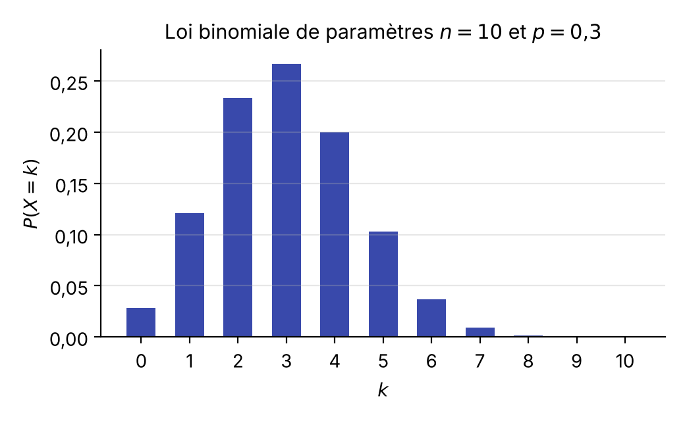
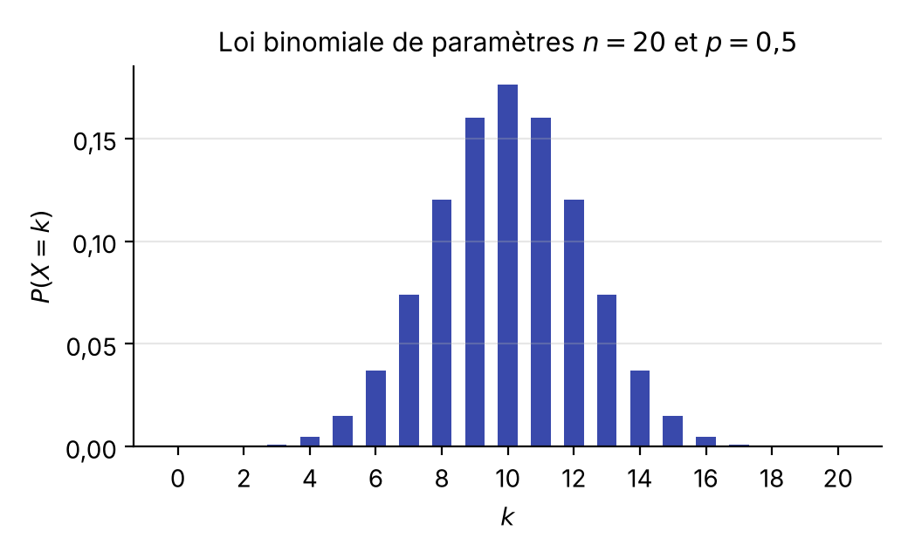

# Cours — Succession d'épreuves indépendantes, loi binomiale

[📄 Cours en PDF (version classique)](pdf/cours.pdf){ .md-button }
[📄 Cours complet avec toutes les démonstrations (PDF)](pdf/cours-complet.pdf){ .md-button }

!!! lecture "Comment lire les démonstrations"
    Chaque résultat est démontré dès que c'est possible avec les outils de Terminale.

    Sur le site, clique sur un bloc pour l'ouvrir.

    - **Démonstration — au programme du bac** : à savoir refaire, elle peut être demandée à l'examen.
    - **Démonstration — pour aller plus loin** : à comprendre, inutile de l'apprendre par cœur. Indispensable si tu vises des études de maths.

Dans tout le chapitre, on note $q = 1 - p$ quand $p$ désigne une probabilité de succès.

---

## 1. Succession d'épreuves indépendantes

### 1.1 Le modèle

On réalise successivement $n$ expériences aléatoires (des **épreuves**). La $i$-ème a pour univers fini $\Omega_i$, muni d'une probabilité $P_i$. Une issue de la succession est une liste $(x_1, x_2, \ldots, x_n)$ où $x_i \in \Omega_i$ : l'univers est le **produit cartésien** $\Omega = \Omega_1 \times \Omega_2 \times \cdots \times \Omega_n$.

!!! definition "Épreuves indépendantes"
    On dit que les épreuves sont **indépendantes** lorsque l'on munit $\Omega$ de la probabilité $P$ définie sur chaque issue par
    $$P\big(\{(x_1, \ldots, x_n)\}\big) = P_1(\{x_1\}) \times P_2(\{x_2\}) \times \cdots \times P_n(\{x_n\}).$$

C'est un **choix de modèle** : on l'adopte quand le résultat d'une épreuve n'influence pas les suivantes. Lancers successifs d'un dé ou d'une pièce, tirages **avec remise** : oui. Tirages **sans remise** : non, car la composition de l'urne change.

!!! propriete "C'est bien une probabilité"
    Les nombres ainsi définis sont positifs et leur somme vaut $1$. De plus, pour des événements $A_1 \subset \Omega_1$, …, $A_n \subset \Omega_n$ :
    $$P(A_1 \times A_2 \times \cdots \times A_n) = P_1(A_1) \times P_2(A_2) \times \cdots \times P_n(A_n).$$

??? demoplus "Démonstration — pour aller plus loin"
    Pour $n = 2$, on somme sur toutes les issues $(x_1, x_2)$ de $A_1 \times A_2$ et l'on factorise par distributivité :
    $$\sum_{x_1 \in A_1} \sum_{x_2 \in A_2} P_1(\{x_1\})\,P_2(\{x_2\}) = \Big(\sum_{x_1 \in A_1} P_1(\{x_1\})\Big)\Big(\sum_{x_2 \in A_2} P_2(\{x_2\})\Big) = P_1(A_1)\,P_2(A_2).$$
    Avec $A_1 = \Omega_1$ et $A_2 = \Omega_2$, on obtient $1 \times 1 = 1$. Pour $n$ épreuves, on raisonne par récurrence, en voyant $\Omega_1 \times \cdots \times \Omega_n$ comme $(\Omega_1 \times \cdots \times \Omega_{n-1}) \times \Omega_n$.

### 1.2 Arbres pondérés

On représente la succession par un **arbre** : chaque niveau correspond à une épreuve, et chaque chemin à une issue. Avec des épreuves indépendantes, les probabilités inscrites sur les branches d'un niveau ne dépendent pas du chemin suivi, et :

!!! propriete "Règle du produit"
    La probabilité d'une issue est le **produit** des probabilités inscrites sur les branches du chemin qui y mène. La probabilité d'un événement est la **somme** des probabilités des chemins qui le réalisent.

**Exemple.** On lance un dé équilibré, puis une pièce équilibrée. La probabilité d'obtenir « $6$ puis Pile » est $\dfrac{1}{6} \times \dfrac{1}{2} = \dfrac{1}{12}$. Celle d'obtenir « un nombre pair puis Face » est $\dfrac{3}{6} \times \dfrac{1}{2} = \dfrac{1}{4}$.

---

## 2. Épreuve et loi de Bernoulli

!!! definition "Épreuve de Bernoulli, loi de Bernoulli"
    - Une **épreuve de Bernoulli** est une expérience aléatoire à deux issues, appelées **succès** ($S$) et **échec** ($\overline{S}$). On note $p = P(S)$.
    - La variable aléatoire $X$ qui vaut $1$ en cas de succès et $0$ en cas d'échec suit la **loi de Bernoulli** de paramètre $p$ : $P(X = 1) = p$ et $P(X = 0) = 1 - p$.

!!! propriete "Espérance et variance"
    Si $X$ suit la loi de Bernoulli de paramètre $p$, alors $E(X) = p$ et $V(X) = p(1 - p)$.

??? demoplus "Démonstration — pour aller plus loin"
    $E(X) = 1 \times p + 0 \times (1 - p) = p$. Puis, avec la définition de Première,
    $$V(X) = p(1 - p)^2 + (1 - p)(0 - p)^2 = p(1 - p)\big[(1 - p) + p\big] = p(1 - p).$$

---

## 3. Schéma de Bernoulli et loi binomiale

### 3.1 Définitions

!!! definition "Schéma de Bernoulli"
    Un **schéma de Bernoulli** de paramètres $n$ et $p$ est la répétition de $n$ épreuves de Bernoulli **identiques** (même probabilité de succès $p$) et **indépendantes**.

!!! definition "Loi binomiale"
    Dans un schéma de Bernoulli de paramètres $n$ et $p$, la variable aléatoire $X$ égale au **nombre de succès** suit la **loi binomiale** de paramètres $n$ et $p$. On note $X \sim \mathcal{B}(n, p)$. Elle prend les valeurs $0, 1, \ldots, n$.

!!! tip "Justifier une loi binomiale sur une copie"
    Il faut citer les quatre ingrédients : « on répète **$n$ fois**, de façon **identique et indépendante**, une **épreuve à deux issues** dont le succès a pour probabilité **$p$** ; $X$ compte le **nombre de succès**. Donc $X$ suit la loi $\mathcal{B}(n, p)$. »

### 3.2 La formule

!!! theoreme "Probabilité de $k$ succès"
    Si $X \sim \mathcal{B}(n, p)$, alors pour tout entier $k$ tel que $0 \leq k \leq n$ :
    $$P(X = k) = \binom{n}{k}\, p^k\, (1 - p)^{n - k}.$$

??? demo "Démonstration — au programme du bac"
    Une issue du schéma est une liste de $n$ résultats, chacun étant $S$ ou $\overline{S}$.

    **Probabilité d'une issue.** Considérons une issue comportant exactement $k$ succès et $n - k$ échecs. Les épreuves étant indépendantes, sa probabilité est le produit des probabilités de ses $n$ résultats : $k$ facteurs égaux à $p$ et $n - k$ facteurs égaux à $1 - p$. Elle vaut donc $p^k(1 - p)^{n-k}$, quelle que soit la place des succès.

    **Nombre de ces issues.** Une telle issue est entièrement déterminée par l'ensemble des **positions** de ses $k$ succès, qui est une partie à $k$ éléments de $\{1, 2, \ldots, n\}$. D'après le chapitre 9, il y en a $\dbinom{n}{k}$.

    **Conclusion.** L'événement $\{X = k\}$ est la réunion de ces $\dbinom{n}{k}$ issues, deux à deux distinctes. Sa probabilité est la somme de leurs probabilités, toutes égales à $p^k(1 - p)^{n-k}$ :
    $$P(X = k) = \binom{n}{k} p^k (1 - p)^{n-k}.$$

    *Sur l'arbre : $\binom{n}{k}$ est le nombre de chemins qui comportent exactement $k$ succès.*

!!! info "Une conséquence : la formule du binôme"
    Les événements $\{X = 0\}$, …, $\{X = n\}$ forment une partition de l'univers, donc $\sum_{k=0}^{n} \binom{n}{k} p^k q^{n-k} = 1 = (p + q)^n$. C'est la formule du binôme de Newton (chapitre 9, § 6), vue ici pour des réels $p$ et $q$ positifs de somme $1$.

**Exemple.** On lance $5$ fois un dé équilibré ; $X$ compte le nombre de $6$. Alors $X \sim \mathcal{B}\left(5, \frac{1}{6}\right)$ et
$$P(X = 2) = \binom{5}{2}\left(\frac{1}{6}\right)^2\left(\frac{5}{6}\right)^3 = 10 \times \frac{125}{7776} = \frac{1250}{7776} \approx 0{,}161.$$

### 3.3 Représentation graphique

{ width="48%" }
{ width="48%" }

Les probabilités augmentent puis diminuent : elles sont maximales pour une valeur de $k$ proche de $np$ (exercice 24). Pour $p = \frac{1}{2}$, le diagramme est symétrique.

!!! propriete "Symétrie"
    Si $X \sim \mathcal{B}(n, p)$, alors $n - X \sim \mathcal{B}(n, 1 - p)$. En particulier, si $p = \frac{1}{2}$, $P(X = k) = P(X = n - k)$.

??? demoplus "Démonstration — pour aller plus loin"
    $n - X$ compte le nombre d'échecs, c'est-à-dire le nombre de succès du schéma où l'on échange les rôles de $S$ et $\overline{S}$, de probabilité $1 - p$. Par le calcul : $P(n - X = k) = P(X = n - k) = \binom{n}{n-k}p^{n-k}q^{k} = \binom{n}{k}q^k p^{n-k}$, car $\binom{n}{n-k} = \binom{n}{k}$.

### 3.4 Calculs pratiques

!!! propriete "Probabilités cumulées"
    - $P(X \leq k) = P(X = 0) + P(X = 1) + \cdots + P(X = k)$ ;
    - $P(X \geq k) = 1 - P(X \leq k - 1)$ ;
    - $P(a \leq X \leq b) = P(X \leq b) - P(X \leq a - 1)$ ;
    - $P(X \geq 1) = 1 - P(X = 0) = 1 - (1 - p)^n$.

!!! warning "Inégalités strictes et larges"
    $X$ ne prend que des valeurs entières : $P(X < 5) = P(X \leq 4)$ et $P(X > 5) = 1 - P(X \leq 5)$. C'est la source d'erreur la plus fréquente.

!!! tip "Avec la calculatrice ou Python"
    - TI : `binomFdp(n, p, k)` donne $P(X = k)$ et `binomFRép(n, p, k)` donne $P(X \leq k)$.
    - Casio : `BinomialPD` et `BinomialCD` (menu Distribution).
    - NumWorks : application Probabilités, loi binomiale.
    - Python :

    ```python
    from math import comb

    def binom(n, p, k):           # P(X = k)
        return comb(n, k) * p**k * (1 - p)**(n - k)

    def binom_cumul(n, p, k):     # P(X <= k)
        return sum(binom(n, p, i) for i in range(k + 1))
    ```

---

## 4. Espérance, variance, écart type

!!! theoreme "Paramètres de la loi binomiale"
    Si $X \sim \mathcal{B}(n, p)$ :
    $$E(X) = np, \qquad V(X) = np(1 - p), \qquad \sigma(X) = \sqrt{np(1 - p)}.$$

**Interprétation.** Sur un grand nombre de répétitions du schéma, le nombre moyen de succès est proche de $np$ : c'est intuitif, puisque chaque épreuve « rapporte » $p$ succès en moyenne.

Le chapitre 14 démontre ces formules en deux lignes, en écrivant $X$ comme une somme de variables de Bernoulli : c'est la démonstration attendue au bac. En voici une preuve directe, par le calcul.

??? demoplus "Démonstration directe — pour aller plus loin"
    **Une identité.** Pour $1 \leq k \leq n$ :
    $$k\binom{n}{k} = k \times \frac{n!}{k!\,(n-k)!} = n \times \frac{(n-1)!}{(k-1)!\,(n-k)!} = n\binom{n-1}{k-1}.$$
    En l'appliquant deux fois, pour $2 \leq k \leq n$ : $k(k-1)\binom{n}{k} = n(n-1)\binom{n-2}{k-2}$.

    **Espérance.** Le terme $k = 0$ est nul. On pose $j = k - 1$ :
    $$E(X) = \sum_{k=1}^{n} k\binom{n}{k}p^k q^{n-k} = np\sum_{k=1}^{n}\binom{n-1}{k-1}p^{k-1}q^{n-k} = np\sum_{j=0}^{n-1}\binom{n-1}{j}p^{j}q^{(n-1)-j} = np.$$
    La dernière somme vaut $1$ : c'est la somme des probabilités de la loi $\mathcal{B}(n - 1, p)$.

    **Une formule pour la variance (König-Huygens).** Avec $\mu = E(X)$ et les valeurs $x_i$ de probabilités $p_i$ :
    $$V(X) = \sum p_i(x_i - \mu)^2 = \sum p_i x_i^2 - 2\mu\sum p_i x_i + \mu^2\sum p_i = E(X^2) - 2\mu^2 + \mu^2 = E(X^2) - E(X)^2.$$

    **Variance.** Pour $n \geq 2$, de la même façon, avec $j = k - 2$ :
    $$\sum_{k=0}^{n} k(k-1)\binom{n}{k}p^k q^{n-k} = n(n-1)p^2\sum_{j=0}^{n-2}\binom{n-2}{j}p^j q^{(n-2)-j} = n(n-1)p^2.$$
    (Pour $n = 1$, les deux membres sont nuls.) Comme $k^2 = k(k-1) + k$, on obtient $E(X^2) = n(n-1)p^2 + np$, puis
    $$V(X) = n(n-1)p^2 + np - n^2p^2 = np - np^2 = np(1 - p).$$

**Exemple.** Si $X \sim \mathcal{B}(20\,;\,0{,}3)$ : $E(X) = 6$, $V(X) = 4{,}2$ et $\sigma(X) = \sqrt{4{,}2} \approx 2{,}05$.

---

## 5. Seuils et intervalles

### 5.1 « Au moins un succès »

!!! propriete "Combien de répétitions ?"
    Pour que la probabilité d'obtenir au moins un succès soit au moins égale à $1 - \alpha$ (avec $0 < \alpha < 1$ et $0 < p < 1$), il faut et il suffit que
    $$1 - (1 - p)^n \geq 1 - \alpha \iff (1 - p)^n \leq \alpha \iff n \geq \frac{\ln \alpha}{\ln(1 - p)}.$$

??? demoplus "Démonstration — pour aller plus loin"
    La fonction $\ln$ est strictement croissante sur $]0, +\infty[$, donc $(1 - p)^n \leq \alpha \iff n\ln(1 - p) \leq \ln\alpha$. Comme $0 < 1 - p < 1$, on a $\ln(1 - p) < 0$ : en divisant, **le sens de l'inégalité change**.

**Exemple.** Combien de fois lancer un dé pour avoir au moins $99\,\%$ de chances d'obtenir au moins un $6$ ? Il faut $n \geq \dfrac{\ln 0{,}01}{\ln(5/6)} \approx 25{,}3$, soit **au moins $26$ lancers**.

### 5.2 Intervalle de probabilité donnée

On cherche souvent un intervalle $[a, b]$ dans lequel $X$ tombe avec une probabilité d'au moins $1 - \alpha$ (par exemple $95\,\%$, avec $\alpha = 0{,}05$), en coupant environ $\frac{\alpha}{2}$ de chaque côté.

!!! propriete "Construction de l'intervalle"
    Soit $a$ le plus petit entier tel que $P(X \leq a) > \frac{\alpha}{2}$, et $b$ le plus petit entier tel que $P(X \leq b) \geq 1 - \frac{\alpha}{2}$. Alors
    $$P(a \leq X \leq b) \geq 1 - \alpha.$$

??? demoplus "Démonstration — pour aller plus loin"
    Par définition de $a$ (le plus petit), $P(X \leq a - 1) \leq \frac{\alpha}{2}$. Donc
    $$P(a \leq X \leq b) = P(X \leq b) - P(X \leq a - 1) \geq \left(1 - \frac{\alpha}{2}\right) - \frac{\alpha}{2} = 1 - \alpha.$$

On détermine $a$ et $b$ avec le tableau des probabilités cumulées de la calculatrice (méthode 6).

!!! tip "Prendre une décision"
    Si l'on fait l'hypothèse que $X \sim \mathcal{B}(n, p)$ et que la valeur observée tombe **hors** de l'intervalle à $95\,\%$, on a de bonnes raisons de rejeter l'hypothèse : on se trompe dans moins de $5\,\%$ des cas où elle est vraie. C'est le principe d'un **test statistique**, étudié dans le supérieur.

---

## 6. Pour aller plus loin

- **Loi géométrique.** Le rang du premier succès dans une répétition illimitée d'épreuves de Bernoulli vérifie $P(T = k) = (1 - p)^{k-1}p$. Son espérance vaut $\frac{1}{p}$ : il faut en moyenne $6$ lancers pour obtenir un $6$.
- **Approximations.** Quand $n$ est grand, la loi binomiale ressemble à une « courbe en cloche » : c'est le **théorème de Moivre-Laplace**, qui conduit à la loi normale (L1-L2). Quand $n$ est grand et $p$ petit, elle ressemble à la **loi de Poisson** de paramètre $np$.
- **Sommes de variables.** Une variable binomiale est la somme de $n$ variables de Bernoulli indépendantes : c'est le point de départ du chapitre 14, puis de la loi des grands nombres (chapitre 15).

!!! success "Tu as fini le cours"
    Passe aux [méthodes](methodes.md), puis entraîne-toi avec les exercices corrigés.
