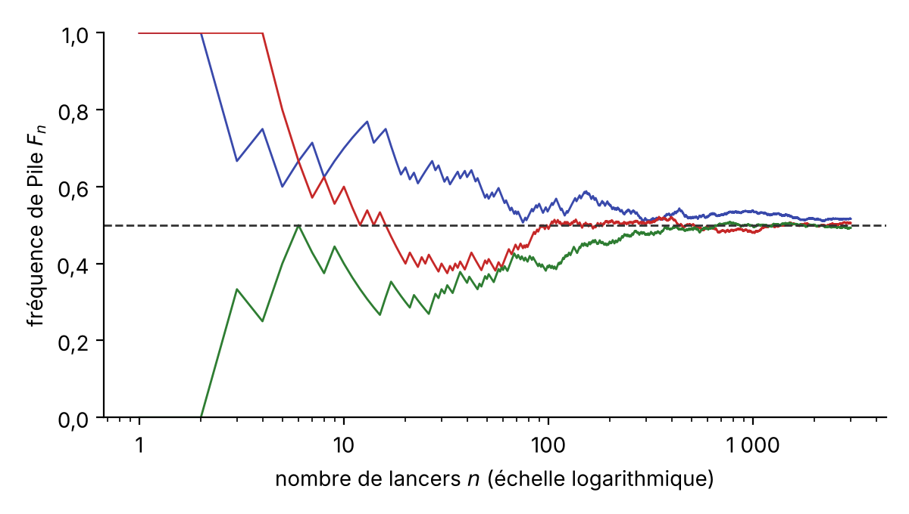

# Cours — Concentration, loi des grands nombres

[📄 Cours en PDF (version classique)](pdf/cours.pdf){ .md-button }
[📄 Cours complet avec toutes les démonstrations (PDF)](pdf/cours-complet.pdf){ .md-button }

!!! lecture "Comment lire les démonstrations"
    Chaque résultat est démontré dès que c'est possible avec les outils de Terminale.

    Sur le site, clique sur un bloc pour l'ouvrir.

    - **Démonstration — pour aller plus loin** : à comprendre, inutile de l'apprendre par cœur. Indispensable si tu vises des études de maths.

    Aucune démonstration de ce chapitre ne figure dans la liste officielle du bac. Celle de l'inégalité de concentration (§ 3) est toutefois souvent demandée, guidée par des questions, dans les sujets : sache la refaire.

Dans tout le chapitre, les variables aléatoires sont définies sur un univers fini. On note $\mu = E(X)$ l'espérance de $X$, $V = V(X)$ sa variance et $\sigma = \sigma(X)$ son écart type.

**La question du chapitre.** La variance mesure la dispersion de $X$ autour de $\mu$. Peut-on en déduire une garantie : « $X$ est rarement loin de $\mu$ » ? Et la moyenne de $n$ observations se rapproche-t-elle vraiment de $\mu$ quand $n$ grandit ?

---

## 1. L'inégalité de Markov

!!! propriete "Inégalité de Markov"
    Si $Y$ est une variable aléatoire **à valeurs positives** et $a$ un réel strictement positif :
    $$P(Y \geq a) \leq \frac{E(Y)}{a}.$$

??? demoplus "Démonstration — pour aller plus loin"
    Notons $y_1, \ldots, y_r$ les valeurs de $Y$, toutes positives. Dans la somme $E(Y) = \sum_i y_i\,P(Y = y_i)$, tous les termes sont positifs ; on ne garde que ceux pour lesquels $y_i \geq a$, ce qui ne peut que diminuer la somme :
    $$E(Y) \geq \sum_{y_i \geq a} y_i\,P(Y = y_i) \geq \sum_{y_i \geq a} a\,P(Y = y_i) = a\,P(Y \geq a).$$
    On divise par $a > 0$.

**Exemple.** Si la durée d'attente à un guichet a pour espérance $5$ minutes, la probabilité d'attendre au moins $20$ minutes est au plus $\frac{5}{20} = 0{,}25$, quelle que soit la loi de la durée.

---

## 2. L'inégalité de Bienaymé-Tchebychev

!!! theoreme "Inégalité de Bienaymé-Tchebychev"
    Pour toute variable aléatoire $X$ d'espérance $\mu$ et de variance $V$, et pour tout réel $\delta > 0$ :
    $$P\big(|X - \mu| \geq \delta\big) \leq \frac{V}{\delta^2}.$$

??? demoplus "Démonstration — pour aller plus loin"
    La variable $Y = (X - \mu)^2$ est positive, et $E(Y) = V(X)$ (définition de la variance). Comme les deux membres sont positifs et que la fonction carré est croissante sur $[0, +\infty[$ :
    $$|X - \mu| \geq \delta \iff (X - \mu)^2 \geq \delta^2.$$
    D'après l'inégalité de Markov appliquée à $Y$ avec $a = \delta^2 > 0$ :
    $$P\big(|X - \mu| \geq \delta\big) = P(Y \geq \delta^2) \leq \frac{E(Y)}{\delta^2} = \frac{V}{\delta^2}.$$

!!! propriete "Formes équivalentes"
    - En passant à l'événement contraire : $P\big(|X - \mu| < \delta\big) \geq 1 - \dfrac{V}{\delta^2}$.
    - En prenant $\delta = k\sigma$ (avec $k > 0$) : $P\big(|X - \mu| \geq k\sigma\big) \leq \dfrac{1}{k^2}$.

**Interprétation.** Quelle que soit la loi de $X$, la probabilité de s'écarter de $\mu$ d'au moins $2\sigma$ est au plus $\frac{1}{4}$, et d'au moins $3\sigma$ au plus $\frac{1}{9}$. L'écart type est donc bien l'**échelle naturelle** des écarts à la moyenne.

!!! warning "Une inégalité universelle, donc souvent grossière"
    Pour $X \sim \mathcal{B}(100\,;\,0{,}5)$ ($\mu = 50$, $V = 25$), l'inégalité donne $P(|X - 50| \geq 10) \leq 0{,}25$, alors que la valeur exacte est environ $0{,}057$. L'inégalité est valable pour **toutes** les lois : elle ne peut pas être précise pour chacune. Elle est pourtant parfois atteinte (exercice 5). Et si $\delta \leq \sigma$, le majorant dépasse $1$ : l'inégalité ne dit rien.

!!! info "Les intervalles « $\mu \pm 2\sigma$ »"
    $|X - \mu| < \delta$ signifie $\mu - \delta < X < \mu + \delta$. Avec $\delta = 2\sigma$ : la probabilité que $X$ tombe dans l'intervalle $]\mu - 2\sigma, \mu + 2\sigma[$ est **au moins $0{,}75$**.

---

## 3. L'inégalité de concentration

On considère un échantillon $(X_1, \ldots, X_n)$ de la loi de $X$ (variables indépendantes de même loi), et sa moyenne $M_n = \dfrac{X_1 + \cdots + X_n}{n}$. On sait (chapitre 14) que $E(M_n) = \mu$ et $V(M_n) = \dfrac{V}{n}$.

!!! theoreme "Inégalité de concentration"
    Pour tout réel $\delta > 0$ :
    $$P\big(|M_n - \mu| \geq \delta\big) \leq \frac{V}{n\,\delta^2}.$$

??? demoplus "Démonstration — pour aller plus loin (à savoir refaire)"
    On applique l'inégalité de Bienaymé-Tchebychev à la variable $M_n$, d'espérance $\mu$ et de variance $\dfrac{V}{n}$ :
    $$P\big(|M_n - \mu| \geq \delta\big) \leq \frac{V(M_n)}{\delta^2} = \frac{V/n}{\delta^2} = \frac{V}{n\,\delta^2}.$$

!!! propriete "Le cas d'une fréquence"
    Si $F_n$ est la fréquence des succès dans un schéma de Bernoulli de paramètres $n$ et $p$, alors $F_n$ est la moyenne d'un échantillon de la loi de Bernoulli, de variance $p(1 - p) \leq \frac{1}{4}$. Donc
    $$P\big(|F_n - p| \geq \delta\big) \leq \frac{p(1 - p)}{n\,\delta^2} \leq \frac{1}{4n\,\delta^2}.$$
    La seconde majoration ne dépend pas de $p$ : elle est utile quand $p$ est inconnu (sondage).

??? demoplus "Démonstration — pour aller plus loin"
    $p(1 - p) = \frac{1}{4} - \left(p - \frac{1}{2}\right)^2 \leq \frac{1}{4}$.

### Taille d'un échantillon

L'inégalité de concentration répond à la question : **combien d'observations faut-il** pour que la moyenne soit à moins de $\delta$ de $\mu$, avec un **risque** d'erreur d'au plus $\alpha$ ?

!!! propriete "Taille suffisante"
    Si $n \geq \dfrac{V}{\alpha\,\delta^2}$, alors $P\big(|M_n - \mu| \geq \delta\big) \leq \alpha$.

??? demoplus "Démonstration — pour aller plus loin"
    Si $n \geq \frac{V}{\alpha\delta^2}$, alors $\frac{V}{n\delta^2} \leq \alpha$, et l'on conclut avec l'inégalité de concentration.

**Exemple.** Pour estimer la proportion $p$ de personnes favorables à un projet à $0{,}05$ près, avec un risque d'au plus $5\,\%$, il suffit d'interroger $n \geq \dfrac{1/4}{0{,}05 \times 0{,}05^2} = 2\,000$ personnes.

!!! warning "Suffisant, pas nécessaire"
    Cette taille **suffit**, mais elle est généralement beaucoup trop grande, car l'inégalité est grossière. Avec des outils du supérieur (théorème central limite), on montre qu'environ $400$ personnes suffisent dans l'exemple précédent.

---

## 4. La loi des grands nombres

!!! theoreme "Loi (faible) des grands nombres"
    Pour tout réel $\delta > 0$ :
    $$\lim_{n \to +\infty} P\big(|M_n - \mu| \geq \delta\big) = 0.$$

??? demoplus "Démonstration — pour aller plus loin"
    Pour tout $n \geq 1$, d'après l'inégalité de concentration :
    $$0 \leq P\big(|M_n - \mu| \geq \delta\big) \leq \frac{V}{n\,\delta^2}.$$
    Le majorant tend vers $0$ quand $n$ tend vers $+\infty$ ($V$ et $\delta$ sont fixés). D'après le théorème des gendarmes (chapitre 1), la probabilité tend vers $0$.

**Interprétation.** Aussi petite que soit la marge $\delta$, la probabilité que la moyenne de l'échantillon s'écarte de $\mu$ de plus de $\delta$ devient aussi petite qu'on veut quand $n$ est assez grand : la moyenne **se concentre** autour de l'espérance.

{ width="70%" }

!!! info "La fréquence tend vers la probabilité"
    Appliquée à une fréquence $F_n$ de succès, la loi des grands nombres dit que $F_n$ se rapproche de $p$ quand $n$ grandit. C'est la justification mathématique de l'**approche fréquentiste** vue au collège et en Seconde : on peut **estimer une probabilité par une fréquence** observée sur un grand nombre d'expériences. La figure montre trois simulations de $3\,000$ lancers d'une pièce équilibrée.

!!! warning "Ce que la loi des grands nombres ne dit pas"
    - Elle ne dit **pas** que $M_n = \mu$ pour $n$ grand, seulement que de grands écarts deviennent improbables.
    - Elle ne dit **pas** que le hasard « compense » : après dix Pile, la probabilité d'obtenir Pile au lancer suivant est toujours $\frac{1}{2}$. Les écarts anciens ne sont pas rattrapés, ils sont **dilués** dans la moyenne (exercices 17 et 18).
    - Elle concerne la **moyenne**, pas la somme : l'écart $|S_n - n\mu|$ a tendance à **grandir** (son écart type est $\sigma\sqrt{n}$), alors que l'écart $|M_n - \mu|$ diminue.

---

## 5. Pour aller plus loin

- **Loi forte des grands nombres.** Un énoncé plus fort affirme qu'avec probabilité $1$, la suite $(M_n)$ **converge** vers $\mu$. Sa démonstration demande la théorie de la mesure (L3).
- **Théorème central limite.** Il précise la taille des écarts : $M_n - \mu$ est de l'ordre de $\frac{\sigma}{\sqrt{n}}$, et sa loi ressemble, pour $n$ grand, à une courbe en cloche. Il conduit aux **intervalles de confiance** utilisés dans les sondages et en statistique.
- **Inégalités plus fines.** Les inégalités de Chernoff et de Hoeffding donnent des majorants qui décroissent **exponentiellement** en $n$, bien meilleurs que $\frac{1}{n}$. Elles sont très utilisées en apprentissage automatique.
- **Méthode de Monte-Carlo.** Estimer une quantité (une aire, une intégrale, $\pi$…) par la moyenne de nombreuses simulations aléatoires : la loi des grands nombres garantit le résultat (exercice 23 et sujet type bac 4).

!!! success "Tu as fini le cours"
    Passe aux [méthodes](methodes.md), puis entraîne-toi avec les exercices corrigés.
