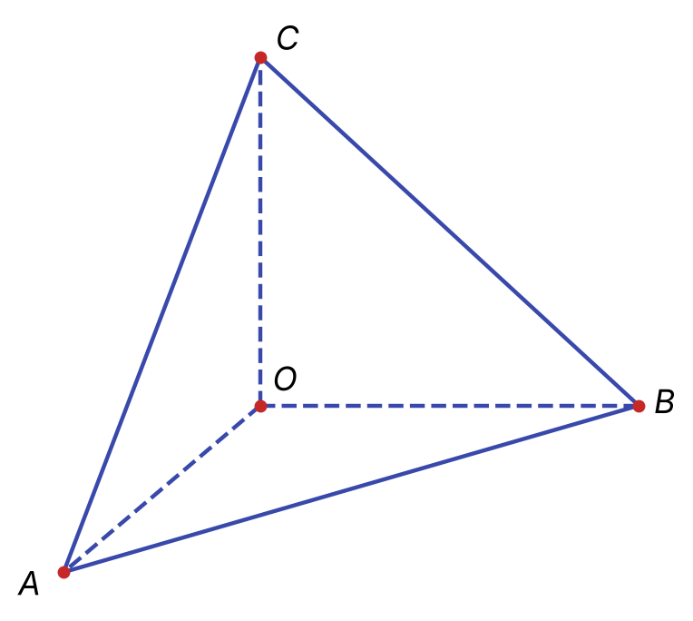

# Sujets type bac — Orthogonalité et distances dans l'espace

[📄 Sujets seuls (PDF)](pdf/bac-enonces.pdf){ .md-button }
[📄 Sujets + corrections (PDF)](pdf/bac-corriges.pdf){ .md-button }

Quatre sujets dans l'esprit de l'épreuve. Au bac, ce chapitre est presque toujours combiné avec les représentations paramétriques et les équations cartésiennes (chapitre 12) : ces sujets n'utilisent que les outils vus jusqu'ici. Dans tous les sujets, le repère est **orthonormé**.

| Sujet | Thème | Durée conseillée |
|---|---|---|
| 1 | Cube : vecteur normal, projeté, distance | 45 min |
| 2 | Tétraèdre trirectangle | 45 min |
| 3 | QCM | 25 min |
| 4 | Distance d'un point à une droite | 35 min |

## Sujet 1 — Une diagonale du cube

{ width="40%" }

On considère un cube $ABCDEFGH$ d'arête $1$ et le repère orthonormé $\left(A \,;\, \overrightarrow{AB}, \overrightarrow{AD}, \overrightarrow{AE}\right)$.

1. Donner les coordonnées des points $A$, $C$, $D$, $F$ et $H$.
2. Montrer que le vecteur $\overrightarrow{DF}$ est normal au plan $(ACH)$.
3. On note $K$ le projeté orthogonal du point $D$ sur le plan $(ACH)$.  
   a. Justifier qu'il existe un réel $k$ tel que $\overrightarrow{DK} = k\overrightarrow{DF}$.  
   b. Déterminer $k$, puis les coordonnées de $K$.
4. Montrer que $K$ est le centre de gravité du triangle $ACH$.
5. a. Calculer la distance du point $D$ au plan $(ACH)$.  
   b. Retrouver ce résultat en calculant de deux façons le volume du tétraèdre $DACH$.
6. Montrer que le plan $(ACH)$ coupe le segment $[DF]$ au tiers de sa longueur en partant de $D$.

??? success "Correction"
    **1.** $A(0, 0, 0)$, $C(1, 1, 0)$, $D(0, 1, 0)$, $F(1, 0, 1)$, $H(0, 1, 1)$.

    **2.** $\overrightarrow{DF}(1, -1, 1)$, $\overrightarrow{AC}(1, 1, 0)$ et $\overrightarrow{AH}(0, 1, 1)$, ces deux derniers n'étant pas colinéaires. $\overrightarrow{DF} \cdot \overrightarrow{AC} = 1 - 1 + 0 = 0$ et $\overrightarrow{DF} \cdot \overrightarrow{AH} = 0 - 1 + 1 = 0$. Le vecteur $\overrightarrow{DF}$ est orthogonal à deux vecteurs non colinéaires du plan $(ACH)$ : il lui est normal.

    **3. a.** Par définition du projeté, $\overrightarrow{DK}$ est colinéaire à un vecteur normal du plan, donc à $\overrightarrow{DF}$.

    **b.** $K = D + k\overrightarrow{DF}$, soit $K(k,\; 1 - k,\; k)$. $K \in (ACH)$ si et seulement si $\overrightarrow{AK} \cdot \overrightarrow{DF} = 0$ :
    $$k - (1 - k) + k = 0 \iff 3k = 1 \iff k = \frac{1}{3}.$$
    Donc $K\left(\dfrac{1}{3}, \dfrac{2}{3}, \dfrac{1}{3}\right)$.

    **4.** Le centre de gravité de $ACH$ a pour coordonnées $\left(\dfrac{0 + 1 + 0}{3}, \dfrac{0 + 1 + 1}{3}, \dfrac{0 + 0 + 1}{3}\right) = \left(\dfrac{1}{3}, \dfrac{2}{3}, \dfrac{1}{3}\right)$ : c'est $K$.

    **5. a.** $DK = \dfrac{1}{3} \times DF = \dfrac{1}{3} \times \sqrt{3} = \dfrac{\sqrt{3}}{3}$.

    **b.** En prenant pour base le triangle $ACD$ (rectangle isocèle en $D$, d'aire $\dfrac{1}{2}$) et pour hauteur $DH = 1$ : $V = \dfrac{1}{3} \times \dfrac{1}{2} \times 1 = \dfrac{1}{6}$.

    En prenant pour base le triangle $ACH$ : ses côtés sont des diagonales de faces, de longueur $\sqrt{2}$. Il est équilatéral, d'aire $\dfrac{\sqrt{3}}{4} \times 2 = \dfrac{\sqrt{3}}{2}$. La hauteur est la distance $h$ de $D$ au plan $(ACH)$ : $\dfrac{1}{6} = \dfrac{1}{3} \times \dfrac{\sqrt{3}}{2} \times h$, d'où $h = \dfrac{1}{\sqrt{3}} = \dfrac{\sqrt{3}}{3}$.

    **6.** $\overrightarrow{DK} = \dfrac{1}{3}\overrightarrow{DF}$ avec $\dfrac{1}{3} \in [0, 1]$ : $K$ est sur le segment $[DF]$, au tiers en partant de $D$. Comme $K$ est dans le plan $(ACH)$ et que $(DF)$ n'est pas contenue dans ce plan ($D \notin (ACH)$), $K$ est l'unique point d'intersection.

---

## Sujet 2 — Tétraèdre trirectangle

{ width="35%" }

On considère les points $O(0, 0, 0)$, $A(2, 0, 0)$, $B(0, 3, 0)$ et $C(0, 0, 6)$.

1. Justifier que le tétraèdre $OABC$ est trirectangle en $O$.
2. Montrer que le vecteur $\vec{n}(3, 2, 1)$ est normal au plan $(ABC)$.
3. Déterminer les coordonnées du projeté orthogonal $H$ de $O$ sur le plan $(ABC)$, puis la distance $OH$.
4. Calculer le volume du tétraèdre $OABC$. En déduire l'aire du triangle $ABC$.
5. Vérifier que $\dfrac{1}{OH^2} = \dfrac{1}{OA^2} + \dfrac{1}{OB^2} + \dfrac{1}{OC^2}$.
6. Montrer que $H$ est l'orthocentre du triangle $ABC$.

??? success "Correction"
    **1.** $\overrightarrow{OA}(2, 0, 0)$, $\overrightarrow{OB}(0, 3, 0)$, $\overrightarrow{OC}(0, 0, 6)$ : les trois produits scalaires deux à deux sont nuls, les arêtes issues de $O$ sont deux à deux perpendiculaires.

    **2.** $\overrightarrow{AB}(-2, 3, 0)$ et $\overrightarrow{AC}(-2, 0, 6)$ ne sont pas colinéaires. $\vec{n} \cdot \overrightarrow{AB} = -6 + 6 + 0 = 0$ et $\vec{n} \cdot \overrightarrow{AC} = -6 + 0 + 6 = 0$ : $\vec{n}$ est normal au plan $(ABC)$.

    **3.** $\overrightarrow{OH} = k\vec{n}$, soit $H(3k, 2k, k)$. $H \in (ABC)$ si et seulement si $\overrightarrow{AH} \cdot \vec{n} = 0$ :
    $$3(3k - 2) + 2 \times 2k + k = 0 \iff 14k = 6 \iff k = \frac{3}{7}.$$
    Donc $H\left(\dfrac{9}{7}, \dfrac{6}{7}, \dfrac{3}{7}\right)$ et $OH = \dfrac{3}{7}\|\vec{n}\| = \dfrac{3\sqrt{14}}{7}$.

    **4.** Avec la base $OAB$ (rectangle en $O$, d'aire $3$) et la hauteur $OC = 6$ : $V = \dfrac{1}{3} \times 3 \times 6 = 6$.

    Avec la base $ABC$ et la hauteur $OH$ : $6 = \dfrac{1}{3} \times \mathcal{A}(ABC) \times \dfrac{3\sqrt{14}}{7}$, donc $\mathcal{A}(ABC) = \dfrac{42}{\sqrt{14}} = 3\sqrt{14}$.

    **5.** $OH^2 = \dfrac{9 \times 14}{49} = \dfrac{18}{7}$, donc $\dfrac{1}{OH^2} = \dfrac{7}{18}$. Et $\dfrac{1}{4} + \dfrac{1}{9} + \dfrac{1}{36} = \dfrac{9 + 4 + 1}{36} = \dfrac{14}{36} = \dfrac{7}{18}$.

    **6.** $\overrightarrow{AH}\left(-\dfrac{5}{7}, \dfrac{6}{7}, \dfrac{3}{7}\right)$ et $\overrightarrow{BC}(0, -3, 6)$ : $\overrightarrow{AH} \cdot \overrightarrow{BC} = -\dfrac{18}{7} + \dfrac{18}{7} = 0$. De même, $\overrightarrow{BH}\left(\dfrac{9}{7}, -\dfrac{15}{7}, \dfrac{3}{7}\right)$ et $\overrightarrow{AC}(-2, 0, 6)$ : $\overrightarrow{BH} \cdot \overrightarrow{AC} = -\dfrac{18}{7} + \dfrac{18}{7} = 0$. Le point $H$ est sur deux hauteurs du triangle $ABC$ : c'est son orthocentre (voir aussi l'exercice 27).

---

## Sujet 3 — QCM

Pour chaque question, une seule réponse est exacte. Justifier.

**Question 1.** Le produit scalaire de $\vec{u}(1, 2, -2)$ et $\vec{v}(2, -1, 3)$ vaut :

a. $6$ ; b. $-6$ ; c. $0$ ; d. $-2$.

**Question 2.** La norme du vecteur $\vec{w}(2, -1, 2)$ vaut :

a. $3$ ; b. $5$ ; c. $9$ ; d. $\sqrt{5}$.

**Question 3.** Dans un cube $ABCDEFGH$, les droites $(AB)$ et $(FG)$ sont :

a. parallèles ; b. perpendiculaires ; c. orthogonales et non sécantes ; d. ni orthogonales ni parallèles.

**Question 4.** Un vecteur normal au plan passant par $I(1, 0, 0)$, $J(0, 1, 0)$ et $K(0, 0, 1)$ est :

a. $(1, -1, 0)$ ; b. $(1, 0, 0)$ ; c. $(1, 1, -1)$ ; d. $(1, 1, 1)$.

**Question 5.** La distance du point $M(1, 2, 3)$ à l'axe $(Oz)$ vaut :

a. $3$ ; b. $\sqrt{5}$ ; c. $\sqrt{14}$ ; d. $1$.

??? success "Correction"
    **Question 1 : b.** $2 - 2 - 6 = -6$.

    **Question 2 : a.** $\sqrt{4 + 1 + 4} = 3$.

    **Question 3 : c.** $\overrightarrow{FG} = \overrightarrow{BC} = \overrightarrow{AD}$, orthogonal à $\overrightarrow{AB}$. Les droites ne sont pas sécantes : $(AB)$ est dans le plan $(ABC)$ et $(FG)$ dans le plan parallèle $(EFG)$.

    **Question 4 : d.** $\overrightarrow{IJ}(-1, 1, 0)$ et $\overrightarrow{IK}(-1, 0, 1)$ sont orthogonaux à $(1, 1, 1)$. Le vecteur $(1, -1, 0)$ n'est pas orthogonal à $\overrightarrow{IJ}$ ($-1 - 1 = -2$).

    **Question 5 : b.** Le projeté de $M$ sur $(Oz)$ est $H(0, 0, 3)$ (on vérifie que $\overrightarrow{HM}(1, 2, 0)$ est orthogonal à $\vec{k}(0, 0, 1)$). Donc $MH = \sqrt{1 + 4} = \sqrt{5}$.

---

## Sujet 4 — Distance d'un point à une droite

On considère le point $A(1, -1, 0)$, le vecteur $\vec{u}(2, 1, -2)$ et la droite $d$ passant par $A$ et de vecteur directeur $\vec{u}$. On considère aussi le point $B(5, -2, -1)$.

1. Pour tout réel $t$, on note $M_t$ le point tel que $\overrightarrow{AM_t} = t\vec{u}$. Donner les coordonnées de $M_t$.
2. Montrer que $BM_t^2 = 9t^2 - 18t + 18$.
3. En déduire la distance du point $B$ à la droite $d$, et le point $H$ de $d$ le plus proche de $B$.
4. Vérifier que $H$ est le projeté orthogonal de $B$ sur $d$.
5. Calculer l'aire du triangle $ABH$.
6. Déterminer les coordonnées du symétrique $B'$ de $B$ par rapport à la droite $d$, c'est-à-dire du point tel que $H$ soit le milieu de $[BB']$. Quelle est la distance de $B'$ à $d$ ?

??? success "Correction"
    **1.** $M_t(1 + 2t,\; -1 + t,\; -2t)$.

    **2.** $\overrightarrow{BM_t}(2t - 4,\; t + 1,\; -2t + 1)$, donc
    $$BM_t^2 = (4t^2 - 16t + 16) + (t^2 + 2t + 1) + (4t^2 - 4t + 1) = 9t^2 - 18t + 18.$$

    **3.** Le trinôme est minimal en $t = \dfrac{18}{18} = 1$, où il vaut $9$. La distance de $B$ à $d$ est donc $\sqrt{9} = 3$, atteinte en $H = M_1(3, 0, -2)$.

    **4.** $\overrightarrow{BH}(-2, 2, -1)$ et $\overrightarrow{BH} \cdot \vec{u} = -4 + 2 + 2 = 0$ : $H$ est le projeté orthogonal de $B$ sur $d$. C'est cohérent avec le cours : le projeté est le point le plus proche.

    **5.** Le triangle $ABH$ est rectangle en $H$, avec $AH = \|\vec{u}\| = 3$ et $BH = 3$ : son aire vaut $\dfrac{3 \times 3}{2} = \dfrac{9}{2}$.

    **6.** $B' = 2H - B$ en coordonnées : $B'(6 - 5,\; 0 + 2,\; -4 + 1) = (1, 2, -3)$. Le projeté de $B'$ sur $d$ est encore $H$, car $\overrightarrow{B'H} = -\overrightarrow{BH}$ est orthogonal à $\vec{u}$. Donc la distance de $B'$ à $d$ vaut aussi $3$.
