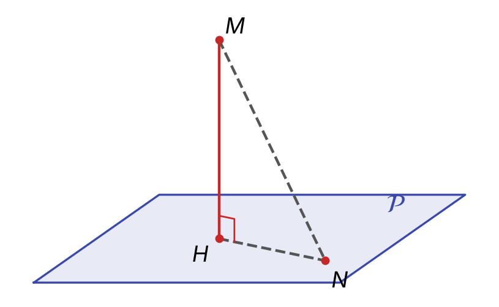

# Cours — Orthogonalité et distances dans l'espace

[📄 Cours en PDF (version classique)](pdf/cours.pdf){ .md-button }
[📄 Cours complet avec toutes les démonstrations (PDF)](pdf/cours-complet.pdf){ .md-button }

!!! lecture "Comment lire les démonstrations"
    Chaque résultat est démontré dès que c'est possible avec les outils de Terminale.

    Sur le site, clique sur un bloc pour l'ouvrir.

    - **Démonstration — au programme du bac** : à savoir refaire, elle peut être demandée à l'examen.
    - **Démonstration — pour aller plus loin** : à comprendre, inutile de l'apprendre par cœur. Indispensable si tu vises des études de maths.
    - **Pourquoi ce résultat est admis** : la preuve demande une notion du supérieur, qui est indiquée.

On illustre les notions sur le **cube $ABCDEFGH$** du chapitre 10, d'arête $1$ : $ABCD$ est la face du bas et $E$, $F$, $G$, $H$ sont respectivement au-dessus de $A$, $B$, $C$, $D$.

{ width="45%" }

---

## 1. Le produit scalaire dans l'espace

### 1.1 Définition

Soit $\vec{u}$ et $\vec{v}$ deux vecteurs de l'espace. On choisit un point $A$, puis les points $B$ et $C$ tels que $\vec{u} = \overrightarrow{AB}$ et $\vec{v} = \overrightarrow{AC}$. Les trois points $A$, $B$, $C$ sont toujours contenus dans au moins un plan.

!!! definition "Produit scalaire"
    Le **produit scalaire** $\vec{u} \cdot \vec{v}$ est le produit scalaire $\overrightarrow{AB} \cdot \overrightarrow{AC}$ calculé dans un plan contenant $A$, $B$ et $C$, comme en Première. En particulier :

    - si $\vec{u}$ et $\vec{v}$ sont non nuls, $\vec{u} \cdot \vec{v} = \|\vec{u}\| \times \|\vec{v}\| \times \cos\left(\widehat{BAC}\right)$ ;
    - si l'un des deux vecteurs est nul, $\vec{u} \cdot \vec{v} = 0$ ;
    - dans tous les cas, $\vec{u} \cdot \vec{v} = \dfrac{1}{2}\left(\|\vec{u} + \vec{v}\|^2 - \|\vec{u}\|^2 - \|\vec{v}\|^2\right)$.

La dernière formule ne fait intervenir que des **longueurs** : le résultat ne dépend donc ni du point $A$ choisi, ni du plan choisi quand $A$, $B$, $C$ sont alignés.

!!! tip "Le produit scalaire par projection"
    Si $H$ est le projeté orthogonal de $C$ sur la droite $(AB)$, alors $\overrightarrow{AB} \cdot \overrightarrow{AC} = \overrightarrow{AB} \cdot \overrightarrow{AH}$ : c'est $AB \times AH$ si $\overrightarrow{AB}$ et $\overrightarrow{AH}$ sont de même sens, et $-AB \times AH$ sinon.

    **Dans le cube.** Le projeté de $G$ sur $(AB)$ est $B$, donc $\overrightarrow{AB} \cdot \overrightarrow{AG} = AB^2 = 1$.

### 1.2 Règles de calcul

!!! propriete "Propriétés du produit scalaire"
    Pour tous vecteurs $\vec{u}$, $\vec{v}$, $\vec{w}$ et tout réel $k$ :

    - **symétrie** : $\vec{u} \cdot \vec{v} = \vec{v} \cdot \vec{u}$ ;
    - $\vec{u} \cdot \vec{u} = \|\vec{u}\|^2$ ;
    - $(k\vec{u}) \cdot \vec{v} = k\,(\vec{u} \cdot \vec{v})$ ;
    - **distributivité** : $\vec{u} \cdot (\vec{v} + \vec{w}) = \vec{u} \cdot \vec{v} + \vec{u} \cdot \vec{w}$.

Les trois premières règles ne font intervenir que deux vecteurs, que l'on peut toujours représenter dans un même plan : ce sont les règles de Première. Il en va de même pour la distributivité quand $\vec{u}$, $\vec{v}$, $\vec{w}$ sont coplanaires.

??? admis "Pourquoi la distributivité est admise quand les trois vecteurs ne sont pas coplanaires"
    Trois vecteurs non coplanaires ne peuvent pas être représentés dans un même plan : on ne peut donc plus utiliser la géométrie plane de Première.

    Une preuve directe existe à partir des axiomes de la géométrie de l'espace, mais elle est longue : elle passe par des cas d'égalité de triangles dans l'espace (c'est ce que fait Euclide au livre XI de ses *Éléments*).

    Dans le supérieur, on procède à l'envers : on **définit** un espace euclidien comme un espace muni d'un produit scalaire, et la distributivité fait partie de la définition. C'est le cadre de l'**algèbre bilinéaire** (L2, ou deuxième année de prépa).

!!! propriete "Identités remarquables"
    $$\|\vec{u} + \vec{v}\|^2 = \|\vec{u}\|^2 + 2\,\vec{u} \cdot \vec{v} + \|\vec{v}\|^2, \qquad \|\vec{u} - \vec{v}\|^2 = \|\vec{u}\|^2 - 2\,\vec{u} \cdot \vec{v} + \|\vec{v}\|^2,$$

    $$(\vec{u} + \vec{v}) \cdot (\vec{u} - \vec{v}) = \|\vec{u}\|^2 - \|\vec{v}\|^2.$$

??? demoplus "Démonstration — pour aller plus loin"
    On développe avec la distributivité et la symétrie : $(\vec{u} + \vec{v}) \cdot (\vec{u} + \vec{v}) = \vec{u} \cdot \vec{u} + \vec{u} \cdot \vec{v} + \vec{v} \cdot \vec{u} + \vec{v} \cdot \vec{v} = \|\vec{u}\|^2 + 2\,\vec{u} \cdot \vec{v} + \|\vec{v}\|^2$. Les deux autres se traitent de la même façon.

### 1.3 L'inégalité de Cauchy-Schwarz

!!! theoreme "Inégalité de Cauchy-Schwarz"
    Pour tous vecteurs $\vec{u}$ et $\vec{v}$ :
    $$|\vec{u} \cdot \vec{v}| \leq \|\vec{u}\| \times \|\vec{v}\|,$$
    avec égalité si et seulement si $\vec{u}$ et $\vec{v}$ sont colinéaires.

??? demoplus "Démonstration — pour aller plus loin"
    Si l'un des vecteurs est nul, les deux membres sont nuls, et les vecteurs sont colinéaires.

    Sinon, $\vec{u} \cdot \vec{v} = \|\vec{u}\| \times \|\vec{v}\| \times \cos\theta$, où $\theta$ est l'angle $\widehat{BAC}$. Comme $|\cos\theta| \leq 1$, on obtient l'inégalité. Il y a égalité si et seulement si $\cos\theta = \pm 1$, c'est-à-dire $\theta = 0$ ou $\theta = \pi$ : les points $A$, $B$, $C$ sont alors alignés, ce qui signifie que $\vec{u}$ et $\vec{v}$ sont colinéaires.

    *Une autre preuve, purement algébrique, utilise le signe du trinôme $t \mapsto \|\vec{u} + t\vec{v}\|^2$ : c'est celle qui se généralise dans le supérieur (exercice 26).*

---

## 2. Orthogonalité

### 2.1 Vecteurs et droites orthogonaux

!!! definition "Vecteurs orthogonaux, droites orthogonales"
    - Deux vecteurs $\vec{u}$ et $\vec{v}$ sont **orthogonaux** lorsque $\vec{u} \cdot \vec{v} = 0$. Le vecteur nul est orthogonal à tout vecteur.
    - Deux droites sont **orthogonales** lorsque leurs vecteurs directeurs sont orthogonaux.
    - Deux droites orthogonales et **sécantes** sont dites **perpendiculaires**.

**Dans le cube.** $(AB)$ et $(CG)$ sont orthogonales, car $\overrightarrow{AB} \cdot \overrightarrow{CG} = \overrightarrow{AB} \cdot \overrightarrow{AE} = 0$, mais elles ne sont pas perpendiculaires : elles ne se coupent pas.

!!! warning "Deux pièges classiques"
    - Dans l'espace, deux droites orthogonales **ne se coupent pas forcément**.
    - Deux droites orthogonales à une même droite **ne sont pas forcément parallèles** : $(AB)$ et $(AD)$ sont toutes deux orthogonales à $(AE)$, et elles sont sécantes.

### 2.2 Droite orthogonale à un plan

!!! definition "Droite orthogonale à un plan"
    Une droite $d$ est **orthogonale à un plan** $\mathcal{P}$ lorsqu'elle est orthogonale à **toutes** les droites de $\mathcal{P}$.

Vérifier une infinité de droites serait impossible. Le théorème suivant ramène ce travail à deux vérifications.

!!! theoreme "Caractérisation"
    Une droite est orthogonale à un plan si et seulement si elle est orthogonale à **deux droites sécantes** de ce plan.

??? demoplus "Démonstration — pour aller plus loin"
    Le sens direct est évident. Réciproquement, soit $\vec{w}$ un vecteur directeur de la droite $d$, et $\vec{u}$, $\vec{v}$ des vecteurs directeurs des deux droites sécantes du plan $\mathcal{P}$. Ces deux vecteurs ne sont pas colinéaires (les droites sont sécantes et distinctes), donc ils dirigent le plan $\mathcal{P}$.

    Toute droite de $\mathcal{P}$ a un vecteur directeur de la forme $a\vec{u} + b\vec{v}$. Par distributivité :
    $$\vec{w} \cdot (a\vec{u} + b\vec{v}) = a\,(\vec{w} \cdot \vec{u}) + b\,(\vec{w} \cdot \vec{v}) = a \times 0 + b \times 0 = 0.$$
    Donc $d$ est orthogonale à toute droite de $\mathcal{P}$.

**Dans le cube.** $(AE)$ est orthogonale à $(AB)$ et à $(AD)$, qui sont sécantes : $(AE)$ est orthogonale au plan $(ABC)$. Elle est donc aussi orthogonale à $(BD)$, à $(AC)$, à $(HF)$…

!!! warning "Attention"
    Il faut **deux** droites, et **sécantes** (ou au moins non parallèles). Une droite orthogonale à une seule droite d'un plan n'a aucune raison d'être orthogonale au plan.

### 2.3 Vecteur normal à un plan

!!! definition "Vecteur normal"
    Un vecteur $\vec{n}$ **non nul** est **normal** à un plan $\mathcal{P}$ lorsqu'il dirige une droite orthogonale à $\mathcal{P}$. D'après le théorème précédent, cela revient à dire que $\vec{n}$ est orthogonal à deux vecteurs non colinéaires de $\mathcal{P}$.

**Dans le cube.** $\overrightarrow{AE}$ est normal au plan $(ABC)$. Le vecteur $\overrightarrow{AG}$ est normal au plan $(BDE)$ (méthode 3).

!!! propriete "Existence"
    Tout plan admet un vecteur normal, et deux vecteurs normaux à un même plan sont colinéaires.

??? demoplus "Démonstration — pour aller plus loin"
    **Existence.** Soit $\mathcal{P}$ un plan dirigé par $\vec{u}$ et $\vec{v}$ non colinéaires, et $\vec{w}$ un vecteur qui n'est pas dans la direction de $\mathcal{P}$ (il en existe : sinon tout l'espace serait engendré par $\vec{u}$ et $\vec{v}$, et il n'y aurait pas de base de trois vecteurs). On cherche $\vec{n} = \vec{w} - a\vec{u} - b\vec{v}$ orthogonal à $\vec{u}$ et à $\vec{v}$, ce qui s'écrit :
    $$\begin{cases} a\|\vec{u}\|^2 + b\,(\vec{u} \cdot \vec{v}) = \vec{w} \cdot \vec{u} \\ a\,(\vec{u} \cdot \vec{v}) + b\|\vec{v}\|^2 = \vec{w} \cdot \vec{v} \end{cases}$$
    Ce système de deux équations à deux inconnues a une unique solution, car son déterminant $\delta = \|\vec{u}\|^2\|\vec{v}\|^2 - (\vec{u} \cdot \vec{v})^2$ est strictement positif : c'est le **cas d'égalité de Cauchy-Schwarz**, puisque $\vec{u}$ et $\vec{v}$ ne sont pas colinéaires. Enfin, $\vec{n} \neq \vec{0}$, car sinon $\vec{w} = a\vec{u} + b\vec{v}$ serait dans la direction de $\mathcal{P}$.

    **Colinéarité.** Soit $\vec{n}$ et $\vec{n}'$ deux vecteurs normaux. Le vecteur $\vec{n}$ n'est pas dans la direction de $\mathcal{P}$ (sinon il serait orthogonal à lui-même, donc nul). Ainsi $(\vec{u}, \vec{v}, \vec{n})$ est une base, et l'on écrit $\vec{n}' = a\vec{u} + b\vec{v} + c\vec{n}$. En faisant le produit scalaire par $\vec{u}$ puis par $\vec{v}$, on retrouve un système en $a$, $b$ de déterminant $\delta \neq 0$ et de second membre nul : $a = b = 0$, et $\vec{n}' = c\vec{n}$.

!!! theoreme "Plan défini par un point et un vecteur normal"
    Soit $A$ un point et $\vec{n}$ un vecteur non nul. L'ensemble des points $M$ tels que
    $$\overrightarrow{AM} \cdot \vec{n} = 0$$
    est **l'unique plan** passant par $A$ et de vecteur normal $\vec{n}$.

??? demoplus "Démonstration — pour aller plus loin"
    **Construction d'un plan de vecteur normal $\vec{n}$.** Soit $(\vec{e}_1, \vec{e}_2, \vec{e}_3)$ une base. Pour chaque $i$, le vecteur $\vec{p}_i = \vec{e}_i - \dfrac{\vec{e}_i \cdot \vec{n}}{\|\vec{n}\|^2}\vec{n}$ est orthogonal à $\vec{n}$ (on développe $\vec{p}_i \cdot \vec{n}$). Deux de ces vecteurs ne sont pas colinéaires : sinon ils seraient tous colinéaires à un même vecteur $\vec{p}$, et les trois $\vec{e}_i$ seraient combinaisons de $\vec{p}$ et $\vec{n}$, donc coplanaires, ce qui est impossible. Notons $\vec{u}$ et $\vec{v}$ deux tels vecteurs, et $\mathcal{P}$ le plan passant par $A$ dirigé par $\vec{u}$ et $\vec{v}$ : $\vec{n}$ lui est normal.

    **Égalité des ensembles.** Si $M \in \mathcal{P}$, $\overrightarrow{AM} = a\vec{u} + b\vec{v}$, donc $\overrightarrow{AM} \cdot \vec{n} = 0$. Réciproquement, $(\vec{u}, \vec{v}, \vec{n})$ est une base (même argument que ci-dessus) ; si $\overrightarrow{AM} = a\vec{u} + b\vec{v} + c\vec{n}$ vérifie $\overrightarrow{AM} \cdot \vec{n} = 0$, alors $c\|\vec{n}\|^2 = 0$, donc $c = 0$ et $M \in \mathcal{P}$.

    **Unicité.** Un plan $\mathcal{P}'$ passant par $A$ et de vecteur normal $\vec{n}$ est contenu dans l'ensemble précédent, c'est-à-dire dans $\mathcal{P}$. Un plan contenu dans un autre plan lui est égal.

!!! propriete "Parallélisme et vecteurs normaux"
    Soit $\mathcal{P}$ un plan de vecteur normal $\vec{n}$.

    - La direction de $\mathcal{P}$ est formée des vecteurs orthogonaux à $\vec{n}$. Une droite de vecteur directeur $\vec{w}$ est donc **parallèle** à $\mathcal{P}$ si et seulement si $\vec{w} \cdot \vec{n} = 0$.
    - Une droite est **orthogonale** à $\mathcal{P}$ si et seulement si son vecteur directeur est colinéaire à $\vec{n}$.
    - Deux plans sont **parallèles** si et seulement si leurs vecteurs normaux sont colinéaires.

??? demoplus "Démonstration — pour aller plus loin"
    Le premier point découle du théorème précédent : $\vec{w}$ est dans la direction de $\mathcal{P}$ si et seulement si le point $M$ tel que $\overrightarrow{AM} = \vec{w}$ est dans $\mathcal{P}$, c'est-à-dire $\vec{w} \cdot \vec{n} = 0$.

    Le deuxième point est la propriété « Existence » : tout vecteur directeur d'une droite orthogonale à $\mathcal{P}$ est normal à $\mathcal{P}$, donc colinéaire à $\vec{n}$.

    Pour le troisième : si $\vec{n}' = k\vec{n}$, les vecteurs orthogonaux à $\vec{n}$ et à $\vec{n}'$ sont les mêmes, donc les deux plans ont la même direction. Réciproquement, deux plans parallèles ont la même direction, donc tout vecteur normal à l'un est normal à l'autre, et lui est colinéaire.

---

## 3. Repères orthonormés

!!! definition "Base et repère orthonormés"
    Une base $\left(\vec{\imath}, \vec{\jmath}, \vec{k}\right)$ est **orthonormée** lorsque les trois vecteurs sont de norme $1$ et deux à deux orthogonaux. Un repère $\left(O \,;\, \vec{\imath}, \vec{\jmath}, \vec{k}\right)$ est orthonormé lorsque sa base l'est.

**Dans le cube d'arête $1$**, le repère $\left(A \,;\, \overrightarrow{AB}, \overrightarrow{AD}, \overrightarrow{AE}\right)$ est orthonormé.

!!! theoreme "Produit scalaire et normes en repère orthonormé"
    Dans une base orthonormée, si $\vec{u}(x, y, z)$ et $\vec{v}(x', y', z')$ :
    $$\vec{u} \cdot \vec{v} = xx' + yy' + zz', \qquad \|\vec{u}\| = \sqrt{x^2 + y^2 + z^2}.$$
    Dans un repère orthonormé, la distance entre $A(x_A, y_A, z_A)$ et $B(x_B, y_B, z_B)$ est
    $$AB = \sqrt{(x_B - x_A)^2 + (y_B - y_A)^2 + (z_B - z_A)^2}.$$

??? demoplus "Démonstration — pour aller plus loin"
    On écrit $\vec{u} = x\vec{\imath} + y\vec{\jmath} + z\vec{k}$ et $\vec{v} = x'\vec{\imath} + y'\vec{\jmath} + z'\vec{k}$, et l'on développe $\vec{u} \cdot \vec{v}$ par distributivité. On obtient neuf termes. Les termes croisés comme $xy'\,(\vec{\imath} \cdot \vec{\jmath})$ sont nuls car les vecteurs de base sont orthogonaux, et les termes comme $xx'\,(\vec{\imath} \cdot \vec{\imath})$ valent $xx'$ car $\|\vec{\imath}\| = 1$. Il reste $xx' + yy' + zz'$.

    La norme s'obtient avec $\vec{v} = \vec{u}$, et la distance $AB$ est la norme de $\overrightarrow{AB}(x_B - x_A, y_B - y_A, z_B - z_A)$.

!!! warning "Seulement en repère orthonormé"
    Ces formules sont **fausses** dans un repère quelconque. Avant de les utiliser, vérifie (et écris sur ta copie) que le repère est orthonormé.

**Exemple.** Dans le cube, $\overrightarrow{AG}(1, 1, 1)$ et $\overrightarrow{BH}(-1, 1, 1)$. Donc $\overrightarrow{AG} \cdot \overrightarrow{BH} = -1 + 1 + 1 = 1$, et $\|\overrightarrow{AG}\| = \|\overrightarrow{BH}\| = \sqrt{3}$. L'angle $\theta$ entre ces deux diagonales vérifie $\cos\theta = \dfrac{1}{3}$, soit $\theta \approx 70{,}5°$.

---

## 4. Projeté orthogonal et distances

### 4.1 Projeté orthogonal sur une droite

!!! definition "Projeté orthogonal sur une droite"
    Soit $d$ une droite de vecteur directeur $\vec{u}$ et $M$ un point. Le **projeté orthogonal** de $M$ sur $d$ est le point $H$ de $d$ tel que $\overrightarrow{MH} \cdot \vec{u} = 0$.

!!! propriete "Existence, unicité et calcul"
    Si $A$ est un point de $d$, le projeté $H$ existe, est unique, et
    $$\overrightarrow{AH} = \frac{\overrightarrow{AM} \cdot \vec{u}}{\|\vec{u}\|^2}\,\vec{u}.$$

??? demoplus "Démonstration — pour aller plus loin"
    Un point $H$ est sur $d$ si et seulement si $\overrightarrow{AH} = t\vec{u}$ pour un réel $t$. Alors $\overrightarrow{MH} = \overrightarrow{MA} + t\vec{u}$, et
    $$\overrightarrow{MH} \cdot \vec{u} = -\overrightarrow{AM} \cdot \vec{u} + t\|\vec{u}\|^2.$$
    Cette quantité est nulle pour une unique valeur de $t$, à savoir $t = \dfrac{\overrightarrow{AM} \cdot \vec{u}}{\|\vec{u}\|^2}$.

### 4.2 Projeté orthogonal sur un plan

{ width="45%" }

!!! definition "Projeté orthogonal sur un plan"
    Soit $\mathcal{P}$ un plan de vecteur normal $\vec{n}$ et $M$ un point. Le **projeté orthogonal** de $M$ sur $\mathcal{P}$ est le point $H$ de $\mathcal{P}$ tel que $\overrightarrow{MH}$ soit colinéaire à $\vec{n}$. Autrement dit, $H$ est l'intersection de $\mathcal{P}$ et de la droite orthogonale à $\mathcal{P}$ passant par $M$ (si $M \in \mathcal{P}$, alors $H = M$).

!!! propriete "Existence, unicité et calcul"
    Si $A$ est un point de $\mathcal{P}$, le projeté $H$ existe, est unique, et
    $$\overrightarrow{MH} = -\frac{\overrightarrow{AM} \cdot \vec{n}}{\|\vec{n}\|^2}\,\vec{n}.$$

??? demoplus "Démonstration — pour aller plus loin"
    $\overrightarrow{MH}$ est colinéaire à $\vec{n}$ si et seulement si $\overrightarrow{MH} = k\vec{n}$ pour un réel $k$. Le point $H$ est alors dans $\mathcal{P}$ si et seulement si $\overrightarrow{AH} \cdot \vec{n} = 0$ (théorème du § 2.3), c'est-à-dire
    $$\left(\overrightarrow{AM} + k\vec{n}\right) \cdot \vec{n} = 0 \iff k = -\frac{\overrightarrow{AM} \cdot \vec{n}}{\|\vec{n}\|^2}.$$
    Il y a une unique valeur de $k$ qui convient, donc un unique point $H$.

### 4.3 Le point le plus proche

!!! theoreme "Le projeté est le point le plus proche"
    Soit $H$ le projeté orthogonal d'un point $M$ sur un plan $\mathcal{P}$. Pour tout point $N$ de $\mathcal{P}$,
    $$MN \geq MH,$$
    avec égalité si et seulement si $N = H$. Le projeté $H$ est donc **le point de $\mathcal{P}$ le plus proche de $M$**.

??? demo "Démonstration — au programme du bac"
    Soit $N$ un point de $\mathcal{P}$. Par la relation de Chasles, $\overrightarrow{MN} = \overrightarrow{MH} + \overrightarrow{HN}$, donc
    $$MN^2 = \|\overrightarrow{MH} + \overrightarrow{HN}\|^2 = MH^2 + 2\,\overrightarrow{MH} \cdot \overrightarrow{HN} + HN^2.$$
    Les points $H$ et $N$ sont dans $\mathcal{P}$, donc $\overrightarrow{HN}$ est dans la direction de $\mathcal{P}$. Le vecteur $\overrightarrow{MH}$ est colinéaire au vecteur normal $\vec{n}$. Ils sont donc orthogonaux : $\overrightarrow{MH} \cdot \overrightarrow{HN} = 0$. Il reste
    $$MN^2 = MH^2 + HN^2 \geq MH^2.$$
    Comme les distances sont positives, $MN \geq MH$. L'égalité a lieu si et seulement si $HN^2 = 0$, c'est-à-dire $N = H$.

    *C'est le théorème de Pythagore dans le triangle $MHN$, rectangle en $H$.*

Le même raisonnement montre que le projeté orthogonal de $M$ sur une **droite** est le point de la droite le plus proche de $M$.

### 4.4 Distances

!!! definition "Distance d'un point à un plan, à une droite"
    La **distance** d'un point $M$ à un plan $\mathcal{P}$ (ou à une droite $d$) est la distance $MH$, où $H$ est le projeté orthogonal de $M$ sur $\mathcal{P}$ (ou sur $d$). D'après le § 4.3, c'est la plus petite distance entre $M$ et un point de $\mathcal{P}$ (ou de $d$).

!!! propriete "Calcul de la distance à un plan"
    Si $A \in \mathcal{P}$ et $\vec{n}$ est normal à $\mathcal{P}$ :
    $$d(M, \mathcal{P}) = \frac{\left|\overrightarrow{AM} \cdot \vec{n}\right|}{\|\vec{n}\|}.$$

??? demoplus "Démonstration — pour aller plus loin"
    D'après le § 4.2, $MH = \|\overrightarrow{MH}\| = \dfrac{\left|\overrightarrow{AM} \cdot \vec{n}\right|}{\|\vec{n}\|^2} \times \|\vec{n}\| = \dfrac{\left|\overrightarrow{AM} \cdot \vec{n}\right|}{\|\vec{n}\|}$.

!!! tip "Distances et volumes"
    La hauteur d'un tétraèdre ou d'une pyramide est la distance du sommet au plan de la base. On calcule ainsi des volumes avec $V = \dfrac{1}{3} \times \mathcal{B} \times h$, ou, à l'inverse, une distance à partir d'un volume connu (sujet type bac 1).

---

## 5. Pour aller plus loin

- **Équation cartésienne d'un plan.** Dans un repère orthonormé, la condition $\overrightarrow{AM} \cdot \vec{n} = 0$ s'écrit $ax + by + cz + d = 0$. C'est l'objet du chapitre 12, où la formule de distance devient $\dfrac{|ax_M + by_M + cz_M + d|}{\sqrt{a^2 + b^2 + c^2}}$.
- **Produit vectoriel** (hors programme, prépa et L1). Il fournit directement un vecteur orthogonal à deux vecteurs donnés : pour $\vec{u}(x, y, z)$ et $\vec{v}(x', y', z')$, c'est $\vec{u} \wedge \vec{v}\,(yz' - zy',\; zx' - xz',\; xy' - yx')$. Sa norme est l'aire du parallélogramme construit sur $\vec{u}$ et $\vec{v}$.
- **Espaces euclidiens** (L2). Tout ce chapitre se généralise en dimension quelconque : bases orthonormées, projections orthogonales, procédé de Gram-Schmidt. La démonstration du § 2.3 est un premier pas vers ce procédé.

!!! success "Tu as fini le cours"
    Passe aux [méthodes](methodes.md), puis entraîne-toi avec les exercices corrigés.
