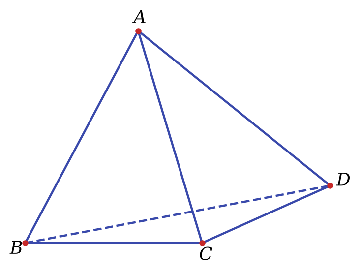
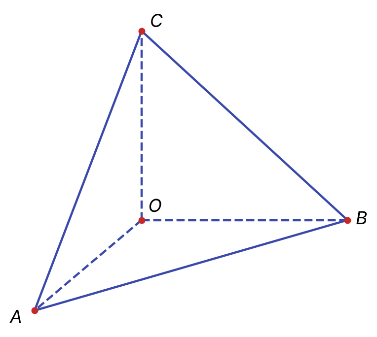

# Exercices corrigés — Orthogonalité et distances dans l'espace

[📄 Énoncés seuls (PDF)](pdf/exercices-enonces.pdf){ .md-button }
[📄 Énoncés + corrections (PDF)](pdf/exercices-corriges.pdf){ .md-button }

28 exercices classés par thème. Difficulté : <span class="etoiles">★</span> application directe — <span class="etoiles">★★</span> entraînement — <span class="etoiles">★★★</span> approfondissement.

Pour t'entraîner dans les conditions de l'examen, va voir les [sujets type bac](bac.md).

Clique sur **Correction** seulement après avoir vraiment cherché.

| Thème | Exercices |
|---|---|
| 1. Produit scalaire sans coordonnées | 1 à 6 |
| 2. Produit scalaire en repère orthonormé | 7 à 12 |
| 3. Orthogonalité, vecteur normal | 13 à 19 |
| 4. Projetés orthogonaux et distances | 20 à 25 |
| 5. Approfondissement | 26 à 28 |

Sauf mention contraire, $ABCDEFGH$ est un cube d'arête $1$, nommé comme ci-dessous, et le repère utilisé est le repère orthonormé $\left(A \,;\, \overrightarrow{AB}, \overrightarrow{AD}, \overrightarrow{AE}\right)$. Dans les exercices avec des coordonnées, le repère est orthonormé.

{ width="40%" }

---

## Thème 1 — Produit scalaire sans coordonnées

*Méthode associée : [Méthode 1](methodes.md#methode-1-calculer-un-produit-scalaire-dans-lespace).*

### Exercice 1 — Par projection <span class="etoiles">★</span>

Sans coordonnées, calculer $\overrightarrow{AB} \cdot \overrightarrow{AC}$, $\overrightarrow{AB} \cdot \overrightarrow{AG}$, $\overrightarrow{AC} \cdot \overrightarrow{AG}$ et $\overrightarrow{EG} \cdot \overrightarrow{BD}$.

??? success "Correction"
    - Le projeté de $C$ sur $(AB)$ est $B$ : $\overrightarrow{AB} \cdot \overrightarrow{AC} = AB^2 = 1$.
    - Le projeté de $G$ sur $(AB)$ est $B$ : $\overrightarrow{AB} \cdot \overrightarrow{AG} = 1$.
    - $(CG)$ est orthogonale au plan $(ABC)$, donc à $(AC)$ : le projeté de $G$ sur $(AC)$ est $C$, et $\overrightarrow{AC} \cdot \overrightarrow{AG} = AC^2 = 2$.
    - $\overrightarrow{EG} = \overrightarrow{AC}$, et les diagonales du carré $ABCD$ sont perpendiculaires : $\overrightarrow{EG} \cdot \overrightarrow{BD} = 0$.

### Exercice 2 — Tétraèdre régulier <span class="etoiles">★★</span>

{ width="35%" }

$ABCD$ est un tétraèdre régulier d'arête $a$ : ses quatre faces sont des triangles équilatéraux.

1. Calculer $\overrightarrow{AB} \cdot \overrightarrow{AC}$.
2. En déduire $\overrightarrow{AB} \cdot \overrightarrow{CD}$. Que peut-on dire des droites $(AB)$ et $(CD)$ ?

??? success "Correction"
    **1.** L'angle $\widehat{BAC}$ mesure $60°$ : $\overrightarrow{AB} \cdot \overrightarrow{AC} = a \times a \times \cos 60° = \dfrac{a^2}{2}$.

    **2.** $\overrightarrow{CD} = \overrightarrow{AD} - \overrightarrow{AC}$, donc $\overrightarrow{AB} \cdot \overrightarrow{CD} = \overrightarrow{AB} \cdot \overrightarrow{AD} - \overrightarrow{AB} \cdot \overrightarrow{AC} = \dfrac{a^2}{2} - \dfrac{a^2}{2} = 0$. Les droites $(AB)$ et $(CD)$ sont **orthogonales** (et non coplanaires) : dans un tétraèdre régulier, deux arêtes opposées sont orthogonales.

### Exercice 3 — Règles de calcul <span class="etoiles">★</span>

On sait que $\|\vec{u}\| = 2$, $\|\vec{v}\| = 3$ et $\vec{u} \cdot \vec{v} = -1$. Calculer $\|\vec{u} + \vec{v}\|$ et $(2\vec{u} - \vec{v}) \cdot (\vec{u} + 3\vec{v})$.

??? success "Correction"
    $\|\vec{u} + \vec{v}\|^2 = 4 + 2 \times (-1) + 9 = 11$, donc $\|\vec{u} + \vec{v}\| = \sqrt{11}$.

    $(2\vec{u} - \vec{v}) \cdot (\vec{u} + 3\vec{v}) = 2\|\vec{u}\|^2 + 6\,\vec{u} \cdot \vec{v} - \vec{v} \cdot \vec{u} - 3\|\vec{v}\|^2 = 8 - 6 + 1 - 27 = -24$.

### Exercice 4 — La relation d'Euler <span class="etoiles">★★</span>

Montrer que pour tous points $A$, $B$, $C$, $D$ de l'espace :
$$\overrightarrow{AB} \cdot \overrightarrow{CD} + \overrightarrow{AC} \cdot \overrightarrow{DB} + \overrightarrow{AD} \cdot \overrightarrow{BC} = 0.$$
En déduire que si, dans un tétraèdre, deux paires d'arêtes opposées sont orthogonales, la troisième l'est aussi.

??? success "Correction"
    On exprime tout à partir de $A$ : $\overrightarrow{CD} = \overrightarrow{AD} - \overrightarrow{AC}$, $\overrightarrow{DB} = \overrightarrow{AB} - \overrightarrow{AD}$, $\overrightarrow{BC} = \overrightarrow{AC} - \overrightarrow{AB}$. En développant :
    $$\overrightarrow{AB} \cdot \overrightarrow{AD} - \overrightarrow{AB} \cdot \overrightarrow{AC} + \overrightarrow{AC} \cdot \overrightarrow{AB} - \overrightarrow{AC} \cdot \overrightarrow{AD} + \overrightarrow{AD} \cdot \overrightarrow{AC} - \overrightarrow{AD} \cdot \overrightarrow{AB} = 0.$$
    Si deux des trois produits sont nuls, le troisième l'est aussi.

### Exercice 5 — Par décomposition <span class="etoiles">★★</span>

Sans coordonnées, montrer que les droites $(EC)$ et $(BG)$ sont orthogonales.

??? success "Correction"
    $\overrightarrow{EC} = \overrightarrow{EA} + \overrightarrow{AB} + \overrightarrow{BC} = \overrightarrow{AB} + \overrightarrow{AD} - \overrightarrow{AE}$ et $\overrightarrow{BG} = \overrightarrow{AD} + \overrightarrow{AE}$. Les vecteurs $\overrightarrow{AB}$, $\overrightarrow{AD}$, $\overrightarrow{AE}$ sont deux à deux orthogonaux et de norme $1$, donc en développant :
    $$\overrightarrow{EC} \cdot \overrightarrow{BG} = 0 + 0 + 1 + 0 + 0 - 1 = 0.$$

### Exercice 6 — Longueur de la grande diagonale <span class="etoiles">★</span>

En développant $\|\overrightarrow{AB} + \overrightarrow{AD} + \overrightarrow{AE}\|^2$, calculer la longueur $AG$. Que devient ce résultat pour un cube d'arête $a$ ?

??? success "Correction"
    $\overrightarrow{AG} = \overrightarrow{AB} + \overrightarrow{AD} + \overrightarrow{AE}$. En développant, les trois carrés valent $1$ et les doubles produits sont nuls : $AG^2 = 3$, donc $AG = \sqrt{3}$. Pour une arête $a$, on obtient $AG = a\sqrt{3}$.

---

## Thème 2 — Produit scalaire en repère orthonormé

### Exercice 7 — Calculs directs <span class="etoiles">★</span>

Soit $\vec{u}(1, -2, 3)$, $\vec{v}(4, 1, -1)$ et $\vec{w}(1, 2, 1)$. Calculer $\vec{u} \cdot \vec{v}$, $\|\vec{u}\|$, $\|\vec{v}\|$ et $\vec{u} \cdot \vec{w}$. Quels vecteurs sont orthogonaux ?

??? success "Correction"
    $\vec{u} \cdot \vec{v} = 4 - 2 - 3 = -1$, $\|\vec{u}\| = \sqrt{14}$, $\|\vec{v}\| = \sqrt{18} = 3\sqrt{2}$, $\vec{u} \cdot \vec{w} = 1 - 4 + 3 = 0$. Seuls $\vec{u}$ et $\vec{w}$ sont orthogonaux.

### Exercice 8 — Une distance <span class="etoiles">★</span>

Calculer la distance entre $A(1, 2, -1)$ et $B(3, -1, 5)$.

??? success "Correction"
    $\overrightarrow{AB}(2, -3, 6)$, donc $AB = \sqrt{4 + 9 + 36} = \sqrt{49} = 7$.

### Exercice 9 — Nature d'un triangle <span class="etoiles">★★</span>

Soit $A(1, 1, 1)$, $B(2, 3, 3)$ et $C(3, 2, -1)$. Déterminer la nature du triangle $ABC$ et son aire.

??? success "Correction"
    $\overrightarrow{AB}(1, 2, 2)$ et $\overrightarrow{AC}(2, 1, -2)$ : $AB = AC = 3$ et $\overrightarrow{AB} \cdot \overrightarrow{AC} = 2 + 2 - 4 = 0$. Le triangle est **rectangle isocèle en $A$**, et $BC = 3\sqrt{2}$. Son aire vaut $\dfrac{3 \times 3}{2} = \dfrac{9}{2}$.

### Exercice 10 — Calculs d'angles <span class="etoiles">★★</span>

Dans le cube, calculer une mesure en degrés des angles $\widehat{BAG}$ et $\widehat{FAH}$.

??? success "Correction"
    $\overrightarrow{AB}(1, 0, 0)$ et $\overrightarrow{AG}(1, 1, 1)$ : $\cos\widehat{BAG} = \dfrac{1}{1 \times \sqrt{3}}$, donc $\widehat{BAG} \approx 54{,}7°$.

    $\overrightarrow{AF}(1, 0, 1)$ et $\overrightarrow{AH}(0, 1, 1)$ : $\cos\widehat{FAH} = \dfrac{1}{\sqrt{2} \times \sqrt{2}} = \dfrac{1}{2}$, donc $\widehat{FAH} = 60°$. C'est logique : $AFH$ est équilatéral, ses côtés sont des diagonales de faces.

### Exercice 11 — Orthogonalité avec un paramètre <span class="etoiles">★★</span>

Pour quelles valeurs du réel $m$ les vecteurs $\vec{u}(m, m, 1)$ et $\vec{v}(m, -2, -3)$ sont-ils orthogonaux ?

??? success "Correction"
    $\vec{u} \cdot \vec{v} = m^2 - 2m - 3 = (m - 3)(m + 1)$. Les vecteurs sont orthogonaux si et seulement si $m = 3$ ou $m = -1$.

### Exercice 12 — Un vecteur orthogonal à deux autres <span class="etoiles">★★</span>

Déterminer un vecteur $\vec{n}$ orthogonal à $\vec{u}(1, 1, 0)$ et à $\vec{v}(0, 1, 1)$, puis un tel vecteur de norme $1$.

??? success "Correction"
    $\vec{n}(a, b, c)$ doit vérifier $a + b = 0$ et $b + c = 0$. Avec $b = -1$ : $\vec{n}(1, -1, 1)$. Sa norme vaut $\sqrt{3}$, donc $\dfrac{1}{\sqrt{3}}\vec{n}$ convient (son opposé aussi).

---

## Thème 3 — Orthogonalité, vecteur normal

*Méthodes associées : [Méthode 2](methodes.md#methode-2-demontrer-que-deux-droites-sont-orthogonales), [Méthode 3](methodes.md#methode-3-demontrer-quune-droite-est-orthogonale-a-un-plan) et [Méthode 4](methodes.md#methode-4-trouver-un-vecteur-normal-a-un-plan).*

### Exercice 13 — Une diagonale orthogonale à un plan <span class="etoiles">★★</span>

Montrer que la droite $(HB)$ est orthogonale au plan $(ACF)$.

??? success "Correction"
    $\overrightarrow{HB}(1, -1, -1)$, $\overrightarrow{AC}(1, 1, 0)$ et $\overrightarrow{AF}(1, 0, 1)$, ces deux derniers n'étant pas colinéaires. $\overrightarrow{HB} \cdot \overrightarrow{AC} = 1 - 1 + 0 = 0$ et $\overrightarrow{HB} \cdot \overrightarrow{AF} = 1 + 0 - 1 = 0$. La droite $(HB)$ est orthogonale à deux droites sécantes du plan $(ACF)$, donc à ce plan.

### Exercice 14 — Trouver un vecteur normal <span class="etoiles">★</span>

Déterminer un vecteur normal au plan $(ABC)$, avec $A(2, 1, 0)$, $B(3, 1, 1)$ et $C(2, 3, -1)$.

??? success "Correction"
    $\overrightarrow{AB}(1, 0, 1)$ et $\overrightarrow{AC}(0, 2, -1)$ ne sont pas colinéaires. On cherche $\vec{n}(a, b, c)$ avec $a + c = 0$ et $2b - c = 0$. Avec $c = 2$ : $a = -2$, $b = 1$. Donc $\vec{n}(-2, 1, 2)$. Vérification : $-2 + 0 + 2 = 0$ et $0 + 2 - 2 = 0$.

### Exercice 15 — Appartenance à un plan <span class="etoiles">★</span>

On reprend le plan $(ABC)$ et le vecteur $\vec{n}(-2, 1, 2)$ de l'exercice 14. Les points $D(4, 3, 1)$ et $O(0, 0, 0)$ appartiennent-ils à ce plan ?

??? success "Correction"
    $M \in (ABC)$ si et seulement si $\overrightarrow{AM} \cdot \vec{n} = 0$.

    - $\overrightarrow{AD}(2, 2, 1)$ : $-4 + 2 + 2 = 0$, donc $D \in (ABC)$.
    - $\overrightarrow{AO}(-2, -1, 0)$ : $4 - 1 + 0 = 3 \neq 0$, donc $O \notin (ABC)$.

### Exercice 16 — Position d'une droite et d'un plan <span class="etoiles">★★</span>

On garde le plan $(ABC)$ de l'exercice 14. Donner la position relative de ce plan et des droites $d_1$, $d_2$, $d_3$ de vecteurs directeurs respectifs $\vec{w}_1(4, -2, -4)$, $\vec{w}_2(1, 2, 0)$ et $\vec{w}_3(1, 1, 1)$.

??? success "Correction"
    - $\vec{w}_1 = -2\vec{n}$ : $d_1$ est **orthogonale** au plan.
    - $\vec{w}_2 \cdot \vec{n} = -2 + 2 + 0 = 0$ : $d_2$ est **parallèle** au plan (contenue dedans ou sans point commun, selon le point par lequel elle passe).
    - $\vec{w}_3 \cdot \vec{n} = -2 + 1 + 2 = 1 \neq 0$ : $d_3$ est **sécante** au plan, sans lui être orthogonale.

### Exercice 17 — Deux plans parallèles <span class="etoiles">★★</span>

Le plan $\mathcal{P}$ passe par $O(0, 0, 0)$ et a pour vecteur normal $\vec{n}(1, 2, -1)$. Le plan $\mathcal{Q}$ passe par $K(1, 0, 1)$ et a pour vecteur normal $\vec{n}'(-2, -4, 2)$. Montrer que ces plans sont parallèles. Sont-ils confondus ?

??? success "Correction"
    $\vec{n}' = -2\vec{n}$ : les vecteurs normaux sont colinéaires, les plans sont parallèles. De plus, $\overrightarrow{OK} \cdot \vec{n} = 1 + 0 - 1 = 0$, donc $K \in \mathcal{P}$. Les deux plans parallèles ont un point commun : ils sont **confondus**.

### Exercice 18 — Tétraèdre trirectangle <span class="etoiles">★</span>

{ width="35%" }

$OABC$ est un tétraèdre **trirectangle** en $O$ : les droites $(OA)$, $(OB)$, $(OC)$ sont deux à deux perpendiculaires. Montrer que $(OA)$ et $(BC)$ sont orthogonales.

??? success "Correction"
    $\overrightarrow{OA} \cdot \overrightarrow{BC} = \overrightarrow{OA} \cdot \left(\overrightarrow{OC} - \overrightarrow{OB}\right) = \overrightarrow{OA} \cdot \overrightarrow{OC} - \overrightarrow{OA} \cdot \overrightarrow{OB} = 0 - 0 = 0$.

    *Autre rédaction : $(OA)$ est orthogonale à $(OB)$ et à $(OC)$, sécantes, donc au plan $(OBC)$, qui contient $(BC)$.*

### Exercice 19 — Arêtes opposées d'un tétraèdre régulier, version géométrique <span class="etoiles">★★</span>

$ABCD$ est un tétraèdre régulier et $I$ le milieu de $[CD]$. En utilisant les triangles $ACD$ et $BCD$, montrer que $(CD)$ est orthogonale au plan $(ABI)$, et retrouver le résultat de l'exercice 2.

??? success "Correction"
    Dans le triangle équilatéral $ACD$, la médiane $(AI)$ est aussi une hauteur : $(AI) \perp (CD)$. De même, dans $BCD$, $(BI) \perp (CD)$. Les droites $(AI)$ et $(BI)$ sont sécantes en $I$ (et distinctes, car $A$, $B$, $I$ ne sont pas alignés). Donc $(CD)$ est orthogonale au plan $(ABI)$, et en particulier à la droite $(AB)$ qu'il contient.

---

## Thème 4 — Projetés orthogonaux et distances

*Méthodes associées : [Méthode 5](methodes.md#methode-5-determiner-le-projete-orthogonal-dun-point) et [Méthode 6](methodes.md#methode-6-calculer-une-distance-ou-un-volume).*

### Exercice 20 — Projeté sur une droite <span class="etoiles">★★</span>

La droite $d$ passe par $A(1, 0, 0)$ et a pour vecteur directeur $\vec{u}(1, 1, 1)$. Déterminer le projeté orthogonal $H$ du point $M(2, 3, 1)$ sur $d$, puis la distance de $M$ à $d$.

??? success "Correction"
    $\overrightarrow{AH} = t\vec{u}$ avec $t = \dfrac{\overrightarrow{AM} \cdot \vec{u}}{\|\vec{u}\|^2}$. Ici $\overrightarrow{AM}(1, 3, 1)$, donc $t = \dfrac{5}{3}$ et $H\left(\dfrac{8}{3}, \dfrac{5}{3}, \dfrac{5}{3}\right)$.

    $\overrightarrow{MH}\left(\dfrac{2}{3}, -\dfrac{4}{3}, \dfrac{2}{3}\right)$ (on vérifie $\overrightarrow{MH} \cdot \vec{u} = 0$), donc $MH = \dfrac{\sqrt{4 + 16 + 4}}{3} = \dfrac{2\sqrt{6}}{3}$.

### Exercice 21 — Projeté sur un plan <span class="etoiles">★★</span>

Le plan $\mathcal{P}$ passe par $O(0, 0, 0)$ et a pour vecteur normal $\vec{n}(1, 1, 1)$. Déterminer le projeté orthogonal $H$ de $M(3, 1, 2)$ sur $\mathcal{P}$ et la distance de $M$ à $\mathcal{P}$. Vérifier avec la formule du cours.

??? success "Correction"
    $\overrightarrow{MH} = k\vec{n}$, donc $H(3 + k, 1 + k, 2 + k)$. $H \in \mathcal{P}$ si et seulement si $\overrightarrow{OH} \cdot \vec{n} = 0$, soit $6 + 3k = 0$, donc $k = -2$ et $H(1, -1, 0)$.

    $MH = |k| \times \|\vec{n}\| = 2\sqrt{3}$. Avec la formule : $\dfrac{\left|\overrightarrow{OM} \cdot \vec{n}\right|}{\|\vec{n}\|} = \dfrac{6}{\sqrt{3}} = 2\sqrt{3}$.

### Exercice 22 — Distance d'un sommet à une diagonale <span class="etoiles">★★</span>

Calculer la distance du point $B$ à la droite $(AG)$.

??? success "Correction"
    $\overrightarrow{AH} = t\overrightarrow{AG}$ avec $t = \dfrac{\overrightarrow{AB} \cdot \overrightarrow{AG}}{AG^2} = \dfrac{1}{3}$, donc $H\left(\dfrac{1}{3}, \dfrac{1}{3}, \dfrac{1}{3}\right)$. Puis $\overrightarrow{BH}\left(-\dfrac{2}{3}, \dfrac{1}{3}, \dfrac{1}{3}\right)$ et $BH = \dfrac{\sqrt{6}}{3}$.

### Exercice 23 — Distance minimale par une fonction <span class="etoiles">★★</span>

Pour tout réel $t$, on note $M_t$ le point de coordonnées $(1 + t,\; 2,\; t)$ : quand $t$ varie, $M_t$ décrit une droite $d$. Soit $P(2, 0, 3)$.

1. Exprimer $PM_t^2$ en fonction de $t$.
2. En déduire la distance de $P$ à la droite $d$, et le point de $d$ le plus proche de $P$.
3. Vérifier que ce point est bien le projeté orthogonal de $P$ sur $d$.

??? success "Correction"
    **1.** $\overrightarrow{PM_t}(t - 1, 2, t - 3)$, donc $PM_t^2 = (t - 1)^2 + 4 + (t - 3)^2 = 2t^2 - 8t + 14$.

    **2.** Ce trinôme est minimal pour $t = \dfrac{8}{4} = 2$, où il vaut $8 - 16 + 14 = 6$. La distance est $\sqrt{6}$, atteinte au point $M_2(3, 2, 2)$.

    **3.** Un vecteur directeur de $d$ est $\vec{u}(1, 0, 1)$ et $\overrightarrow{PM_2}(1, 2, -1)$ : $\overrightarrow{PM_2} \cdot \vec{u} = 1 + 0 - 1 = 0$.

### Exercice 24 — Projeté sur un plan donné par deux vecteurs <span class="etoiles">★★</span>

Le plan $\mathcal{P}$ passe par $A(1, 0, 0)$ et est dirigé par $\vec{u}(1, 1, 0)$ et $\vec{v}(0, 0, 1)$. Déterminer le projeté orthogonal $H$ de $M(0, 3, 2)$ sur $\mathcal{P}$, **sans chercher de vecteur normal**, puis la distance de $M$ à $\mathcal{P}$.

??? success "Correction"
    $H \in \mathcal{P}$ s'écrit $\overrightarrow{AH} = a\vec{u} + b\vec{v}$, soit $H(1 + a, a, b)$. Le vecteur $\overrightarrow{MH}(1 + a,\; a - 3,\; b - 2)$ doit être orthogonal à $\vec{u}$ et à $\vec{v}$ :
    $$\begin{cases} (1 + a) + (a - 3) = 0 \\ b - 2 = 0 \end{cases} \iff a = 1,\ b = 2.$$
    Donc $H(2, 1, 2)$, $\overrightarrow{MH}(2, -2, 0)$ et $MH = 2\sqrt{2}$.

### Exercice 25 — Aire d'un triangle de l'espace <span class="etoiles">★★★</span>

Soit $A(1, 0, 0)$, $B(0, 2, 0)$ et $C(0, 0, 2)$.

1. Déterminer le projeté orthogonal $H$ de $C$ sur la droite $(AB)$.
2. En déduire l'aire du triangle $ABC$.

??? success "Correction"
    **1.** $\overrightarrow{AB}(-1, 2, 0)$ et $\overrightarrow{AC}(-1, 0, 2)$. $\overrightarrow{AH} = t\overrightarrow{AB}$ avec $t = \dfrac{\overrightarrow{AC} \cdot \overrightarrow{AB}}{AB^2} = \dfrac{1}{5}$, donc $H\left(\dfrac{4}{5}, \dfrac{2}{5}, 0\right)$.

    **2.** $\overrightarrow{CH}\left(\dfrac{4}{5}, \dfrac{2}{5}, -2\right)$, donc $CH^2 = \dfrac{16 + 4 + 100}{25} = \dfrac{120}{25}$ et $CH = \dfrac{2\sqrt{30}}{5}$. La hauteur issue de $C$ est $CH$ :
    $$\mathcal{A} = \frac{1}{2} \times AB \times CH = \frac{1}{2} \times \sqrt{5} \times \frac{2\sqrt{30}}{5} = \frac{\sqrt{150}}{5} = \sqrt{6}.$$

---

## Thème 5 — Approfondissement

### Exercice 26 — Cauchy-Schwarz par le calcul <span class="etoiles">★★★</span>

Soit $\vec{u}$ et $\vec{v}$ deux vecteurs, avec $\vec{v} \neq \vec{0}$. On pose, pour tout réel $t$, $f(t) = \|\vec{u} + t\vec{v}\|^2$.

1. Montrer que $f(t) = \|\vec{v}\|^2 t^2 + 2(\vec{u} \cdot \vec{v})\,t + \|\vec{u}\|^2$.
2. En utilisant le signe de $f$, démontrer l'inégalité de Cauchy-Schwarz, ainsi que son cas d'égalité.
3. En déduire l'**inégalité triangulaire** : $\|\vec{u} + \vec{v}\| \leq \|\vec{u}\| + \|\vec{v}\|$.

??? success "Correction"
    **1.** On développe $(\vec{u} + t\vec{v}) \cdot (\vec{u} + t\vec{v})$ par distributivité.

    **2.** $f$ est un trinôme du second degré ($\|\vec{v}\|^2 > 0$) positif sur $\mathbb{R}$ : son discriminant est négatif ou nul, $4(\vec{u} \cdot \vec{v})^2 - 4\|\vec{u}\|^2\|\vec{v}\|^2 \leq 0$, d'où $|\vec{u} \cdot \vec{v}| \leq \|\vec{u}\|\|\vec{v}\|$.

    S'il y a égalité, le discriminant est nul, et $f$ s'annule en un réel $t_0$ : $\vec{u} + t_0\vec{v} = \vec{0}$, donc $\vec{u}$ et $\vec{v}$ sont colinéaires. Réciproquement, si $\vec{u} = k\vec{v}$, on vérifie directement l'égalité. (Le cas $\vec{v} = \vec{0}$ est immédiat.)

    **3.** $\|\vec{u} + \vec{v}\|^2 = \|\vec{u}\|^2 + 2\,\vec{u} \cdot \vec{v} + \|\vec{v}\|^2 \leq \|\vec{u}\|^2 + 2\|\vec{u}\|\|\vec{v}\| + \|\vec{v}\|^2 = \left(\|\vec{u}\| + \|\vec{v}\|\right)^2$. Les deux membres étant positifs, on conclut.

    *Cette preuve n'utilise que les règles de calcul du produit scalaire. C'est elle qui se généralise aux espaces de fonctions dans le supérieur.*

### Exercice 27 — Le projeté dans un tétraèdre trirectangle <span class="etoiles">★★★</span>

$OABC$ est un tétraèdre trirectangle en $O$ (voir l'exercice 18), et $H$ est le projeté orthogonal de $O$ sur le plan $(ABC)$.

1. Montrer que $H \neq A$.
2. Montrer que $(BC)$ est orthogonale au plan $(OAH)$.
3. En déduire que $H$ est l'**orthocentre** du triangle $ABC$.

??? success "Correction"
    **1.** Si $H = A$, la droite $(OA)$ serait orthogonale au plan $(ABC)$, donc à $(AB)$. Le triangle $OAB$ aurait alors deux angles droits, en $O$ et en $A$ : c'est impossible.

    **2.** $(BC)$ est orthogonale à $(OA)$ (exercice 18) et à $(OH)$, car $(OH)$ est orthogonale au plan $(ABC)$. Les droites $(OA)$ et $(OH)$ sont sécantes en $O$ et distinctes (question 1) : $(BC)$ est orthogonale au plan $(OAH)$.

    **3.** Ce plan contient $(AH)$ : donc $(AH) \perp (BC)$, et $H$ est sur la hauteur issue de $A$ du triangle $ABC$. En échangeant les rôles, $H$ est aussi sur la hauteur issue de $B$. C'est l'orthocentre.

### Exercice 28 — Angles en Python <span class="etoiles">★★</span>

Écrire trois fonctions Python `scalaire(u, v)`, `norme(u)` et `angle(u, v)`, cette dernière renvoyant en degrés l'angle entre deux vecteurs non nuls donnés par des listes de trois coordonnées dans un repère orthonormé. Tester avec les diagonales $\overrightarrow{AG}$ et $\overrightarrow{BH}$ du cube.

??? success "Correction"
    ```python
    from math import sqrt, acos, degrees

    def scalaire(u, v):
        return u[0] * v[0] + u[1] * v[1] + u[2] * v[2]

    def norme(u):
        return sqrt(scalaire(u, u))

    def angle(u, v):
        c = scalaire(u, v) / (norme(u) * norme(v))
        c = max(-1, min(1, c))     # protège contre les erreurs d'arrondi
        return degrees(acos(c))

    print(angle([1, 1, 1], [-1, 1, 1]))   # environ 70.53
    ```

    *La ligne `max(-1, min(1, c))` évite une erreur quand, à cause des arrondis, le quotient dépasse très légèrement $1$ en valeur absolue (vecteurs colinéaires). C'est l'inégalité de Cauchy-Schwarz qui garantit qu'en théorie, $c$ est entre $-1$ et $1$.*
