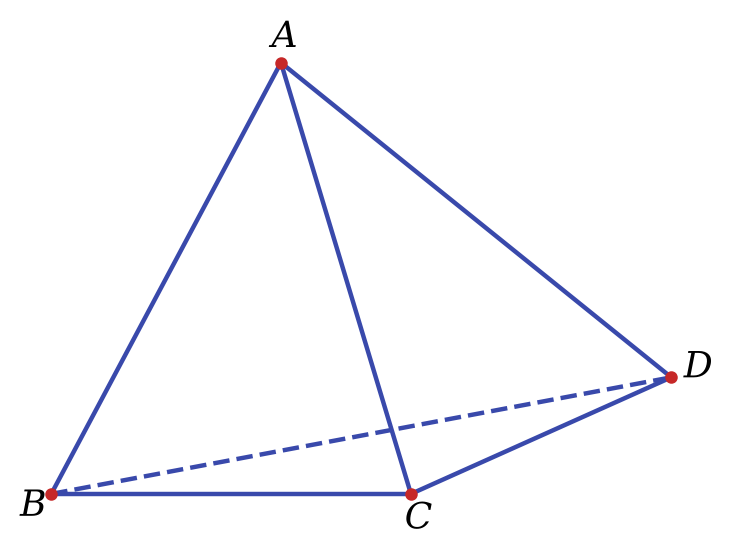

# Sujets type bac — Vecteurs, droites et plans de l'espace

[📄 Sujets seuls (PDF)](pdf/bac-enonces.pdf){ .md-button }
[📄 Sujets + corrections (PDF)](pdf/bac-corriges.pdf){ .md-button }

Quatre sujets dans l'esprit de l'épreuve. Au bac, ce chapitre est presque toujours combiné avec l'orthogonalité et les représentations paramétriques (chapitres 11 et 12) : ces sujets n'utilisent que les outils vus jusqu'ici.

| Sujet | Thème | Durée conseillée |
|---|---|---|
| 1 | Cube, plan et droites sécantes | 40 min |
| 2 | Tétraèdre et centre de gravité | 30 min |
| 3 | QCM | 25 min |
| 4 | Pyramide et intersection droite-plan | 45 min |

## Sujet 1 — Dans un cube

{ width="40%" }

On considère un cube $ABCDEFGH$ et le repère $\left(A \,;\, \overrightarrow{AB}, \overrightarrow{AD}, \overrightarrow{AE}\right)$. On note $I$ le milieu de $[EF]$ et $J$ le milieu de $[FG]$.

1. Donner les coordonnées des points $A$, $C$, $I$ et $J$.
2. Montrer que les droites $(IJ)$ et $(AC)$ sont parallèles.
3. En déduire que les points $A$, $C$, $J$ et $I$ sont coplanaires. Quelle est la nature du quadrilatère $ACJI$ ?
4. a. Montrer que les droites $(AI)$ et $(CJ)$ sont sécantes en un point $K$ dont on donnera les coordonnées.
   b. Montrer que $K$ appartient à la droite $(BF)$.
5. Que peut-on en déduire pour les trois plans $(ABF)$, $(BCG)$ et $(ACJ)$ ?

??? success "Correction"
    **1.** $A(0, 0, 0)$, $C(1, 1, 0)$, $E(0, 0, 1)$, $F(1, 0, 1)$, $G(1, 1, 1)$, donc $I\left(\frac{1}{2}, 0, 1\right)$ et $J\left(1, \frac{1}{2}, 1\right)$.

    **2.** $\overrightarrow{IJ}\left(\frac{1}{2}, \frac{1}{2}, 0\right)$ et $\overrightarrow{AC}(1, 1, 0)$ : $\overrightarrow{AC} = 2\overrightarrow{IJ}$. Les droites sont parallèles.

    **3.** Deux droites parallèles sont coplanaires, donc $A$, $C$, $J$, $I$ sont dans un même plan. $(IJ) \parallel (AC)$ avec $IJ = \frac{1}{2}AC$ : $ACJI$ est un **trapèze**. *On peut ajouter que $AI = CJ = \frac{\sqrt{5}}{2}$ si l'arête vaut $1$ : c'est un trapèze isocèle.*

    **4. a.** Un point de $(AI)$ s'écrit $A + t\overrightarrow{AI} = \left(\frac{t}{2}, 0, t\right)$. Un point de $(CJ)$ s'écrit $C + s\overrightarrow{CJ} = \left(1, 1 - \frac{s}{2}, s\right)$, car $\overrightarrow{CJ}\left(0, -\frac{1}{2}, 1\right)$. On résout :

    $$\begin{cases} \frac{t}{2} = 1 \\ 0 = 1 - \frac{s}{2} \\ t = s \end{cases} \iff t = s = 2.$$

    Le système a une solution : les droites sont sécantes en $K(1, 0, 2)$.

    *Remarque : c'était prévisible. Dans le trapèze $ACJI$, les côtés non parallèles $[AI]$ et $[CJ]$ se coupent.*

    **b.** $\overrightarrow{BK}(0, 0, 2) = 2\overrightarrow{BF}$ : $K \in (BF)$.

    **5.** $K \in (AI) \subset (ABF)$, $K \in (CJ) \subset (BCG)$ et $K \in (ACJ)$. Les trois plans ont le point $K$ en commun. Plus précisément, $(ABF) \cap (ACJ) = (AK)$ et $(BCG) \cap (ACJ) = (CK)$, et les plans $(ABF)$ et $(BCG)$ se coupent selon $(BF)$, qui passe aussi par $K$.

---

## Sujet 2 — Tétraèdre et centre de gravité

{ width="35%" }

$ABCD$ est un tétraèdre. On note $I$ le milieu de $[AB]$, $J$ le milieu de $[CD]$, et $G$ le point défini par

$$\overrightarrow{AG} = \frac{1}{4}\left(\overrightarrow{AB} + \overrightarrow{AC} + \overrightarrow{AD}\right).$$

1. Exprimer $\overrightarrow{AI}$ et $\overrightarrow{AJ}$ en fonction de $\overrightarrow{AB}$, $\overrightarrow{AC}$ et $\overrightarrow{AD}$.
2. Montrer que $G$ est le milieu du segment $[IJ]$.
3. On note $K$ le milieu de $[AC]$ et $L$ celui de $[BD]$. Montrer que $G$ est aussi le milieu de $[KL]$.
4. En déduire que les droites $(IJ)$ et $(KL)$ sont sécantes. Que peut-on dire des points $I$, $J$, $K$, $L$ ?

??? success "Correction"
    **1.** $\overrightarrow{AI} = \frac{1}{2}\overrightarrow{AB}$ et $\overrightarrow{AJ} = \frac{1}{2}\left(\overrightarrow{AC} + \overrightarrow{AD}\right)$ (milieu, exercice 8).

    **2.** Le milieu $M$ de $[IJ]$ vérifie $\overrightarrow{AM} = \frac{1}{2}\left(\overrightarrow{AI} + \overrightarrow{AJ}\right) = \frac{1}{2}\left(\frac{1}{2}\overrightarrow{AB} + \frac{1}{2}\overrightarrow{AC} + \frac{1}{2}\overrightarrow{AD}\right) = \overrightarrow{AG}$. Donc $M = G$.

    **3.** $\overrightarrow{AK} = \frac{1}{2}\overrightarrow{AC}$ et $\overrightarrow{AL} = \frac{1}{2}\left(\overrightarrow{AB} + \overrightarrow{AD}\right)$. Le milieu de $[KL]$ vérifie $\frac{1}{2}\left(\overrightarrow{AK} + \overrightarrow{AL}\right) = \frac{1}{4}\left(\overrightarrow{AB} + \overrightarrow{AC} + \overrightarrow{AD}\right) = \overrightarrow{AG}$ : c'est $G$.

    **4.** $G$ appartient aux deux droites. Elles sont distinctes : $\overrightarrow{IJ} = \frac{1}{2}\left(-\overrightarrow{AB} + \overrightarrow{AC} + \overrightarrow{AD}\right)$ et $\overrightarrow{KL} = \frac{1}{2}\left(\overrightarrow{AB} - \overrightarrow{AC} + \overrightarrow{AD}\right)$ ne sont pas colinéaires, puisque $\left(\overrightarrow{AB}, \overrightarrow{AC}, \overrightarrow{AD}\right)$ est une base (la décomposition est unique). Elles sont donc sécantes en $G$, donc coplanaires : **$I$, $J$, $K$, $L$ sont coplanaires**. Comme $[IJ]$ et $[KL]$ ont le même milieu, $IKJL$ est un **parallélogramme**.

---

## Sujet 3 — QCM

Pour chaque question, une seule réponse est exacte. Justifier. $ABCDEFGH$ est un cube, muni du repère $\left(A \,;\, \overrightarrow{AB}, \overrightarrow{AD}, \overrightarrow{AE}\right)$.

**Question 1.** Les droites $(AB)$ et $(CG)$ sont :

a. parallèles ; b. sécantes ; c. non coplanaires ; d. confondues.

**Question 2.** Les vecteurs $\vec{u}(1, 2, -1)$ et $\vec{v}(-2, -4, 2)$ sont :

a. colinéaires ; b. non colinéaires ; c. orthogonaux ; d. égaux.

**Question 3.** Le milieu de $[PQ]$, avec $P(2, -1, 4)$ et $Q(0, 3, -2)$, a pour coordonnées :

a. $(2, 2, 2)$ ; b. $(1, 1, 1)$ ; c. $(-1, 2, -3)$ ; d. $(1, 2, 1)$.

**Question 4.** Les points $R(1, 0, 0)$, $S(0, 1, 0)$, $T(1, 1, 0)$ et $A$ :

a. sont alignés ; b. sont coplanaires ; c. ne sont pas coplanaires ; d. forment un tétraèdre.

**Question 5.** Le vecteur $\overrightarrow{AG}$ est égal à :

a. $\overrightarrow{AB} + \overrightarrow{AD}$ ; b. $\overrightarrow{AC} + \overrightarrow{AD}$ ; c. $\overrightarrow{AB} + \overrightarrow{AD} + \overrightarrow{AE}$ ; d. $\overrightarrow{AB} + \overrightarrow{AE}$.

??? success "Correction"
    **Question 1 : c.** $(CG)$ coupe le plan $(ABC)$ en $C$, qui n'est pas sur $(AB)$. Si les droites étaient coplanaires, ce plan contiendrait $(AB)$ et $C$, donc serait $(ABC)$, et contiendrait $G$ : absurde.

    **Question 2 : a.** $\vec{v} = -2\vec{u}$.

    **Question 3 : b.** $\left(\frac{2 + 0}{2}, \frac{-1 + 3}{2}, \frac{4 - 2}{2}\right) = (1, 1, 1)$.

    **Question 4 : b.** Les quatre points ont une cote nulle : ils sont dans le plan $(ABC)$. Ils ne sont pas alignés ($\overrightarrow{AR}(1, 0, 0)$ et $\overrightarrow{AS}(0, 1, 0)$ ne sont pas colinéaires).

    **Question 5 : c.** $\overrightarrow{AG} = \overrightarrow{AB} + \overrightarrow{BC} + \overrightarrow{CG} = \overrightarrow{AB} + \overrightarrow{AD} + \overrightarrow{AE}$.

---

## Sujet 4 — Pyramide et intersection

$SABCD$ est une pyramide de sommet $S$ dont la base $ABCD$ est un carré. On se place dans le repère $\left(A \,;\, \overrightarrow{AB}, \overrightarrow{AD}, \overrightarrow{AS}\right)$. On note $M$ le milieu de $[SC]$ et $N$ le point de $[SB]$ tel que $\overrightarrow{SN} = \frac{1}{3}\overrightarrow{SB}$.

1. Donner les coordonnées des points $A$, $B$, $C$, $D$, $S$, puis de $M$ et $N$.
2. Calculer les coordonnées du vecteur $\overrightarrow{MN}$.
3. La droite $(MN)$ est-elle parallèle au plan $(ABC)$ ? Justifier.
4. Déterminer les coordonnées du point $P$, intersection de la droite $(MN)$ et du plan $(ABC)$.
5. Montrer que $P$ appartient à la droite $(BC)$. Placer $P$ sur une figure.
6. En déduire l'intersection des plans $(AMN)$ et $(ABC)$.

??? success "Correction"
    **1.** $A(0, 0, 0)$, $B(1, 0, 0)$, $C(1, 1, 0)$, $D(0, 1, 0)$, $S(0, 0, 1)$. $M\left(\frac{1}{2}, \frac{1}{2}, \frac{1}{2}\right)$. $\overrightarrow{SB}(1, 0, -1)$, donc $N = S + \frac{1}{3}\overrightarrow{SB} = \left(\frac{1}{3}, 0, \frac{2}{3}\right)$.

    **2.** $\overrightarrow{MN}\left(\frac{1}{3} - \frac{1}{2},\; -\frac{1}{2},\; \frac{2}{3} - \frac{1}{2}\right) = \left(-\frac{1}{6}, -\frac{1}{2}, \frac{1}{6}\right)$.

    **3.** La direction du plan $(ABC)$ est engendrée par $\overrightarrow{AB}(1, 0, 0)$ et $\overrightarrow{AD}(0, 1, 0)$ : ses vecteurs sont exactement ceux de cote nulle. $\overrightarrow{MN}$ a une cote non nulle : **$(MN)$ n'est pas parallèle à $(ABC)$**, elle le coupe en un point.

    **4.** Un point de $(MN)$ s'écrit $M + k\overrightarrow{MN} = \left(\frac{1}{2} - \frac{k}{6},\; \frac{1}{2} - \frac{k}{2},\; \frac{1}{2} + \frac{k}{6}\right)$. Il est dans $(ABC)$ si et seulement si sa cote est nulle : $k = -3$. On obtient $P(1, 2, 0)$.

    **5.** $\overrightarrow{BP}(0, 2, 0) = 2\overrightarrow{BC}$ : $P \in (BC)$, et $C$ est le milieu de $[BP]$.

    **6.** $A$ et $P$ sont dans les deux plans ($P \in (MN) \subset (AMN)$). Les plans sont distincts ($M \notin (ABC)$). Leur intersection est la droite $(AP)$.
