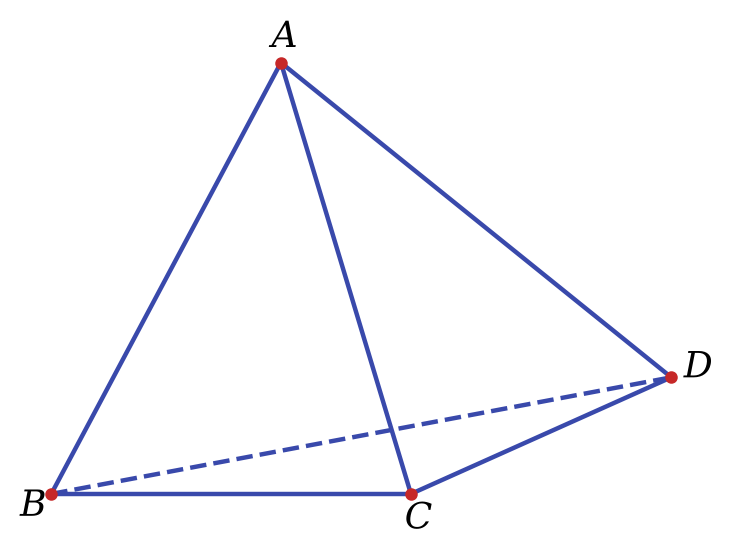

# Exercices corrigés — Vecteurs, droites et plans de l'espace

[📄 Énoncés seuls (PDF)](pdf/exercices-enonces.pdf){ .md-button }
[📄 Énoncés + corrections (PDF)](pdf/exercices-corriges.pdf){ .md-button }

28 exercices classés par thème. Difficulté : <span class="etoiles">★</span> application directe — <span class="etoiles">★★</span> entraînement — <span class="etoiles">★★★</span> approfondissement.

Pour t'entraîner dans les conditions de l'examen, va voir les [sujets type bac](bac.md).

Clique sur **Correction** seulement après avoir vraiment cherché.

| Thème | Exercices |
|---|---|
| 1. Positions relatives | 1 à 5 |
| 2. Calcul vectoriel | 6 à 11 |
| 3. Colinéarité et coplanarité | 12 à 17 |
| 4. Coordonnées et repères | 18 à 24 |
| 5. Approfondissement | 25 à 28 |

Sauf mention contraire, $ABCDEFGH$ est un cube, nommé comme ci-dessous, et le repère utilisé est $\left(A \,;\, \overrightarrow{AB}, \overrightarrow{AD}, \overrightarrow{AE}\right)$.

{ width="40%" }

---

## Thème 1 — Positions relatives

*Méthodes associées : [Méthode 1](methodes.md#methode-1-determiner-la-position-relative-de-deux-droites) et [Méthode 6](methodes.md#methode-6-construire-la-section-dun-solide-par-un-plan).*

### Exercice 1 — Deux droites dans le cube <span class="etoiles">★</span>

Donner la position relative des droites suivantes : $(AB)$ et $(HG)$ ; $(AB)$ et $(CG)$ ; $(AE)$ et $(BF)$ ; $(AC)$ et $(BD)$ ; $(AG)$ et $(EC)$.

??? success "Correction"
    - $(AB)$ et $(HG)$ : parallèles ($\overrightarrow{HG} = \overrightarrow{DC} = \overrightarrow{AB}$).
    - $(AB)$ et $(CG)$ : non coplanaires (méthode 1).
    - $(AE)$ et $(BF)$ : parallèles.
    - $(AC)$ et $(BD)$ : sécantes, au centre de la face $ABCD$.
    - $(AG)$ et $(EC)$ : sécantes. Ce sont les diagonales du rectangle $ACGE$, qui se coupent en son centre, le centre du cube.

### Exercice 2 — Droites et plans dans le cube <span class="etoiles">★</span>

Donner la position relative de : la droite $(EG)$ et le plan $(ABC)$ ; la droite $(AG)$ et le plan $(ABC)$ ; les plans $(ABF)$ et $(DCG)$ ; les plans $(ACG)$ et $(BDH)$.

??? success "Correction"
    - $(EG)$ est parallèle à $(AC)$, qui est contenue dans $(ABC)$ : $(EG)$ est parallèle au plan $(ABC)$ (et n'a aucun point commun avec lui).
    - $(AG)$ coupe le plan $(ABC)$ en $A$ (et $G$ n'y est pas).
    - $(ABF)$ et $(DCG)$ sont les plans des faces avant et arrière : ils sont parallèles.
    - $(ACG)$ et $(BDH)$ sont sécants : ils contiennent tous deux le centre $O$ de la face $ABCD$ et le centre $O'$ de la face $EFGH$. Leur intersection est la droite $(OO')$.

### Exercice 3 — Vrai ou faux ? <span class="etoiles">★★</span>

Justifier chaque réponse, au besoin avec le cube.

1. Deux droites sans point commun sont parallèles.
2. Deux plans parallèles à une même droite sont parallèles entre eux.
3. Deux droites parallèles à un même plan sont parallèles entre elles.
4. Si une droite est parallèle à deux plans sécants, elle est parallèle à leur droite d'intersection.

??? success "Correction"
    1. **Faux** : $(AB)$ et $(CG)$.
    2. **Faux** : les plans $(ABF)$ et $(ADH)$ sont tous deux parallèles à $(AE)$ (ils la contiennent), mais ils sont sécants.
    3. **Faux** : $(EF)$ et $(EH)$ sont parallèles au plan $(ABC)$, mais elles sont sécantes en $E$.
    4. **Vrai** : soit $\vec{u}$ un vecteur directeur de la droite. Il est dans la direction de chacun des deux plans. Par le raisonnement du théorème du toit, si $\vec{u}$ n'était pas colinéaire à un vecteur directeur $\vec{w}$ de l'intersection, les deux plans seraient confondus.

### Exercice 4 — Section par le plan $(BDE)$ <span class="etoiles">★★</span>

Déterminer la section du cube par le plan $(BDE)$, puis sa nature. Le cube a pour arête $a$.

??? success "Correction"
    Le plan $(BDE)$ coupe la face $ABCD$ selon $[BD]$, la face $ABFE$ selon $[BE]$, et la face $ADHE$ selon $[DE]$. La section est le triangle $BDE$. Ses côtés sont des diagonales de faces carrées, de longueur $a\sqrt{2}$ : le triangle est **équilatéral**.

### Exercice 5 — Section d'un tétraèdre <span class="etoiles">★★★</span>

{ width="35%" }

$ABCD$ est un tétraèdre. $I$ et $J$ sont les milieux de $[AB]$ et $[AC]$, et $K$ est un point de $[AD]$ distinct de $A$ et de $D$. On veut construire l'intersection des plans $(IJK)$ et $(BCD)$.

1. Montrer que $(IJ)$ est parallèle à $(BC)$.
2. On suppose que $(IK)$ et $(BD)$ se coupent en un point $L$. Justifier que $L$ appartient aux deux plans.
3. En déduire, grâce au théorème du toit, l'intersection des plans $(IJK)$ et $(BCD)$.

??? success "Correction"
    **1.** D'après le théorème des milieux dans le triangle $ABC$, $(IJ) \parallel (BC)$. Vectoriellement : $\overrightarrow{IJ} = \overrightarrow{IA} + \overrightarrow{AJ} = \frac{1}{2}\overrightarrow{BA} + \frac{1}{2}\overrightarrow{AC} = \frac{1}{2}\overrightarrow{BC}$.

    **2.** $L \in (IK) \subset (IJK)$, et $L \in (BD) \subset (BCD)$.

    **3.** Les plans $(IJK)$ et $(BCD)$ sont distincts et ont le point $L$ en commun : ils sont sécants selon une droite $\Delta$ passant par $L$. Le plan $(IJK)$ contient $(IJ)$, le plan $(BCD)$ contient $(BC)$, et ces droites sont parallèles. D'après le théorème du toit, $\Delta$ est parallèle à $(BC)$.

    **L'intersection est la parallèle à $(BC)$ passant par $L$.**

---

## Thème 2 — Calcul vectoriel

*Méthode associée : [Méthode 2](methodes.md#methode-2-exprimer-un-vecteur-en-fonction-dautres).*

### Exercice 6 — Relation de Chasles <span class="etoiles">★</span>

Pour quatre points $A$, $B$, $C$, $D$ quelconques, simplifier :

1. $\overrightarrow{AB} + \overrightarrow{BC} + \overrightarrow{CD}$
2. $\overrightarrow{AB} - \overrightarrow{AC} + \overrightarrow{BC}$
3. $\overrightarrow{DA} + \overrightarrow{BC} - \overrightarrow{BA}$

??? success "Correction"
    1. $\overrightarrow{AD}$.
    2. $\overrightarrow{AB} + \overrightarrow{CA} + \overrightarrow{BC} = \overrightarrow{CA} + \overrightarrow{AB} + \overrightarrow{BC} = \overrightarrow{CC} = \vec{0}$.
    3. $\overrightarrow{DA} + \overrightarrow{AB} + \overrightarrow{BC} = \overrightarrow{DC}$.

### Exercice 7 — Dans le cube <span class="etoiles">★</span>

Exprimer en fonction de $\overrightarrow{AB}$, $\overrightarrow{AD}$ et $\overrightarrow{AE}$ les vecteurs $\overrightarrow{AG}$, $\overrightarrow{BH}$ et $\overrightarrow{EC}$.

??? success "Correction"
    - $\overrightarrow{AG} = \overrightarrow{AB} + \overrightarrow{BC} + \overrightarrow{CG} = \overrightarrow{AB} + \overrightarrow{AD} + \overrightarrow{AE}$.
    - $\overrightarrow{BH} = \overrightarrow{BA} + \overrightarrow{AD} + \overrightarrow{DH} = -\overrightarrow{AB} + \overrightarrow{AD} + \overrightarrow{AE}$.
    - $\overrightarrow{EC} = \overrightarrow{EA} + \overrightarrow{AB} + \overrightarrow{BC} = \overrightarrow{AB} + \overrightarrow{AD} - \overrightarrow{AE}$.

### Exercice 8 — Milieu et centre de gravité <span class="etoiles">★★</span>

$ABCD$ est un tétraèdre, $I$ est le milieu de $[BC]$ et $G$ le point défini par $\overrightarrow{GB} + \overrightarrow{GC} + \overrightarrow{GD} = \vec{0}$ (centre de gravité du triangle $BCD$).

1. Montrer que $\overrightarrow{AI} = \frac{1}{2}\left(\overrightarrow{AB} + \overrightarrow{AC}\right)$.
2. Montrer que $\overrightarrow{AG} = \frac{1}{3}\left(\overrightarrow{AB} + \overrightarrow{AC} + \overrightarrow{AD}\right)$.

??? success "Correction"
    **1.** $\overrightarrow{AB} + \overrightarrow{AC} = \left(\overrightarrow{AI} + \overrightarrow{IB}\right) + \left(\overrightarrow{AI} + \overrightarrow{IC}\right) = 2\overrightarrow{AI}$, car $\overrightarrow{IB} + \overrightarrow{IC} = \vec{0}$.

    **2.** $\overrightarrow{AB} + \overrightarrow{AC} + \overrightarrow{AD} = 3\overrightarrow{AG} + \left(\overrightarrow{GB} + \overrightarrow{GC} + \overrightarrow{GD}\right) = 3\overrightarrow{AG}$.

### Exercice 9 — Segment joignant deux milieux <span class="etoiles">★★</span>

Soit $A$, $B$, $C$, $D$ quatre points, $I$ le milieu de $[AB]$ et $J$ celui de $[CD]$. Montrer que $\overrightarrow{IJ} = \frac{1}{2}\left(\overrightarrow{AD} + \overrightarrow{BC}\right)$.

??? success "Correction"
    $\overrightarrow{IJ} = \overrightarrow{IA} + \overrightarrow{AD} + \overrightarrow{DJ}$ et $\overrightarrow{IJ} = \overrightarrow{IB} + \overrightarrow{BC} + \overrightarrow{CJ}$. En additionnant, et comme $\overrightarrow{IA} + \overrightarrow{IB} = \vec{0}$ et $\overrightarrow{DJ} + \overrightarrow{CJ} = \vec{0}$ : $2\overrightarrow{IJ} = \overrightarrow{AD} + \overrightarrow{BC}$.

### Exercice 10 — Placer un point <span class="etoiles">★★</span>

Placer dans le cube les points $M$, $N$, $P$ définis par :

$$\overrightarrow{AM} = \overrightarrow{AB} + \tfrac{1}{2}\overrightarrow{AE}, \qquad \overrightarrow{AN} = \tfrac{1}{2}\overrightarrow{AB} + \tfrac{1}{2}\overrightarrow{AD} + \overrightarrow{AE}, \qquad \overrightarrow{AP} = \overrightarrow{AC} + \overrightarrow{AE}.$$

??? success "Correction"
    - $\overrightarrow{AM} = \overrightarrow{AB} + \frac{1}{2}\overrightarrow{BF}$ : $M$ est le **milieu de $[BF]$**.
    - $N$ a pour coordonnées $\left(\frac{1}{2}, \frac{1}{2}, 1\right)$ : c'est le **centre de la face $EFGH$**.
    - $\overrightarrow{AP} = \overrightarrow{AC} + \overrightarrow{CG} = \overrightarrow{AG}$ : $P = G$.

### Exercice 11 — Les diagonales d'un pavé <span class="etoiles">★★★</span>

Montrer, à l'aide de coordonnées, que les quatre « grandes diagonales » $[AG]$, $[BH]$, $[CE]$ et $[DF]$ du cube ont le même milieu.

??? success "Correction"
    Les milieux se calculent par la formule du cours :

    - $[AG]$ : $\left(\frac{0 + 1}{2}, \frac{0 + 1}{2}, \frac{0 + 1}{2}\right) = \left(\frac{1}{2}, \frac{1}{2}, \frac{1}{2}\right)$ ;
    - $[BH]$ : $\left(\frac{1 + 0}{2}, \frac{0 + 1}{2}, \frac{0 + 1}{2}\right)$, le même point ;
    - $[CE]$ et $[DF]$ : de même, $\left(\frac{1}{2}, \frac{1}{2}, \frac{1}{2}\right)$.

    Les quatre diagonales se coupent en leur milieu commun, le **centre du cube**. *Le même calcul, dans un repère quelconque, vaut pour tout parallélépipède.*

---

## Thème 3 — Colinéarité et coplanarité

*Méthodes associées : [Méthode 3](methodes.md#methode-3-demontrer-un-alignement-ou-un-parallelisme) et [Méthode 4](methodes.md#methode-4-demontrer-que-des-vecteurs-ou-des-points-sont-coplanaires).*

### Exercice 12 — Colinéarité <span class="etoiles">★</span>

Les vecteurs suivants sont-ils colinéaires ? $\vec{u}(2, -1, 3)$ et $\vec{v}(-4, 2, -6)$ ; $\vec{u}(2, -1, 3)$ et $\vec{w}(1, 2, 3)$.

??? success "Correction"
    $\vec{v} = -2\vec{u}$ : colinéaires. Pour $\vec{w}$ : il faudrait $k$ avec $1 = 2k$ et $2 = -k$, soit $k = \frac{1}{2}$ et $k = -2$, impossible : non colinéaires.

### Exercice 13 — Alignement <span class="etoiles">★</span>

Les points $A(1, 2, 3)$, $B(2, 4, 7)$ et $C(4, 8, 15)$ sont-ils alignés ?

??? success "Correction"
    $\overrightarrow{AB}(1, 2, 4)$ et $\overrightarrow{AC}(3, 6, 12) = 3\overrightarrow{AB}$ : les points sont alignés.

### Exercice 14 — Trois vecteurs coplanaires <span class="etoiles">★★</span>

Montrer que $\vec{u}(1, 0, 1)$, $\vec{v}(0, 1, 1)$ et $\vec{w}(2, 3, 5)$ sont coplanaires.

??? success "Correction"
    $\vec{u}$ et $\vec{v}$ ne sont pas colinéaires. $a\vec{u} + b\vec{v} = (a, b, a + b)$. Pour obtenir $\vec{w}$ : $a = 2$, $b = 3$, et la troisième coordonnée vaut bien $2 + 3 = 5$. Donc $\vec{w} = 2\vec{u} + 3\vec{v}$.

### Exercice 15 — Une base <span class="etoiles">★★</span>

On considère $\vec{u}(1, 0, 0)$, $\vec{v}(1, 1, 0)$ et $\vec{w}(1, 1, 1)$.

1. Montrer que $(\vec{u}, \vec{v}, \vec{w})$ est une base.
2. Décomposer $\vec{t}(3, 2, 1)$ dans cette base.

??? success "Correction"
    **1.** $\vec{u}$ et $\vec{v}$ ne sont pas colinéaires, et toute combinaison $a\vec{u} + b\vec{v} = (a + b, b, 0)$ a une troisième coordonnée nulle : $\vec{w}$ n'en est pas une. Les trois vecteurs ne sont pas coplanaires : c'est une base.

    **2.** $a\vec{u} + b\vec{v} + c\vec{w} = (a + b + c,\; b + c,\; c) = (3, 2, 1)$. On trouve $c = 1$, puis $b = 1$, puis $a = 1$ : $\vec{t} = \vec{u} + \vec{v} + \vec{w}$.

### Exercice 16 — Quatre points coplanaires <span class="etoiles">★★</span>

Les points $A(1, 0, 0)$, $B(0, 1, 0)$, $C(0, 0, 1)$ et $D(1, 1, -1)$ sont-ils coplanaires ?

??? success "Correction"
    $\overrightarrow{AB}(-1, 1, 0)$ et $\overrightarrow{AC}(-1, 0, 1)$ ne sont pas colinéaires. $\overrightarrow{AD}(0, 1, -1)$. On cherche $a\overrightarrow{AB} + b\overrightarrow{AC} = (-a - b,\; a,\; b) = (0, 1, -1)$ : $a = 1$, $b = -1$, et la première coordonnée vaut bien $-1 + 1 = 0$. Donc $\overrightarrow{AD} = \overrightarrow{AB} - \overrightarrow{AC}$ : les points sont coplanaires.

### Exercice 17 — Avec un paramètre <span class="etoiles">★★★</span>

Soit $A(1, 1, 0)$, $B(2, 0, 1)$, $C(0, 2, 1)$ et $D(m, 1, 2)$, où $m$ est un réel. Pour quelle valeur de $m$ ces quatre points sont-ils coplanaires ?

??? success "Correction"
    $\overrightarrow{AB}(1, -1, 1)$, $\overrightarrow{AC}(-1, 1, 1)$ (non colinéaires), $\overrightarrow{AD}(m - 1, 0, 2)$. On cherche $a$, $b$ tels que

    $$\begin{cases} a - b = m - 1 \\ -a + b = 0 \\ a + b = 2 \end{cases}$$

    Les deux dernières équations donnent $a = b = 1$, et la première impose alors $m - 1 = 0$. Les points sont coplanaires si et seulement si $m = 1$.

---

## Thème 4 — Coordonnées et repères

*Méthode associée : [Méthode 5](methodes.md#methode-5-choisir-un-repere-et-calculer).*

### Exercice 18 — Coordonnées dans le cube <span class="etoiles">★</span>

Donner les coordonnées des sommets du cube, du centre $\Omega$ de la face $EFGH$, et du centre $O$ du cube.

??? success "Correction"
    Les sommets sont dans le tableau du cours. $\Omega$ est le milieu de $[EG]$ : $\left(\frac{1}{2}, \frac{1}{2}, 1\right)$. $O$ est le milieu de $[AG]$ : $\left(\frac{1}{2}, \frac{1}{2}, \frac{1}{2}\right)$.

### Exercice 19 — Milieu et vecteur <span class="etoiles">★</span>

Soit $A(1, -2, 3)$ et $B(3, 4, -1)$. Calculer les coordonnées du milieu $I$ de $[AB]$, et celles de $\overrightarrow{AB}$.

??? success "Correction"
    $I(2, 1, 1)$ et $\overrightarrow{AB}(2, 6, -4)$.

### Exercice 20 — Compléter un parallélogramme <span class="etoiles">★★</span>

Soit $A(1, 0, 2)$, $B(3, 1, 0)$ et $C(4, 3, 1)$. Déterminer les coordonnées du point $D$ tel que $ABCD$ soit un parallélogramme.

??? success "Correction"
    $ABCD$ est un parallélogramme si et seulement si $\overrightarrow{AD} = \overrightarrow{BC}$. Or $\overrightarrow{BC}(1, 2, 1)$, donc $D = (1 + 1,\; 0 + 2,\; 2 + 1) = (2, 2, 3)$.

### Exercice 21 — Droites parallèles <span class="etoiles">★★</span>

Soit $A(0, 1, 2)$, $B(2, 3, 0)$, $C(1, 0, 1)$ et $D(4, 3, -2)$. Montrer que les droites $(AB)$ et $(CD)$ sont strictement parallèles.

??? success "Correction"
    $\overrightarrow{AB}(2, 2, -2)$ et $\overrightarrow{CD}(3, 3, -3) = \frac{3}{2}\overrightarrow{AB}$ : les droites sont parallèles. De plus, $\overrightarrow{AC}(1, -1, -1)$ n'est pas colinéaire à $\overrightarrow{AB}$ (la deuxième coordonnée donnerait $k = -\frac{1}{2}$ et la première $k = \frac{1}{2}$), donc $C \notin (AB)$ : elles sont strictement parallèles.

### Exercice 22 — Droite parallèle à un plan <span class="etoiles">★★</span>

Soit $A(0, 0, 0)$, $B(1, 0, 0)$, $C(0, 1, 1)$, $D(5, 5, 5)$ et $E(6, 7, 7)$. Montrer que la droite $(DE)$ est parallèle au plan $(ABC)$.

??? success "Correction"
    $\overrightarrow{DE}(1, 2, 2)$, $\overrightarrow{AB}(1, 0, 0)$ et $\overrightarrow{AC}(0, 1, 1)$. On a $\overrightarrow{DE} = \overrightarrow{AB} + 2\overrightarrow{AC}$ : $\overrightarrow{DE}$ est dans la direction du plan, donc $(DE)$ est parallèle au plan $(ABC)$.

### Exercice 23 — Intersection d'une droite et d'un plan <span class="etoiles">★★</span>

Dans le cube, on cherche le point d'intersection $M$ de la droite $(AG)$ et du plan $(BDE)$.

1. Justifier qu'il existe un réel $t$ tel que $M(t, t, t)$.
2. En écrivant $\overrightarrow{BM} = a\overrightarrow{BD} + b\overrightarrow{BE}$, déterminer $t$.
3. Montrer que $M$ est le centre de gravité du triangle $BDE$.

??? success "Correction"
    **1.** $M \in (AG)$, donc $\overrightarrow{AM} = t\overrightarrow{AG}$ avec $\overrightarrow{AG}(1, 1, 1)$.

    **2.** $\overrightarrow{BM}(t - 1, t, t)$, $\overrightarrow{BD}(-1, 1, 0)$ et $\overrightarrow{BE}(-1, 0, 1)$. On veut $(t - 1, t, t) = (-a - b,\; a,\; b)$, donc $a = b = t$ et $t - 1 = -2t$, soit $t = \frac{1}{3}$. $M\left(\frac{1}{3}, \frac{1}{3}, \frac{1}{3}\right)$.

    **3.** Le centre de gravité de $BDE$ a pour coordonnées la moyenne de celles des sommets : $\left(\frac{1 + 0 + 0}{3}, \frac{0 + 1 + 0}{3}, \frac{0 + 0 + 1}{3}\right)$. C'est bien $M$.

### Exercice 24 — Deux diagonales du cube <span class="etoiles">★★★</span>

Montrer que les droites $(AG)$ et $(EC)$ sont sécantes et déterminer leur point d'intersection.

??? success "Correction"
    Un point de $(AG)$ s'écrit $(t, t, t)$, et un point de $(EC)$ s'écrit $E + s\overrightarrow{EC} = (s, s, 1 - s)$, car $\overrightarrow{EC}(1, 1, -1)$. Ils sont égaux si et seulement si $t = s$ et $t = 1 - s$, soit $s = t = \frac{1}{2}$. Les droites se coupent au point $\left(\frac{1}{2}, \frac{1}{2}, \frac{1}{2}\right)$, le centre du cube.

---

## Thème 5 — Approfondissement

### Exercice 25 — Redémontrer le théorème du toit <span class="etoiles">★★</span>

Rédiger la démonstration vectorielle du théorème du toit, en explicitant chaque étape (voir le cours, § 3.3).

??? success "Correction"
    Voir le cours. Les étapes clés sont : $\vec{u}$ (direction commune de $d_1$ et $d_2$) est dans les directions des deux plans ; un vecteur $\vec{w}$ de l'intersection aussi ; si $\vec{u}$ et $\vec{w}$ n'étaient pas colinéaires, ils dirigeraient les deux plans, qui passent par un même point et seraient donc confondus. C'est absurde, donc $\vec{w}$ est colinéaire à $\vec{u}$.

### Exercice 26 — Centre de gravité d'un tétraèdre <span class="etoiles">★★</span>

$ABCD$ est un tétraèdre. On note $G$ le point tel que $\overrightarrow{GA} + \overrightarrow{GB} + \overrightarrow{GC} + \overrightarrow{GD} = \vec{0}$, et $G_A$ le centre de gravité du triangle $BCD$.

1. Montrer que $\overrightarrow{AG} = \frac{1}{4}\left(\overrightarrow{AB} + \overrightarrow{AC} + \overrightarrow{AD}\right)$.
2. En déduire que $\overrightarrow{AG} = \frac{3}{4}\overrightarrow{AG_A}$. Interpréter.

??? success "Correction"
    **1.** On écrit $\overrightarrow{GB} = \overrightarrow{GA} + \overrightarrow{AB}$, etc. : $4\overrightarrow{GA} + \overrightarrow{AB} + \overrightarrow{AC} + \overrightarrow{AD} = \vec{0}$, donc $\overrightarrow{AG} = \frac{1}{4}\left(\overrightarrow{AB} + \overrightarrow{AC} + \overrightarrow{AD}\right)$.

    **2.** D'après l'exercice 8, $\overrightarrow{AG_A} = \frac{1}{3}\left(\overrightarrow{AB} + \overrightarrow{AC} + \overrightarrow{AD}\right)$. Donc $\overrightarrow{AG} = \frac{3}{4}\overrightarrow{AG_A}$ : $G$ est sur le segment joignant $A$ au centre de gravité de la face opposée, aux trois quarts en partant de $A$. Par symétrie des rôles, $G$ est sur les quatre segments analogues : ils sont concourants.

### Exercice 27 — Deux plans parallèles dans le cube <span class="etoiles">★★★</span>

Montrer que les plans $(BDE)$ et $(CFH)$ sont parallèles.

??? success "Correction"
    Direction de $(BDE)$ : $\overrightarrow{BD}(-1, 1, 0)$ et $\overrightarrow{BE}(-1, 0, 1)$. Direction de $(CFH)$ : $\overrightarrow{CF}(0, -1, 1)$ et $\overrightarrow{CH}(-1, 0, 1)$.

    On a $\overrightarrow{CH} = \overrightarrow{BE}$ et $\overrightarrow{CF} = \overrightarrow{BE} - \overrightarrow{BD}$. Les deux vecteurs directeurs de $(CFH)$ sont des combinaisons linéaires de ceux de $(BDE)$ : les plans ont la même direction, ils sont parallèles. *Ils sont même distincts, car $C \notin (BDE)$ : la diagonale $[AG]$ est coupée en trois parties égales par ces deux plans.*

### Exercice 28 — Tester la coplanarité en Python <span class="etoiles">★★★</span>

Écrire une fonction Python `coplanaires(u, v, w)` qui, pour trois vecteurs donnés par des listes de coordonnées entières (avec $\vec{u}$ et $\vec{v}$ non colinéaires), renvoie `True` si $\vec{w}$ est une combinaison linéaire de $\vec{u}$ et $\vec{v}$. *Indication : on peut utiliser la quantité $u_1v_2 - u_2v_1$.*

??? success "Correction"
    On résout le système formé par les deux premières coordonnées, $a u_1 + b v_1 = w_1$ et $a u_2 + b v_2 = w_2$, par combinaison. Si $\delta = u_1v_2 - u_2v_1 \neq 0$, on trouve $a = \frac{w_1v_2 - w_2v_1}{\delta}$ et $b = \frac{u_1w_2 - u_2w_1}{\delta}$. Puis on vérifie la troisième coordonnée.

    ```python
    def coplanaires(u, v, w):
        # on cherche un couple de coordonnées (i, j) qui permet de résoudre
        for (i, j) in [(0, 1), (0, 2), (1, 2)]:
            d = u[i] * v[j] - u[j] * v[i]
            if d != 0:
                a = (w[i] * v[j] - w[j] * v[i]) / d
                b = (u[i] * w[j] - u[j] * w[i]) / d
                k = 3 - i - j                 # la coordonnée restante
                return abs(a * u[k] + b * v[k] - w[k]) < 1e-9
        return None   # u et v sont colinéaires

    print(coplanaires([1, 0, 1], [0, 1, 1], [2, 3, 5]))   # True
    print(coplanaires([1, 0, 0], [1, 1, 0], [1, 1, 1]))   # False
    ```

    *Si $\delta = 0$ pour les deux premières coordonnées alors que $\vec{u}$ et $\vec{v}$ ne sont pas colinéaires, il faut utiliser un autre couple de coordonnées : c'est ce que fait la boucle.*
